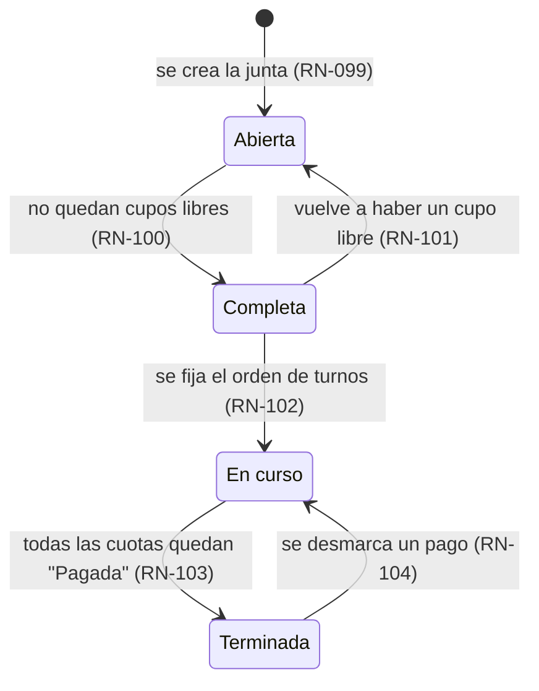

--- 00-constitucion.md ---
# Constitución de Mi Junta

Versión: 1.3

Estos principios son obligatorios para todo agente de IA y toda persona que trabaje en Mi Junta. Si una instrucción contradice un principio, gana el principio. Cambiar un principio requiere aprobación humana (PRINCIPIO-012).

La v1.3 cambió PRINCIPIO-001, 002, 003, 005, 006 y 008 a partir de la auditoría QA, con aprobación del Product Owner del 14/11/2026 (auditorias/qa-clase1.md, sección 5).

---

### PRINCIPIO-001: El spec-pack es la única fuente de verdad
Todo requisito, regla y valor de negocio sale de `spec-pack/`. Ahí todo se escribe en Markdown, los diagramas van en Mermaid y cada archivo empieza con un título `#` seguido de la línea `Versión: MAYOR.MENOR`. Cada regla EARS tiene un solo DEBE / NO DEBE / PUEDE. Los IDs (`PRINCIPIO-NNN`, `RN-NNN`, `HU-NNN`, `P-NNN`, `T-NNN`, `PREG-NNN`, y en el brief y el alcance `F-NN`, `NO-NN`, `S-NN`, `R-NN` y `KPI-NN`) nunca se renumeran ni se reutilizan, y un ID nuevo toma el siguiente número libre. Las palabras "rápido", "seguro", "fácil", "adecuado", "razonable" e "intuitivo" solo pueden aparecer junto a un valor medible.

**Ejemplo de cumplimiento:** `RN-008: Cuando el organizador confirma el sorteo, el sistema DEBE guardar la semilla usada.` El ID sigue a RN-007.
**Ejemplo de violación:** `RN-003: El sistema DEBE validar el DNI y NO DEBE aceptar duplicados.` (dos verbos modales en una regla), o un diagrama entregado como imagen PNG.

### PRINCIPIO-002: Idioma del código, la documentación y la interfaz
Los identificadores del código van en inglés: variables, funciones, clases, tablas, columnas y rutas de API. La única excepción es el término del dominio `junta`, que se usa tal cual (tabla `juntas`, ruta `/juntas/{id}`, columna `junta_id`). Los comentarios, los mensajes de commit, la documentación técnica y el spec-pack van en español. Todo texto que recibe el usuario (pantallas, correos y notificaciones push) está solo en español de Perú y lo trata de "usted".

**Ejemplo de cumplimiento:** tabla `payments`, columna `due_date`, comentario `// Calcula la próxima cuota pendiente`, botón "Registre su pago".
**Ejemplo de violación:** tabla `pagos`, commit `fix payment bug`, mensaje "¿Ya pagaste tu cuota?".

### PRINCIPIO-003: Formatos de Perú y montos exactos
- **Montos:** se muestran como `S/ 1,250.50` y se guardan como número entero de céntimos (`integer` o `bigint`), nunca como `float` ni `double`.
- **Fechas y horas:** se muestran como DD/MM/AAAA y la hora como HH:MM en 24 horas, en la zona America/Lima (UTC-5). Un instante se guarda como `timestamptz` y una fecha sin hora (por ejemplo, una fecha de vencimiento) como `date`. "En America/Lima" significa que esa zona se usa para mostrar el valor y para calcular fechas de calendario, no que se guarde una hora local sin zona.
- **Celular:** cumple `^9\d{8}$`.
- **DNI:** cumple `^\d{8}$`.

La unidad mínima de una cuota es S/ 0.10 y no hay redondeo, porque el pozo se calcula multiplicando y nunca dividiendo (PREG-002, RN-004 y RN-041 de `03-reglas-de-negocio.md`).

**Ejemplo de cumplimiento:** una cuota de S/ 20.80 se guarda como `2080` y se muestra como "S/ 20.80". La fecha se muestra como "05/03/2027" y la hora como "22:30".
**Ejemplo de violación:** `amount: 20.8` guardado como float, mostrar "2027-03-05", o aceptar el celular "812345678".

### PRINCIPIO-004: Mi Junta no mueve dinero
La app solo registra pagos hechos fuera de ella (por ejemplo Yape, Plin o efectivo). No cobra, no transfiere ni guarda dinero. No almacena números de tarjeta, cuentas bancarias ni credenciales de billeteras digitales, y no integra pasarelas de pago ni APIs de billeteras.

**Ejemplo de cumplimiento:** se registra que la cuota de un participante quedó "Pagada" el 05/03/2027.
**Ejemplo de violación:** agregar el SDK de una pasarela de pagos, o crear el campo `bank_account_number`.

### PRINCIPIO-005: Cifrado y credenciales
- **Datos en reposo:** el DNI y el celular se cifran en la aplicación con AES-256-GCM. La clave no se guarda en la base de datos ni en el repositorio, y ninguno de los dos datos aparece en claro en los logs.
- **Tráfico:** todo usa TLS 1.2 o superior.
- **Contraseñas:** se guardan con Argon2id (mínimo m=19 MiB, t=2, p=1) o bcrypt con costo ≥ 12. Nunca en texto plano ni con cifrado reversible.
- **Segundo factor:** desde que se publique F-11 de `02-alcance.md`, el usuario puede activar un código enviado a su correo. Si lo activa, no se inicia sesión sin ese código. El código tiene 6 dígitos, vale 600 segundos desde su envío y se anula después de 5 intentos fallidos (PREG-023, resuelta el 14/11/2026).

**Ejemplo de cumplimiento:** `SELECT dni FROM members` devuelve texto cifrado, y una petición HTTP se redirige a HTTPS.
**Ejemplo de violación:** un DNI en claro en la base de datos o en un log, la clave AES en un `.env` subido al repositorio, o contraseñas guardadas con SHA-256 sin sal.

### PRINCIPIO-006: Datos personales privados y datos de la junta según el rol
Los datos de una persona se dividen en dos grupos:
- **Datos personales:** celular, correo, DNI, fecha de nacimiento y foto. Ningún usuario, ni siquiera el organizador, recibe los datos personales de otro miembro. Si en el futuro se muestra el DNI de los demás está [REQUIERE DECISIÓN] (PREG-003).
- **Datos de la junta:** nombre, turno, cuotas, pagos, correcciones y registro del sorteo.

De los otros miembros de una junta, un miembro que no es el organizador solo recibe estos cuatro datos de la junta:
- nombre;
- número de turno;
- estado de su cuota en la ronda actual;
- fecha de vencimiento y estado de su próxima cuota.

Además, todo miembro recibe el registro del sorteo de su junta (semilla, versión del algoritmo, lista de entrada con nombres y resultado), para poder verificarlo (PRINCIPIO-008).

El organizador recibe, de los participantes de las juntas que gestiona, todos los datos de la junta que necesita para gestionarla: cada cuota de cada ronda con su estado, sus pagos, sus fechas de pago, sus correcciones y sus pagos informados. Nunca recibe sus datos personales. Las acciones de gestión del organizador (04-glosario.md) se validan en el servidor, no solo ocultando botones en la interfaz.

**Ejemplo de cumplimiento:** un test comprueba que la respuesta de `GET /juntas/{id}/members` contiene solo los campos permitidos para el rol de quien la pide.
**Ejemplo de violación:** la API devuelve `phone` y `email` de todos los miembros y la interfaz simplemente no los muestra, o un participante recibe las fechas de pago de los demás.

### PRINCIPIO-007: Consentimiento y canales de notificación
No se crea una cuenta sin que el usuario acepte la política de privacidad y el consentimiento para recibir notificaciones. Se guardan la versión aceptada y la fecha y hora en America/Lima. Las notificaciones solo se envían por correo y por notificación push. No se usan SMS ni WhatsApp.

**Ejemplo de cumplimiento:** la casilla de consentimiento aparece desmarcada, "Crear cuenta" se habilita solo al marcarla, y se guarda `policy_version = 1.0` con su fecha y hora.
**Ejemplo de violación:** la casilla viene marcada por defecto, o se envía un recordatorio por WhatsApp.

### PRINCIPIO-008: Sorteo auditable y reproducible
- **Cómo se sortea:** cada sorteo usa una semilla de 256 bits generada con un generador criptográfico (CSPRNG) y un algoritmo Fisher–Yates determinista, versionado y documentado paso a paso en `03-reglas-de-negocio.md` (anexo A) con un vector de prueba.
- **Qué se guarda:** la semilla, la versión del algoritmo, la lista de entrada (los identificadores de usuario de los participantes, ordenados por el momento en que ocuparon su cupo), el resultado, el usuario que lo ejecutó y la fecha y hora en America/Lima.
- **Inmutabilidad:** ese registro nunca se sobrescribe. Con la misma semilla y la misma entrada siempre sale el mismo orden.
- **Verificación:** todo miembro de la junta puede ver el registro del sorteo y reproducirlo (PRINCIPIO-006).
- **Orden sin sorteo y cambios de turno:** el orden que asigna el organizador sin sorteo (F-10) se guarda con el mismo cuidado: es inmutable y registra quién lo asignó y cuándo. Todo cambio posterior de turno se guarda como un evento aparte.

**Ejemplo de cumplimiento:** un test vuelve a ejecutar el sorteo con la semilla guardada y obtiene el mismo orden.
**Ejemplo de violación:** usar `Math.random()`, o cambiar el orden con un `UPDATE` sin dejar registro.

### PRINCIPIO-009: Web con Next.js y PostgreSQL, que funciona sin conexión
La app es web, hecha con Next.js y TypeScript sobre PostgreSQL. Usa la versión estable vigente de cada uno el día en que se fijen las versiones, fijada exactamente en `package.json` y en el lockfile, sin `^` ni `~`. Las versiones exactas están [REQUIERE DECISIÓN] y se fijarán al iniciar el desarrollo.

Sin red, la app abre y muestra los últimos datos sincronizados junto con la fecha y hora de la última sincronización. Los cambios hechos sin red se guardan en el dispositivo y se envían al servidor, en el orden en que se hicieron, cuando vuelve la conexión. Cómo se resuelven los conflictos está [REQUIERE DECISIÓN].

**Ejemplo de cumplimiento:** con el navegador en modo "Offline" se registra un pago. Al reconectar, el pago aparece en el servidor con su hora original.
**Ejemplo de violación:** sin red la app muestra una pantalla de error del navegador, o se pierde un cambio hecho sin conexión.

### PRINCIPIO-010: Responsive, accesible y con rendimiento medido
- **Ancho de pantalla:** cada pantalla funciona sin scroll horizontal entre 360 px y 1440 px.
- **Accesibilidad:** cumple WCAG 2.2 nivel A (0 violaciones de nivel A en axe-core), con contraste de texto ≥ 4.5:1, áreas táctiles ≥ 44×44 px CSS y texto base ≥ 16 px.
- **Rendimiento:** en Lighthouse con perfil móvil, cada pantalla logra LCP ≤ 2.5 s, CLS ≤ 0.1 y TBT ≤ 200 ms. Cada endpoint de la API responde en ≤ 500 ms en el percentil 95.

**Ejemplo de cumplimiento:** el pipeline ejecuta axe-core y Lighthouse y falla si un valor supera el límite.
**Ejemplo de violación:** una tabla de pagos que obliga a desplazarse en horizontal a 360 px, o un botón de 30×30 px.

### PRINCIPIO-011: Calidad verificada por tests
La cobertura es ≥ 80 % de líneas en todo el código y 100 % de líneas y ramas en los módulos de sorteo y cálculo de cuotas. Cada regla EARS de `03-reglas-de-negocio.md` tiene al menos un escenario de aceptación en Gherkin (Dado / Cuando / Entonces) que cita su ID. No se integra código con tests fallidos, tests omitidos (`.skip`, `.only`) ni cobertura bajo esos mínimos.

**Ejemplo de cumplimiento:** `Escenario: RN-008 guarda la semilla. Dado… Cuando… Entonces…`
**Ejemplo de violación:** `it.skip('calcula cuota')`, o una RN sin ningún escenario que la cite.

### PRINCIPIO-012: Límites de los agentes de IA
Un agente de IA NO DEBE:
- a) inventar reglas, montos, plazos ni porcentajes que no estén en `spec-pack/`;
- b) modificar archivos distintos al indicado;
- c) renumerar ni borrar IDs;
- d) hacer commit, push ni merge sin aprobación humana;
- e) agregar dependencias sin aprobación;
- f) desactivar ni saltar tests, linters ni hooks;
- g) decidir sobre dinero (montos, multas, orden del sorteo) sin una regla escrita;
- h) enviar datos del proyecto a servicios externos no aprobados.

Estos cambios requieren aprobación humana explícita antes de aceptarse:
- cualquier cambio a `00-constitucion.md`;
- borrar una RN o una HU, o cambiar su significado;
- cambios en el sorteo, el cálculo de cuotas, el cifrado, la autenticación o los permisos;
- migraciones que borren o renombren tablas o columnas.

**Ejemplo de cumplimiento:** el agente no encuentra una regla para atrasos, escribe [REQUIERE DECISIÓN] y propone una PREG-NNN.
**Ejemplo de violación:** el agente escribe "multa de S/ 5.00 por día de atraso" sin que exista en `03-reglas-de-negocio.md`.
--- 01-project-brief.md ---
# Project Brief de Mi Junta

Versión: 0.3

Fuente: entrevista de descubrimiento con el Product Owner (Agente Analyst, 4 rondas). Las cifras de este documento vienen de la experiencia del Product Owner en su entorno (juntas de familia y de trabajo). No se han validado con una muestra más amplia, y por eso los supuestos están en la sección 6.

El rol que crea y gestiona la junta se llama "organizador" (PREG-010, resuelta). En las entrevistas también se le decía "administrador de la junta", término que ya no se usa.

---

## 1. Problema y oportunidad

### Cómo funciona hoy una junta
Una junta es un sistema de ahorro rotativo. Cada participante paga una cuota periódica y, en cada ronda, uno de ellos recibe el pozo completo. En el entorno estudiado:

| Aspecto | Situación actual |
|---|---|
| Quiénes participan | Familia y compañeros de trabajo |
| Tamaño | Más de 10 participantes por junta |
| Cuota | Entre S/ 300 y S/ 1,000 al mes, según el pozo que el grupo quiere juntar y la cantidad de participantes |
| Pozo por ronda (ejemplo) | 10 participantes × S/ 300 = S/ 3,000 |
| Orden de turnos | Casi siempre por sorteo. A veces se asigna según la necesidad de cada participante |
| Recepción del dinero | El organizador recibe las cuotas (Yape, Plin, efectivo u otro medio) y paga el pozo a quien le toca la ronda |
| Recordatorios | El organizador los envía por WhatsApp |
| Control | El organizador lleva la cuenta en un Excel |
| Reglas | No hay reglas escritas sobre multas, atrasos, garantías ni retiros. Todo se resuelve sobre la marcha |

### Quién sufre y qué pierde
El que más sufre es el **organizador**. Sus problemas, del más grave al menos grave:

1. **Tiempo:** dedica entre **8 y 16 horas al mes** a cobrar, recordar y actualizar el Excel. Envía cerca de **3 a 4 recordatorios por participante al mes**, es decir, 30 a 40 mensajes en una junta de 10 personas. Administra **1 o 2 juntas a la vez**.
2. **Morosidad:** se presenta, aunque no con frecuencia. El atraso típico es de **2 a 3 días**. Cuando un participante no puede pagar, a veces otro le presta. Rara vez el organizador pone dinero de su bolsillo.
3. **Desconfianza por el orden del sorteo:** aparece al inicio, porque todos tienen necesidad y nadie quiere el último turno.
4. **Confusión sobre quién pagó:** aparece cuando el organizador no lleva bien el Excel. A veces los participantes desconfían de ese Excel.

En la experiencia del Product Owner, una junta que sale mal **se retrasa, pero no se cancela**. No se reportaron casos de alguien que cobra su turno y deja de pagar, ni pérdidas en soles.

### Oportunidad
- El Product Owner no conoce ninguna app ni servicio en Perú que hoy se use para organizar juntas. Es un supuesto por validar (S-07).
- Las juntas se organizan con herramientas gratuitas pero dispersas: WhatsApp para comunicarse y Excel para llevar la cuenta. Ninguna de las dos da a los participantes una vista compartida de los pagos.
- El producto busca atraer usuarios y tráfico como base para una futura línea de préstamos. Esa línea es un proyecto aparte y está fuera de este alcance.

---

## 2. Usuarios y segmentos objetivo

### Usuarios

| Usuario | Perfil | Qué necesita |
|---|---|---|
| **Organizador** | 18 a 40 años. Usa Yape y Plin, tiene celular propio y usa más WhatsApp que el correo. Organiza de forma voluntaria y en esta versión no recibe ningún beneficio (PREG-019, resuelta) | Dedicar menos horas a cobrar y recordar, tener menos discusiones con el grupo y verse más serio ante él |
| **Participante** | Mismo perfil que el organizador | Saber cuándo le toca cobrar, si su pago quedó registrado y quién falta pagar. Ver su propio estado y el de los demás (dentro de lo que permite PRINCIPIO-006) |

### Personas
Las personas son arquetipos armados con los datos de la entrevista. Los nombres son ficticios, y las edades, los montos y las horas están dentro de los rangos que reportó el Product Owner.

**Persona 1: Carmen, organizadora de una junta familiar**
- **Perfil:** 35 años. Organiza 1 junta de 12 participantes, ella y 11 familiares, con una cuota de S/ 300 al mes, así que el pozo de cada ronda es de S/ 3,600. Cobra por Yape, Plin y en efectivo, y lleva la cuenta en un Excel.
- **Situación actual:** envía unos 40 recordatorios por WhatsApp al mes y dedica unas 10 horas al mes a la junta. Cuando alguien se atrasa 2 o 3 días, a veces tiene que esperar o buscar quién le preste.
- **Necesidad principal:** dejar de perseguir a cada familiar para cobrar y recordar, sin que la relación familiar se tense por el dinero.

**Persona 2: Jorge, organizador de juntas del trabajo**
- **Perfil:** 30 años. Administra 2 juntas a la vez con compañeros de trabajo, con cuotas de hasta S/ 1,000 al mes.
- **Situación actual:** sus grupos son más estrictos con los atrasos y, al inicio, discuten el orden del sorteo porque nadie quiere el último turno.
- **Necesidad principal:** que las reglas y el orden de turnos queden claros desde el inicio y que nadie pueda discutirlos después.

**Persona 3: Lucía, participante**
- **Perfil:** 25 años. Participa en la junta de su trabajo y paga por Yape.
- **Situación actual:** le pregunta al organizador "¿cuándo me toca?" y "¿ya registraste mi pago?". A veces desconfía del Excel, que solo ve el organizador.
- **Necesidad principal:** consultar su turno y el estado de sus pagos y los del grupo sin tener que preguntarle a nadie.

### Necesidades expresadas por el Product Owner
Se dejan aquí para que el Product Manager decida cómo atenderlas:
- Un participante quiere poder informar su propio pago, y el organizador quiere confirmarlo antes de darlo por válido (PREG-017).
- El organizador quiere dejar definidas las reglas de la junta (multas, atrasos, retiros) al crearla, para no resolverlas sobre la marcha (PREG-016).
- A veces el orden de turnos se decide según la necesidad de los participantes y no por sorteo (PREG-018).

**Cómo las atiende el alcance:** 02-alcance.md las incluye como funcionalidades Should, después del MVP. Son F-08 (el participante informa su pago), F-09 (reglas escritas, solo como texto que la app no aplica) y F-10 (orden de turnos sin sorteo).

### Segmentos

| Segmento | Persona | Diferencias observadas | Necesidad diferenciada | Estado |
|---|---|---|---|---|
| Familia | Persona 1 | Mayor tolerancia al atraso | Recordar y cobrar sin tensionar la relación familiar | Observado por el Product Owner. La necesidad es una inferencia por validar |
| Compañeros de trabajo | Personas 2 y 3 | Más estricto. Otro organizador y otra forma de sortear | Reglas y orden de turnos claros desde el inicio, que nadie discuta después | Observado por el Product Owner. La necesidad es una inferencia por validar |
| Comerciantes de mercado, vecinos, emprendedores | Sin persona | Sin datos | Sin datos | Supuesto por validar (S-08) |

**Decisión del Product Owner:** el lanzamiento se dirige a **todos los segmentos a la vez**, sin elegir un segmento inicial.

---

## 3. Propuesta de valor

**Para el organizador:** dedicar al menos un 80 % menos de horas al mes a gestionar la junta, tener un registro de pagos y turnos que el grupo puede consultar sin preguntarle, y todo sin pagar nada.

**Para el participante:** saber en cualquier momento cuándo le toca, si su pago quedó registrado y quién falta pagar, sin depender de un Excel que solo ve el organizador.

**Frente a la alternativa actual (WhatsApp + Excel):**

| | WhatsApp + Excel | Mi Junta |
|---|---|---|
| Costo | Gratis | Gratis y sin publicidad |
| Quién ve el estado de pagos | Solo el organizador | Todos los miembros, dentro de lo que permite PRINCIPIO-006 |
| Recordatorios | El organizador los envía a mano | Por correo y notificación push (PRINCIPIO-007) |
| Orden de turnos | Sorteo sin registro | Sorteo con registro auditable (PRINCIPIO-008) |

**Límite de la propuesta:** Mi Junta no recibe, no transfiere ni guarda el dinero de la junta (PRINCIPIO-004). Solo registra los pagos que se hacen fuera de la app.

---

## 4. Modelo de negocio preliminar

| Elemento | Decisión |
|---|---|
| Precio en el lanzamiento | Gratis para organizadores y participantes |
| Publicidad | Ninguna |
| Objetivo de esta etapa | Atraer usuarios y tráfico |
| Costos de operación (infraestructura, envío de correos) | Los asume la empresa que desarrolla el producto, sin un tope mensual definido |
| Comisiones sobre el dinero de la junta | No existen. La app no toca el dinero (PRINCIPIO-004) |

### Fuentes de ingreso futuras (fuera de este proyecto)
- **Plan VIP:** idea del Product Owner, por un monto mensual pequeño, alrededor de US$ 1. Queda para después del lanzamiento. La idea original era que el plan gratis permitiera una sola junta y el VIP varias, pero el lanzamiento permite varias juntas sin límite (PREG-013, resuelta). Por eso, qué ofrece el plan VIP, su precio en S/ y el medio de cobro están [REQUIERE DECISIÓN] (PREG-011). Cobrar una suscripción dentro de la app hoy choca con PRINCIPIO-004, que prohíbe integrar pasarelas de pago.
- **Línea de préstamos:** es la fuente de ingresos principal que espera el Product Owner. Es un proyecto aparte que se conectaría con Mi Junta. Puede requerir autorización de la SBS, y el uso de datos para evaluar créditos requiere un consentimiento propio (PREG-015).

---

## 5. Métricas de éxito (KPIs medibles)

El **mes 1** es el primer mes calendario después del lanzamiento. La fecha de lanzamiento no está definida.

**Definiciones:**
- **Junta activa:** junta en estado "En curso" en la que todas las cuotas de la ronda 1 están en el estado "Pagada". Si después se desmarca uno de esos pagos, deja de estar activa hasta que se vuelva a registrar. Una junta "Terminada" ya no cuenta como activa.
- **Junta terminada:** junta en estado "Terminada", es decir, con todas las cuotas de todas sus rondas en el estado "Pagada" (04-glosario.md).
- **Junta al día en un mes:** junta activa en la que todas las cuotas que vencían en ese mes calendario quedaron pagadas a tiempo, es decir, con fecha de pago igual o anterior a su fecha de vencimiento (RN-055). Esta definición aplica a cualquier frecuencia de cuota (semanal, quincenal, mensual o cada cierta cantidad de días, según 02-alcance.md). En una junta semanal cuentan todas las cuotas que vencieron en el mes.

| ID | KPI | Cómo se calcula | Meta | Cuándo se mide | Fuente |
|---|---|---|---|---|---|
| KPI-01 | Juntas activas | Cantidad de juntas activas al cierre del mes | 10 en el mes 1, 20 en el mes 3 y 40 en el mes 6 | Al cierre de los meses 1, 3 y 6 | Datos de la app |
| KPI-02 | Usuarios registrados | Cantidad de cuentas creadas al cierre del mes | [REQUIERE DECISIÓN] (PREG-012) | Al cierre de los meses 1, 3 y 6 | Datos de la app |
| KPI-03 | Juntas al día | (Juntas al día en el mes ÷ juntas activas en el mes) × 100 | ≥ 80 % | Cada mes | Datos de la app |
| KPI-04 | Pagos a tiempo | (Cuotas pagadas a tiempo ÷ cuotas vencidas en el mes) × 100 | ≥ 80 % | Cada mes | Datos de la app (definición de "a tiempo" en RN-055) |
| KPI-05 | Reducción de horas del organizador | (Horas antes − horas a los 3 meses) ÷ horas antes × 100 | ≥ 80 % (con la línea base actual de 8 a 16 horas, bajar a 1.6–3.2 horas al mes) | Encuesta al organizador al empezar a usar la app y a los 3 meses | Encuesta (PREG-021) |
| KPI-06 | Juntas terminadas en la app | (Juntas terminadas ÷ juntas cuya última ronda vencía dentro del periodo) × 100 | ≥ 80 % | A los 12 meses del lanzamiento | Datos de la app |

**Por qué KPI-06 se mide a los 12 meses:** una junta mensual de 10 participantes, el tamaño típico del brief, dura 10 meses, así que antes de ese plazo hay pocas juntas terminadas. Las juntas más chicas (desde 2 participantes, RN-005) y las semanales o quincenales terminan antes, y entran en el cálculo si debían terminar dentro del periodo. KPI-03 sirve como indicador temprano mientras tanto.

---

## 6. Riesgos identificados y supuestos

### Supuestos

| ID | Supuesto | Fuente | Cómo validarlo |
|---|---|---|---|
| S-01 | Los participantes crearán una cuenta y aceptarán la política de privacidad para ver su junta | Confirmado por el Product Owner, sin datos | Porcentaje de invitados que crean su cuenta en las primeras 10 juntas |
| S-02 | El organizador seguirá recibiendo el dinero fuera de la app y registrará cada pago en ella | Confirmado por el Product Owner | Porcentaje de cuotas vencidas que quedan registradas en las primeras 10 juntas |
| S-03 | Los participantes leerán los recordatorios por correo o push sin que el organizador los reenvíe por WhatsApp | Confirmado por el Product Owner, aunque los usuarios usan más WhatsApp que el correo | Pregunta en la encuesta de KPI-05 sobre reenvíos por WhatsApp |
| S-04 | Las cifras del problema (8 a 16 h/mes, 3 a 4 recordatorios por participante, 2 a 3 días de atraso) representan a la mayoría de organizadores | Experiencia del Product Owner | Encuesta inicial de KPI-05 |
| S-05 | El perfil de usuario (18 a 40 años, digital, celular propio) aplica a todos los segmentos | Observado solo en familia y trabajo | Encuesta inicial a organizadores de otros segmentos |
| S-06 | Una app gratuita es motivo suficiente para dejar WhatsApp + Excel | Product Owner | KPI-01 y KPI-03 |
| S-07 | No hay competidores en Perú | Product Owner, sin investigación | Revisión de competidores (PREG-022) |
| S-08 | Mercados, vecinos y emprendedores tienen el mismo problema y las mismas necesidades | Sin datos | Entrevistas a organizadores de esos segmentos |

### Riesgos

| ID | Tipo | Riesgo | Impacto | Probabilidad | Mitigación conocida |
|---|---|---|---|---|---|
| R-01 | Negocio | Los participantes no leen el correo, porque usan más WhatsApp, y el organizador vuelve a recordar a mano | Alto: KPI-05 no se cumple | Media | Integrar WhatsApp después del lanzamiento, lo que requiere cambiar PRINCIPIO-007 (PREG-014) |
| R-02 | Negocio | Crear una cuenta es una barrera y los participantes no se registran | Alto: la junta no llega a estar activa | Media | Medir S-01 en las primeras 10 juntas |
| R-03 | Negocio | El organizador deja de registrar pagos y vuelve al Excel | Alto: KPI-03 y KPI-04 pierden validez | Media | Medir S-02 |
| R-04 | Negocio | La línea base del problema viene de un solo entorno y no representa al mercado | Medio: metas mal calibradas | Alta | Encuesta inicial de KPI-05 |
| R-05 | Negocio | Lanzar para todos los segmentos a la vez dispersa el esfuerzo de adquisición | Medio: KPI-01 no se cumple | Media | Revisar KPI-01 por segmento al mes 3 |
| R-06 | Negocio | El producto no genera ingresos y depende de una línea de préstamos futura que puede requerir autorización de la SBS | Alto para la sostenibilidad del negocio | No estimada | Fuera de este proyecto. Lo asume el Product Owner |
| R-07 | Legal | Usar después los datos de pago para evaluar créditos sin un consentimiento válido según la Ley N.° 29733 | Alto: riesgo legal | No estimada | Consentimiento aparte cuando exista esa funcionalidad (PREG-015, PREG-001) |
| R-08 | Recursos | Todo el producto depende de un solo líder técnico | Medio: retrasos sin plan de respaldo | No estimada | Spec-pack como fuente de verdad (PRINCIPIO-001) |
| R-09 | Negocio | El estado de pagos visible para todos genera conflictos entre miembros | Medio | Baja | Limitar lo visible según PRINCIPIO-006 |
| R-10 | Técnico | En iPhone, una app web solo recibe notificaciones push si el usuario la agrega a la pantalla de inicio, y solo desde iOS 16.4. Si no lo hace, solo le llegan correos | Alto: agrava R-01 y afecta KPI-04 | No estimada (depende de la proporción de usuarios con iPhone) | A definir en el diseño de arquitectura |
| R-11 | Técnico | Los correos de recordatorio caen en spam o no se entregan | Alto: los participantes no reciben el recordatorio y afecta KPI-04 | Media | A definir en el diseño de arquitectura. Medir la tasa de entrega desde el lanzamiento |
| R-12 | Técnico | El mismo pago se registra o cambia sin conexión desde dos dispositivos y, al sincronizar, los datos chocan (PRINCIPIO-009). En el MVP solo el organizador registra pagos (F-04 de 02-alcance.md), así que el choque ocurre cuando usa dos dispositivos. Con F-08 también puede ocurrir entre el organizador y un participante | Alto: estados de pago incorrectos que afectan KPI-03 y KPI-04 y la confianza del grupo | Media | El servidor aplica los cambios en orden y rechaza el que ya no es válido, y la app le muestra al usuario el cambio rechazado (PREG-005, RN-171 a RN-173 de 03-reglas-de-negocio.md) |
| R-13 | Seguridad | Quien conoce el correo de otra persona puede bloquear su inicio de sesión con 5 intentos fallidos (RN-075) | Bajo: el bloqueo dura 900 s y no afecta datos | Baja | Aceptado en esta versión. Revisar si se reportan bloqueos repetidos |

---

## 7. Restricciones conocidas

**Del negocio:**
- La app es gratis y sin publicidad en el lanzamiento.
- En el lanzamiento, un organizador puede gestionar varias juntas a la vez, sin límite (PREG-013, resuelta).
- El plan VIP, la integración con WhatsApp y la línea de préstamos quedan después del lanzamiento o fuera del proyecto.
- El lanzamiento es real, al mercado y para todos los segmentos.
- No hay fecha límite de lanzamiento.

**Del equipo y los recursos:**
- **Equipo:** 1 líder técnico asistido por IA, con la metodología del diploma (Spec Driven Development, pipeline BMAD).
- **Costos:** los asume la empresa, sin tope mensual definido.
- **Adquisición:** red propia de familia y trabajo, redes sociales y recomendación boca a boca.

**De la constitución (obligatorias):**

| Principio | Restricción |
|---|---|
| PRINCIPIO-004 | La app no mueve dinero y no integra pasarelas de pago ni APIs de billeteras. Esto también impide hoy cobrar el plan VIP dentro de la app |
| PRINCIPIO-007 | Las notificaciones van solo por correo y push, sin SMS ni WhatsApp. No se crea una cuenta sin aceptar la política de privacidad y el consentimiento |
| PRINCIPIO-006 | Cada miembro ve solo el nombre, el turno, el estado de pago y el próximo pago de los demás |
| PRINCIPIO-008 | El sorteo es auditable y reproducible |
| PRINCIPIO-009 | La app es web (Next.js, TypeScript, PostgreSQL) y funciona sin conexión |
| PRINCIPIO-002 y PRINCIPIO-003 | Interfaz en español de Perú, con trato de "usted", montos en S/ y fechas en DD/MM/AAAA, zona America/Lima |

**Legales:**
- El cumplimiento de la Ley N.° 29733 está pendiente (PREG-001).
- La actividad de préstamos puede requerir autorización de la SBS, pero queda fuera de este proyecto.
--- 02-alcance.md ---
# Alcance de Mi Junta

Versión: 0.2

Fuente: 01-project-brief.md v0.3, 00-constitucion.md v1.3, 03-reglas-de-negocio.md v0.2, las decisiones del Product Owner del 14/11/2026 (sección 7) y las decisiones del Product Owner del 14/11/2026 sobre la auditoría QA (auditorias/qa-clase1.md). El rol que crea y gestiona la junta se llama "organizador" (PREG-010, resuelta).

**IDs de este documento:** `F-NN` identifica una funcionalidad dentro del alcance y `NO-NN` una funcionalidad fuera del alcance. Los supuestos siguen la serie `S-NN` de 01-project-brief.md.

---

## 1. In-scope

### Must have

| ID | Funcionalidad | Descripción | Prioridad | Trazabilidad |
|---|---|---|---|---|
| F-01 | Cuenta con consentimiento | El usuario crea su cuenta con nombre, correo y contraseña e inicia sesión solo después de aceptar la política de privacidad y el consentimiento para recibir notificaciones. Verifica su correo antes de crear una junta o unirse a una, y puede recuperar su contraseña por correo. | M | PRINCIPIO-005, PRINCIPIO-007, PREG-001, PREG-036, PREG-043 |
| F-02 | Crear junta e invitar por código | El organizador crea las juntas que necesite, sin límite, con nombre, cuota en S/, cantidad de participantes, frecuencia, fecha de vencimiento y días de aviso previo, elige si también participa, y comparte un código con el que cada invitado se une después de crear su cuenta. Antes de fijar el orden de turnos puede editar la junta y quitar participantes, y los participantes pueden salir. | M | PRINCIPIO-003, PREG-013, PREG-024, PREG-025, PREG-027, PREG-028, PREG-032, PREG-033, sección 7 |
| F-03 | Sorteo auditable | El organizador ejecuta el sorteo de turnos y el sistema guarda la semilla, la entrada, el resultado, quién lo ejecutó y cuándo, sin sobrescribirlo nunca. Todo miembro puede ver el registro y reproducirlo. Al sortear se crean las rondas y las cuotas. | M | PRINCIPIO-008, PREG-005, PREG-029, PREG-031, PREG-035 |
| F-04 | Registro de pagos | El organizador marca cada cuota como pagada con su fecha, y el dinero se mueve fuera de la app. | M | PRINCIPIO-004, S-02, PREG-020 |
| F-05 | Estado compartido de la junta | Cada miembro ve su propio turno y el estado de sus cuotas, y de los demás solo ve los cuatro datos permitidos: nombre, turno, estado de su cuota en la ronda actual y fecha y estado de su próxima cuota. El organizador ve además todas las cuotas y pagos de su junta, sin datos personales. | M | PRINCIPIO-006, PREG-003, PREG-004, PREG-034, PREG-039 |
| F-06 | Recordatorios por correo | El sistema envía a cada participante un correo antes del vencimiento (según los días de aviso que fijó el organizador), otro el día del vencimiento y hasta 5 después, cada 2 días, mientras su cuota siga "Pendiente". | M | PRINCIPIO-007, PREG-009, PREG-025, PREG-026, PREG-030, PREG-041, R-01, R-11, sección 7 |

> El funcionamiento sin conexión (PRINCIPIO-009), la accesibilidad y el rendimiento (PRINCIPIO-010) y la calidad verificada por tests (PRINCIPIO-011) no son funcionalidades aparte. Son condiciones que cumple cada funcionalidad Must. Sin conexión, todas las funcionalidades Must se pueden consultar, pero solo se permiten las acciones de RN-170: registrar, desmarcar, informar, confirmar o rechazar pagos.

### Should have

| ID | Funcionalidad | Descripción | Prioridad | Por qué no es Must | Trazabilidad |
|---|---|---|---|---|---|
| F-07 | Notificaciones push | El sistema envía los mismos recordatorios de F-06 como notificación push en los navegadores que lo permiten. | S | El correo ya cubre el canal mínimo. En iPhone el push solo funciona desde iOS 16.4 y con la app agregada a la pantalla de inicio. | PRINCIPIO-007, R-10 |
| F-08 | Pago informado por el participante | El participante informa que pagó, con su fecha de pago, y la cuota queda "Por confirmar" hasta que el organizador lo confirma o lo rechaza. El organizador recibe un aviso. | S | F-04 ya permite registrar todos los pagos. | PREG-017, PREG-020, PREG-030 |
| F-09 | Reglas escritas de la junta | Al crear la junta, o después mientras no se fije el orden de turnos, el organizador escribe sus reglas (atrasos, multas, retiros) como un texto de hasta 2,000 caracteres que todos los miembros pueden leer, y la app no las aplica. | S | Hoy las juntas funcionan sin reglas escritas. | PREG-016, PRINCIPIO-012 g |
| F-10 | Orden de turnos sin sorteo | En lugar del sorteo, el organizador asigna el orden de turnos a mano, por ejemplo según la necesidad, y queda un registro inmutable de quién lo decidió y cuándo. | S | El sorteo es el caso habitual. | PREG-018, PRINCIPIO-008 |
| F-11 | Segundo factor por correo | El usuario que lo desee activa un código enviado a su correo, y desde entonces no inicia sesión sin ese código. | S | Es opcional para el usuario, así que la junta funciona sin él. PRINCIPIO-005 v1.3 lo exige desde que se publique F-11. | PRINCIPIO-005, PREG-023, PREG-037 |

### Could have

| ID | Funcionalidad | Descripción | Prioridad | Por qué no es Must | Trazabilidad |
|---|---|---|---|---|---|
| F-12 | Entrega del pozo | El organizador marca que entregó el pozo de la ronda a quien le tocaba. | C | F-05 ya muestra cuándo se completaron los pagos de la ronda. | PRINCIPIO-004 |
| F-13 | Cambio de turno | El organizador registra un cambio de turno como un evento aparte del sorteo. | C | El brief no lo menciona como problema. | PRINCIPIO-008 |
| F-14 | Exportar historial | El organizador descarga el historial de pagos y turnos en una hoja de cálculo que solo contiene los campos permitidos. | C | Reemplaza al Excel, pero la junta funciona sin esto. | PRINCIPIO-006 |
| F-15 | Cerrar y borrar una junta | El organizador cierra una junta terminada y decide si guarda o borra sus datos. | C | Cerrar una junta no es necesario para que funcione, y las reglas de borrado dependen de preguntas legales abiertas. | PREG-001, PREG-006 |

---

## 2. Out-of-scope

Todas las funcionalidades de esta sección tienen prioridad W (Won't) en esta versión.

| ID | Funcionalidad | Razón |
|---|---|---|
| NO-01 | Cobrar, transferir o guardar dinero, o integrar Yape, Plin, pasarelas de pago o bancos | PRINCIPIO-004: la app solo registra pagos hechos fuera de ella. |
| NO-02 | Notificaciones por WhatsApp o SMS | PRINCIPIO-007 solo permite correo y push. La integración con WhatsApp se revisa a los 3 meses del lanzamiento (PREG-014). |
| NO-03 | Plan VIP o cualquier suscripción de pago | Queda para después del lanzamiento, y cobrar dentro de la app choca con PRINCIPIO-004 (PREG-011). Como el lanzamiento no limita la cantidad de juntas (sección 7), el plan VIP necesitará otra propuesta de valor. |
| NO-04 | Línea de préstamos o evaluación crediticia con el historial de pagos | Es un proyecto aparte, puede requerir autorización de la SBS y necesita un consentimiento propio (PREG-015, R-07). |
| NO-05 | Publicidad | El modelo de negocio del lanzamiento es gratis y sin publicidad (sección 4 de 01-project-brief.md). |
| NO-06 | Calcular o cobrar automáticamente multas, intereses o penalidades | Un agente de IA no decide sobre dinero sin una regla escrita (PRINCIPIO-012 g, PREG-016) y la app no mueve dinero (PRINCIPIO-004). F-09 solo muestra las reglas como texto. |
| NO-07 | Apps nativas en App Store o Google Play | PRINCIPIO-009 define una app web. |
| NO-08 | Ver el celular, el correo, la fecha de nacimiento o la foto de otros miembros | PRINCIPIO-006 limita lo que se ve de los demás a cuatro datos. La foto está excluida mientras PREG-004 siga abierta, y hacerla visible requeriría cambiar PRINCIPIO-006 con aprobación humana (PRINCIPIO-012). |
| NO-09 | Chat o mensajería entre miembros | El brief no lo pide, y agrega datos personales y moderación de contenido que el spec-pack no cubre. |
| NO-10 | Registrar préstamos o garantías entre participantes | Es una operación de dinero sin regla escrita (PRINCIPIO-012 g) y se acerca a la línea de préstamos (NO-04). |
| NO-11 | Validar el DNI con RENIEC u otro servicio de identidad | Solo se valida el formato `^\d{8}$` (PRINCIPIO-003). Un servicio externo requiere aprobación (PRINCIPIO-012 h) y el brief no lo pide. |
| NO-12 | Otros idiomas u otras monedas | PRINCIPIO-002 fija el español de Perú y PRINCIPIO-003 fija los montos en S/. |
| NO-13 | Salir de una junta después de fijar el orden de turnos, reemplazar a un participante o transferir el rol de organizador | Mover turnos o deudas después del sorteo es una decisión sobre dinero sin regla escrita (PRINCIPIO-012 g). Los cambios de turno quedan para F-13 (PREG-032). |
| NO-14 | Pedir o guardar la fecha de nacimiento o la foto del usuario | Ninguna funcionalidad de esta versión las usa, y guardarlas suma datos personales sin necesidad (PREG-001, PREG-004, PREG-007). |

---

## 3. MVP (Minimum Viable Product)

El MVP está formado por F-01 a F-06. Con solo eso, una organizadora como Carmen crea su cuenta aceptando la política de privacidad. Crea una o varias juntas con la cuota en S/, la cantidad de participantes, la frecuencia (semanal, quincenal, mensual o cada cierta cantidad de días), la fecha de vencimiento y los días de aviso previo, y decide si ella también participa. Después comparte el código de la junta con sus familiares, que crean su cuenta y se unen con ese código. Cuando se llenan los cupos, ejecuta el sorteo, que queda registrado y que cualquier miembro puede reproducir con su semilla. En cada ronda recibe las cuotas fuera de la app (Yape, Plin o efectivo) y las marca como pagadas. Mientras tanto, la app envía a cada participante un correo antes del vencimiento, otro ese mismo día y hasta 5 después mientras no pague, en lugar de los 30 a 40 mensajes de WhatsApp que hoy envía ella. Una participante como Lucía abre la app, incluso sin conexión, y ve su turno, si su pago quedó registrado y quién falta pagar, sin preguntarle a nadie. Hay cosas que el MVP no hace: el participante no informa su propio pago, no hay notificaciones push, no hay segundo factor, el orden de turnos siempre sale del sorteo y las reglas de la junta se siguen acordando fuera de la app. Aun así, con los pagos que registra F-04 ya se pueden medir KPI-01, KPI-03 y KPI-04, y KPI-05 depende sobre todo de F-06.

---

## 4. Supuestos

Siguen vigentes los supuestos S-01 a S-08 de 01-project-brief.md. Estos supuestos nuevos dependen del alcance:

| ID | Supuesto | Cómo validarlo |
|---|---|---|
| S-09 | Cada participante tiene un correo propio que revisa, porque la cuenta y los recordatorios del MVP dependen del correo | Porcentaje de invitados con correo en las primeras 10 juntas, y tasa de entrega de correos (R-11) |
| S-10 | Los recordatorios automáticos por correo reemplazan la mayoría de los 3 a 4 recordatorios manuales que hoy recibe cada participante | Encuesta de KPI-05 |
| S-11 | Ver el estado de pagos compartido reduce la confusión sobre quién pagó y la desconfianza en el Excel del organizador | Encuesta de KPI-05 |
| S-12 | Un sorteo registrado y reproducible reduce las discusiones por el orden de turnos | Encuesta de KPI-05 |
| S-13 | En el MVP el organizador acepta registrar él mismo todos los pagos, sin que el participante los informe (F-08 es Should) | Medición de S-02 |
| S-14 | En cada junta todos los participantes pagan la misma cuota y hay un solo pozo por ronda | Revisión de las primeras 10 juntas |
| S-15 | El organizador comparte el código de invitación por sus propios medios (por ejemplo, WhatsApp), sin que la app lo envíe | Porcentaje de invitados que se unen con el código, medido junto con S-01 |

---

## 5. Restricciones

### Técnicas
- La app es web, hecha con Next.js y TypeScript sobre PostgreSQL, con versiones exactas en `package.json` y en el lockfile (PRINCIPIO-009).
- Sin conexión, todas las funcionalidades Must se pueden consultar y solo se permiten las acciones de pagos de RN-170. El sorteo exige conexión (RN-029). Al sincronizar, el servidor aplica los cambios en orden y rechaza el que ya no cumple las reglas, y la app muestra el rechazo (RN-171, RN-172, PREG-005).
- Cada pantalla funciona sin scroll horizontal entre 360 px y 1440 px, cumple WCAG 2.2 nivel A y los límites de Lighthouse, y cada endpoint responde en ≤ 500 ms en el percentil 95 (PRINCIPIO-010).
- La cobertura de tests es ≥ 80 % de líneas en todo el código y del 100 % de líneas y ramas en los módulos de sorteo y de cálculo de cuotas (PRINCIPIO-011).
- El DNI y el celular se cifran con AES-256-GCM, las contraseñas se guardan con Argon2id o bcrypt y todo el tráfico usa TLS 1.2 o superior (PRINCIPIO-005).
- Los montos se guardan en céntimos y las fechas se muestran en DD/MM/AAAA en America/Lima (PRINCIPIO-003).
- Las notificaciones solo van por correo y push (PRINCIPIO-007). En iPhone, el push solo llega desde iOS 16.4 y con la app agregada a la pantalla de inicio (R-10).

### Legales
- El cumplimiento de la Ley N.° 29733 está pendiente (PREG-001). Esa respuesta bloquea el texto de la política de privacidad, así que F-01 no puede salir al mercado mientras PREG-001 siga abierta.
- Se guardan la versión de la política aceptada y la fecha y hora de la aceptación (PRINCIPIO-007).
- La app no mueve dinero (PRINCIPIO-004). Lo que podría requerir autorización de la SBS queda fuera del alcance (NO-04).

### De recursos
- Todo el producto está a cargo de 1 líder técnico asistido por IA (R-08).
- No hay fecha límite de lanzamiento. Los costos los asume la empresa, sin un tope mensual definido.
- La adquisición de usuarios depende de la red propia de familia y trabajo, de redes sociales y de la recomendación boca a boca.
- Cada dependencia nueva y cada servicio externo requieren aprobación humana (PRINCIPIO-012 e y h).

---

## 6. Dependencias

| Dependencia | Para qué se usa | Estado |
|---|---|---|
| Servicio de correo transaccional | F-06 y F-11 | Proveedor [REQUIERE DECISIÓN]. Requiere aprobación (PRINCIPIO-012 h). Riesgo de spam (R-11) |
| Servicios de Web Push de los navegadores (Google, Apple, Mozilla) | F-07 | Se necesita después del MVP |
| Hosting para Next.js y PostgreSQL administrado | Todas las funcionalidades | [REQUIERE DECISIÓN] |
| Dominio y certificado TLS | PRINCIPIO-005 | Pendiente |
| Gestor de secretos para la clave AES, fuera de la base de datos y del repositorio | PRINCIPIO-005 | [REQUIERE DECISIÓN] (PREG-008) |
| Tareas programadas que se ejecutan en hora de America/Lima | F-06 | Se define en el diseño de arquitectura |
| Navegador con Service Worker y almacenamiento local | Funcionamiento sin conexión (PRINCIPIO-009) | Navegadores mínimos [REQUIERE DECISIÓN] |
| Yape, Plin y efectivo, sin integración | Los pagos ocurren fuera de la app (S-02) | Dependencia de negocio |
| Asesor legal | PREG-001 | Pendiente |
| Encuesta a organizadores, al empezar a usar la app y a los 3 meses | Medir KPI-05 y validar S-03, S-04, S-10, S-11 y S-12 | Preguntas y medio de envío [REQUIERE DECISIÓN] (PREG-021). Si usa un servicio externo, requiere aprobación (PRINCIPIO-012 h) |
| axe-core, Lighthouse y un framework de tests en CI | PRINCIPIO-010 y PRINCIPIO-011 | Requiere aprobación (PRINCIPIO-012 e) |

---

## 7. Decisiones del Product Owner para este alcance

Tomadas el 14/11/2026:

1. **Cantidad de juntas (resuelve PREG-013):** en el lanzamiento, un organizador puede gestionar varias juntas a la vez, sin límite.
2. **Invitación:** el invitado se une a la junta con un código, y para unirse debe tener una cuenta.
3. **Recordatorios:** se envían antes del vencimiento, según los días de aviso que el organizador fija al crear la junta. También se envía uno el día del vencimiento y otros después, hasta que la cuota quede registrada como pagada.
4. **Frecuencias de cuota:** semanal, quincenal, mensual, o cada cierta cantidad de días que define el organizador.
5. **Organizador participante:** el organizador decide al crear la junta si también participa, es decir, si paga cuota y entra al sorteo.
6. **Segundo factor:** pasa a Should (F-11) porque es opcional para el usuario.
7. **Reglas de la junta:** en esta versión solo se registran como texto visible (F-09). Aplicarlas automáticamente queda fuera del alcance (NO-06).

### Valores que estas decisiones dejaban pendientes
Todos quedaron resueltos el 14/11/2026, y sus valores están en 03-reglas-de-negocio.md §1.1:
- Formato, vigencia y cantidad de usos del código de invitación: PREG-024 (RN-015 a RN-021).
- Valores mínimo y máximo de los días de aviso previo: PREG-025 (RN-010 a RN-012).
- Cada cuánto se envía un recordatorio después del vencimiento, y si hay un máximo de envíos: PREG-026 (RN-066, RN-070 y RN-071). Por eso el punto 3 de arriba ("hasta que la cuota quede registrada como pagada") tiene un tope de 5 envíos después del vencimiento.
- Valores mínimo y máximo de la frecuencia "cada cierta cantidad de días", y cómo se calculan los vencimientos quincenales y mensuales: PREG-027 (RN-008 y RN-046 a RN-050). PREG-028 subió después el mínimo de N a 2.
--- 03-reglas-de-negocio.md ---
# Reglas de negocio de Mi Junta

Versión: 0.2

Fuente: 00-constitucion.md v1.3, 01-project-brief.md v0.3, 02-alcance.md v0.2 y las decisiones del Product Owner del 2026-11-14 (sección 1.1, y sección 1.2 sobre auditorias/qa-clase1.md). Este catálogo cubre las funcionalidades Must (F-01 a F-06) y Should (F-07 a F-11) de 02-alcance.md. Las funcionalidades Could (F-12 a F-15) quedan para una versión posterior.

**Cómo leer este catálogo:**
- Cada regla tiene un solo DEBE / NO DEBE / PUEDE (PRINCIPIO-001) y necesita al menos un escenario Gherkin que cite su ID (PRINCIPIO-011).
- Los montos se escriben como `S/ 300.00` junto con su valor guardado en céntimos (`30000`), según PRINCIPIO-003.
- Las fechas de las reglas y los ejemplos van en ISO 8601 (`2026-11-30`, `2026-11-30T09:00:00-05:00`). Cuando un ejemplo cita lo que ve el usuario en pantalla, la fecha va entre comillas en DD/MM/AAAA y la hora en HH:MM de 24 horas ("30/11/2026 22:30"). Esto incluye las fechas de las decisiones y de las fuentes (2026-11-14). Los demás archivos del spec-pack escriben esas fechas en DD/MM/AAAA (14/11/2026), y las dos formas indican el mismo día.
- "En America/Lima" significa que esa zona se usa para mostrar el valor y para calcular fechas de calendario. Un instante se guarda como `timestamptz` y una fecha sin hora como `date` (PRINCIPIO-003).
- **Sujeto de las reglas:** "el sistema" es el producto completo y la regla se valida en el servidor. "La app" es el comportamiento en el dispositivo del usuario (formularios y funcionamiento sin conexión).
- **Validación pendiente:** una regla con fuente "Business Analyst" no se implementa hasta que el Product Owner la valide (PRINCIPIO-012 a).
- Los términos del dominio están definidos en 04-glosario.md. Los textos que ve el usuario cuando una regla rechaza algo están en la sección 2.9.

| Patrón EARS | Plantilla |
|---|---|
| Ubiquitous | El sistema DEBE … (aplica siempre) |
| Event-driven | Cuando \<evento\>, el sistema DEBE … |
| State-driven | Mientras \<estado\>, el sistema DEBE … |
| Unwanted | Si \<situación no deseada\>, entonces el sistema DEBE … |
| Optional | Donde \<opción o configuración presente\>, el sistema DEBE … |

### Datos de ejemplo

Todos los ejemplos usan estos datos, para que los escenarios Gherkin no hereden contradicciones.

| Junta | Organizador | ¿Participa? | Participantes | Cuota | Frecuencia y ronda 1 | Código de invitación |
|---|---|---|---|---|---|---|
| Junta Familia | Carmen (`user_123`) | Sí | 12: Carmen y 11 familiares | S/ 300.00 | Mensual, vence el `2026-11-30` | `K7MP4XR2`, regenerado después a `T9QW3HZ5` |
| Junta Oficina | Jorge (`user_456`) | Sí | 10 | S/ 1,000.00 | Mensual, vence el `2026-11-30` | `M3QX7KPA` |
| Junta Ventas | Jorge (`user_456`) | No | 10 | S/ 500.00 | Quincenal, vence el `2026-12-01` | `W8RT5NHC` |

| Persona | Datos |
|---|---|
| Lucía (`user_789`) | Participa en la Junta Oficina. Turno 7. Correo `lucia@example.com` |
| Pedro (`user_234`) | Participa en la Junta Oficina. Turno 2 |
| Jorge (`user_456`) | Organiza y participa en la Junta Oficina, con el turno 4. Organiza la Junta Ventas sin participar |
| Marta (`user_610`) | Participa en la Junta Ventas |
| Rosa | Tiene cuenta y no es miembro de ninguna de estas juntas |
| Ana | No tiene cuenta |

El sorteo de la Junta Oficina lo ejecutó Jorge el `2026-11-20T19:30:12-05:00`. Su resultado empieza con `["user_501","user_234","user_502","user_456",…]`.

---

## 1. Decisiones

### 1.1 Decisiones del Product Owner del 2026-11-14

Estas decisiones dan los valores de las reglas. Las que cierran una pregunta abierta quedaron registradas en 05-preguntas-abiertas.md.

| Tema | Decisión | Pregunta |
|---|---|---|
| Unidad mínima de monto | S/ 0.10. El organizador ingresa la cuota y el pozo se calcula como cuota × participantes, así que no hay división ni redondeo | PREG-002 |
| Rango de la cuota | De S/ 10.00 a S/ 5,000.00 por participante | — |
| Beneficio del organizador | Ninguno en esta versión. Si participa, paga la misma cuota que los demás | PREG-019 |
| Cantidad de participantes | De 2 a 50. Hay una ronda por participante y cada uno recibe el pozo una sola vez | — |
| Calendario | Quincenal es cada 15 días. Si un mes no tiene el día de vencimiento, vence el último día de ese mes. "Cada N días" va de 1 a 60 (la sección 1.2 sube el mínimo a 2). La ronda 1 vence en la fecha de creación o después | PREG-027 |
| Código de invitación | 8 caracteres de `ABCDEFGHJKLMNPQRSTUVWXYZ23456789`. Sirve para todo el grupo mientras haya cupos libres y hasta que se fija el orden de turnos. El organizador puede regenerarlo, y entonces el código anterior deja de funcionar | PREG-024 |
| Sorteo | Solo con todos los cupos llenos, una sola vez por junta y con conexión. Después del sorteo nadie más se une | PREG-005 (en parte) |
| Pago a tiempo | Cuenta la fecha de pago que registra el organizador. Es a tiempo si es igual o anterior a la fecha de vencimiento. La fecha de pago no puede ser futura | PREG-020 |
| Corrección de un pago | El organizador puede desmarcar un pago. La corrección se guarda como un evento aparte y el registro original se conserva | — |
| Pago informado (F-08) | Si el organizador lo rechaza, la cuota vuelve a "Pendiente". Si no responde, sigue en "Por confirmar" sin plazo. No se adjunta evidencia | PREG-017 (en parte) |
| Aviso previo | De 1 a 7 días, con 3 por defecto, y siempre menos días que el periodo | PREG-025 |
| Recordatorios después del vencimiento | Cada 2 días, con un máximo de 5 envíos. Todos los recordatorios salen a las 09:00 America/Lima | PREG-026 |
| Contraseña | Mínimo 8 caracteres. Bloqueo de 900 s después de 5 intentos fallidos seguidos | — |
| Segundo factor | Código de 6 dígitos, válido por 600 s y anulado después de 5 intentos fallidos. Se aprobó el cambio en PRINCIPIO-005 | PREG-023 |
| DNI de los demás | No se muestra mientras PREG-003 siga abierta | PREG-003 (en parte) |
| Nombre del rol | "Organizador" | PREG-010 |

### 1.2 Decisiones del Product Owner del 2026-11-14 sobre la auditoría QA

El Agente QA propuso estas decisiones para resolver los hallazgos de auditorias/qa-clase1.md, y el Product Owner las aprobó el 2026-11-14 junto con 00-constitucion.md v1.3 (PRINCIPIO-012).

| Tema | Decisión | Pregunta | Hallazgo |
|---|---|---|---|
| Ciclo de vida de la junta | Estados "Abierta", "Completa", "En curso" y "Terminada". Las rondas y las cuotas se generan al fijar el orden de turnos, no antes | PREG-031 | QA-02 |
| Vencimiento antes del sorteo | Las cuotas no existen antes del sorteo. Si al fijar el orden la ronda 1 ya venció, se rechaza y el organizador debe cambiar la fecha | PREG-029 | QA-02 |
| Salida de la junta | Antes del sorteo, un participante puede salir y el organizador puede quitarlo. Después del sorteo nadie sale. El organizador no puede dejar su junta ni transferir el rol | PREG-032 | QA-03 |
| Edición de la junta | Antes del sorteo se editan todos los datos con las mismas validaciones de la creación. Después del sorteo solo el nombre | PREG-033 | QA-04, QA-35 |
| Datos que recibe cada rol | El organizador recibe todas las cuotas y pagos de su junta, sin datos personales. Todo miembro ve el registro del sorteo | PREG-034 | QA-01, QA-25 |
| Sin conexión | Sin red solo se consulta y se registran, desmarcan, informan, confirman o rechazan pagos. El servidor aplica los cambios en orden y rechaza el que ya no cumple las reglas, y la app muestra el rechazo | PREG-005 | QA-05, QA-32 |
| Lista de entrada y algoritmo | Identificadores de usuario ordenados por el momento en que ocuparon su cupo. Algoritmo `fisher-yates-v1` con HMAC-SHA256 y muestreo por rechazo (anexo A) | PREG-035 | QA-06 |
| Recordatorios de cuotas "Por confirmar" | Se pausan mientras la cuota esté "Por confirmar". Al organizador le llega un aviso cuando un participante informa su pago | PREG-030 | QA-08, QA-18 |
| Cuenta | Obligatorios: nombre (2 a 80 caracteres), correo único y verificado, y contraseña. DNI y celular opcionales y únicos. No se piden la fecha de nacimiento ni la foto. Recuperación de contraseña por enlace de 3600 s. La sesión se cierra tras 30 días sin uso | PREG-036 | QA-09 |
| Código de verificación | Un solo uso. Pedir un código nuevo anula el anterior. Máximo 5 códigos cada 900 s. La activación y la desactivación se confirman con un código | PREG-037 | QA-10 |
| Código de invitación | Ningún código se reutiliza nunca. Un código inexistente se rechaza. Máximo 10 códigos inválidos por cuenta en 3600 s | PREG-038 | QA-11, QA-24 |
| Ronda actual y próxima cuota | Ronda actual: la de número más bajo que vence hoy o después. Si todas vencieron, la última. Próxima cuota: la de la ronda siguiente a la actual | PREG-039 | QA-12 |
| Orden sin sorteo (F-10) | Excluye al sorteo, exige los cupos llenos, debe ser una permutación completa, es inmutable y anula el código | PREG-018 | QA-16 |
| Casos borde de pagos | Solo se registra un pago en una cuota "Pendiente" y solo se desmarca una "Pagada". La fecha de pago no puede ser anterior a la creación de la junta. Se permiten pagos de rondas futuras. La fecha de pago no se edita: se desmarca y se vuelve a registrar | PREG-040 | QA-17 |
| Pago informado | El participante indica la fecha de pago, que se usa al confirmarlo. El organizador no informa sus propias cuotas | PREG-017 | QA-18 |
| Recordatorios | Salen entre 09:00:00 y 09:15:00. No se envía un recordatorio cuyo momento ya pasó. Correo más push cuentan como un recordatorio, y cuenta como enviado cuando el proveedor lo acepta. Llevan junta, ronda, monto y vencimiento, sin datos de otros miembros | PREG-041 | QA-19 |
| "Cada N días" | N va de 2 a 60. Si al elegir la frecuencia el aviso no es menor que el periodo, el aviso pasa a periodo − 1 | PREG-028 | QA-20 |
| Bloqueo por intentos fallidos | Al terminar el bloqueo el contador vuelve a 0. Durante el bloqueo los intentos se rechazan sin contarse | PREG-042 | QA-23 |
| Política de privacidad | Una versión nueva se acepta antes de volver a ver las juntas | PREG-043 | QA-26 |
| Formatos y textos | Nombre de la junta de 3 a 60 caracteres. El monto se ingresa con dígitos y punto decimal. Hora en HH:MM de 24 h. "Usted" y formatos de Perú también en correos y push. Catálogo de mensajes en la sección 2.9 | PREG-044 | QA-21, QA-22, QA-33 |
| Reglas escritas (F-09) | Texto libre y opcional de hasta 2,000 caracteres, editable solo antes del sorteo | PREG-016 | QA-35 |

---

## 2. Catálogo de reglas

### 2.1 Juntas

---

**RN-001** | Categoría: Juntas | Prioridad: MUST | Fuente: Product Owner (02-alcance.md §7.1, PREG-013)

Patrón EARS: Ubiquitous

El sistema NO DEBE limitar la cantidad de juntas que gestiona un mismo organizador.

✅ **Ejemplo:** Jorge ya gestiona 2 juntas (Junta Oficina y Junta Ventas). Crea una tercera, "Junta Oficina 2027", y queda creada.

❌ **Contraejemplo:** el sistema muestra "Ya alcanzó el máximo de 2 juntas" y no crea la tercera.

---

**RN-002** | Categoría: Juntas | Prioridad: MUST | Fuente: Alcance (F-02)

Patrón EARS: Unwanted

Si al crear una junta falta el nombre, la cuota, la cantidad de participantes, la frecuencia, la fecha de vencimiento de la ronda 1, los días de aviso previo o la elección de si el organizador participa, entonces el sistema NO DEBE crear la junta.

✅ **Ejemplo:** Carmen completa "Junta Familia", S/ 300.00, 12 participantes, mensual, `2026-11-30`, 3 días de aviso y "Sí participo". La junta se crea.

❌ **Contraejemplo:** Carmen deja vacía la fecha de vencimiento de la ronda 1 y la junta "Junta Familia" se crea igual.

---

**RN-003** | Categoría: Juntas | Prioridad: MUST | Fuente: Product Owner (2026-11-14)

Patrón EARS: Ubiquitous

El sistema DEBE aceptar como monto de la cuota solo un monto entre S/ 10.00 (`1000`) y S/ 5,000.00 (`500000`), ambos incluidos.

✅ **Ejemplo:** Jorge ingresa una cuota de S/ 1,000.00 y se guarda como `100000`.

❌ **Contraejemplo:** se acepta una cuota de S/ 6,000.00 (`600000`) o de S/ 5.00 (`500`).

---

**RN-004** | Categoría: Juntas | Prioridad: MUST | Fuente: Product Owner (2026-11-14, PREG-002)

Patrón EARS: Unwanted

Si el monto de la cuota ingresado no es un múltiplo de S/ 0.10, entonces el sistema DEBE rechazarlo.

✅ **Ejemplo:** la cuota S/ 20.80 (`2080`) se acepta.

❌ **Contraejemplo:** la cuota S/ 20.85 (`2085`) se acepta.

---

**RN-005** | Categoría: Juntas | Prioridad: MUST | Fuente: Product Owner (2026-11-14)

Patrón EARS: Ubiquitous

El sistema DEBE aceptar como cantidad de participantes solo un número entero entre 2 y 50, ambos incluidos.

✅ **Ejemplo:** Carmen crea una junta de 12 participantes.

❌ **Contraejemplo:** se crea una junta de 51 participantes, o una de 1 participante.

---

**RN-006** | Categoría: Juntas | Prioridad: MUST | Fuente: Product Owner (02-alcance.md §7.5)

Patrón EARS: Optional

Donde el organizador eligió participar en la junta, el sistema DEBE contarlo como uno de los participantes.

✅ **Ejemplo:** Carmen participa en una junta de 12 participantes. Quedan 11 cupos para sus familiares.

❌ **Contraejemplo:** Carmen participa y el sistema abre 12 cupos para invitados, y la junta termina con 13 participantes.

---

**RN-007** | Categoría: Juntas | Prioridad: MUST | Fuente: Product Owner (02-alcance.md §7.4)

Patrón EARS: Ubiquitous

El sistema DEBE aceptar como frecuencia solo uno de estos valores: semanal, quincenal, mensual o cada N días.

✅ **Ejemplo:** Jorge elige "mensual".

❌ **Contraejemplo:** se guarda una junta con frecuencia "bimestral".

---

**RN-008** | Categoría: Juntas | Prioridad: MUST | Fuente: Product Owner (2026-11-14, PREG-027) · Modificada: Product Owner a propuesta QA (2026-11-14, PREG-028)

Patrón EARS: Optional

Donde la frecuencia es cada N días, el sistema DEBE aceptar solo un N entero entre 2 y 60, ambos incluidos.

✅ **Ejemplo:** el organizador fija una frecuencia de cada 10 días.

❌ **Contraejemplo:** se acepta una frecuencia de cada 90 días, o de cada 1 día.

---

**RN-009** | Categoría: Juntas | Prioridad: MUST | Fuente: Product Owner (2026-11-14, PREG-027)

Patrón EARS: Unwanted

Si la fecha de vencimiento de la ronda 1 es anterior a la fecha de creación de la junta en America/Lima, entonces el sistema DEBE rechazarla.

✅ **Ejemplo:** la junta se crea el `2026-11-14` con la ronda 1 venciendo el `2026-11-30`. También se acepta que la ronda 1 venza el mismo `2026-11-14`.

❌ **Contraejemplo:** la junta se crea el `2026-11-14` y se acepta que la ronda 1 venza el `2026-11-10`.

---

**RN-010** | Categoría: Juntas | Prioridad: MUST | Fuente: Product Owner (2026-11-14, PREG-025)

Patrón EARS: Ubiquitous

El sistema DEBE aceptar como días de aviso previo solo un número entero entre 1 y 7, ambos incluidos.

✅ **Ejemplo:** Carmen fija 3 días de aviso previo.

❌ **Contraejemplo:** se aceptan 10 días, o 0 días.

---

**RN-011** | Categoría: Juntas | Prioridad: MUST | Fuente: Product Owner (2026-11-14, PREG-025) · Modificada: redacción EARS (QA-36)

Patrón EARS: Event-driven

Cuando el organizador abre el formulario para crear una junta, el sistema DEBE mostrar el valor 3 en el campo de días de aviso previo.

✅ **Ejemplo:** Jorge abre "Crear junta" y el campo "Días de aviso previo" muestra 3.

❌ **Contraejemplo:** el campo aparece vacío, o con el valor 1.

---

**RN-012** | Categoría: Juntas | Prioridad: MUST | Fuente: Product Owner (2026-11-14, PREG-025) · Aclarada: periodo mensual (QA-38)

Patrón EARS: Unwanted

Si los días de aviso previo son iguales o mayores que la cantidad de días del periodo de la junta, que en la frecuencia mensual se toma como 28, entonces el sistema DEBE rechazarlos.

✅ **Ejemplo:** una junta semanal (periodo de 7 días) con 6 días de aviso previo se acepta.

❌ **Contraejemplo:** una junta de cada 5 días con 5 días de aviso previo se acepta.

---

**RN-013** | Categoría: Juntas | Prioridad: MUST | Fuente: Product Owner (2026-11-14) · Modificada: Product Owner a propuesta QA (2026-11-14, PREG-031)

Patrón EARS: Event-driven

Cuando se fija el orden de turnos de una junta, el sistema DEBE crear una ronda por cada participante.

✅ **Ejemplo:** Jorge ejecuta el sorteo de la Junta Oficina, de 10 participantes, y la junta queda con las rondas 1 a 10.

❌ **Contraejemplo:** la Junta Oficina queda con 8 rondas, o las rondas ya existían desde que se creó la junta.

---

**RN-014** | Categoría: Juntas | Prioridad: SHOULD | Fuente: Alcance (F-09)

Patrón EARS: Optional

Donde el organizador escribió las reglas de la junta, el sistema DEBE mostrarlas a todos los miembros de esa junta.

✅ **Ejemplo:** Jorge escribe "Quien no pueda pagar avisa al grupo antes de la fecha de vencimiento", y Lucía lo lee en la pantalla de la Junta Oficina.

❌ **Contraejemplo:** Jorge guardó el texto "Quien no pueda pagar avisa al grupo antes de la fecha de vencimiento", pero `GET /juntas/{id}` le devuelve `junta_rules = null` a Lucía.

---

**RN-096** | Categoría: Juntas | Prioridad: MUST | Fuente: Product Owner a propuesta QA (2026-11-14, PREG-044)

Patrón EARS: Ubiquitous

El sistema DEBE aceptar como nombre de una junta solo un texto de 3 a 60 caracteres, ambos incluidos.

✅ **Ejemplo:** Carmen nombra su junta "Junta Familia" (13 caracteres).

❌ **Contraejemplo:** se crea una junta con el nombre "J1" (2 caracteres).

---

**RN-097** | Categoría: Juntas | Prioridad: MUST | Fuente: Product Owner a propuesta QA (2026-11-14, PREG-044)

Patrón EARS: Unwanted

Si el monto de la cuota ingresado contiene algo distinto de dígitos y un solo punto decimal seguido de hasta 2 dígitos, entonces el sistema DEBE rechazarlo.

✅ **Ejemplo:** "1000", "1000.5" y "1000.50" se aceptan como S/ 1,000.00, S/ 1,000.50 y S/ 1,000.50.

❌ **Contraejemplo:** "300,50" se acepta y se guarda como `3005000` (S/ 30,050.00), o "1,000" se acepta.

---

**RN-098** | Categoría: Juntas | Prioridad: MUST | Fuente: Product Owner a propuesta QA (2026-11-14, PREG-028)

Patrón EARS: Event-driven

Cuando el organizador elige una frecuencia cuyo periodo es igual o menor que los días de aviso previo ingresados, el sistema DEBE cambiar los días de aviso previo al periodo menos 1.

✅ **Ejemplo:** el campo muestra 3 y el organizador elige "cada 2 días". El campo pasa a 1.

❌ **Contraejemplo:** el campo sigue en 3 y el formulario muestra un error que el organizador no causó.

---

**RN-099** | Categoría: Juntas | Prioridad: MUST | Fuente: Product Owner a propuesta QA (2026-11-14, PREG-031)

Patrón EARS: Event-driven

Cuando se crea una junta, el sistema DEBE asignarle el estado "Abierta".

✅ **Ejemplo:** Carmen crea la Junta Familia y queda con `status = "open"`.

❌ **Contraejemplo:** la junta se crea sin estado, o directamente "En curso".

---

**RN-100** | Categoría: Juntas | Prioridad: MUST | Fuente: Product Owner a propuesta QA (2026-11-14, PREG-031)

Patrón EARS: Event-driven

Cuando una junta "Abierta" se queda sin cupos libres, el sistema DEBE cambiar su estado a "Completa".

✅ **Ejemplo:** el último familiar de Carmen se une, la Junta Familia llega a 12 de 12 cupos y pasa a `full`.

❌ **Contraejemplo:** con 12 de 12 cupos ocupados la junta sigue en `open`.

---

**RN-101** | Categoría: Juntas | Prioridad: MUST | Fuente: Product Owner a propuesta QA (2026-11-14, PREG-031)

Patrón EARS: Event-driven

Cuando una junta "Completa" vuelve a tener un cupo libre, el sistema DEBE cambiar su estado a "Abierta".

✅ **Ejemplo:** un familiar sale de la Junta Familia, que pasa de 12 a 11 de 12 cupos ocupados y vuelve a `open`.

❌ **Contraejemplo:** con 11 de 12 cupos ocupados la junta sigue en `full`.

---

**RN-102** | Categoría: Juntas | Prioridad: MUST | Fuente: Product Owner a propuesta QA (2026-11-14, PREG-031)

Patrón EARS: Event-driven

Cuando se fija el orden de turnos de una junta, el sistema DEBE cambiar su estado a "En curso".

✅ **Ejemplo:** Jorge ejecuta el sorteo de la Junta Oficina el `2026-11-20` y la junta pasa a `in_progress`.

❌ **Contraejemplo:** después del sorteo la junta sigue en `full`.

---

**RN-103** | Categoría: Juntas | Prioridad: MUST | Fuente: Product Owner a propuesta QA (2026-11-14, PREG-031)

Patrón EARS: Event-driven

Cuando todas las cuotas de todas las rondas de una junta quedan en el estado "Pagada", el sistema DEBE cambiar su estado a "Terminada".

✅ **Ejemplo:** Jorge registra la última cuota pendiente de la ronda 10 de la Junta Oficina y la junta pasa a `finished`.

❌ **Contraejemplo:** la junta pasa a `finished` al vencer la ronda 10, aunque Pedro todavía no pagó su cuota de la ronda 9.

---

**RN-104** | Categoría: Juntas | Prioridad: MUST | Fuente: Product Owner a propuesta QA (2026-11-14, PREG-031)

Patrón EARS: Event-driven

Cuando el organizador desmarca un pago de una junta "Terminada", el sistema DEBE devolver la junta al estado "En curso".

✅ **Ejemplo:** Jorge desmarca un pago de la ronda 10 de la Junta Oficina terminada y la junta vuelve a `in_progress`.

❌ **Contraejemplo:** la junta sigue en `finished` con una cuota en "Pendiente".

---

**RN-105** | Categoría: Juntas | Prioridad: MUST | Fuente: Product Owner a propuesta QA (2026-11-14, PREG-031, PREG-029)

Patrón EARS: State-driven

Mientras la junta esté en el estado "Abierta" o "Completa", el sistema NO DEBE generar cuotas para ella.

✅ **Ejemplo:** la Junta Familia tiene 11 de 12 cupos ocupados el `2026-11-30`, fecha de la ronda 1, y no tiene ninguna cuota ni envía ningún recordatorio.

❌ **Contraejemplo:** el `2026-11-27` sale un recordatorio de una cuota de la Junta Familia, que todavía no hizo su sorteo.

---

**RN-106** | Categoría: Juntas | Prioridad: MUST | Fuente: Product Owner a propuesta QA (2026-11-14, PREG-033)

Patrón EARS: State-driven

Mientras la junta esté en el estado "Abierta" o "Completa", el sistema DEBE permitir que el organizador edite el nombre, el monto de la cuota, la cantidad de participantes, la frecuencia, la fecha de vencimiento de la ronda 1, los días de aviso previo, su participación y las reglas de la junta.

✅ **Ejemplo:** antes del sorteo, Carmen cambia la cuota de S/ 300.00 a S/ 350.00 y se guarda `35000`.

❌ **Contraejemplo:** antes del sorteo, Carmen intenta cambiar la fecha de la ronda 1 y la app le responde que la junta no se puede editar.

---

**RN-107** | Categoría: Juntas | Prioridad: MUST | Fuente: Product Owner a propuesta QA (2026-11-14, PREG-033)

Patrón EARS: Event-driven

Cuando el organizador edita una junta, el sistema DEBE validar cada dato con las mismas reglas que se aplican al crearla.

✅ **Ejemplo:** Carmen edita la cuota a S/ 6,000.00 y se rechaza por RN-003.

❌ **Contraejemplo:** al editar se acepta una cuota de S/ 6,000.00 que no se habría aceptado al crear la junta.

---

**RN-108** | Categoría: Juntas | Prioridad: MUST | Fuente: Product Owner a propuesta QA (2026-11-14, PREG-033)

Patrón EARS: Unwanted

Si la nueva cantidad de participantes es menor que la cantidad de cupos ocupados, entonces el sistema DEBE rechazar el cambio.

✅ **Ejemplo:** la Junta Familia tiene 9 cupos ocupados. Carmen intenta bajar la cantidad a 8 y se rechaza. Bajarla a 9 se acepta.

❌ **Contraejemplo:** la cantidad baja a 8 y la junta queda con 9 participantes en 8 cupos.

---

**RN-109** | Categoría: Juntas | Prioridad: MUST | Fuente: Product Owner a propuesta QA (2026-11-14, PREG-033)

Patrón EARS: Unwanted

Si el organizador elige participar en una junta que no tiene cupos libres, entonces el sistema DEBE rechazar el cambio.

✅ **Ejemplo:** Jorge no participa en la Junta Ventas, que tiene 10 de 10 cupos ocupados. Marca "Sí participo" y se rechaza.

❌ **Contraejemplo:** Jorge pasa a participar y la Junta Ventas queda con 11 participantes en 10 cupos.

---

**RN-110** | Categoría: Juntas | Prioridad: MUST | Fuente: Product Owner a propuesta QA (2026-11-14, PREG-033, PREG-016)

Patrón EARS: State-driven

Mientras la junta esté en el estado "En curso" o "Terminada", el sistema NO DEBE permitir editar ningún dato de la junta distinto de su nombre.

✅ **Ejemplo:** después del sorteo, Jorge cambia el nombre "Junta Oficina" a "Junta Oficina 2026" y se guarda. Su intento de cambiar la cuota se rechaza.

❌ **Contraejemplo:** después del sorteo, Jorge cambia la cuota de S/ 1,000.00 a S/ 1,200.00, o edita las reglas de la junta.

---

### 2.2 Participantes

---

**RN-015** | Categoría: Participantes | Prioridad: MUST | Fuente: Product Owner (2026-11-14, PREG-024)

Patrón EARS: Event-driven

Cuando se crea una junta, el sistema DEBE generarle un código de invitación de 8 caracteres tomados del conjunto `ABCDEFGHJKLMNPQRSTUVWXYZ23456789`.

✅ **Ejemplo:** la Junta Familia recibe el código `K7MP4XR2`.

❌ **Contraejemplo:** se genera el código `K7M04XR1` (tiene `0` y `1`), o el código `K7MP4X` (6 caracteres).

---

**RN-016** | Categoría: Participantes | Prioridad: MUST | Fuente: Business Analyst, derivada de F-02 · Modificada: Product Owner a propuesta QA (2026-11-14, PREG-038)

Patrón EARS: Unwanted

Si un código generado coincide con cualquier código de invitación generado antes, para cualquier junta y esté vigente o no, entonces el sistema DEBE generar otro código.

✅ **Ejemplo:** al crear la Junta Oficina sale `K7MP4XR2`, que ya se generó para la Junta Familia, y el sistema genera `M3QX7KPA`. Tampoco se vuelve a entregar `K7MP4XR2` después de que Carmen lo regenera.

❌ **Contraejemplo:** Carmen regenera su código, `K7MP4XR2` queda anulado y una semana después se le asigna a otra junta. Un familiar con el mensaje viejo termina en esa otra junta.

---

**RN-017** | Categoría: Participantes | Prioridad: MUST | Fuente: Product Owner (02-alcance.md §7.2)

Patrón EARS: Unwanted

Si una persona sin sesión iniciada ingresa un código de invitación, entonces el sistema NO DEBE unirla a la junta.

✅ **Ejemplo:** Ana, sin cuenta, ingresa `K7MP4XR2` y ve "Inicie sesión o cree su cuenta para unirse a la junta".

❌ **Contraejemplo:** Ana, sin cuenta, ingresa `K7MP4XR2` y la Junta Familia pasa de 8 a 9 cupos ocupados, uno de ellos sin cuenta.

---

**RN-018** | Categoría: Participantes | Prioridad: MUST | Fuente: Product Owner (2026-11-14, PREG-024)

Patrón EARS: State-driven

Mientras la junta tenga todos sus cupos ocupados, el sistema DEBE rechazar su código de invitación.

✅ **Ejemplo:** la Junta Familia tiene 12 de 12 cupos ocupados. Rosa ingresa `K7MP4XR2` y ve "Esta junta ya no tiene cupos disponibles". Si después un familiar sale antes del sorteo, el mismo código vuelve a servir. Y si dos personas ingresan el código al mismo tiempo por el último cupo, solo una se une.

❌ **Contraejemplo:** Rosa se une como participante número 13.

---

**RN-019** | Categoría: Participantes | Prioridad: MUST | Fuente: Product Owner (2026-11-14, PREG-024)

Patrón EARS: Event-driven

Cuando se ejecuta el sorteo de una junta, el sistema DEBE anular su código de invitación.

✅ **Ejemplo:** el sorteo de la Junta Oficina se ejecuta el `2026-11-20T19:30:12-05:00`. Al día siguiente, alguien ingresa `M3QX7KPA` y el código ya no es válido.

❌ **Contraejemplo:** después del sorteo, la pantalla de la Junta Oficina sigue mostrando `M3QX7KPA` como código vigente.

---

**RN-020** | Categoría: Participantes | Prioridad: MUST | Fuente: Product Owner (2026-11-14, PREG-024)

Patrón EARS: Event-driven

Cuando el organizador regenera el código de invitación, el sistema DEBE anular el código anterior.

✅ **Ejemplo:** Carmen cambia `K7MP4XR2` por `T9QW3HZ5`. Rosa ingresa `K7MP4XR2` y ve "Este código ya no es válido".

❌ **Contraejemplo:** `K7MP4XR2` y `T9QW3HZ5` siguen sirviendo para unirse.

---

**RN-021** | Categoría: Participantes | Prioridad: MUST | Fuente: Business Analyst, derivada de F-02

Patrón EARS: Unwanted

Si un miembro de una junta ingresa el código de esa misma junta, entonces el sistema NO DEBE ocupar otro cupo con él.

✅ **Ejemplo:** Lucía, que ya está en la Junta Oficina, vuelve a ingresar `M3QX7KPA`. La junta sigue con 8 de 10 cupos ocupados.

❌ **Contraejemplo:** la junta pasa de 8 a 9 cupos ocupados y Lucía aparece dos veces.

---

**RN-022** | Categoría: Participantes | Prioridad: MUST | Fuente: Constitución (PRINCIPIO-006) · Modificada: Product Owner a propuesta QA (2026-11-14, PREG-034, PREG-039)

Patrón EARS: Ubiquitous

El sistema DEBE entregar a un miembro que no es el organizador, de cada otro miembro de la junta, solo su nombre, su número de turno, el estado de su cuota en la ronda actual, la fecha de vencimiento de su próxima cuota y el estado de su próxima cuota.

✅ **Ejemplo:** el `2026-11-25` (la ronda actual es la 1), Lucía pide `GET /juntas/{id}/members` de la Junta Oficina y recibe para Jorge `{"name":"Jorge","turn_number":4,"current_round_status":"paid","next_due_date":"2026-12-30","next_status":"pending"}`.

❌ **Contraejemplo:** la respuesta también incluye `"phone":"987654321"` o `"paid_on":"2026-11-28"` de Jorge, y la interfaz solo lo oculta.

---

**RN-023** | Categoría: Participantes | Prioridad: MUST | Fuente: Product Owner (2026-11-14, PREG-003 sigue abierta)

Patrón EARS: Ubiquitous

El sistema NO DEBE entregar a ningún usuario el DNI de otro miembro.

✅ **Ejemplo:** Carmen, como organizadora, llama a `GET /juntas/{id}/members` y la respuesta no trae el campo `dni` en ninguno de sus 11 familiares.

❌ **Contraejemplo:** la lista muestra "DNI ****5678" para un familiar de Carmen.

---

**RN-024** | Categoría: Participantes | Prioridad: MUST | Fuente: Constitución (PRINCIPIO-006)

Patrón EARS: Unwanted

Si un usuario que no es miembro de una junta pide los datos de esa junta, entonces el sistema DEBE rechazar la solicitud.

✅ **Ejemplo:** Rosa, que no es miembro, llama a `GET /juntas/{id}/members` de la Junta Familia y recibe `403`.

❌ **Contraejemplo:** Rosa recibe `200` con los 12 miembros de la junta y sus estados de pago.

---

**RN-025** | Categoría: Participantes | Prioridad: MUST | Fuente: Alcance (F-05)

Patrón EARS: Ubiquitous

El sistema DEBE mostrar a cada participante su número de turno.

✅ **Ejemplo:** después del sorteo, Lucía abre la Junta Oficina y ve "Su turno: 7".

❌ **Contraejemplo:** después del sorteo del `2026-11-20`, la pantalla de Lucía muestra "Su turno: —" y ella tiene que preguntarle a Jorge.

---

**RN-026** | Categoría: Participantes | Prioridad: MUST | Fuente: Alcance (F-05)

Patrón EARS: Ubiquitous

El sistema DEBE mostrar a cada participante el estado de cada una de sus cuotas.

✅ **Ejemplo:** Lucía ve la ronda 1 "Pagada", la ronda 2 "Pagada" y la ronda 3 "Pendiente".

❌ **Contraejemplo:** Lucía está en la ronda 3 y solo ve "Ronda 3: Pendiente", sin las rondas 1 y 2.

---

**RN-111** | Categoría: Participantes | Prioridad: MUST | Fuente: Product Owner a propuesta QA (2026-11-14, PREG-032)

Patrón EARS: State-driven

Mientras la junta esté en el estado "Abierta" o "Completa", el sistema DEBE permitir que un participante distinto del organizador salga de ella.

✅ **Ejemplo:** antes del sorteo, un familiar de Carmen pulsa "Salir de la junta" y deja de ser miembro de la Junta Familia.

❌ **Contraejemplo:** antes del sorteo, el familiar no tiene cómo salir y Carmen tiene que regenerar el código y crear otra junta.

---

**RN-112** | Categoría: Participantes | Prioridad: MUST | Fuente: Product Owner a propuesta QA (2026-11-14, PREG-032)

Patrón EARS: State-driven

Mientras la junta esté en el estado "Abierta" o "Completa", el sistema DEBE permitir que el organizador quite a un participante de la junta.

✅ **Ejemplo:** antes del sorteo, Carmen quita a una persona que se unió por error a la Junta Familia.

❌ **Contraejemplo:** antes del sorteo, Carmen no puede quitar a quien se unió por error, y la junta no llega a sortearse.

---

**RN-113** | Categoría: Participantes | Prioridad: MUST | Fuente: Product Owner a propuesta QA (2026-11-14, PREG-032)

Patrón EARS: Event-driven

Cuando un participante deja una junta, el sistema DEBE liberar su cupo.

✅ **Ejemplo:** la Junta Familia pasa de 12 a 11 de 12 cupos ocupados cuando sale un familiar.

❌ **Contraejemplo:** el familiar sale y la junta sigue con 12 de 12 cupos ocupados.

---

**RN-114** | Categoría: Participantes | Prioridad: MUST | Fuente: Product Owner a propuesta QA (2026-11-14, PREG-032)

Patrón EARS: State-driven

Mientras la junta esté en el estado "En curso" o "Terminada", el sistema NO DEBE permitir que un participante deje la junta.

✅ **Ejemplo:** después del sorteo, Pedro intenta salir de la Junta Oficina y ve "La junta ya fijó su orden de turnos. Ya no es posible salir de ella".

❌ **Contraejemplo:** después de recibir el pozo de la ronda 2, Pedro sale de la Junta Oficina y sus cuotas de las rondas 3 a 10 desaparecen.

---

**RN-115** | Categoría: Participantes | Prioridad: MUST | Fuente: Product Owner a propuesta QA (2026-11-14, PREG-032)

Patrón EARS: Unwanted

Si el organizador intenta dejar de ser organizador de una junta que gestiona, entonces el sistema DEBE rechazar la acción.

✅ **Ejemplo:** Carmen pulsa "Salir de la junta" en la Junta Familia y ve "Usted es la persona organizadora de esta junta y no puede salir de ella".

❌ **Contraejemplo:** Carmen sale y la Junta Familia queda sin organizador.

---

**RN-116** | Categoría: Participantes | Prioridad: MUST | Fuente: Product Owner a propuesta QA (2026-11-14, PREG-038)

Patrón EARS: Unwanted

Si un usuario ingresa un código que no corresponde a ninguna junta, entonces el sistema DEBE rechazarlo.

✅ **Ejemplo:** Rosa ingresa `ZZZZ2222` y ve "Este código no es válido".

❌ **Contraejemplo:** la app muestra un error técnico `500`, o no muestra nada.

---

**RN-117** | Categoría: Participantes | Prioridad: MUST | Fuente: Product Owner a propuesta QA (2026-11-14, PREG-038)

Patrón EARS: Unwanted

Si una cuenta ingresa 10 códigos de invitación inválidos en 3600 segundos, entonces el sistema DEBE rechazar sus intentos de unirse a una junta durante los 3600 segundos siguientes.

✅ **Ejemplo:** entre las `10:00` y las `10:20`, Rosa ingresa 10 códigos que no existen. A las `10:25` ingresa `T9QW3HZ5`, que es válido, y se rechaza. A las `11:21` se acepta.

❌ **Contraejemplo:** una cuenta prueba 5,000 códigos en una hora.

---

**RN-118** | Categoría: Participantes | Prioridad: MUST | Fuente: Product Owner a propuesta QA (2026-11-14, PREG-039)

Patrón EARS: Optional

Donde el organizador no participa en la junta, el sistema DEBE entregarlo a los demás miembros solo con su nombre y su rol de organizador.

✅ **Ejemplo:** Marta pide los miembros de la Junta Ventas y recibe para Jorge `{"name":"Jorge","role":"organizer"}`.

❌ **Contraejemplo:** Marta recibe para Jorge `"turn_number":null,"current_round_status":"pending"`, como si debiera una cuota.

---

**RN-119** | Categoría: Participantes | Prioridad: MUST | Fuente: Product Owner a propuesta QA (2026-11-14, PREG-039)

Patrón EARS: Unwanted

Si un participante no tiene próxima cuota, entonces el sistema DEBE entregar vacíos la fecha de vencimiento y el estado de su próxima cuota.

✅ **Ejemplo:** durante la ronda 10 de la Junta Oficina, Lucía recibe para Pedro `"next_due_date":null,"next_status":null`.

❌ **Contraejemplo:** la respuesta falla con un error, o inventa una ronda 11.

---

**RN-120** | Categoría: Participantes | Prioridad: MUST | Fuente: Product Owner a propuesta QA (2026-11-14, PREG-034)

Patrón EARS: Ubiquitous

El sistema DEBE entregar al organizador, de cada cuota de la junta que gestiona, el nombre del participante, la ronda, el estado, la fecha de pago, la clasificación "a tiempo" o "atrasado" y sus correcciones.

✅ **Ejemplo:** Jorge abre "Pagos" de la Junta Oficina y ve que la cuota de Lucía de la ronda 1 está "Pagada" con fecha de pago "28/11/2026", a tiempo.

❌ **Contraejemplo:** Jorge solo ve el estado de la ronda actual y no puede encontrar la cuota de la ronda 1 que necesita desmarcar.

---

**RN-121** | Categoría: Participantes | Prioridad: MUST | Fuente: Product Owner a propuesta QA (2026-11-14, PREG-034)

Patrón EARS: Ubiquitous

El sistema DEBE mostrar a cada miembro de la junta el registro del sorteo de esa junta, con la semilla, la versión del algoritmo, la lista de entrada con los nombres en su orden y el resultado.

✅ **Ejemplo:** Lucía abre "Ver sorteo" en la Junta Oficina, copia la semilla y la lista de entrada, y con el anexo A obtiene el mismo orden de turnos.

❌ **Contraejemplo:** solo el equipo técnico puede ver la semilla, y Lucía tiene que confiar en Jorge.

---

### 2.3 Sorteo

---

**RN-027** | Categoría: Sorteo | Prioridad: MUST | Fuente: Product Owner (2026-11-14)

Patrón EARS: State-driven

Mientras la junta tenga al menos un cupo libre, el sistema NO DEBE permitir ejecutar el sorteo.

✅ **Ejemplo:** con 11 de 12 cupos ocupados, el botón "Ejecutar sorteo" está deshabilitado. Con 12 de 12, se habilita.

❌ **Contraejemplo:** Carmen ejecuta el sorteo con 11 de 12 cupos ocupados.

---

**RN-028** | Categoría: Sorteo | Prioridad: MUST | Fuente: Product Owner (2026-11-14)

Patrón EARS: Unwanted

Si la junta ya tiene un sorteo registrado, entonces el sistema DEBE rechazar otra ejecución del sorteo.

✅ **Ejemplo:** Jorge sorteó la Junta Oficina el `2026-11-20`. El `2026-11-21` envía `POST /juntas/{id}/draw` y recibe `409`.

❌ **Contraejemplo:** el `2026-11-21` Jorge sortea por segunda vez, recibe `201` y su turno pasa de 4 a 9.

---

**RN-029** | Categoría: Sorteo | Prioridad: MUST | Fuente: Product Owner (2026-11-14, PREG-005)

Patrón EARS: State-driven

Mientras el dispositivo del organizador no tenga conexión, la app NO DEBE permitir ejecutar el sorteo.

✅ **Ejemplo:** con el navegador en modo "Offline", Carmen ve "Necesita conexión a internet para ejecutar el sorteo".

❌ **Contraejemplo:** Carmen sortea en modo "Offline" a las `2026-11-20T19:30:00-05:00`, y el resultado llega al servidor cuando reconecta a las `2026-11-20T20:05:00-05:00`.

---

**RN-030** | Categoría: Sorteo | Prioridad: MUST | Fuente: Product Owner (02-alcance.md §7.5)

Patrón EARS: Optional

Donde el organizador eligió no participar, el sistema NO DEBE incluirlo en la lista de entrada del sorteo.

✅ **Ejemplo:** Jorge no participa en la Junta Ventas, de 10 participantes. La lista de entrada tiene 10 identificadores y `user_456` no está entre ellos.

❌ **Contraejemplo:** `user_456` aparece en el resultado del sorteo de la Junta Ventas con el turno 3.

---

**RN-031** | Categoría: Sorteo | Prioridad: MUST | Fuente: Constitución (PRINCIPIO-008)

Patrón EARS: Event-driven

Cuando el organizador ejecuta el sorteo, el sistema DEBE generar una semilla de 256 bits con un generador criptográfico de números aleatorios (CSPRNG).

✅ **Ejemplo:** la semilla se obtiene con `crypto.randomBytes(32)` y vale `9f2c…e41a` (64 caracteres hexadecimales).

❌ **Contraejemplo:** la semilla sale de `Math.random()` o de la fecha actual.

---

**RN-032** | Categoría: Sorteo | Prioridad: MUST | Fuente: Constitución (PRINCIPIO-008)

Patrón EARS: Ubiquitous

El sistema DEBE obtener el orden de turnos aplicando el algoritmo Fisher–Yates determinista a la lista de entrada con la semilla del sorteo.

✅ **Ejemplo:** la función `shuffle(input, seed)` implementa Fisher–Yates con el generador derivado de la semilla que define el anexo A.

❌ **Contraejemplo:** el orden sale de `array.sort(() => Math.random() - 0.5)`.

---

**RN-033** | Categoría: Sorteo | Prioridad: MUST | Fuente: Constitución (PRINCIPIO-008)

Patrón EARS: Event-driven

Cuando se vuelve a ejecutar el algoritmo con la semilla guardada y la misma lista de entrada, el sistema DEBE obtener el mismo orden de turnos.

✅ **Ejemplo:** un test lee la semilla y la entrada del sorteo de la Junta Oficina del `2026-11-20`, ejecuta de nuevo `shuffle` y obtiene `["user_501","user_234","user_502","user_456",…]`, igual que el resultado guardado.

❌ **Contraejemplo:** con la misma semilla y la misma entrada, la segunda ejecución da `["user_234","user_501","user_502","user_456",…]`.

---

**RN-034** | Categoría: Sorteo | Prioridad: MUST | Fuente: Constitución (PRINCIPIO-008)

Patrón EARS: Event-driven

Cuando el organizador ejecuta el sorteo, el sistema DEBE guardar el registro del sorteo con la semilla, la versión del algoritmo, la lista de participantes en el orden de entrada, el resultado, el usuario que lo ejecutó y la fecha y hora en America/Lima.

✅ **Ejemplo:** se guarda `{"seed":"9f2c…e41a","algorithm_version":"fisher-yates-v1","input":["user_456","user_789","user_234",…],"result":["user_501","user_234","user_502","user_456",…],"executed_by":"user_456","executed_at":"2026-11-20T19:30:12-05:00"}`.

❌ **Contraejemplo:** solo se guarda `{"result":["user_501","user_234",…],"executed_at":"2026-11-20T19:30:12-05:00"}`, sin `seed` ni `input`.

---

**RN-035** | Categoría: Sorteo | Prioridad: MUST | Fuente: Constitución (PRINCIPIO-008)

Patrón EARS: Ubiquitous

El sistema NO DEBE modificar un registro de sorteo ya guardado.

✅ **Ejemplo:** un cambio de turno posterior se guarda como un evento aparte y el registro del sorteo de la Junta Oficina del `2026-11-20` sigue igual.

❌ **Contraejemplo:** se ejecuta `UPDATE draws SET result = …` sobre el sorteo del `2026-11-20`.

---

**RN-036** | Categoría: Sorteo | Prioridad: MUST | Fuente: Business Analyst, derivada de PRINCIPIO-008 y F-03

Patrón EARS: Ubiquitous

El sistema DEBE asignar a cada participante como número de turno su posición en el resultado del sorteo.

✅ **Ejemplo:** el resultado empieza con `["user_501","user_234","user_502","user_456",…]`. `user_501` tiene el turno 1, Pedro (`user_234`) el 2 y Jorge (`user_456`) el 4.

❌ **Contraejemplo:** Pedro sale segundo en el resultado y la app le muestra el turno 5.

---

**RN-037** | Categoría: Sorteo | Prioridad: MUST | Fuente: Business Analyst, derivada de 01-project-brief.md §1

Patrón EARS: Ubiquitous

El sistema DEBE asignar el pozo de la ronda k al participante con el turno k.

✅ **Ejemplo:** Pedro tiene el turno 2 y es quien recibe el pozo de la ronda 2, que vence el `2026-12-30`.

❌ **Contraejemplo:** Pedro tiene el turno 2 y la app lo muestra como receptor del pozo de la ronda 3.

---

**RN-038** | Categoría: Sorteo | Prioridad: SHOULD | Fuente: Alcance (F-10) · Modificada: patrón EARS (QA-16)

Patrón EARS: Event-driven

Cuando el organizador asigna el orden de turnos sin sorteo, el sistema DEBE guardar el usuario que asignó el orden.

✅ **Ejemplo:** en la Junta Ventas, Jorge asigna el turno 1 a Marta por necesidad, y se guarda `assigned_by = "user_456"`.

❌ **Contraejemplo:** se guarda el orden `["user_610",…]` con `assigned_by = null`.

---

**RN-039** | Categoría: Sorteo | Prioridad: SHOULD | Fuente: Alcance (F-10) · Modificada: patrón EARS (QA-16)

Patrón EARS: Event-driven

Cuando el organizador asigna el orden de turnos sin sorteo, el sistema DEBE guardar la fecha y hora de la asignación en America/Lima.

✅ **Ejemplo:** se guarda `assigned_at = "2026-11-20T19:45:03-05:00"`.

❌ **Contraejemplo:** se guarda el orden `["user_610",…]` con `assigned_at = null`.

---

**RN-122** | Categoría: Sorteo | Prioridad: MUST | Fuente: Product Owner a propuesta QA (2026-11-14, PREG-029)

Patrón EARS: Unwanted

Si al fijar el orden de turnos la fecha de vencimiento de la ronda 1 es anterior a la fecha actual en America/Lima, entonces el sistema DEBE rechazar la acción.

✅ **Ejemplo:** la ronda 1 de la Junta Familia vence el `2026-11-30` y los cupos se llenan el `2026-12-02`. Carmen intenta sortear y ve "La fecha de vencimiento de la ronda 1 ya pasó. Cámbiela antes de fijar el orden de turnos". Cambia la fecha al `2026-12-15` (RN-106) y sortea.

❌ **Contraejemplo:** el sorteo se acepta el `2026-12-02` y todas las cuotas de la ronda 1 nacen vencidas.

---

**RN-123** | Categoría: Sorteo | Prioridad: MUST | Fuente: Product Owner a propuesta QA (2026-11-14, PREG-035)

Patrón EARS: Ubiquitous

El sistema DEBE armar la lista de entrada del sorteo con los identificadores de usuario de los participantes, ordenados por el momento en que cada uno ocupó su cupo.

✅ **Ejemplo:** Jorge ocupó su cupo al crear la Junta Oficina, Lucía se unió después y Pedro después de ella. La lista de entrada empieza con `["user_456","user_789","user_234",…]`.

❌ **Contraejemplo:** la lista de entrada es `["Carmen","Lucía",…]` con nombres, que pueden repetirse, o se ordena distinto en cada ejecución.

---

**RN-124** | Categoría: Sorteo | Prioridad: MUST | Fuente: Product Owner a propuesta QA (2026-11-14, PREG-035)

Patrón EARS: Ubiquitous

El sistema DEBE implementar el algoritmo `fisher-yates-v1` exactamente como lo define el anexo A.

✅ **Ejemplo:** con la semilla y la entrada del vector de prueba del anexo A, la implementación devuelve el resultado esperado del anexo.

❌ **Contraejemplo:** la implementación usa `r % (i + 1)` sin muestreo por rechazo, u otro generador, y el vector de prueba da otro resultado.

---

**RN-125** | Categoría: Sorteo | Prioridad: SHOULD | Fuente: Product Owner a propuesta QA (2026-11-14, PREG-018)

Patrón EARS: Unwanted

Si la junta ya tiene un orden de turnos fijado, por sorteo o por asignación manual, entonces el sistema DEBE rechazar cualquier nuevo intento de fijar el orden.

✅ **Ejemplo:** Jorge sorteó la Junta Oficina y después intenta asignar el orden a mano. Recibe `409`.

❌ **Contraejemplo:** Jorge asigna el orden a mano en la Junta Ventas y después ejecuta un sorteo que lo reemplaza.

---

**RN-126** | Categoría: Sorteo | Prioridad: SHOULD | Fuente: Product Owner a propuesta QA (2026-11-14, PREG-018)

Patrón EARS: State-driven

Mientras la junta tenga al menos un cupo libre, el sistema NO DEBE permitir asignar el orden de turnos sin sorteo.

✅ **Ejemplo:** la Junta Ventas tiene 9 de 10 cupos ocupados y la opción "Asignar orden" está deshabilitada.

❌ **Contraejemplo:** Jorge asigna el orden con 9 de 10 cupos ocupados y el participante que entra después queda sin turno.

---

**RN-127** | Categoría: Sorteo | Prioridad: SHOULD | Fuente: Product Owner a propuesta QA (2026-11-14, PREG-018)

Patrón EARS: Unwanted

Si una asignación manual no da a cada participante exactamente un turno distinto entre 1 y la cantidad de participantes, entonces el sistema DEBE rechazarla.

✅ **Ejemplo:** en la Junta Ventas, Jorge asigna los turnos 1 a 10 sin repetir y se acepta.

❌ **Contraejemplo:** se acepta una asignación en la que Marta y otro participante tienen el turno 1 y nadie tiene el turno 10.

---

**RN-128** | Categoría: Sorteo | Prioridad: SHOULD | Fuente: Product Owner a propuesta QA (2026-11-14, PREG-018)

Patrón EARS: Ubiquitous

El sistema NO DEBE modificar un registro de asignación manual del orden ya guardado.

✅ **Ejemplo:** un cambio de turno posterior se guarda como un evento aparte y la asignación de la Junta Ventas del `2026-11-20` sigue igual.

❌ **Contraejemplo:** se ejecuta `UPDATE turn_assignments SET result = …` sobre la asignación del `2026-11-20`.

---

**RN-129** | Categoría: Sorteo | Prioridad: SHOULD | Fuente: Product Owner a propuesta QA (2026-11-14, PREG-018)

Patrón EARS: Event-driven

Cuando el organizador asigna el orden de turnos sin sorteo, el sistema DEBE anular el código de invitación de la junta.

✅ **Ejemplo:** Jorge asigna el orden de la Junta Ventas y `W8RT5NHC` deja de ser válido.

❌ **Contraejemplo:** después de asignar el orden, `W8RT5NHC` sigue apareciendo como código vigente.

---

### 2.4 Cuotas y Pagos

---

**RN-040** | Categoría: Cuotas y Pagos | Prioridad: MUST | Fuente: Constitución (PRINCIPIO-003)

Patrón EARS: Ubiquitous

El sistema DEBE guardar cada monto como un número entero de céntimos.

✅ **Ejemplo:** la cuota S/ 300.00 se guarda como `30000` en una columna `bigint`.

❌ **Contraejemplo:** se guarda `amount = 300.0` en una columna `double precision`.

---

**RN-041** | Categoría: Cuotas y Pagos | Prioridad: MUST | Fuente: Product Owner (2026-11-14, PREG-002)

Patrón EARS: Ubiquitous

El sistema DEBE calcular el pozo de cada ronda multiplicando el monto de la cuota por la cantidad de participantes.

✅ **Ejemplo:** `30000 × 12 = 360000`, y la app muestra un pozo de "S/ 3,600.00".

❌ **Contraejemplo:** el organizador escribe a mano un pozo de S/ 3,500.00 en una junta de 12 participantes con cuota de S/ 300.00.

---

**RN-042** | Categoría: Cuotas y Pagos | Prioridad: MUST | Fuente: Product Owner (2026-11-14, PREG-002, S-14) · Modificada: Product Owner a propuesta QA (2026-11-14, PREG-031)

Patrón EARS: Event-driven

Cuando se fija el orden de turnos de una junta, el sistema DEBE generar en cada ronda una cuota para cada participante, incluido el que recibe el pozo de esa ronda.

✅ **Ejemplo:** al sortear la Junta Oficina se generan 10 cuotas por ronda. En la ronda 2, Pedro recibe el pozo y también tiene su cuota de S/ 1,000.00.

❌ **Contraejemplo:** la ronda 2 tiene 9 cuotas porque a Pedro no se le genera la suya.

---

**RN-043** | Categoría: Cuotas y Pagos | Prioridad: MUST | Fuente: Product Owner (2026-11-14, PREG-019, S-14)

Patrón EARS: Ubiquitous

El sistema DEBE asignar a todas las cuotas de una junta el monto de la cuota que fijó el organizador.

✅ **Ejemplo:** Carmen participa y su cuota es de S/ 300.00 (`30000`), igual que la de sus 11 familiares.

❌ **Contraejemplo:** la cuota de Carmen es de S/ 0.00 por ser la organizadora.

---

**RN-044** | Categoría: Cuotas y Pagos | Prioridad: MUST | Fuente: Product Owner (02-alcance.md §7.5)

Patrón EARS: Optional

Donde el organizador eligió no participar, el sistema NO DEBE generarle cuotas.

✅ **Ejemplo:** Jorge no participa en la Junta Ventas, de 10 participantes, y cada ronda tiene 10 cuotas, ninguna a su nombre.

❌ **Contraejemplo:** a Jorge le llega un recordatorio de una cuota de S/ 500.00 de la Junta Ventas.

---

**RN-045** | Categoría: Cuotas y Pagos | Prioridad: MUST | Fuente: Business Analyst, derivada de F-04 · Modificada: redacción EARS (QA-36)

Patrón EARS: Event-driven

Cuando el sistema genera una cuota, el sistema DEBE asignarle el estado "Pendiente".

✅ **Ejemplo:** al sortear la Junta Oficina, cada una de las 100 cuotas nuevas queda con `status = "pending"`.

❌ **Contraejemplo:** una cuota nueva queda con `status = "paid"` o sin estado.

---

**RN-046** | Categoría: Cuotas y Pagos | Prioridad: MUST | Fuente: Product Owner (02-alcance.md §7.4)

Patrón EARS: Optional

Donde la frecuencia es semanal, el sistema DEBE fijar el vencimiento de cada ronda 7 días después del vencimiento de la ronda anterior.

✅ **Ejemplo:** la ronda 1 vence el `2026-12-05` y la ronda 2 el `2026-12-12`.

❌ **Contraejemplo:** la ronda 2 vence el `2026-12-14`.

---

**RN-047** | Categoría: Cuotas y Pagos | Prioridad: MUST | Fuente: Product Owner (2026-11-14, PREG-027)

Patrón EARS: Optional

Donde la frecuencia es quincenal, el sistema DEBE fijar el vencimiento de cada ronda 15 días después del vencimiento de la ronda anterior.

✅ **Ejemplo:** la ronda 1 de la Junta Ventas vence el `2026-12-01`, la ronda 2 el `2026-12-16` y la ronda 3 el `2026-12-31`.

❌ **Contraejemplo:** la ronda 2 vence el `2026-12-15` porque se usan fechas fijas los días 1 y 15.

---

**RN-048** | Categoría: Cuotas y Pagos | Prioridad: MUST | Fuente: Product Owner (2026-11-14, PREG-027)

Patrón EARS: Optional

Donde la frecuencia es cada N días, el sistema DEBE fijar el vencimiento de cada ronda N días después del vencimiento de la ronda anterior.

✅ **Ejemplo:** con N = 10, la ronda 1 vence el `2026-12-01` y la ronda 2 el `2026-12-11`.

❌ **Contraejemplo:** con N = 10, la ronda 2 vence el `2026-12-10`.

---

**RN-049** | Categoría: Cuotas y Pagos | Prioridad: MUST | Fuente: Product Owner (2026-11-14, PREG-027)

Patrón EARS: Optional

Donde la frecuencia es mensual, el sistema DEBE fijar el vencimiento de la ronda k en el mismo día del mes que la ronda 1, k − 1 meses después.

✅ **Ejemplo:** la ronda 1 vence el `2027-01-15`, la ronda 2 el `2027-02-15` y la ronda 3 el `2027-03-15`.

❌ **Contraejemplo:** la ronda 2 vence el `2027-02-14` porque se sumaron 30 días.

---

**RN-050** | Categoría: Cuotas y Pagos | Prioridad: MUST | Fuente: Product Owner (2026-11-14, PREG-027)

Patrón EARS: Unwanted

Si el mes de una ronda mensual no tiene el día del mes de la ronda 1, entonces el sistema DEBE fijar el vencimiento en el último día de ese mes.

✅ **Ejemplo:** la ronda 1 vence el `2027-01-31`, la ronda 2 el `2027-02-28`, la ronda 3 el `2027-03-31` y la ronda 4 el `2027-04-30`. En un año bisiesto, una ronda 1 del `2028-01-31` tiene la ronda 2 el `2028-02-29`.

❌ **Contraejemplo:** la ronda 2 vence el `2027-03-03`, o la ronda 3 vence el `2027-03-28` porque se tomó el día de la ronda 2.

---

**RN-051** | Categoría: Cuotas y Pagos | Prioridad: MUST | Fuente: Alcance (F-04), Constitución (PRINCIPIO-006)

Patrón EARS: Unwanted

Si un usuario que no es el organizador de la junta intenta marcar una cuota como pagada, entonces el sistema DEBE rechazar la acción.

✅ **Ejemplo:** Lucía envía `POST /contributions/{id}/payment` y recibe `403`.

❌ **Contraejemplo:** el botón está oculto para Lucía, pero `POST /contributions/{id}/payment` responde `200` y la cuota pasa a `paid`.

---

**RN-052** | Categoría: Cuotas y Pagos | Prioridad: MUST | Fuente: Alcance (F-04)

Patrón EARS: Event-driven

Cuando el organizador marca una cuota como pagada, el sistema DEBE guardar la fecha de pago que él indica.

✅ **Ejemplo:** Jorge marca la cuota de Lucía con fecha de pago `2026-11-28` y se guarda `paid_on = 2026-11-28`.

❌ **Contraejemplo:** se guarda la fecha en que Jorge hizo el registro, `2026-12-01`, en lugar de la fecha que indicó.

---

**RN-053** | Categoría: Cuotas y Pagos | Prioridad: MUST | Fuente: Alcance (F-04)

Patrón EARS: Event-driven

Cuando el organizador marca una cuota como pagada, el sistema DEBE cambiar el estado de esa cuota a "Pagada".

✅ **Ejemplo:** la cuota de Lucía pasa de `pending` a `paid`.

❌ **Contraejemplo:** la cuota sigue en `pending` después del registro.

---

**RN-054** | Categoría: Cuotas y Pagos | Prioridad: MUST | Fuente: Product Owner (2026-11-14, PREG-020) · Modificada: Product Owner a propuesta QA (2026-11-14, PREG-017)

Patrón EARS: Unwanted

Si la fecha de pago indicada al registrar o al informar un pago es posterior a la fecha actual en America/Lima, entonces el sistema DEBE rechazar el pago.

✅ **Ejemplo:** el `2026-11-28`, Jorge indica la fecha de pago `2026-11-28` y se acepta.

❌ **Contraejemplo:** el `2026-11-28`, Lucía informa un pago con fecha `2026-11-30` y se acepta.

---

**RN-055** | Categoría: Cuotas y Pagos | Prioridad: MUST | Fuente: Product Owner (2026-11-14, PREG-020)

Patrón EARS: Event-driven

Cuando se registra un pago con fecha de pago igual o anterior a la fecha de vencimiento de la cuota, el sistema DEBE clasificarlo como "a tiempo".

✅ **Ejemplo:** la cuota vence el `2026-11-30` y la fecha de pago es `2026-11-30`. El pago queda "a tiempo".

❌ **Contraejemplo:** el mismo pago queda "atrasado" porque Jorge lo registró el `2026-12-01`.

---

**RN-056** | Categoría: Cuotas y Pagos | Prioridad: MUST | Fuente: Product Owner (2026-11-14, PREG-020)

Patrón EARS: Event-driven

Cuando se registra un pago con fecha de pago posterior a la fecha de vencimiento de la cuota, el sistema DEBE clasificarlo como "atrasado".

✅ **Ejemplo:** la cuota vence el `2026-11-30` y la fecha de pago es `2026-12-02`. El pago queda "atrasado".

❌ **Contraejemplo:** el pago con fecha `2026-12-02` queda "a tiempo".

---

**RN-057** | Categoría: Cuotas y Pagos | Prioridad: MUST | Fuente: Product Owner (2026-11-14)

Patrón EARS: Event-driven

Cuando el organizador desmarca un pago, el sistema DEBE guardar un evento de corrección con la cuota, el usuario que la hizo y la fecha y hora en America/Lima.

✅ **Ejemplo:** se guarda `{"contribution_id":"c_789","corrected_by":"user_456","corrected_at":"2026-12-02T08:15:40-05:00"}`.

❌ **Contraejemplo:** el `2026-12-02` la cuota `c_789` vuelve a `pending`, y la tabla `payment_corrections` sigue con 0 filas para esa cuota.

---

**RN-058** | Categoría: Cuotas y Pagos | Prioridad: MUST | Fuente: Product Owner (2026-11-14)

Patrón EARS: Ubiquitous

El sistema NO DEBE borrar el registro original de un pago corregido.

✅ **Ejemplo:** después de la corrección, el historial muestra el pago del `2026-11-28` y, debajo, la corrección del `2026-12-02`.

❌ **Contraejemplo:** se ejecuta `DELETE FROM payments WHERE id = …` al desmarcar.

---

**RN-059** | Categoría: Cuotas y Pagos | Prioridad: MUST | Fuente: Product Owner (2026-11-14)

Patrón EARS: Event-driven

Cuando el organizador desmarca un pago, el sistema DEBE devolver la cuota al estado "Pendiente".

✅ **Ejemplo:** la cuota de Lucía pasa de `paid` a `pending`.

❌ **Contraejemplo:** la cuota sigue en `paid` después de la corrección.

---

**RN-060** | Categoría: Cuotas y Pagos | Prioridad: SHOULD | Fuente: Alcance (F-08)

Patrón EARS: Event-driven

Cuando un participante informa el pago de una de sus cuotas, el sistema DEBE cambiar el estado de esa cuota a "Por confirmar".

✅ **Ejemplo:** Lucía pulsa "Informar mi pago" en su cuota de la ronda 3 y la cuota pasa a `awaiting_confirmation`.

❌ **Contraejemplo:** la cuota pasa directo a `paid` sin que Jorge la confirme.

---

**RN-061** | Categoría: Cuotas y Pagos | Prioridad: SHOULD | Fuente: Business Analyst, derivada de F-08

Patrón EARS: Unwanted

Si un participante intenta informar el pago de una cuota de otro participante, entonces el sistema DEBE rechazar la acción.

✅ **Ejemplo:** Lucía envía `POST /contributions/{id_de_Pedro}/report` y recibe `403`.

❌ **Contraejemplo:** Lucía envía `POST /contributions/{id_de_Pedro}/report`, recibe `200` y la cuota de Pedro pasa a `awaiting_confirmation`.

---

**RN-062** | Categoría: Cuotas y Pagos | Prioridad: SHOULD | Fuente: Alcance (F-08)

Patrón EARS: Event-driven

Cuando el organizador confirma un pago informado, el sistema DEBE cambiar el estado de la cuota a "Pagada".

✅ **Ejemplo:** Jorge confirma el pago que informó Lucía y la cuota pasa de `awaiting_confirmation` a `paid`.

❌ **Contraejemplo:** la cuota sigue en `awaiting_confirmation` después de la confirmación.

---

**RN-063** | Categoría: Cuotas y Pagos | Prioridad: SHOULD | Fuente: Product Owner (2026-11-14, PREG-017)

Patrón EARS: Event-driven

Cuando el organizador rechaza un pago informado, el sistema DEBE devolver la cuota al estado "Pendiente".

✅ **Ejemplo:** Jorge rechaza el pago que informó Lucía y la cuota pasa de `awaiting_confirmation` a `pending`.

❌ **Contraejemplo:** la cuota queda en un estado `rejected` que no existe en el glosario, o pasa a `paid`.

---

**RN-064** | Categoría: Cuotas y Pagos | Prioridad: SHOULD | Fuente: Product Owner (2026-11-14, PREG-017)

Patrón EARS: State-driven

Mientras el organizador no responda a un pago informado, el sistema DEBE mantener la cuota en el estado "Por confirmar".

✅ **Ejemplo:** Lucía informó su pago el `2026-11-28`. El `2027-01-10` Jorge todavía no responde y la cuota sigue en `awaiting_confirmation`.

❌ **Contraejemplo:** el `2026-12-05` la cuota pasa sola a `paid` o a `pending` porque se cumplió un plazo.

---

**RN-065** | Categoría: Cuotas y Pagos | Prioridad: SHOULD | Fuente: Product Owner (2026-11-14, PREG-017) · Modificada: sujeto y ejemplo (QA-18, QA-36)

Patrón EARS: Ubiquitous

El sistema NO DEBE aceptar archivos adjuntos al informar un pago.

✅ **Ejemplo:** el formulario "Informar mi pago" solo tiene el campo "Fecha de pago" y el botón "Informar pago", y la API ignora cualquier archivo que se le envíe.

❌ **Contraejemplo:** el formulario pide "Adjunte la captura de su Yape", o la API guarda un archivo recibido.

---

**RN-130** | Categoría: Cuotas y Pagos | Prioridad: MUST | Fuente: Product Owner a propuesta QA (2026-11-14, PREG-040)

Patrón EARS: Unwanted

Si el organizador intenta registrar el pago de una cuota que no está en el estado "Pendiente", entonces el sistema DEBE rechazar el registro.

✅ **Ejemplo:** la cuota de Lucía ya está "Pagada" y Jorge intenta registrarla otra vez. Se rechaza. Si está "Por confirmar", Jorge la confirma o la rechaza (RN-062, RN-063).

❌ **Contraejemplo:** la cuota de Lucía queda con dos pagos activos, o un pago registrado a mano reemplaza el pago informado sin dejar rastro.

---

**RN-131** | Categoría: Cuotas y Pagos | Prioridad: MUST | Fuente: Product Owner a propuesta QA (2026-11-14, PREG-040)

Patrón EARS: Unwanted

Si el organizador intenta desmarcar una cuota que no está en el estado "Pagada", entonces el sistema DEBE rechazar la acción.

✅ **Ejemplo:** Jorge intenta desmarcar la cuota "Pendiente" de Pedro y ve "Esta cuota no tiene un pago registrado".

❌ **Contraejemplo:** se guarda un evento de corrección para una cuota que nunca tuvo un pago.

---

**RN-132** | Categoría: Cuotas y Pagos | Prioridad: MUST | Fuente: Product Owner a propuesta QA (2026-11-14, PREG-040)

Patrón EARS: Unwanted

Si la fecha de pago indicada es anterior a la fecha de creación de la junta en America/Lima, entonces el sistema DEBE rechazar el pago.

✅ **Ejemplo:** la Junta Oficina se creó el `2026-11-14`. Jorge indica la fecha de pago `2026-11-14` y se acepta.

❌ **Contraejemplo:** se acepta un pago con fecha `2025-01-01` en la Junta Oficina.

---

**RN-133** | Categoría: Cuotas y Pagos | Prioridad: MUST | Fuente: Product Owner a propuesta QA (2026-11-14, PREG-040)

Patrón EARS: Ubiquitous

El sistema DEBE permitir registrar el pago de una cuota de cualquier ronda de la junta, incluidas las rondas que todavía no vencen.

✅ **Ejemplo:** el `2026-11-28`, Lucía le paga a Jorge por adelantado su cuota de la ronda 2, que vence el `2026-12-30`. Jorge la registra y queda "a tiempo".

❌ **Contraejemplo:** el sistema solo permite registrar la cuota de la ronda actual y Jorge tiene que anotar el adelanto fuera de la app.

---

**RN-134** | Categoría: Cuotas y Pagos | Prioridad: MUST | Fuente: Product Owner a propuesta QA (2026-11-14, PREG-040)

Patrón EARS: Ubiquitous

El sistema NO DEBE permitir cambiar la fecha de pago de un pago ya registrado.

✅ **Ejemplo:** Jorge se equivocó de fecha. Desmarca el pago (RN-057) y lo vuelve a registrar con la fecha correcta, y el historial muestra los dos registros.

❌ **Contraejemplo:** `PATCH /payments/{id}` cambia `paid_on` de `2026-12-02` a `2026-11-28` y el pago pasa de "atrasado" a "a tiempo" sin dejar rastro.

---

**RN-135** | Categoría: Cuotas y Pagos | Prioridad: SHOULD | Fuente: Product Owner a propuesta QA (2026-11-14, PREG-017)

Patrón EARS: Unwanted

Si un participante intenta informar el pago de una cuota que no está en el estado "Pendiente", entonces el sistema DEBE rechazar la acción.

✅ **Ejemplo:** la cuota de la ronda 1 de Lucía ya está "Pagada". Lucía intenta informarla y ve "Esta cuota ya no está pendiente".

❌ **Contraejemplo:** una cuota "Pagada" vuelve a "Por confirmar" porque Lucía la informó.

---

**RN-136** | Categoría: Cuotas y Pagos | Prioridad: SHOULD | Fuente: Product Owner a propuesta QA (2026-11-14, PREG-017)

Patrón EARS: Unwanted

Si el organizador intenta informar el pago de una de sus propias cuotas, entonces el sistema DEBE rechazar la acción.

✅ **Ejemplo:** Jorge participa en la Junta Oficina. Para su propia cuota usa "Registrar pago" (F-04), y "Informar mi pago" no está disponible para él.

❌ **Contraejemplo:** Jorge informa su propio pago y luego lo confirma él mismo.

---

**RN-137** | Categoría: Cuotas y Pagos | Prioridad: SHOULD | Fuente: Product Owner a propuesta QA (2026-11-14, PREG-017)

Patrón EARS: Event-driven

Cuando un participante informa el pago de una de sus cuotas, el sistema DEBE guardar la fecha de pago que él indica.

✅ **Ejemplo:** Lucía informa su pago con fecha `2027-01-28` y se guarda `reported_paid_on = 2027-01-28`.

❌ **Contraejemplo:** se guarda la fecha en que Jorge confirma, `2027-02-03`.

---

**RN-138** | Categoría: Cuotas y Pagos | Prioridad: SHOULD | Fuente: Product Owner a propuesta QA (2026-11-14, PREG-017)

Patrón EARS: Event-driven

Cuando el organizador confirma un pago informado, el sistema DEBE registrar el pago con la fecha de pago que indicó el participante.

✅ **Ejemplo:** Jorge confirma el `2027-02-03` el pago que Lucía informó con fecha `2027-01-28`. Se guarda `paid_on = 2027-01-28` y, como la ronda 3 vence el `2027-01-30`, el pago queda "a tiempo".

❌ **Contraejemplo:** se guarda `paid_on = 2027-02-03` y el pago queda "atrasado" porque Jorge tardó en confirmar.

---

**RN-139** | Categoría: Cuotas y Pagos | Prioridad: SHOULD | Fuente: Product Owner a propuesta QA (2026-11-14, PREG-030)

Patrón EARS: Event-driven

Cuando un participante informa el pago de una de sus cuotas, el sistema DEBE enviar un aviso al organizador de la junta.

✅ **Ejemplo:** Lucía informa su pago a las `2027-01-28T20:10:00-05:00` y Jorge recibe en ese momento un correo: "Lucía informó el pago de su cuota de la ronda 3 de la Junta Oficina. Confírmelo o recházelo en Mi Junta".

❌ **Contraejemplo:** Jorge no recibe nada y la cuota queda "Por confirmar" por semanas sin que él lo sepa.

---

### 2.5 Notificaciones

---

**RN-066** | Categoría: Notificaciones | Prioridad: MUST | Fuente: Product Owner (2026-11-14, PREG-026) · Modificada: tolerancia, Product Owner a propuesta QA (2026-11-14, PREG-041)

Patrón EARS: Ubiquitous

El sistema DEBE enviar cada recordatorio entre las 09:00:00 y las 09:15:00 en America/Lima.

✅ **Ejemplo:** el recordatorio del `2026-11-27` sale a las `2026-11-27T09:03:20-05:00`.

❌ **Contraejemplo:** el recordatorio sale a las `2026-11-27T09:00:00Z` (04:00 en Lima), o a las `09:40` en Lima.

---

**RN-067** | Categoría: Notificaciones | Prioridad: MUST | Fuente: Alcance (F-06), Constitución (PRINCIPIO-007)

Patrón EARS: Ubiquitous

El sistema DEBE enviar cada recordatorio al correo de la cuenta del participante.

✅ **Ejemplo:** Lucía creó su cuenta con `lucia@example.com`, y el recordatorio del `2026-11-27` llega a `lucia@example.com`.

❌ **Contraejemplo:** el recordatorio de Lucía del `2026-11-27` se envía a `jorge@example.com` para que Jorge se lo reenvíe.

---

**RN-068** | Categoría: Notificaciones | Prioridad: MUST | Fuente: Product Owner (02-alcance.md §7.3, PREG-025)

Patrón EARS: Event-driven

Cuando faltan para el vencimiento de una cuota "Pendiente" tantos días como los días de aviso previo de la junta, el sistema DEBE enviar un recordatorio al participante de esa cuota.

✅ **Ejemplo:** con 3 días de aviso, una cuota que vence el `2026-11-30` genera un recordatorio el `2026-11-27`.

❌ **Contraejemplo:** el primer recordatorio sale el `2026-11-29`, o la cuota ya está "Pagada" el `2026-11-25` y el recordatorio sale igual el `2026-11-27`.

---

**RN-069** | Categoría: Notificaciones | Prioridad: MUST | Fuente: Product Owner (02-alcance.md §7.3) · Modificada: Product Owner a propuesta QA (2026-11-14, PREG-030)

Patrón EARS: Event-driven

Cuando llega la fecha de vencimiento de una cuota que está en el estado "Pendiente", el sistema DEBE enviar un recordatorio al participante de esa cuota.

✅ **Ejemplo:** la cuota de Pedro vence el `2026-11-30` y sigue "Pendiente". El `2026-11-30` Pedro recibe un recordatorio.

❌ **Contraejemplo:** el `2026-11-30` no sale ningún recordatorio para la cuota "Pendiente" de Pedro.

---

**RN-070** | Categoría: Notificaciones | Prioridad: MUST | Fuente: Product Owner (2026-11-14, PREG-026) · Modificada: Product Owner a propuesta QA (2026-11-14, PREG-030)

Patrón EARS: State-driven

Mientras una cuota vencida esté en el estado "Pendiente", el sistema DEBE enviar un recordatorio al participante cada 2 días contados desde la fecha de vencimiento.

✅ **Ejemplo:** la cuota vence el `2026-11-30` y sigue sin pagar. Salen recordatorios el `2026-12-02`, el `2026-12-04`, el `2026-12-06`, el `2026-12-08` y el `2026-12-10`.

❌ **Contraejemplo:** salen recordatorios todos los días desde el `2026-12-01`.

---

**RN-071** | Categoría: Notificaciones | Prioridad: MUST | Fuente: Product Owner (2026-11-14, PREG-026)

Patrón EARS: Unwanted

Si una cuota ya recibió 5 recordatorios después de su fecha de vencimiento, entonces el sistema NO DEBE enviar más recordatorios de esa cuota.

✅ **Ejemplo:** el último recordatorio de la cuota que venció el `2026-11-30` sale el `2026-12-10`, y el `2026-12-12` no sale ninguno.

❌ **Contraejemplo:** el `2026-12-12` sale un sexto recordatorio posterior al vencimiento.

---

**RN-072** | Categoría: Notificaciones | Prioridad: MUST | Fuente: Alcance (F-06)

Patrón EARS: Unwanted

Si una cuota está en el estado "Pagada", entonces el sistema NO DEBE enviar recordatorios de esa cuota.

✅ **Ejemplo:** Jorge registra el pago de Pedro el `2026-12-03`, y el recordatorio del `2026-12-04` ya no sale.

❌ **Contraejemplo:** Pedro recibe el `2026-12-04` "Su cuota está vencida" aunque su cuota ya figura como "Pagada".

---

**RN-073** | Categoría: Notificaciones | Prioridad: SHOULD | Fuente: Alcance (F-07)

Patrón EARS: Optional

Donde el participante activó las notificaciones push en su navegador, el sistema DEBE enviarle cada recordatorio también como notificación push.

✅ **Ejemplo:** Lucía activó el push en Chrome para Android. El `2026-11-27` a las 09:00 recibe el correo y la notificación push.

❌ **Contraejemplo:** Lucía activó el push, y el `2026-11-27` a las 09:00 solo recibe el correo.

---

**RN-140** | Categoría: Notificaciones | Prioridad: SHOULD | Fuente: Product Owner a propuesta QA (2026-11-14, PREG-030)

Patrón EARS: Unwanted

Si una cuota está en el estado "Por confirmar", entonces el sistema NO DEBE enviar recordatorios de esa cuota.

✅ **Ejemplo:** la cuota de Lucía venció el `2026-11-30` y ella la informó el `2026-12-01`. El `2026-12-02` no sale recordatorio. Jorge la rechaza el `2026-12-03`, la cuota vuelve a "Pendiente" y el recordatorio del `2026-12-04` sí sale y cuenta para el máximo de RN-071.

❌ **Contraejemplo:** Lucía recibe el `2026-12-02` "Su cuota está vencida" aunque ya informó su pago.

---

**RN-141** | Categoría: Notificaciones | Prioridad: MUST | Fuente: Product Owner a propuesta QA (2026-11-14, PREG-041)

Patrón EARS: Unwanted

Si el momento de un recordatorio ya pasó cuando se genera la cuota, entonces el sistema NO DEBE enviar ese recordatorio.

✅ **Ejemplo:** Carmen sortea la Junta Familia el `2026-12-14` a las 19:30, con la ronda 1 venciendo el `2026-12-15` y 3 días de aviso. El aviso previo del `2026-12-12` no sale, y el recordatorio del día del vencimiento sale el `2026-12-15` a las 09:00.

❌ **Contraejemplo:** a las 19:31 del `2026-12-14` sale el aviso previo que tocaba el `2026-12-12`.

---

**RN-142** | Categoría: Notificaciones | Prioridad: MUST | Fuente: Product Owner a propuesta QA (2026-11-14, PREG-041)

Patrón EARS: Ubiquitous

El sistema DEBE contar como un solo recordatorio el correo y la notificación push de un mismo envío.

✅ **Ejemplo:** el `2026-12-02` Lucía recibe el correo y el push del mismo recordatorio. El contador de RN-071 sube de 0 a 1.

❌ **Contraejemplo:** el contador sube de 0 a 2 y Lucía deja de recibir recordatorios a la mitad.

---

**RN-143** | Categoría: Notificaciones | Prioridad: MUST | Fuente: Product Owner a propuesta QA (2026-11-14, PREG-041)

Patrón EARS: Ubiquitous

El sistema DEBE contar un recordatorio como enviado cuando el servicio de correo acepta el mensaje, aunque después no se entregue.

✅ **Ejemplo:** el correo del `2026-12-02` rebota porque el buzón de Pedro está lleno. El contador de RN-071 sube igual a 1.

❌ **Contraejemplo:** el sistema reintenta el mismo recordatorio cada hora porque no recibió confirmación de entrega.

---

**RN-144** | Categoría: Notificaciones | Prioridad: MUST | Fuente: Product Owner a propuesta QA (2026-11-14, PREG-041)

Patrón EARS: Ubiquitous

El sistema DEBE incluir en cada recordatorio el nombre de la junta, el número de ronda, el monto de la cuota y su fecha de vencimiento.

✅ **Ejemplo:** "Junta Oficina: su cuota de la ronda 3, de S/ 1,000.00, vence el 30/01/2027".

❌ **Contraejemplo:** "Tiene un pago pendiente", sin decir de qué junta ni cuánto.

---

**RN-145** | Categoría: Notificaciones | Prioridad: MUST | Fuente: Product Owner a propuesta QA (2026-11-14, PREG-041), Constitución (PRINCIPIO-006)

Patrón EARS: Ubiquitous

El sistema NO DEBE incluir en un recordatorio datos de otros miembros de la junta.

✅ **Ejemplo:** el recordatorio de Pedro solo habla de su propia cuota.

❌ **Contraejemplo:** el recordatorio de Pedro dice "Lucía y Jorge ya pagaron, solo falta usted".

---

### 2.6 Seguridad

---

**RN-074** | Categoría: Seguridad | Prioridad: MUST | Fuente: Product Owner (2026-11-14) · Modificada: Product Owner a propuesta QA (2026-11-14, PREG-036)

Patrón EARS: Unwanted

Si la contraseña ingresada al crear la cuenta o al cambiar la contraseña tiene menos de 8 caracteres, entonces el sistema DEBE rechazarla.

✅ **Ejemplo:** la contraseña "Junta2026" (9 caracteres) se acepta.

❌ **Contraejemplo:** la contraseña "abc123" (6 caracteres) se acepta al recuperar la contraseña.

---

**RN-075** | Categoría: Seguridad | Prioridad: MUST | Fuente: Product Owner (2026-11-14)

Patrón EARS: Unwanted

Si una cuenta acumula 5 intentos fallidos de inicio de sesión seguidos, entonces el sistema DEBE bloquear el inicio de sesión de esa cuenta durante 900 segundos.

✅ **Ejemplo:** el quinto intento fallido es a las `10:00:00`. A las `10:14:59` la contraseña correcta se rechaza, y a las `10:15:00` se acepta.

❌ **Contraejemplo:** a las `10:01:00` un sexto intento con la contraseña correcta inicia sesión.

---

**RN-076** | Categoría: Seguridad | Prioridad: MUST | Fuente: Business Analyst, derivada de RN-075 · Modificada: contraejemplo (QA-23)

Patrón EARS: Event-driven

Cuando un usuario inicia sesión con éxito, el sistema DEBE reiniciar a 0 el contador de intentos fallidos de esa cuenta.

✅ **Ejemplo:** Lucía falla 3 veces, entra en el cuarto intento y el contador vuelve a 0. Después falla 2 veces y la cuenta no se bloquea.

❌ **Contraejemplo:** Lucía falla 3 veces, entra en el cuarto intento, después falla 2 veces y la cuenta se bloquea porque el contador sumó los 5 fallos.

---

**RN-077** | Categoría: Seguridad | Prioridad: MUST | Fuente: Constitución (PRINCIPIO-006) · Modificada: lista de acciones (QA-13)

Patrón EARS: Ubiquitous

El sistema DEBE comprobar en el servidor que el usuario es el organizador de la junta antes de ejecutar una acción de gestión de esa junta, según la lista de 04-glosario.md.

✅ **Ejemplo:** Lucía envía `POST /juntas/{id}/invite-code` para regenerar el código y recibe `403`. Lo mismo pasa si intenta desmarcar un pago o quitar a un participante.

❌ **Contraejemplo:** la interfaz oculta el botón "Regenerar código" a Lucía, pero `POST /juntas/{id}/invite-code` responde `200` y el código cambia.

---

**RN-078** | Categoría: Seguridad | Prioridad: SHOULD | Fuente: Constitución (PRINCIPIO-005), Alcance (F-11)

Patrón EARS: Optional

Donde el usuario activó el segundo factor, el sistema NO DEBE iniciar su sesión sin un código de verificación válido.

✅ **Ejemplo:** Jorge activó el segundo factor el `2026-11-14`. El `2026-11-15` ingresa su contraseña correcta y la app le pide el código de 6 dígitos antes de entrar.

❌ **Contraejemplo:** el `2026-11-15` Jorge, con el segundo factor activado, ingresa solo su contraseña y `POST /sessions` responde `200` sin pedirle el código.

---

**RN-079** | Categoría: Seguridad | Prioridad: SHOULD | Fuente: Constitución (PRINCIPIO-005), Product Owner (2026-11-14, PREG-023)

Patrón EARS: Event-driven

Cuando un usuario con el segundo factor activado ingresa su contraseña correcta, el sistema DEBE enviar a su correo un código de verificación de 6 dígitos.

✅ **Ejemplo:** Jorge recibe en su correo el código `482915`.

❌ **Contraejemplo:** Jorge recibe un código de 4 dígitos, `4829`, o lo recibe por SMS.

---

**RN-080** | Categoría: Seguridad | Prioridad: SHOULD | Fuente: Constitución (PRINCIPIO-005), Product Owner (2026-11-14, PREG-023)

Patrón EARS: Unwanted

Si pasaron más de 600 segundos desde el envío de un código de verificación, entonces el sistema DEBE rechazar ese código.

✅ **Ejemplo:** el código sale a las `10:00:00`. Se acepta a las `10:09:58` y a las `10:10:00` (600 s exactos), y se rechaza a las `10:10:01`.

❌ **Contraejemplo:** el código enviado a las `10:00:00` se acepta a las `10:25:00`.

---

**RN-081** | Categoría: Seguridad | Prioridad: SHOULD | Fuente: Constitución (PRINCIPIO-005), Product Owner (2026-11-14, PREG-023)

Patrón EARS: Unwanted

Si un código de verificación acumula 5 intentos fallidos, entonces el sistema DEBE anular ese código.

✅ **Ejemplo:** Jorge ingresa 5 códigos equivocados. En el sexto intento escribe `482915`, que era el correcto, y se rechaza porque el código está anulado.

❌ **Contraejemplo:** en el sexto intento `482915` se acepta y Jorge inicia sesión.

---

**RN-146** | Categoría: Seguridad | Prioridad: MUST | Fuente: Product Owner a propuesta QA (2026-11-14, PREG-036)

Patrón EARS: Ubiquitous

El sistema DEBE exigir el nombre, el correo y la contraseña para crear una cuenta.

✅ **Ejemplo:** Lucía completa "Lucía Quispe", `lucia@example.com` y "Junta2026", marca el consentimiento y la cuenta se crea.

❌ **Contraejemplo:** se crea una cuenta sin correo, y sus recordatorios no tienen a dónde llegar.

---

**RN-147** | Categoría: Seguridad | Prioridad: MUST | Fuente: Product Owner a propuesta QA (2026-11-14, PREG-036)

Patrón EARS: Ubiquitous

El sistema DEBE aceptar como nombre de un usuario solo un texto de 2 a 80 caracteres, ambos incluidos.

✅ **Ejemplo:** "Lucía Quispe" (12 caracteres) se acepta.

❌ **Contraejemplo:** se acepta el nombre "L" (1 carácter), o uno de 200 caracteres que rompe la lista de miembros a 360 px.

---

**RN-148** | Categoría: Seguridad | Prioridad: MUST | Fuente: Product Owner a propuesta QA (2026-11-14, PREG-036)

Patrón EARS: Ubiquitous

El sistema DEBE permitir crear una cuenta sin DNI y sin celular.

✅ **Ejemplo:** Lucía deja vacíos el DNI y el celular, y la cuenta se crea. Si los ingresa, se validan con RN-085 y RN-086 y se cifran (PRINCIPIO-005).

❌ **Contraejemplo:** la cuenta no se crea porque falta el DNI, aunque ninguna funcionalidad lo usa.

---

**RN-149** | Categoría: Seguridad | Prioridad: MUST | Fuente: Product Owner a propuesta QA (2026-11-14, PREG-036, PREG-004, PREG-007)

Patrón EARS: Ubiquitous

El sistema NO DEBE pedir ni guardar la fecha de nacimiento ni la foto del usuario en esta versión.

✅ **Ejemplo:** el formulario "Crear cuenta" no tiene los campos "Fecha de nacimiento" ni "Foto", y la tabla `users` no tiene esas columnas.

❌ **Contraejemplo:** se agrega la columna `birth_date` "por si se necesita después".

---

**RN-150** | Categoría: Seguridad | Prioridad: MUST | Fuente: Product Owner a propuesta QA (2026-11-14, PREG-036)

Patrón EARS: Unwanted

Si el correo ingresado al crear una cuenta ya pertenece a otra cuenta, sin distinguir mayúsculas de minúsculas, entonces el sistema DEBE rechazar la creación.

✅ **Ejemplo:** ya existe `lucia@example.com`. Alguien intenta crear `Lucia@Example.com` y se rechaza.

❌ **Contraejemplo:** quedan dos cuentas, `lucia@example.com` y `Lucia@Example.com`, y los recordatorios llegan a las dos.

---

**RN-151** | Categoría: Seguridad | Prioridad: MUST | Fuente: Product Owner a propuesta QA (2026-11-14, PREG-036)

Patrón EARS: Unwanted

Si el DNI ingresado ya pertenece a otra cuenta, entonces el sistema DEBE rechazarlo.

✅ **Ejemplo:** el DNI `45678912` ya está en la cuenta de Lucía. Otra cuenta intenta registrarlo y se rechaza. Como el DNI va cifrado, la comparación usa un valor derivado que se define en el diseño de arquitectura.

❌ **Contraejemplo:** dos cuentas guardan el mismo DNI `45678912`.

---

**RN-152** | Categoría: Seguridad | Prioridad: MUST | Fuente: Product Owner a propuesta QA (2026-11-14, PREG-036)

Patrón EARS: Event-driven

Cuando se crea una cuenta, el sistema DEBE enviar al correo de la cuenta un enlace de verificación válido por 86,400 segundos.

✅ **Ejemplo:** Lucía crea su cuenta a las `2026-11-14T10:32:05-05:00` y su enlace sirve hasta las `2026-11-15T10:32:05-05:00`.

❌ **Contraejemplo:** el enlace no vence nunca, o la cuenta queda verificada sin abrir ningún enlace.

---

**RN-153** | Categoría: Seguridad | Prioridad: MUST | Fuente: Product Owner a propuesta QA (2026-11-14, PREG-036)

Patrón EARS: State-driven

Mientras el correo de una cuenta no esté verificado, el sistema NO DEBE permitir que esa cuenta cree una junta ni se una a una.

✅ **Ejemplo:** Lucía todavía no abrió el enlace, ingresa `M3QX7KPA` y ve "Verifique su correo para crear una junta o unirse a una".

❌ **Contraejemplo:** una cuenta con un correo mal escrito se une a la Junta Oficina y nunca recibe un recordatorio.

---

**RN-154** | Categoría: Seguridad | Prioridad: MUST | Fuente: Product Owner a propuesta QA (2026-11-14, PREG-036)

Patrón EARS: Event-driven

Cuando el usuario pide un nuevo enlace de verificación, el sistema DEBE anular el enlace anterior.

✅ **Ejemplo:** Lucía pide un enlace nuevo. El anterior muestra "Este enlace ya se usó o venció. Pida uno nuevo".

❌ **Contraejemplo:** los dos enlaces siguen sirviendo.

---

**RN-155** | Categoría: Seguridad | Prioridad: MUST | Fuente: Product Owner a propuesta QA (2026-11-14, PREG-036)

Patrón EARS: Event-driven

Cuando un usuario pide recuperar su contraseña, el sistema DEBE enviar a su correo un enlace para cambiarla, válido por 3600 segundos.

✅ **Ejemplo:** Lucía pide recuperar su contraseña a las `10:00:00` y el enlace sirve hasta las `11:00:00`.

❌ **Contraejemplo:** la app envía una contraseña nueva en texto plano por correo.

---

**RN-156** | Categoría: Seguridad | Prioridad: MUST | Fuente: Product Owner a propuesta QA (2026-11-14, PREG-036)

Patrón EARS: Unwanted

Si alguien pide recuperar la contraseña de un correo que no corresponde a ninguna cuenta, entonces el sistema DEBE responder con el mismo mensaje que si la cuenta existiera.

✅ **Ejemplo:** con `nadie@example.com` y con `lucia@example.com` la app muestra "Si el correo está registrado, le enviamos un enlace para recuperar su contraseña".

❌ **Contraejemplo:** la app muestra "Ese correo no está registrado", y permite averiguar quién usa Mi Junta.

---

**RN-157** | Categoría: Seguridad | Prioridad: MUST | Fuente: Product Owner a propuesta QA (2026-11-14, PREG-036)

Patrón EARS: Unwanted

Si un enlace de recuperación de contraseña ya se usó, entonces el sistema DEBE rechazarlo.

✅ **Ejemplo:** Lucía cambia su contraseña con el enlace y, al abrirlo otra vez, ve "Este enlace ya se usó o venció. Pida uno nuevo".

❌ **Contraejemplo:** quien encuentre el correo después puede volver a cambiar la contraseña con el mismo enlace.

---

**RN-158** | Categoría: Seguridad | Prioridad: MUST | Fuente: Product Owner a propuesta QA (2026-11-14, PREG-036)

Patrón EARS: Event-driven

Cuando un usuario cambia su contraseña, el sistema DEBE cerrar todas sus demás sesiones abiertas.

✅ **Ejemplo:** Lucía recupera su contraseña desde su celular y la sesión que tenía abierta en una computadora compartida se cierra.

❌ **Contraejemplo:** después del cambio, la computadora compartida sigue con la sesión de Lucía abierta.

---

**RN-159** | Categoría: Seguridad | Prioridad: MUST | Fuente: Product Owner a propuesta QA (2026-11-14, PREG-036)

Patrón EARS: Unwanted

Si pasaron 2,592,000 segundos (30 días) desde la última petición de una sesión al servidor, entonces el sistema DEBE cerrar esa sesión.

✅ **Ejemplo:** Pedro usó la app por última vez el `2026-12-01` y el `2027-01-05` tiene que volver a iniciar sesión.

❌ **Contraejemplo:** una sesión iniciada en 2026 sigue abierta en 2028 sin uso.

---

**RN-160** | Categoría: Seguridad | Prioridad: MUST | Fuente: Product Owner a propuesta QA (2026-11-14, PREG-042)

Patrón EARS: Event-driven

Cuando termina el bloqueo de inicio de sesión de una cuenta, el sistema DEBE reiniciar a 0 su contador de intentos fallidos.

✅ **Ejemplo:** el bloqueo de Lucía termina a las `10:15:00`. A las `10:16:00` falla una vez y la cuenta no se vuelve a bloquear.

❌ **Contraejemplo:** a las `10:16:00` un solo fallo vuelve a bloquear la cuenta porque el contador seguía en 5.

---

**RN-161** | Categoría: Seguridad | Prioridad: MUST | Fuente: Product Owner a propuesta QA (2026-11-14, PREG-042)

Patrón EARS: State-driven

Mientras una cuenta esté bloqueada, el sistema DEBE rechazar todo intento de inicio de sesión sin contarlo como intento fallido.

✅ **Ejemplo:** durante el bloqueo, Lucía intenta 3 veces más. Las 3 se rechazan y el bloqueo igual termina a las `10:15:00`.

❌ **Contraejemplo:** cada intento durante el bloqueo lo alarga otros 900 segundos.

---

**RN-162** | Categoría: Seguridad | Prioridad: SHOULD | Fuente: Product Owner a propuesta QA (2026-11-14, PREG-037)

Patrón EARS: Unwanted

Si un código de verificación ya se usó, entonces el sistema DEBE rechazarlo.

✅ **Ejemplo:** Jorge entra con `482915` a las `10:02`. A las `10:05` alguien vuelve a usar `482915` y se rechaza.

❌ **Contraejemplo:** el mismo código sirve para abrir varias sesiones durante 600 segundos.

---

**RN-163** | Categoría: Seguridad | Prioridad: SHOULD | Fuente: Product Owner a propuesta QA (2026-11-14, PREG-037)

Patrón EARS: Event-driven

Cuando el sistema envía un código de verificación nuevo a un usuario, el sistema DEBE anular el código anterior de ese usuario.

✅ **Ejemplo:** Jorge pide otro código. Recibe `730264`, y `482915` deja de servir.

❌ **Contraejemplo:** Jorge tiene 4 códigos vigentes a la vez.

---

**RN-164** | Categoría: Seguridad | Prioridad: SHOULD | Fuente: Product Owner a propuesta QA (2026-11-14, PREG-037)

Patrón EARS: Unwanted

Si un usuario pidió 5 códigos de verificación en los últimos 900 segundos, entonces el sistema DEBE rechazar el envío de otro código.

✅ **Ejemplo:** Jorge pidió 5 códigos entre las `10:00` y las `10:04`. A las `10:05` pide el sexto y ve "Ya pidió varios códigos. Intente de nuevo en 15 minutos".

❌ **Contraejemplo:** un script hace que el sistema envíe 1,000 correos a Jorge en una hora.

---

**RN-165** | Categoría: Seguridad | Prioridad: SHOULD | Fuente: Product Owner a propuesta QA (2026-11-14, PREG-037)

Patrón EARS: Event-driven

Cuando un usuario pide activar el segundo factor, el sistema DEBE enviar un código de verificación a su correo.

✅ **Ejemplo:** Jorge pulsa "Activar segundo factor" y recibe un código de 6 dígitos.

❌ **Contraejemplo:** el segundo factor se activa sin comprobar que Jorge recibe los correos.

---

**RN-166** | Categoría: Seguridad | Prioridad: SHOULD | Fuente: Product Owner a propuesta QA (2026-11-14, PREG-037)

Patrón EARS: Event-driven

Cuando un usuario ingresa un código de verificación válido durante la activación del segundo factor, el sistema DEBE activar el segundo factor de su cuenta.

✅ **Ejemplo:** Jorge ingresa el código que recibió y su cuenta queda con `two_factor_enabled = true`.

❌ **Contraejemplo:** el segundo factor queda activo antes de que Jorge ingrese el código, y si su correo estaba mal escrito ya no puede entrar.

---

**RN-167** | Categoría: Seguridad | Prioridad: SHOULD | Fuente: Product Owner a propuesta QA (2026-11-14, PREG-037)

Patrón EARS: Unwanted

Si un usuario pide desactivar el segundo factor sin ingresar su contraseña y un código de verificación válido, entonces el sistema DEBE rechazar la desactivación.

✅ **Ejemplo:** Jorge ingresa su contraseña y el código, y el segundo factor se desactiva.

❌ **Contraejemplo:** quien encuentra la sesión de Jorge abierta desactiva el segundo factor con un clic.

---

### 2.7 Datos

---

**RN-082** | Categoría: Datos | Prioridad: MUST | Fuente: Constitución (PRINCIPIO-007), Alcance (F-01)

Patrón EARS: Unwanted

Si el usuario no marcó la casilla de aceptación de la política de privacidad y del consentimiento para recibir notificaciones, entonces el sistema NO DEBE crear su cuenta.

✅ **Ejemplo:** Lucía marca la casilla, pulsa "Crear cuenta" y la cuenta se crea.

❌ **Contraejemplo:** una petición directa a `POST /accounts` con `consent = false` crea la cuenta.

---

**RN-083** | Categoría: Datos | Prioridad: MUST | Fuente: Constitución (PRINCIPIO-007)

Patrón EARS: Event-driven

Cuando se crea una cuenta, el sistema DEBE guardar la versión de la política de privacidad que aceptó el usuario.

✅ **Ejemplo:** se guarda `policy_version = "1.0"`.

❌ **Contraejemplo:** la cuenta se crea sin `policy_version`.

---

**RN-084** | Categoría: Datos | Prioridad: MUST | Fuente: Constitución (PRINCIPIO-007)

Patrón EARS: Event-driven

Cuando se crea una cuenta, el sistema DEBE guardar la fecha y hora de la aceptación del consentimiento en America/Lima.

✅ **Ejemplo:** se guarda `consent_accepted_at = "2026-11-14T10:32:05-05:00"`.

❌ **Contraejemplo:** solo se guarda la fecha `2026-11-14`, sin la hora.

---

**RN-085** | Categoría: Datos | Prioridad: MUST | Fuente: Constitución (PRINCIPIO-003)

Patrón EARS: Unwanted

Si el DNI ingresado no cumple el patrón `^\d{8}$`, entonces el sistema DEBE rechazarlo.

✅ **Ejemplo:** el DNI `45678912` se acepta.

❌ **Contraejemplo:** se aceptan los DNI `4567891A` o `4567891`.

---

**RN-086** | Categoría: Datos | Prioridad: MUST | Fuente: Constitución (PRINCIPIO-003)

Patrón EARS: Unwanted

Si el celular ingresado no cumple el patrón `^9\d{8}$`, entonces el sistema DEBE rechazarlo.

✅ **Ejemplo:** el celular `987654321` se acepta.

❌ **Contraejemplo:** se acepta el celular `812345678`.

---

**RN-087** | Categoría: Datos | Prioridad: MUST | Fuente: Constitución (PRINCIPIO-009)

Patrón EARS: Event-driven

Cuando el dispositivo recupera la conexión, la app DEBE enviar al servidor los cambios guardados sin conexión en el orden en que se hicieron.

✅ **Ejemplo:** sin red, Jorge registra el pago de Lucía a las `18:40` y el de Pedro a las `18:42`. Al reconectar, el servidor recibe primero el de Lucía y después el de Pedro.

❌ **Contraejemplo:** el servidor recibe primero el pago de Pedro de las `18:42` y después el de Lucía de las `18:40`, o el pago de Lucía de las `18:40` se pierde.

---

**RN-168** | Categoría: Datos | Prioridad: MUST | Fuente: Product Owner a propuesta QA (2026-11-14, PREG-043)

Patrón EARS: State-driven

Mientras el usuario no haya aceptado la versión vigente de la política de privacidad, la app DEBE pedirle que la acepte antes de mostrarle sus juntas.

✅ **Ejemplo:** el `2027-03-01` se publica la política 1.1. Lucía abre la app, ve la política nueva con la casilla desmarcada y, al aceptarla, entra a sus juntas.

❌ **Contraejemplo:** Lucía sigue usando la app con la política 1.0 sin enterarse del cambio.

---

**RN-169** | Categoría: Datos | Prioridad: MUST | Fuente: Product Owner a propuesta QA (2026-11-14, PREG-043)

Patrón EARS: Event-driven

Cuando un usuario acepta una nueva versión de la política de privacidad, el sistema DEBE guardar esa versión y la fecha y hora de la aceptación en America/Lima.

✅ **Ejemplo:** se guarda `policy_version = "1.1"` con `consent_accepted_at = "2027-03-02T08:10:00-05:00"`, y se conserva el registro de la versión 1.0.

❌ **Contraejemplo:** se sobrescribe `policy_version` y se pierde cuándo aceptó Lucía la versión 1.0.

---

**RN-170** | Categoría: Datos | Prioridad: MUST | Fuente: Product Owner a propuesta QA (2026-11-14, PREG-005)

Patrón EARS: State-driven

Mientras el dispositivo no tenga conexión, la app DEBE permitir solo estas acciones: consultar los datos guardados, registrar un pago, desmarcar un pago, informar un pago y confirmar o rechazar un pago informado.

✅ **Ejemplo:** sin red, Jorge registra el pago de Lucía. El botón "Regenerar código" aparece deshabilitado con el texto "Necesita conexión a internet".

❌ **Contraejemplo:** sin red, Carmen crea una junta con un código que después resulta repetido, o Rosa se une a una junta que ya estaba llena.

---

**RN-171** | Categoría: Datos | Prioridad: MUST | Fuente: Product Owner a propuesta QA (2026-11-14, PREG-005)

Patrón EARS: Unwanted

Si un cambio hecho sin conexión ya no cumple las reglas de este catálogo cuando llega al servidor, entonces el sistema DEBE rechazar ese cambio.

✅ **Ejemplo:** a las `18:40`, sin red, Jorge registra en su tablet el pago de Lucía. A las `18:50`, desde su celular con red, registra el mismo pago. A las `19:00` la tablet reconecta y su cambio se rechaza por RN-130, porque la cuota ya está "Pagada".

❌ **Contraejemplo:** la cuota de Lucía queda con dos pagos, o el segundo cambio pisa al primero sin dejar rastro.

---

**RN-172** | Categoría: Datos | Prioridad: MUST | Fuente: Product Owner a propuesta QA (2026-11-14, PREG-005)

Patrón EARS: Event-driven

Cuando el servidor rechaza un cambio hecho sin conexión, la app DEBE mostrar al usuario qué cambio se rechazó y por qué.

✅ **Ejemplo:** la tablet de Jorge muestra "No se pudo guardar un cambio hecho sin conexión: el pago de Lucía de la ronda 1 ya estaba registrado".

❌ **Contraejemplo:** el cambio desaparece de la tablet sin ningún aviso.

---

**RN-173** | Categoría: Datos | Prioridad: MUST | Fuente: Product Owner a propuesta QA (2026-11-14, PREG-005), Constitución (PRINCIPIO-009)

Patrón EARS: Event-driven

Cuando el servidor recibe un cambio hecho sin conexión, el sistema DEBE guardar la fecha y hora en que el cambio se hizo en el dispositivo.

✅ **Ejemplo:** el pago que Jorge registró sin red a las `2026-11-28T18:40:00-05:00` llega a las `19:00` y se guarda con `performed_at = "2026-11-28T18:40:00-05:00"`.

❌ **Contraejemplo:** se guarda solo la hora de llegada, `19:00`.

---

**RN-174** | Categoría: Datos | Prioridad: MUST | Fuente: Product Owner a propuesta QA (2026-11-14, PREG-005)

Patrón EARS: State-driven

Mientras haya cambios hechos sin conexión que todavía no se enviaron al servidor, la app DEBE mostrar cuántos son.

✅ **Ejemplo:** Jorge registró 2 pagos sin red y ve "2 cambios sin enviar".

❌ **Contraejemplo:** Jorge cierra la pestaña creyendo que todo ya se guardó en el servidor.

---

**RN-175** | Categoría: Datos | Prioridad: MUST | Fuente: Product Owner a propuesta QA (2026-11-14, PREG-005)

Patrón EARS: Ubiquitous

La app DEBE guardar en el dispositivo los datos de todas las juntas del usuario que recibió en la última sincronización.

✅ **Ejemplo:** Jorge abre la app sin red y ve tanto la Junta Oficina como la Junta Ventas, aunque ayer solo abrió la Junta Oficina.

❌ **Contraejemplo:** sin red, la Junta Ventas aparece vacía porque Jorge no la abrió antes de perder la conexión.

---

**RN-176** | Categoría: Datos | Prioridad: MUST | Fuente: Product Owner a propuesta QA (2026-11-14, PREG-005, PREG-036)

Patrón EARS: Unwanted

Si la sesión ya se cerró cuando la app intenta enviar cambios hechos sin conexión, entonces la app DEBE conservar esos cambios hasta que el usuario vuelva a iniciar sesión.

✅ **Ejemplo:** Jorge registró un pago sin red y su sesión venció (RN-159). Al reconectar, inicia sesión y el pago se envía.

❌ **Contraejemplo:** el servidor responde `401` y la app borra el pago pendiente.

---

### 2.8 UX

---

**RN-088** | Categoría: UX | Prioridad: MUST | Fuente: Constitución (PRINCIPIO-007) · Modificada: patrón EARS (QA-36)

Patrón EARS: Event-driven

Cuando se abre el formulario de creación de cuenta, la app DEBE mostrar desmarcada la casilla de consentimiento.

✅ **Ejemplo:** Lucía abre "Crear cuenta" y la casilla aparece con `checked = false`.

❌ **Contraejemplo:** la casilla aparece con `checked = true` al abrir el formulario.

---

**RN-089** | Categoría: UX | Prioridad: MUST | Fuente: Constitución (PRINCIPIO-007)

Patrón EARS: State-driven

Mientras la casilla de consentimiento esté desmarcada, la app DEBE mantener deshabilitado el botón "Crear cuenta".

✅ **Ejemplo:** Lucía completa su nombre, su correo y la contraseña "Junta2026" sin marcar la casilla, y el botón "Crear cuenta" sigue con `disabled = true`.

❌ **Contraejemplo:** con la casilla en `checked = false`, el botón "Crear cuenta" tiene `disabled = false`.

---

**RN-090** | Categoría: UX | Prioridad: MUST | Fuente: Constitución (PRINCIPIO-002) · Modificada: alcance a correos y push, Product Owner a propuesta QA (2026-11-14, PREG-044)

Patrón EARS: Ubiquitous

El sistema DEBE tratar al usuario de "usted" en las pantallas, los correos y las notificaciones push.

✅ **Ejemplo:** "Registre su pago", "Su turno: 7" o el correo "Su cuota vence el 30/11/2026".

❌ **Contraejemplo:** "¿Ya pagaste tu cuota?" en la pantalla o en el asunto de un recordatorio.

---

**RN-091** | Categoría: UX | Prioridad: MUST | Fuente: Constitución (PRINCIPIO-003) · Modificada: alcance a correos y push, Product Owner a propuesta QA (2026-11-14, PREG-044)

Patrón EARS: Ubiquitous

El sistema DEBE mostrar cada monto con el formato `S/ 1,250.50` en las pantallas, los correos y las notificaciones push.

✅ **Ejemplo:** el valor guardado `360000` se muestra como "S/ 3,600.00".

❌ **Contraejemplo:** se muestra "3600", "S/3600.0" o "PEN 3,600.00", también en un correo.

---

**RN-092** | Categoría: UX | Prioridad: MUST | Fuente: Constitución (PRINCIPIO-003) · Modificada: alcance a correos y push, Product Owner a propuesta QA (2026-11-14, PREG-044)

Patrón EARS: Ubiquitous

El sistema DEBE mostrar cada fecha con el formato DD/MM/AAAA en las pantallas, los correos y las notificaciones push.

✅ **Ejemplo:** la fecha `2026-11-30` se muestra como "30/11/2026".

❌ **Contraejemplo:** se muestra "2026-11-30" o "11/30/2026".

---

**RN-093** | Categoría: UX | Prioridad: MUST | Fuente: Constitución (PRINCIPIO-003) · Modificada: alcance a correos y push, Product Owner a propuesta QA (2026-11-14, PREG-044)

Patrón EARS: Ubiquitous

El sistema DEBE mostrar cada fecha y hora convertida a la zona America/Lima en las pantallas, los correos y las notificaciones push.

✅ **Ejemplo:** el valor `2026-12-01T03:30:00Z` se muestra como "30/11/2026 22:30".

❌ **Contraejemplo:** el mismo valor se muestra como "01/12/2026 03:30".

---

**RN-094** | Categoría: UX | Prioridad: MUST | Fuente: Constitución (PRINCIPIO-009)

Patrón EARS: State-driven

Mientras el dispositivo no tenga conexión, la app DEBE mostrar los últimos datos sincronizados.

✅ **Ejemplo:** la última sincronización fue el `2027-01-20T18:45:00-05:00`. Lucía abre la app en modo "Offline" y ve "Su turno: 7" y su ronda 3 "Pendiente", tal como estaban a esa hora.

❌ **Contraejemplo:** la app muestra la pantalla de error del navegador "Sin conexión a internet".

---

**RN-095** | Categoría: UX | Prioridad: MUST | Fuente: Constitución (PRINCIPIO-009)

Patrón EARS: State-driven

Mientras el dispositivo no tenga conexión, la app DEBE mostrar la fecha y hora de la última sincronización.

✅ **Ejemplo:** la app muestra "Sin conexión. Última sincronización: 20/01/2027 18:45".

❌ **Contraejemplo:** la última sincronización fue el `2027-01-20T18:45:00-05:00`, y en modo "Offline" la app muestra los datos sin el texto "Última sincronización: 20/01/2027 18:45".

---

**RN-177** | Categoría: UX | Prioridad: MUST | Fuente: Product Owner a propuesta QA (2026-11-14, PREG-044), Constitución (PRINCIPIO-003 v1.3)

Patrón EARS: Ubiquitous

El sistema DEBE mostrar cada hora con el formato HH:MM de 24 horas.

✅ **Ejemplo:** el instante `2026-11-30T22:30:00-05:00` se muestra como "22:30".

❌ **Contraejemplo:** se muestra "10:30 p. m." o "22:30:00".

---

### 2.9 Mensajes al usuario

Texto exacto que ve el usuario cuando una regla rechaza algo. Siguen RN-090 a RN-093. `{n}` es un valor que calcula el sistema.

| RN | Situación | Mensaje |
|---|---|---|
| RN-002 | Falta un dato al crear la junta | "Complete los campos marcados." |
| RN-003 | Cuota fuera de rango | "Ingrese una cuota entre S/ 10.00 y S/ 5,000.00." |
| RN-004 | Cuota que no es múltiplo de S/ 0.10 | "La cuota debe ser múltiplo de S/ 0.10, por ejemplo S/ 20.80." |
| RN-005 | Participantes fuera de rango | "Ingrese entre 2 y 50 participantes." |
| RN-008 | N fuera de rango | "Ingrese un número de días entre 2 y 60." |
| RN-009 | Ronda 1 antes de la creación | "La fecha de vencimiento de la ronda 1 no puede ser anterior a hoy." |
| RN-010 | Aviso fuera de rango | "Ingrese entre 1 y 7 días de aviso previo." |
| RN-012 | Aviso no menor que el periodo | "Los días de aviso previo deben ser menos que los días entre una cuota y la siguiente." |
| RN-017 | Código sin sesión | "Inicie sesión o cree su cuenta para unirse a la junta." |
| RN-018 | Junta llena | "Esta junta ya no tiene cupos disponibles." |
| RN-019, RN-020, RN-129 | Código anulado | "Este código ya no es válido." |
| RN-029 | Sorteo sin conexión | "Necesita conexión a internet para ejecutar el sorteo." |
| RN-054 | Fecha de pago futura | "La fecha de pago no puede ser posterior a hoy." |
| RN-074 | Contraseña corta | "Su contraseña debe tener al menos 8 caracteres." |
| RN-075, RN-161 | Cuenta bloqueada | "Demasiados intentos fallidos. Intente de nuevo en 15 minutos." |
| RN-080, RN-081, RN-162, RN-163 | Código de verificación inválido | "Este código ya no es válido. Pida uno nuevo." |
| RN-085 | DNI inválido | "Ingrese un DNI de 8 dígitos." |
| RN-086 | Celular inválido | "Ingrese un celular de 9 dígitos que empiece con 9." |
| RN-096 | Nombre de junta inválido | "El nombre de la junta debe tener entre 3 y 60 caracteres." |
| RN-097 | Monto mal escrito | "Ingrese el monto solo con números y un punto decimal, por ejemplo 1250.50." |
| RN-108 | Cantidad menor que los ocupados | "La junta ya tiene {n} cupos ocupados. Ingrese al menos {n} participantes." |
| RN-109 | Organizador sin cupo para participar | "La junta no tiene cupos libres para que usted participe." |
| RN-110 | Edición después del sorteo | "La junta ya fijó su orden de turnos. Solo puede cambiar su nombre." |
| RN-114 | Salida después del sorteo | "La junta ya fijó su orden de turnos. Ya no es posible salir de ella." |
| RN-115 | Organizador intenta salir | "Usted es la persona organizadora de esta junta y no puede salir de ella." |
| RN-116 | Código inexistente | "Este código no es válido." |
| RN-117 | Demasiados códigos inválidos | "Demasiados códigos no válidos. Intente de nuevo en 1 hora." |
| RN-122 | Ronda 1 vencida al fijar el orden | "La fecha de vencimiento de la ronda 1 ya pasó. Cámbiela antes de fijar el orden de turnos." |
| RN-125 | Orden ya fijado | "Esta junta ya tiene su orden de turnos." |
| RN-127 | Asignación manual inválida | "Asigne a cada participante un turno distinto, del 1 al {n}." |
| RN-130, RN-135 | Cuota que no está pendiente | "Esta cuota ya no está pendiente." |
| RN-131 | Desmarcar sin pago | "Esta cuota no tiene un pago registrado." |
| RN-132 | Fecha de pago antes de la junta | "La fecha de pago no puede ser anterior a la creación de la junta." |
| RN-136 | Organizador informa su propio pago | "Registre su propio pago con la opción 'Registrar pago'." |
| RN-147 | Nombre de usuario inválido | "Su nombre debe tener entre 2 y 80 caracteres." |
| RN-150 | Correo repetido | "Ya existe una cuenta con este correo. Inicie sesión o recupere su contraseña." |
| RN-151 | DNI repetido | "Ya existe una cuenta con este DNI." |
| RN-153 | Correo sin verificar | "Verifique su correo para crear una junta o unirse a una." |
| RN-154, RN-157 | Enlace vencido o usado | "Este enlace ya se usó o venció. Pida uno nuevo." |
| RN-156 | Recuperación de contraseña | "Si el correo está registrado, le enviamos un enlace para recuperar su contraseña." |
| RN-164 | Demasiados códigos pedidos | "Ya pidió varios códigos. Intente de nuevo en 15 minutos." |
| RN-170 | Acción no permitida sin conexión | "Necesita conexión a internet para hacer esto." |
| RN-172 | Cambio rechazado al sincronizar | "No se pudo guardar un cambio hecho sin conexión: {motivo}." |
| RN-174 | Cambios pendientes | "{n} cambios sin enviar." |

---

## 3. Temas pendientes

Estas reglas no se escribieron, o se escribieron solo en parte, porque falta una decisión. Cuando se resuelvan, las RN nuevas toman el siguiente número libre (RN-178 en adelante).

| Tema | Qué falta decidir | Estado |
|---|---|---|
| Política de privacidad | Texto y requisitos de la Ley N.° 29733. También si se necesitan dos consentimientos separados (política y notificaciones) y si se siguen enviando recordatorios mientras el usuario no acepta una versión nueva (RN-168) | [REQUIERE DECISIÓN] (PREG-001) |
| Retiro del consentimiento | Si el usuario puede retirarlo y qué pasa con sus recordatorios | [REQUIERE DECISIÓN] (PREG-009) |
| DNI de los demás | Decisión definitiva entre completo, parcialmente oculto o no visible. Mientras tanto aplica RN-023 | [REQUIERE DECISIÓN] (PREG-003) |
| Foto y fecha de nacimiento | Si se piden en una versión futura. Mientras tanto aplica RN-149 | [REQUIERE DECISIÓN] (PREG-004, PREG-007) |
| Borrado de datos y de la cuenta | Si un participante puede borrar su cuenta, y qué pasa si está en una junta "En curso" | [REQUIERE DECISIÓN] (PREG-006) |
| Datos en el dispositivo | Cómo se protegen los datos que guarda RN-175, y si se borran al cerrar sesión | [REQUIERE DECISIÓN] (PREG-008) |

---

## Anexo A. Algoritmo `fisher-yates-v1`

Define RN-124. Lo aprobó el Product Owner el 2026-11-14. Cualquier cambio requiere aprobación humana, porque cambia el sorteo (PRINCIPIO-012). Una versión distinta del algoritmo tiene que usar otro valor de `algorithm_version` y nunca reemplaza a esta.

**Entrada:** la lista de entrada `L` de n elementos (RN-123), con n ≥ 2, y la semilla `S` de 32 bytes (RN-031).

**Generador derivado de la semilla:**
1. Para k = 0, 1, 2, …, calcular el bloque `B_k = HMAC-SHA256(clave = S, mensaje = k como entero sin signo de 4 bytes big-endian)`.
2. Concatenar los bloques `B_0 ‖ B_1 ‖ B_2 ‖ …` en un flujo de bytes.
3. Leer del flujo enteros `r` sin signo de 4 bytes big-endian, uno tras otro y sin saltar bytes.

**Mezcla:**
1. Para i desde n − 1 hasta 1, de uno en uno hacia abajo:
   1. m = i + 1, y límite = 2³² − (2³² mod m).
   2. Leer el siguiente `r`. Mientras r ≥ límite, descartarlo y leer otro (muestreo por rechazo, para evitar sesgo).
   3. j = r mod m.
   4. Intercambiar `L[i]` y `L[j]`.
2. El resultado es `L`. El turno de cada participante es su posición en `L` contando desde 1 (RN-036).

**Vector de prueba** (verificado con dos implementaciones independientes, en Python y en Node.js):

| Dato | Valor |
|---|---|
| Semilla (hex) | `000102030405060708090a0b0c0d0e0f101112131415161718191a1b1c1d1e1f` |
| Entrada | `["p01","p02","p03","p04","p05","p06","p07","p08","p09","p10"]` |
| Resultado esperado | `["p05","p07","p02","p01","p08","p03","p09","p10","p04","p06"]` |

**Verificación por un miembro (RN-121):** como el algoritmo solo mueve posiciones, un miembro puede reproducir el sorteo con la semilla y la lista de entrada en nombres. No necesita los identificadores internos.
--- 04-glosario.md ---
# Glosario de Mi Junta

Versión: 0.2

Lenguaje ubicuo del proyecto. Todo el spec-pack, las HU, las pantallas y el código usan estos términos con este significado. La columna "Identificador en código" da el nombre en inglés que se usa en variables, tablas, columnas y rutas de API (PRINCIPIO-002). La única excepción es `junta`, que se usa tal cual. La columna "No usar" lista términos que no deben aparecer en su lugar.

**Convención de nombres:** las tablas van en plural y en `snake_case` (`juntas`, `contributions`, `payments`, `payment_corrections`, `draws`, `turn_assignments`). Las columnas y los campos de la API van en singular y en `snake_case`.

Fuente: 00-constitucion.md v1.3, 01-project-brief.md v0.3, 02-alcance.md v0.2 y 03-reglas-de-negocio.md v0.2.

---

## Términos

### Junta y participantes

| Término | Definición | Identificador en código | No usar |
|---|---|---|---|
| **Junta** | Sistema de ahorro rotativo registrado en Mi Junta. Un grupo de participantes paga una cuota en cada ronda, y en cada ronda uno de ellos recibe el pozo. | `junta` (tabla `juntas`) | — |
| **Estado de la junta** | Etapa de la junta: "Abierta" (`open`) si tiene cupos libres y no fijó su orden de turnos; "Completa" (`full`) si no tiene cupos libres y no fijó su orden; "En curso" (`in_progress`) desde que se fija el orden de turnos; y "Terminada" (`finished`) cuando todas sus cuotas están "Pagada" (RN-099 a RN-104). | `junta_status` | "activa" como estado (ver "Junta activa"), "cerrada" |
| **Usuario** | Persona que tiene una cuenta en Mi Junta. | `user` | "cliente" |
| **Cuenta** | Registro de un usuario con su nombre, su correo verificado y su contraseña, y opcionalmente su DNI y su celular (RN-146 a RN-151). | `user` (tabla `users`) | "perfil" como sinónimo de cuenta |
| **Sesión** | Periodo en que un usuario tiene iniciada su cuenta en un dispositivo. Se cierra a los 30 días sin uso (RN-159). | `session` | — |
| **Organizador** | Usuario que crea una junta y la gestiona: comparte el código de invitación, fija el orden de turnos y registra los pagos. Puede ser también participante si así lo elige (RN-006). No puede dejar su junta (RN-115). | `organizer` | "administrador de la junta" (PREG-010, resuelta) |
| **Participante** | Miembro de una junta que ocupa un cupo, paga una cuota en cada ronda y recibe el pozo en la ronda de su turno. | `participant` | "socio", "jugador" |
| **Miembro** | Todo usuario que pertenece a una junta: sus participantes y su organizador, participe este o no. | `member` | "integrante" |
| **Cupo** | Lugar para un participante dentro de una junta. Una junta tiene tantos cupos como su cantidad de participantes (de 2 a 50, RN-005). | `slot` | "vacante" |
| **Dejar la junta** | Que un participante salga por su cuenta o que el organizador lo quite. Solo es posible antes de fijar el orden de turnos (RN-111 a RN-114). | `leave` / `remove_participant` | "renunciar", "expulsar" |
| **Código de invitación** | Código de 8 caracteres de `ABCDEFGHJKLMNPQRSTUVWXYZ23456789` con el que un usuario con cuenta se une a una junta (RN-015). Se rechaza mientras la junta no tenga cupos libres (RN-018) y se anula para siempre al fijarse el orden de turnos o al regenerarse (RN-019, RN-020, RN-129). Ningún código se reutiliza (RN-016). | `invite_code` | "link", "contraseña de la junta" |
| **Acción de gestión** | Acción que solo puede hacer el organizador de la junta, validada en el servidor (RN-077): editar la junta, regenerar el código de invitación, quitar a un participante, ejecutar el sorteo, asignar el orden sin sorteo, registrar un pago, desmarcar un pago, confirmar o rechazar un pago informado y escribir las reglas de la junta. | `management_action` | — |
| **Reglas de la junta** | Texto libre y opcional de hasta 2,000 caracteres que escribe el organizador sobre atrasos, multas o retiros, visible para todos los miembros. Solo se edita antes de fijar el orden de turnos. La app no las aplica (F-09, RN-014, RN-110). | `junta_rules` | "reglamento" |

### Rondas, turnos y sorteo

| Término | Definición | Identificador en código | No usar |
|---|---|---|---|
| **Ronda** | Cada uno de los periodos de una junta. Tiene una fecha de vencimiento y un receptor del pozo. Una junta tiene una ronda por participante, y las rondas se crean al fijar el orden de turnos (RN-013). | `round` | "mes" (las rondas pueden ser semanales o quincenales), "vuelta" |
| **Ronda actual** | La ronda de número más bajo cuya fecha de vencimiento es igual o posterior a la fecha actual en America/Lima. Si todas las rondas ya vencieron, es la última. Antes de fijar el orden de turnos no hay ronda actual. | `current_round` | "ronda vigente" |
| **Turno** | Número de la ronda en que un participante recibe el pozo. Es su posición en el resultado del sorteo (RN-036), o la que asignó el organizador en el orden sin sorteo (F-10). | `turn_number` | "puesto" |
| **Receptor del pozo** | Participante cuyo turno coincide con el número de la ronda (RN-037). | `pot_recipient` | "ganador" |
| **Fijar el orden de turnos** | Evento que asigna los turnos de una junta, por sorteo (F-03) o por asignación manual (F-10). Pasa una sola vez por junta y exige todos los cupos llenos (RN-027, RN-125, RN-126). | `fix_turn_order` | — |
| **Sorteo** | Forma de fijar el orden de turnos que ejecuta el organizador, una sola vez por junta, con una semilla y el algoritmo `fisher-yates-v1` (PRINCIPIO-008, anexo A de 03). | `draw` | "rifa", "lotería" |
| **Asignación manual del orden** | Forma de fijar el orden de turnos en la que el organizador da a cada participante un turno distinto, por ejemplo según la necesidad (F-10, RN-127). Es inmutable (RN-128). | `turn_assignment` (tabla `turn_assignments`) | "orden a dedo" |
| **Lista de entrada** | Identificadores de usuario de los participantes, ordenados por el momento en que cada uno ocupó su cupo, que recibe el algoritmo del sorteo (RN-123). | `input` | "lista de nombres" |
| **Resultado del sorteo** | Lista de entrada reordenada por el algoritmo. La posición de cada participante, contando desde 1, es su turno (RN-036). | `result` | — |
| **Semilla** | Valor de 256 bits generado con un CSPRNG que, junto con la lista de entrada, determina el resultado del sorteo (RN-031). | `seed` | — |
| **Versión del algoritmo** | Nombre de la versión exacta del algoritmo con que se hizo un sorteo. Hoy solo existe `fisher-yates-v1` (anexo A de 03). | `algorithm_version` | — |
| **Registro del sorteo** | Registro inmutable de un sorteo: semilla, versión del algoritmo, lista de entrada, resultado, usuario que lo ejecutó (`executed_by`) y fecha y hora (`executed_at`) (RN-034, RN-035). Todo miembro lo puede ver (RN-121). | `draws` (tabla) | "log del sorteo" |
| **Cambio de turno** | Cambio de turno posterior a fijar el orden, que se guarda como un evento aparte (PRINCIPIO-008). Queda para F-13 (Could) y no está en esta versión. | `turn_change` | "reasignación" |

### Cuotas y pagos

| Término | Definición | Identificador en código | No usar |
|---|---|---|---|
| **Monto de la cuota** | Monto que fija el organizador para la junta y que paga cada participante en cada ronda. Va de S/ 10.00 a S/ 5,000.00 y es múltiplo de S/ 0.10 (RN-003, RN-004). | `contribution_amount_cents` (columna de `juntas`) | "monto de la junta", "aporte" |
| **Cuota** | Obligación de un participante de pagar el monto de la cuota en una ronda. Tiene un estado. Se generan al fijar el orden de turnos (RN-042). | `contribution` (tabla `contributions`) | "pago" (el pago es el registro de que la cuota se pagó), "aporte" |
| **Estado de la cuota** | Situación de una cuota: "Pendiente" (`pending`) si no está pagada, "Por confirmar" (`awaiting_confirmation`) si el participante informó su pago y el organizador no respondió, y "Pagada" (`paid`) si el pago quedó registrado o confirmado. | `status` | "Cancelada" como sinónimo de "Pagada", "Rechazada" (el rechazo devuelve la cuota a "Pendiente", RN-063), "estado de pago" |
| **Próxima cuota** | Cuota de un participante en la ronda siguiente a la ronda actual. Si la ronda actual es la última, no hay próxima cuota (RN-119). | `next_due_date`, `next_status` | "próximo pago" |
| **Pozo** | Monto que recibe el receptor del pozo en una ronda. Es igual al monto de la cuota multiplicado por la cantidad de participantes (RN-041). | `pot` | "premio", "monto de la junta" |
| **Frecuencia** | Cada cuánto vencen las cuotas: semanal (7 días), quincenal (15 días), mensual (el mismo día de cada mes, o el último día si ese mes no lo tiene) o cada N días, con N de 2 a 60 (RN-007, RN-008, RN-049, RN-050). | `frequency` | "periodicidad" |
| **Periodo** | Cantidad de días entre el vencimiento de una ronda y el de la siguiente: 7 en semanal, 15 en quincenal, N en cada N días, y de 28 a 31 en mensual según el mes. Para validar el aviso previo, el periodo mensual se toma como 28 (RN-012). | `period_days` | — |
| **Fecha de vencimiento** | Último día, en America/Lima, en que un participante puede pagar la cuota de una ronda y que el pago siga contando como a tiempo. | `due_date` | "fecha límite", "deadline" |
| **Días de aviso previo** | Cuántos días antes de la fecha de vencimiento se envía el primer recordatorio. Va de 1 a 7, vale 3 por defecto y es menor que el periodo (RN-010 a RN-012, RN-098). | `reminder_lead_days` | "anticipación" |
| **Pago** | Registro de que un participante pagó una cuota fuera de la app (Yape, Plin, efectivo u otro medio). Lo hace el organizador, o lo confirma a partir de un pago informado. Mi Junta no mueve dinero (PRINCIPIO-004). | `payment` (tabla `payments`) | "cobro", "transferencia" |
| **Pago vigente** | Último pago de una cuota que no fue corregido. Es el que cuenta para el estado de la cuota y para KPI-03 y KPI-04. | — | — |
| **Fecha de pago** | Fecha en que se pagó una cuota, indicada por el organizador al registrar el pago o por el participante al informarlo. No puede ser posterior a la fecha actual ni anterior a la creación de la junta, en America/Lima (RN-052, RN-054, RN-132, RN-137). No se edita (RN-134). | `paid_on` | "fecha de registro" (es otro dato) |
| **Fecha de registro** | Fecha y hora en que el organizador registró el pago en la app. Puede ser posterior a la fecha de pago. | `recorded_at` | "fecha de pago" |
| **Pago a tiempo** | Pago cuya fecha de pago es igual o anterior a la fecha de vencimiento de la cuota (RN-055). | `is_on_time = true` | "pago puntual" |
| **Pago atrasado** | Pago cuya fecha de pago es posterior a la fecha de vencimiento de la cuota (RN-056). | `is_on_time = false` | "moroso" como nombre de una persona |
| **Pago informado** | Aviso que da un participante, con su fecha de pago, de que pagó su cuota. La cuota queda "Por confirmar" hasta que el organizador lo confirma o lo rechaza (F-08, RN-060 a RN-064, RN-135 a RN-139). | `reported_payment` | "autopago" |
| **Corrección de pago** | Evento que se guarda cuando el organizador desmarca un pago. Guarda la cuota, quién la hizo (`corrected_by`) y la fecha y hora (`corrected_at`), y conserva el pago original (RN-057, RN-058). | `payment_correction` (tabla `payment_corrections`) | "anulación", "borrado de pago" |
| **Céntimo** | Centésima parte de S/ 1. Es la unidad en que se guardan los montos, como número entero (PRINCIPIO-003). La unidad mínima de una cuota es S/ 0.10, es decir, 10 céntimos (RN-004). | `*_cents` (por ejemplo, `amount_cents`) | "decimal", "float" |

### Notificaciones

| Término | Definición | Identificador en código | No usar |
|---|---|---|---|
| **Recordatorio** | Mensaje que el sistema envía a un participante sobre una cuota en el estado "Pendiente", por correo y, si lo activó, por notificación push. Un correo y su push cuentan como un recordatorio (RN-142). Sale entre las 09:00 y las 09:15 en America/Lima (RN-066). | `reminder` | "alerta", "cobranza" |
| **Aviso al organizador** | Mensaje que el sistema envía al organizador en el momento en que un participante informa un pago, por correo y, si lo activó, por notificación push (RN-139). | `organizer_notice` | "recordatorio" (es otro mensaje) |

### Seguridad y datos

| Término | Definición | Identificador en código | No usar |
|---|---|---|---|
| **Datos personales** | Celular, correo, DNI, fecha de nacimiento y foto de una persona. Ningún usuario recibe los datos personales de otro miembro (PRINCIPIO-006). | — | — |
| **Datos de la junta** | Nombre, turno, cuotas, pagos, correcciones y registro del sorteo. Lo que recibe cada rol depende de PRINCIPIO-006 (RN-022, RN-120, RN-121). | — | — |
| **Consentimiento** | Aceptación de la política de privacidad y del envío de notificaciones, obligatoria para crear una cuenta. Se guardan la versión y la fecha y hora, también en cada versión nueva que el usuario acepta (RN-082 a RN-084, RN-168, RN-169). | `consent`, `policy_version`, `consent_accepted_at` | "términos y condiciones" |
| **Correo verificado** | Correo de una cuenta que el usuario confirmó abriendo el enlace de verificación (RN-152). | `email_verified_at` | — |
| **Segundo factor** | Verificación opcional al iniciar sesión con un código de verificación enviado al correo (F-11, RN-078, RN-165 a RN-167). | `two_factor` | "2FA" en la interfaz |
| **Código de verificación** | Código de 6 dígitos y de un solo uso del segundo factor. Vale 600 segundos y se anula después de 5 intentos fallidos o al enviarse uno nuevo (RN-079 a RN-081, RN-162, RN-163). | `verification_code` | "token", "PIN" |
| **Última sincronización** | Fecha y hora en que la app recibió por última vez los datos del servidor. Se muestra mientras no hay conexión (RN-095). | `last_synced_at` | — |
| **Cambio sin enviar** | Cambio que el usuario hizo sin conexión y que la app todavía no envió al servidor (RN-170 a RN-174, RN-176). Se guarda con la fecha y hora en que se hizo. | `pending_change`, `performed_at` | — |

### Métricas

| Término | Definición | Identificador en código | No usar |
|---|---|---|---|
| **Junta activa** | Junta "En curso" en la que todas las cuotas de la ronda 1 están "Pagada" (01-project-brief.md §5). Es una métrica, no un estado guardado. | — | — |
| **Junta al día en un mes** | Junta activa en la que todas las cuotas que vencían en ese mes calendario quedaron pagadas a tiempo (01-project-brief.md §5). | — | — |
| **Junta terminada** | Junta en el estado "Terminada" (01-project-brief.md §5, KPI-06). | — | "junta finalizada" |
--- 05-preguntas-abiertas.md ---
# Preguntas abiertas

Versión: 1.5

Decisiones pendientes detectadas al redactar la constitución, el Project Brief y el alcance. Mientras una pregunta siga abierta, todo lo que dependa de ella se marca [REQUIERE DECISIÓN]. Una pregunta resuelta conserva su ID y lleva la línea "Estado: Resuelta" con la fecha y la decisión. Una pregunta con "Estado: Propuesta" tiene una respuesta redactada por un agente que no rige hasta que el Product Owner la apruebe (PRINCIPIO-012). Al aprobarla, "Propuesta" se cambia por "Resuelta".

---

### PREG-001: ¿Mi Junta debe cumplir la Ley N.° 29733 (Protección de Datos Personales) y su Reglamento, e inscribir su banco de datos ante la ANPD?
- Contexto: la app guarda nombre, DNI, celular, correo, foto y fecha de nacimiento de personas en Perú. Además se planea usar datos reales en desarrollo y pruebas. Si la ley aplica, eso puede exigir cambios en el consentimiento, la retención y el uso de datos reales.
- A quién preguntar: asesor legal del proyecto.
- Bloquea: PRINCIPIO-005, PRINCIPIO-007, el texto de la política de privacidad, el uso de datos reales en desarrollo, y PREG-006, PREG-007 y PREG-009.
- Plan de resolución: consulta legal antes de redactar las HU de registro y de consentimiento. Con la respuesta se actualizan 00-constitucion.md y 03-reglas-de-negocio.md.
- Actualización del 14/11/2026 (auditoría QA): preguntar también al asesor si se necesitan dos casillas separadas, una para la política y otra para las notificaciones (hoy es una sola, RN-082), y si se pueden seguir enviando recordatorios a un usuario que todavía no aceptó una versión nueva de la política (RN-168). La decisión de PREG-036 dejó de pedir la fecha de nacimiento y la foto (RN-149), lo que reduce los datos que cubre esta pregunta.

### PREG-002: ¿Cuál es la unidad mínima de un monto (S/ 0.01 o S/ 0.10) y qué regla de redondeo se usa?
- Contexto: se indicó "hasta céntimos válidos en Perú, por ejemplo S/ 20.80". La moneda más pequeña en circulación es S/ 0.10, pero Yape y Plin aceptan S/ 0.01. Al dividir un pozo entre participantes puede sobrar una fracción, y hace falta saber a quién se le asigna.
- A quién preguntar: Product Owner.
- Bloquea: PRINCIPIO-003, las RN de cálculo de cuotas en 03-reglas-de-negocio.md y los tests al 100 % del módulo de cuotas (PRINCIPIO-011).
- Plan de resolución: decidir antes de escribir las RN de cuotas en 03-reglas-de-negocio.md y registrar ahí la unidad mínima y el redondeo.
- Estado: Resuelta el 14/11/2026. La unidad mínima de una cuota es S/ 0.10. El organizador ingresa la cuota y el pozo se calcula como cuota × participantes, así que no hay división ni redondeo (RN-004 y RN-041 de 03-reglas-de-negocio.md).

### PREG-003: ¿Un participante ve el DNI de los otros miembros: completo, parcialmente oculto o nada?
- Contexto: se indicó que un participante ve "solo el nombre y a lo mucho el DNI" de los demás. El DNI es un dato personal que va cifrado (PRINCIPIO-005).
- A quién preguntar: Product Owner, con visto bueno del asesor legal (relacionada con PREG-001).
- Bloquea: PRINCIPIO-006, la pantalla de lista de miembros y el contrato de la API de miembros.
- Plan de resolución: decidir antes de diseñar la pantalla de miembros en prototipos/. Las opciones son completo, parcialmente oculto (por ejemplo "****5678") o no visible.
- Avance del 14/11/2026: mientras esta pregunta siga abierta, el sistema no entrega a ningún usuario el DNI de otro miembro (RN-023 de 03-reglas-de-negocio.md). Sigue abierta la decisión definitiva.

### PREG-004: ¿La foto de un miembro es visible para los demás miembros de la junta?
- Contexto: la foto es opcional. En la constitución quedó como privada, porque solo se mencionó el nombre y el DNI como datos visibles.
- A quién preguntar: Product Owner.
- Bloquea: PRINCIPIO-006 y la pantalla de lista de miembros.
- Plan de resolución: decidir junto con PREG-003 antes de diseñar la pantalla de miembros.

### PREG-005: ¿Cómo se resuelven los conflictos de cambios hechos sin conexión, y se permite sortear sin conexión?
- Contexto: la app debe funcionar sin red y sincronizar al reconectar (PRINCIPIO-009). Si dos personas cambian el mismo dato sin conexión, hace falta una regla para decidir cuál vale. Un sorteo hecho sin conexión podría chocar con el registro auditable (PRINCIPIO-008).
- A quién preguntar: Product Owner y arquitecto de software.
- Bloquea: PRINCIPIO-008, PRINCIPIO-009, las RN de sincronización en 03-reglas-de-negocio.md y el diseño de arquitectura.
- Plan de resolución: definir antes del diseño de arquitectura. Las opciones son que gane el servidor, que gane el último cambio o que haya revisión manual, y si el sorteo exige conexión.
- Avance del 14/11/2026: el sorteo exige conexión (RN-029 de 03-reglas-de-negocio.md). Sigue abierta la regla de resolución de conflictos.
- Estado: Resuelta el 14/11/2026, con la decisión que propuso la auditoría QA y aprobó el Product Owner (auditorias/qa-clase1.md). Sin conexión solo se consulta y se registran, desmarcan, informan, confirman o rechazan pagos (RN-170). El servidor aplica los cambios en el orden en que se hicieron y rechaza el que ya no cumple las reglas, por ejemplo marcar una cuota que otro dispositivo ya marcó (RN-171). La app muestra el cambio rechazado y el motivo (RN-172), cuenta los cambios sin enviar (RN-174), guarda los datos de todas las juntas del usuario (RN-175) y conserva los cambios si la sesión venció (RN-176). El servidor guarda la hora en que se hizo cada cambio (RN-173).

### PREG-006: ¿Un participante puede pedir que se borren sus datos, o solo el organizador puede borrar la información de una junta?
- Contexto: se indicó que el organizador puede borrar los datos de la junta en cualquier momento o guardarlos para siempre. No se definió qué pasa cuando un participante quiere que se eliminen sus propios datos.
- A quién preguntar: asesor legal (relacionada con PREG-001) y Product Owner.
- Bloquea: las RN de retención y borrado en 03-reglas-de-negocio.md y 02-alcance.md.
- Plan de resolución: resolver después de PREG-001 y antes de escribir las RN de retención.

### PREG-007: ¿Habrá una edad mínima para crear una cuenta?
- Contexto: hoy no hay edad mínima, pero podría agregarse más adelante. La app ya guarda la fecha de nacimiento.
- A quién preguntar: asesor legal (relacionada con PREG-001) y Product Owner.
- Bloquea: las RN de registro en 03-reglas-de-negocio.md y PRINCIPIO-007.
- Plan de resolución: resolver después de PREG-001 y antes de escribir las HU de registro.

### PREG-008: ¿Se cifra también la fecha de nacimiento, y cómo se protegen los datos personales guardados en el dispositivo para el modo sin conexión?
- Contexto: PRINCIPIO-005 solo cifra el DNI y el celular. El modo sin conexión (PRINCIPIO-009) guarda datos en el navegador, fuera del cifrado del servidor.
- A quién preguntar: arquitecto de software o responsable de seguridad.
- Bloquea: PRINCIPIO-005 y PRINCIPIO-009.
- Plan de resolución: decidir en el diseño de arquitectura, junto con PREG-005.

### PREG-009: ¿El usuario puede retirar después su consentimiento para recibir notificaciones?
- Contexto: el consentimiento se acepta al crear la cuenta (PRINCIPIO-007). No se definió si se puede retirar ni qué pasa con los recordatorios de pago si se retira.
- A quién preguntar: Product Owner y asesor legal (relacionada con PREG-001).
- Bloquea: PRINCIPIO-007 y las RN de notificaciones en 03-reglas-de-negocio.md.
- Plan de resolución: decidir antes de escribir las RN de recordatorios.

### PREG-010: ¿El rol que crea y gestiona la junta se llama "organizador" o "administrador de la junta"?
- Contexto: el contexto del proyecto dice "organizador" y las respuestas dicen "administrador de la junta". Un solo término evita ambigüedad en las reglas, las HU y las pantallas.
- A quién preguntar: Product Owner.
- Bloquea: 04-glosario.md, PRINCIPIO-006 y todas las HU que mencionen el rol.
- Plan de resolución: decidir antes de redactar 04-glosario.md y usar ese término en todo el spec-pack.
- Estado: Resuelta el 14/11/2026. El rol se llama "organizador" (04-glosario.md).

### PREG-011: ¿Cuál será el precio del plan VIP en S/ y cómo se cobrará sin violar PRINCIPIO-004?
- Contexto: el Product Owner propuso un plan VIP de unos US$ 1 al mes para gestionar varias juntas a la vez, y lo dejó para después del lanzamiento. PRINCIPIO-003 exige montos en S/. PRINCIPIO-004 prohíbe integrar pasarelas de pago, lo que hoy impide cobrar una suscripción dentro de la app.
- A quién preguntar: Product Owner.
- Bloquea: la sección 4 de 01-project-brief.md, PRINCIPIO-004 y cualquier HU del plan VIP.
- Plan de resolución: decidir después del lanzamiento. Si se decide cobrar dentro de la app, primero se propone un cambio a PRINCIPIO-004 que requiere aprobación humana (PRINCIPIO-012).
- Actualización del 14/11/2026: al resolver PREG-013, el lanzamiento permite varias juntas sin límite. Por eso el plan VIP ya no puede basarse en permitir más de una junta y necesita otra propuesta de valor, que también queda por decidir.

### PREG-012: ¿Cuál es la meta de usuarios registrados en los meses 1, 3 y 6?
- Contexto: el Product Owner fijó metas de juntas activas (10, 20 y 40), pero no de usuarios registrados. Con más de 10 participantes por junta, 40 juntas serían unos 400 usuarios, pero ese número es una estimación, no una meta aprobada.
- A quién preguntar: Product Owner.
- Bloquea: KPI-02 de 01-project-brief.md.
- Plan de resolución: decidir antes del lanzamiento y registrar la meta en 01-project-brief.md.

### PREG-013: En el lanzamiento, ¿un organizador puede gestionar varias juntas a la vez o solo una?
- Contexto: la idea del plan VIP supone que el plan gratis permite una sola junta. Pero el plan VIP quedó para después del lanzamiento, y hoy un organizador administra 1 o 2 juntas a la vez.
- A quién preguntar: Product Owner.
- Bloquea: 02-alcance.md, las RN de creación de juntas en 03-reglas-de-negocio.md y PREG-011.
- Plan de resolución: decidir antes de redactar 02-alcance.md.
- Estado: Resuelta el 14/11/2026. En el lanzamiento, un organizador puede gestionar varias juntas a la vez, sin límite (F-02 de 02-alcance.md).

### PREG-014: ¿Cuándo y con qué condiciones se integrarán las notificaciones por WhatsApp?
- Contexto: los usuarios usan más WhatsApp que el correo (riesgo R-01 de 01-project-brief.md). El Product Owner decidió mantener PRINCIPIO-007 y ver WhatsApp como mejora después del lanzamiento. Los mensajes automáticos de WhatsApp Business tienen un costo por mensaje.
- A quién preguntar: Product Owner.
- Bloquea: PRINCIPIO-007 y las RN de notificaciones en 03-reglas-de-negocio.md.
- Plan de resolución: revisar con los resultados de KPI-05 y del supuesto S-03 a los 3 meses del lanzamiento. Si se aprueba, se propone el cambio a PRINCIPIO-007 con aprobación humana (PRINCIPIO-012).

### PREG-015: ¿Se usará el historial de pagos de Mi Junta para evaluar préstamos, y cómo se pedirá ese consentimiento?
- Contexto: el Product Owner planea una futura línea de préstamos conectada con Mi Junta y prefiere pedir el consentimiento para ese uso cuando exista la funcionalidad. La Ley N.° 29733 exige un consentimiento por cada finalidad. Falta definir si se podrán usar los datos registrados antes de ese consentimiento.
- A quién preguntar: asesor legal (relacionada con PREG-001) y Product Owner.
- Bloquea: PRINCIPIO-007, el texto de la política de privacidad y el riesgo R-07 de 01-project-brief.md.
- Plan de resolución: resolver junto con PREG-001 antes de publicar la política de privacidad del lanzamiento.

### PREG-016: ¿Qué reglas puede o debe definir el organizador al crear una junta?
- Contexto: hoy las juntas no tienen reglas escritas. El Product Owner indicó que el organizador debe definir las reglas al crear la junta. Faltan definir cuáles son (multas por atraso, días de tolerancia, retiro de un participante, reemplazos, garantías), si son obligatorias u opcionales, y si la app solo las muestra o también las aplica. PRINCIPIO-012 g) impide decidir sobre montos o multas sin una regla escrita.
- A quién preguntar: Product Owner.
- Bloquea: 02-alcance.md y las RN de creación de juntas, atrasos y retiros en 03-reglas-de-negocio.md.
- Plan de resolución: decidir antes de redactar las RN de creación de juntas.
- Avance del 14/11/2026: en esta versión las reglas solo se registran como texto visible para todos los miembros (F-09 de 02-alcance.md), y la app no las aplica (NO-06). Siguen abiertas cuáles reglas se registran y si son obligatorias u opcionales.
- Estado: Resuelta el 14/11/2026, con la decisión que propuso la auditoría QA y aprobó el Product Owner (auditorias/qa-clase1.md). Las reglas son un texto libre y opcional de hasta 2,000 caracteres, sin una lista fija de temas, y solo se editan antes de fijar el orden de turnos (RN-106, RN-110).

### PREG-017: Cuando un participante informa su pago, ¿qué pasa si el organizador lo rechaza o no responde?
- Contexto: el Product Owner indicó que un participante puede registrar su pago y que el organizador lo aprueba. Faltan definir el plazo para aprobar, qué pasa si se rechaza o no hay respuesta, si se adjunta una evidencia (por ejemplo, una captura de Yape) y con qué fecha queda registrado el pago.
- A quién preguntar: Product Owner.
- Bloquea: las RN de registro de pagos en 03-reglas-de-negocio.md, KPI-04 y PREG-020.
- Plan de resolución: decidir antes de redactar las RN de pagos.
- Avance del 14/11/2026: si el organizador rechaza el pago informado, la cuota vuelve a "Pendiente". Si no responde, la cuota sigue en "Por confirmar" sin plazo. No se adjunta evidencia (RN-063 a RN-065 de 03-reglas-de-negocio.md). Sigue abierta la fecha de pago que queda registrada.
- Estado: Resuelta el 14/11/2026, con la decisión que propuso la auditoría QA y aprobó el Product Owner (auditorias/qa-clase1.md). El participante indica la fecha de pago al informarlo, con los mismos límites que el organizador (RN-054, RN-132, RN-137). Al confirmarlo, el pago se registra con esa fecha (RN-138). Solo se informa una cuota "Pendiente" (RN-135). El organizador no informa sus propias cuotas, sino que las registra (RN-136), y recibe un aviso cada vez que un participante informa un pago (RN-139).

### PREG-018: ¿Se puede asignar el orden de turnos sin sorteo, por ejemplo según la necesidad de los participantes?
- Contexto: el orden casi siempre se decide por sorteo, pero a veces se asigna a quien tiene más necesidad. PRINCIPIO-008 solo regula el sorteo. Si se permite asignar el orden a mano, hace falta definir quién lo decide y cómo se deja registro.
- A quién preguntar: Product Owner.
- Bloquea: PRINCIPIO-008 y las RN del sorteo y de los cambios de turno en 03-reglas-de-negocio.md.
- Plan de resolución: decidir antes de redactar las RN del sorteo.
- Estado: Resuelta el 14/11/2026, con la decisión que propuso la auditoría QA y aprobó el Product Owner (auditorias/qa-clase1.md). Sí se permite (F-10, Should). El orden manual y el sorteo se excluyen: cada junta fija su orden una sola vez (RN-125). Exige todos los cupos llenos (RN-126) y debe dar a cada participante un turno distinto de 1 a n (RN-127). Es inmutable (RN-128), anula el código de invitación (RN-129) y guarda quién lo asignó y cuándo (RN-038, RN-039).

### PREG-019: ¿El organizador recibe algún beneficio por organizar la junta?
- Contexto: el Product Owner indicó que organizar es voluntario, pero que el organizador podría recibir un beneficio, por ejemplo cobrar primero, quedarse con una comisión o no pagar una cuota. Cualquier beneficio en dinero cambia el cálculo de cuotas, y un agente de IA no puede decidirlo sin una regla escrita (PRINCIPIO-012 g).
- A quién preguntar: Product Owner.
- Bloquea: las RN de cálculo de cuotas y del sorteo en 03-reglas-de-negocio.md.
- Plan de resolución: decidir antes de redactar las RN de cálculo de cuotas, junto con PREG-002.
- Estado: Resuelta el 14/11/2026. En esta versión el organizador no recibe ningún beneficio. Si participa, paga la misma cuota que los demás (RN-043 de 03-reglas-de-negocio.md).

### PREG-020: ¿Qué fecha cuenta para saber si un pago llegó "a tiempo", y el día de vencimiento cuenta como a tiempo?
- Contexto: KPI-03 y KPI-04 dependen de comparar la fecha de pago con la fecha de vencimiento. El pago puede tener varias fechas (cuando se hizo, cuando se registró en la app, cuando lo aprobó el organizador), y la definición acordada dice "antes de la fecha de vencimiento", sin aclarar si el mismo día cuenta.
- A quién preguntar: Product Owner.
- Bloquea: KPI-03 y KPI-04 de 01-project-brief.md y las RN de vencimiento en 03-reglas-de-negocio.md.
- Plan de resolución: decidir junto con PREG-017 antes de redactar las RN de pagos.
- Estado: Resuelta el 14/11/2026. Cuenta la fecha de pago que indica el organizador. El pago es a tiempo si esa fecha es igual o anterior a la fecha de vencimiento, así que el día del vencimiento cuenta como a tiempo. La fecha de pago no puede ser futura (RN-052 a RN-056 de 03-reglas-de-negocio.md).

### PREG-021: ¿Qué preguntas tendrá la encuesta de horas del organizador y cómo se aplicará?
- Contexto: KPI-05 se mide con una encuesta al organizador al empezar a usar la app y a los 3 meses. La línea base actual (8 a 16 horas al mes) viene de un solo entorno. Faltan definir las preguntas, el medio de envío y la cantidad mínima de respuestas para que el resultado sea válido. Si la encuesta usa un servicio externo, ese servicio necesita aprobación (PRINCIPIO-012 h).
- A quién preguntar: Product Owner.
- Bloquea: KPI-05 de 01-project-brief.md.
- Plan de resolución: definir la encuesta antes del lanzamiento, para medir la línea base con las primeras 10 juntas.

### PREG-022: ¿Existen apps o servicios que ya resuelvan la organización de juntas en Perú?
- Contexto: el Product Owner no conoce competidores (supuesto S-07 de 01-project-brief.md). Si existen, la propuesta de valor debe diferenciarse de ellos.
- A quién preguntar: Agente Analyst, con una revisión de competidores validada por el Product Owner.
- Bloquea: la sección 3 de 01-project-brief.md.
- Plan de resolución: revisar las tiendas de apps y las soluciones locales antes de cerrar la versión 1.0 de 01-project-brief.md.

### PREG-023: ¿Cuántos dígitos tiene el código del segundo factor y cuánto tiempo es válido?
- Contexto: PRINCIPIO-005 permite activar un segundo factor con un código enviado al correo, pero no fija la longitud del código, su tiempo de validez ni cuántos intentos fallidos se permiten. Sin esos valores no se puede escribir un test que verifique el principio (PRINCIPIO-011).
- A quién preguntar: arquitecto de software o responsable de seguridad, con visto bueno del Product Owner.
- Bloquea: PRINCIPIO-005 y las RN de autenticación en 03-reglas-de-negocio.md.
- Plan de resolución: decidir antes de redactar las HU de inicio de sesión y registrar los valores en PRINCIPIO-005, con aprobación humana (PRINCIPIO-012).
- Estado: Resuelta el 14/11/2026. El código tiene 6 dígitos, vale 600 segundos y se anula después de 5 intentos fallidos. Con aprobación humana se registró en PRINCIPIO-005 de 00-constitucion.md v1.2 (RN-079 a RN-081 de 03-reglas-de-negocio.md).

### PREG-024: ¿Qué formato tiene el código de invitación, cuánto tiempo es válido y cuántas veces se puede usar?
- Contexto: el Product Owner decidió que un invitado se une a la junta con un código y que para unirse necesita una cuenta (sección 7 de 02-alcance.md). No se definió la longitud ni los caracteres del código, si vence, si sirve para una sola persona o para todo el grupo, ni si el organizador puede anularlo. Sin esos valores no se puede escribir un test que lo verifique (PRINCIPIO-011).
- A quién preguntar: Product Owner, con visto bueno del arquitecto de software o del responsable de seguridad.
- Bloquea: F-02 de 02-alcance.md y las RN de invitación en 03-reglas-de-negocio.md.
- Plan de resolución: decidir antes de redactar las RN de invitación.
- Estado: Resuelta el 14/11/2026. El código tiene 8 caracteres de `ABCDEFGHJKLMNPQRSTUVWXYZ23456789` y sirve para todo el grupo hasta que se llenan los cupos o se ejecuta el sorteo. El organizador puede regenerarlo, y entonces el código anterior se anula (RN-015 a RN-021 de 03-reglas-de-negocio.md).
- Aclaración del 14/11/2026 (PREG-038): con los cupos llenos el código se rechaza, pero no se anula. Si se libera un cupo antes del sorteo, vuelve a servir (RN-018). Se anula para siempre al fijar el orden de turnos o al regenerarse.

### PREG-025: ¿Cuál es el mínimo y el máximo de días de aviso previo que el organizador puede fijar para los recordatorios?
- Contexto: el organizador fija al crear la junta cuántos días antes del vencimiento se envía el primer recordatorio (sección 7 de 02-alcance.md). No se definió el rango permitido ni el valor que aparece por defecto. En una junta semanal, el aviso previo no puede superar la duración del periodo.
- A quién preguntar: Product Owner.
- Bloquea: F-02 y F-06 de 02-alcance.md y las RN de recordatorios en 03-reglas-de-negocio.md.
- Plan de resolución: decidir antes de redactar las RN de recordatorios, junto con PREG-026.
- Estado: Resuelta el 14/11/2026. De 1 a 7 días, con 3 días por defecto, y siempre menos días que el periodo (RN-010 a RN-012 de 03-reglas-de-negocio.md).

### PREG-026: Después del vencimiento, ¿cada cuánto se reenvía el recordatorio y hay un máximo de envíos?
- Contexto: el Product Owner decidió que después del vencimiento se siguen enviando recordatorios hasta que la cuota quede registrada como pagada (sección 7 de 02-alcance.md). No se definió la frecuencia de reenvío ni si hay un tope. Muchos envíos seguidos aumentan el riesgo de que los correos caigan en spam (R-11 de 01-project-brief.md) y pueden tensionar la relación con el participante.
- A quién preguntar: Product Owner.
- Bloquea: F-06 de 02-alcance.md y las RN de recordatorios en 03-reglas-de-negocio.md. Se relaciona con PREG-009.
- Plan de resolución: decidir antes de redactar las RN de recordatorios, junto con PREG-025.
- Estado: Resuelta el 14/11/2026. Después del vencimiento se reenvía cada 2 días, con un máximo de 5 envíos. Todos los recordatorios salen a las 09:00 America/Lima (RN-066, RN-070 y RN-071 de 03-reglas-de-negocio.md).

### PREG-027: ¿Cuál es el rango de la frecuencia "cada cierta cantidad de días", y cómo se calculan las fechas de vencimiento quincenales y mensuales?
- Contexto: las frecuencias permitidas son semanal, quincenal, mensual y cada cierta cantidad de días que define el organizador (sección 7 de 02-alcance.md). No se definió el mínimo ni el máximo de días. Tampoco se definió si "quincenal" significa cada 15 días o dos fechas fijas al mes, ni qué pasa con un vencimiento mensual fijado en un día 29, 30 o 31 en los meses que no lo tienen.
- A quién preguntar: Product Owner.
- Bloquea: F-02 de 02-alcance.md, las RN de cálculo de fechas de vencimiento en 03-reglas-de-negocio.md y los tests al 100 % del módulo de cuotas (PRINCIPIO-011).
- Plan de resolución: decidir antes de redactar las RN de cálculo de cuotas, junto con PREG-002.
- Estado: Resuelta el 14/11/2026. "Cada N días" va de 1 a 60. Quincenal es cada 15 días. El vencimiento mensual cae el mismo día de la ronda 1 y, si el mes no tiene ese día, el último día del mes. La ronda 1 vence en la fecha de creación o después (RN-008, RN-009 y RN-046 a RN-050 de 03-reglas-de-negocio.md).

### PREG-028: ¿Se permite la frecuencia "cada 1 día", y con qué días de aviso previo?
- Contexto: RN-008 de 03-reglas-de-negocio.md permite "cada N días" con N de 1 a 60. Pero RN-010 exige al menos 1 día de aviso previo y RN-012 exige que el aviso sea menor que el periodo. Con N = 1 ningún valor de aviso cumple las dos reglas, así que esa junta no se puede crear.
- A quién preguntar: Product Owner.
- Bloquea: RN-008, RN-010 y RN-012 de 03-reglas-de-negocio.md y el formulario de creación de juntas (F-02).
- Plan de resolución: decidir antes de redactar las HU de creación de juntas. Las opciones son subir el mínimo de N a 2, permitir 0 días de aviso cuando N = 1, o no enviar el aviso previo en esas juntas.
- Actualización del 14/11/2026 (auditoría QA): el mismo problema afecta al valor por defecto (3) cuando N = 2 o N = 3.
- Estado: Resuelta el 14/11/2026, con la decisión que propuso la auditoría QA y aprobó el Product Owner (auditorias/qa-clase1.md). N va de 2 a 60 (RN-008). Si al elegir la frecuencia los días de aviso no son menores que el periodo, pasan a periodo − 1 (RN-098).

### PREG-029: ¿Qué pasa si llega la fecha de vencimiento de la ronda 1 y la junta todavía tiene cupos libres o no hizo el sorteo?
- Contexto: RN-009 permite que la ronda 1 venza el mismo día en que se crea la junta, y RN-027 solo permite sortear con todos los cupos llenos. Por eso una cuota puede vencer antes de que se sepa quién recibe el pozo, y los recordatorios de F-06 saldrían para una junta incompleta.
- A quién preguntar: Product Owner.
- Bloquea: RN-009, RN-027 y RN-068 a RN-071 de 03-reglas-de-negocio.md, y las HU de creación de juntas y de sorteo.
- Plan de resolución: decidir antes de redactar las HU del sorteo. Las opciones son correr las fechas de vencimiento hasta el sorteo, no generar cuotas ni recordatorios antes del sorteo, o exigir una distancia mínima entre la creación y la ronda 1.
- Estado: Resuelta el 14/11/2026, con la decisión que propuso la auditoría QA y aprobó el Product Owner (auditorias/qa-clase1.md). No se generan cuotas ni recordatorios antes de fijar el orden de turnos (RN-105, RN-042). Si al fijarlo la ronda 1 ya venció, se rechaza y el organizador cambia la fecha (RN-122, RN-106). Los recordatorios cuyo momento ya pasó no se envían (RN-141).

### PREG-030: ¿Una cuota "Por confirmar" debe seguir recibiendo recordatorios?
- Contexto: F-06 envía recordatorios hasta que la cuota quede registrada como pagada. Con F-08, una cuota que el participante ya informó queda "Por confirmar" y no "Pagada", así que según RN-069 y RN-070 seguiría recibiendo recordatorios aunque el participante ya pagó. Esto puede tensionar la relación con el grupo (R-09) y aumentar el riesgo de spam (R-11).
- A quién preguntar: Product Owner.
- Bloquea: RN-069 a RN-072 de 03-reglas-de-negocio.md y la HU de pago informado (F-08).
- Plan de resolución: decidir antes de redactar las HU de F-08. Las opciones son seguir enviando recordatorios, pausarlos mientras la cuota esté "Por confirmar", o enviar el recordatorio al organizador para que confirme.
- Actualización del 14/11/2026 (auditoría QA): RN-068 ya filtraba por "Pendiente" y RN-069 y RN-070 por "no Pagada". La decisión tiene que unificar las tres.
- Estado: Resuelta el 14/11/2026, con la decisión que propuso la auditoría QA y aprobó el Product Owner (auditorias/qa-clase1.md). Los recordatorios se pausan mientras la cuota esté "Por confirmar" (RN-140), y RN-068 a RN-070 aplican solo a cuotas "Pendiente". Si el organizador rechaza el pago, los recordatorios siguen según el calendario de RN-070 y cuentan para el máximo de RN-071. Además, el organizador recibe un aviso al momento (RN-139).

### PREG-031: ¿Qué estados tiene una junta y cuándo se generan sus rondas y cuotas?
- Contexto: RN-013 y RN-042 creaban rondas y cuotas sin decir en qué momento, y ninguna regla definía los estados de la junta, aunque RN-018, RN-027 y KPI-06 dependen de ellos (QA-02).
- A quién preguntar: Product Owner.
- Bloquea: el módulo de cálculo de cuotas (PRINCIPIO-011), las HU de creación de juntas y de sorteo, y KPI-01 y KPI-06.
- Plan de resolución: aprobar o cambiar la propuesta antes de redactar las HU.
- Estado: Resuelta el 14/11/2026, con la decisión que propuso la auditoría QA y aprobó el Product Owner (auditorias/qa-clase1.md). Estados "Abierta", "Completa", "En curso" y "Terminada", con el diagrama de la sección 2.1 de 03 (RN-099 a RN-104). Las rondas y las cuotas se generan al fijar el orden de turnos (RN-013, RN-042, RN-105).

### PREG-032: ¿Un participante puede salir de una junta, o el organizador quitarlo?
- Contexto: el contraejemplo de RN-019 daba por hecho que un participante podía salir, pero ninguna regla lo definía (QA-03). Afecta turnos y dinero (PRINCIPIO-012 g).
- A quién preguntar: Product Owner.
- Bloquea: RN-018, las HU de participantes y F-13.
- Plan de resolución: aprobar o cambiar la propuesta antes de redactar las HU de participantes.
- Estado: Resuelta el 14/11/2026, con la decisión que propuso la auditoría QA y aprobó el Product Owner (auditorias/qa-clase1.md). Antes de fijar el orden de turnos, un participante puede salir y el organizador puede quitarlo, y el cupo se libera (RN-111 a RN-113). Después nadie sale (RN-114). El organizador no puede dejar su junta ni transferir el rol (RN-115). Reemplazar participantes y cambiar turnos queda fuera de esta versión (NO-13 de 02-alcance.md).

### PREG-033: ¿Qué datos de una junta se pueden editar después de crearla?
- Contexto: todas las reglas validaban solo la creación (QA-04). Cambiar la cuota es una decisión sobre dinero (PRINCIPIO-012 g).
- A quién preguntar: Product Owner.
- Bloquea: las HU de edición de juntas.
- Plan de resolución: aprobar o cambiar la propuesta antes de redactar las HU.
- Estado: Resuelta el 14/11/2026, con la decisión que propuso la auditoría QA y aprobó el Product Owner (auditorias/qa-clase1.md). Antes de fijar el orden de turnos se edita todo con las mismas validaciones de la creación (RN-106, RN-107), sin bajar la cantidad de participantes por debajo de los cupos ocupados (RN-108) y sin que el organizador pase a participar si no hay cupo (RN-109). Después solo se edita el nombre (RN-110).

### PREG-034: ¿Qué datos de la junta recibe el organizador, y quién puede ver el registro del sorteo?
- Contexto: PRINCIPIO-006 v1.2 limitaba también al organizador a cuatro datos de los demás, y así no podía gestionar pagos (QA-01). Tampoco se definía quién puede verificar el sorteo (QA-25).
- A quién preguntar: Product Owner. Cambia la constitución, así que requiere aprobación humana (PRINCIPIO-012).
- Bloquea: F-04, F-05, F-08, F-14 y el contrato de la API de miembros.
- Plan de resolución: aprobar o cambiar PRINCIPIO-006 y PRINCIPIO-008 de 00-constitucion.md v1.3.
- Estado: Resuelta el 14/11/2026, con la decisión que propuso la auditoría QA y aprobó el Product Owner (auditorias/qa-clase1.md). PRINCIPIO-006 separa los datos personales, que nadie recibe de otro miembro, de los datos de la junta. El organizador recibe todas las cuotas y pagos de su junta (RN-120). Todo miembro ve el registro del sorteo para reproducirlo (RN-121).

### PREG-035: ¿Cómo se arma la lista de entrada del sorteo y qué generador se deriva de la semilla?
- Contexto: "orden de entrada" no estaba definido, los ejemplos guardaban nombres que se pueden repetir, y el generador derivado de la semilla no estaba especificado, así que no se podía reproducir el sorteo fuera del sistema (QA-06).
- A quién preguntar: Product Owner y arquitecto de software. Cambia el sorteo, así que requiere aprobación humana (PRINCIPIO-012).
- Bloquea: F-03 y los tests al 100 % del módulo de sorteo (PRINCIPIO-011).
- Plan de resolución: aprobar o cambiar el anexo A de 03-reglas-de-negocio.md.
- Estado: Resuelta el 14/11/2026, con la decisión que propuso la auditoría QA y aprobó el Product Owner (auditorias/qa-clase1.md). La lista de entrada son los identificadores de usuario ordenados por el momento en que cada uno ocupó su cupo (RN-123). El algoritmo `fisher-yates-v1` usa HMAC-SHA256 sobre la semilla y muestreo por rechazo, con un vector de prueba (RN-124, anexo A).

### PREG-036: ¿Qué datos pide la cuenta y cómo se verifican y recuperan?
- Contexto: RN-085 y RN-086 validaban un DNI y un celular que ninguna regla pedía. Faltaban la unicidad, la verificación del correo, la recuperación de la contraseña y la duración de la sesión (QA-09).
- A quién preguntar: Product Owner y responsable de seguridad. Toca la autenticación, así que requiere aprobación humana (PRINCIPIO-012). Relacionada con PREG-001.
- Bloquea: F-01 y las HU de registro y de inicio de sesión.
- Plan de resolución: aprobar o cambiar la propuesta antes de redactar las HU de registro.
- Estado: Resuelta el 14/11/2026, con la decisión que propuso la auditoría QA y aprobó el Product Owner (auditorias/qa-clase1.md). Obligatorios: nombre de 2 a 80 caracteres, correo y contraseña (RN-146, RN-147). DNI y celular opcionales (RN-148). La fecha de nacimiento y la foto no se piden (RN-149, NO-14). El correo y el DNI son únicos (RN-150, RN-151). El correo se verifica con un enlace de 86,400 s antes de crear una junta o unirse a una (RN-152 a RN-154). La contraseña se recupera con un enlace de un solo uso de 3600 s, que no revela si el correo existe (RN-155 a RN-157). Cambiarla cierra las demás sesiones (RN-158), y una sesión se cierra a los 30 días sin uso (RN-159).

### PREG-037: ¿Cómo funciona el ciclo completo del código de verificación?
- Contexto: PREG-023 fijó la longitud, la vigencia y los intentos, pero no si el código es de un solo uso, cómo se reenvía ni cómo se activa y desactiva el segundo factor (QA-10).
- A quién preguntar: responsable de seguridad, con visto bueno del Product Owner. Toca la autenticación (PRINCIPIO-012).
- Bloquea: F-11.
- Plan de resolución: aprobar o cambiar la propuesta antes de redactar las HU de F-11.
- Estado: Resuelta el 14/11/2026, con la decisión que propuso la auditoría QA y aprobó el Product Owner (auditorias/qa-clase1.md). Un solo uso (RN-162). Un código nuevo anula el anterior (RN-163). Máximo 5 códigos cada 900 s (RN-164). La activación se confirma con un código (RN-165, RN-166), y la desactivación pide la contraseña y un código (RN-167).

### PREG-038: ¿Se pueden reutilizar los códigos de invitación, y cómo se evita que se adivinen?
- Contexto: RN-016 solo evitaba repetir códigos vigentes, así que un código anulado podía volver a salir en otra junta. Tampoco había un límite de intentos ni un mensaje para un código inexistente (QA-24).
- A quién preguntar: Product Owner y responsable de seguridad.
- Bloquea: las HU de invitación.
- Plan de resolución: aprobar o cambiar la propuesta antes de redactar las HU de invitación.
- Estado: Resuelta el 14/11/2026, con la decisión que propuso la auditoría QA y aprobó el Product Owner (auditorias/qa-clase1.md). Ningún código se reutiliza nunca (RN-016). Un código inexistente se rechaza (RN-116). Una cuenta con 10 códigos inválidos en 3600 s no puede unirse a una junta durante los 3600 s siguientes (RN-117). Además, RN-018 rechaza el código mientras no haya cupos, pero no lo anula: si se libera un cupo, el código vuelve a servir.

### PREG-039: ¿Qué es la "ronda actual" y qué se muestra de quien no tiene próxima cuota?
- Contexto: PRINCIPIO-006 y RN-022 usaban "ronda actual" y "próximo pago" sin definirlos, y no decían qué entregar de un organizador que no participa (QA-12).
- A quién preguntar: Product Owner.
- Bloquea: F-05 y el contrato de la API de miembros.
- Plan de resolución: aprobar o cambiar las definiciones de 04-glosario.md.
- Estado: Resuelta el 14/11/2026, con la decisión que propuso la auditoría QA y aprobó el Product Owner (auditorias/qa-clase1.md). Ronda actual: la de número más bajo que vence hoy o después. Si todas vencieron, la última. Próxima cuota: la de la ronda siguiente a la actual (04-glosario.md). Si no hay próxima cuota, sus campos van vacíos (RN-119). Del organizador que no participa solo se entrega el nombre y el rol (RN-118).

### PREG-040: ¿Qué casos borde se aceptan al registrar y corregir pagos?
- Contexto: no estaba definido qué pasa al marcar una cuota ya pagada, al desmarcar una no pagada, con fechas de pago muy antiguas, con pagos adelantados ni al corregir una fecha (QA-17).
- A quién preguntar: Product Owner.
- Bloquea: F-04 y KPI-03 y KPI-04.
- Plan de resolución: aprobar o cambiar la propuesta antes de redactar las HU de pagos.
- Estado: Resuelta el 14/11/2026, con la decisión que propuso la auditoría QA y aprobó el Product Owner (auditorias/qa-clase1.md). Solo se registra un pago en una cuota "Pendiente" (RN-130) y solo se desmarca una cuota "Pagada" (RN-131). La fecha de pago no puede ser anterior a la creación de la junta (RN-132). Se permiten pagos de rondas futuras (RN-133). La fecha de pago no se edita: se desmarca y se vuelve a registrar (RN-134).

### PREG-041: ¿Con qué tolerancia, conteo y contenido salen los recordatorios?
- Contexto: "a las 09:00" no tenía una tolerancia que se pudiera medir. Tampoco estaba definido si un rebote o un push cuentan para el máximo de 5, qué pasa con un recordatorio cuyo momento ya pasó, ni qué dice el mensaje (QA-19).
- A quién preguntar: Product Owner.
- Bloquea: F-06 y F-07.
- Plan de resolución: aprobar o cambiar la propuesta antes de redactar las HU de recordatorios.
- Estado: Resuelta el 14/11/2026, con la decisión que propuso la auditoría QA y aprobó el Product Owner (auditorias/qa-clase1.md). Salen entre las 09:00:00 y las 09:15:00 (RN-066). No se envía un recordatorio cuyo momento ya pasó (RN-141). Un correo y su push cuentan como uno (RN-142), y un recordatorio cuenta como enviado cuando el proveedor lo acepta (RN-143). El mensaje lleva la junta, la ronda, el monto y el vencimiento (RN-144), sin datos de otros miembros (RN-145).

### PREG-042: ¿Qué pasa con el contador de intentos fallidos al terminar el bloqueo?
- Contexto: RN-075 no decía si el contador vuelve a 0 al terminar el bloqueo ni si los intentos durante el bloqueo cuentan. El contraejemplo de RN-076 sugería un reinicio diario (QA-23).
- A quién preguntar: responsable de seguridad. Toca la autenticación (PRINCIPIO-012).
- Bloquea: las HU de inicio de sesión.
- Plan de resolución: aprobar o cambiar la propuesta.
- Estado: Resuelta el 14/11/2026, con la decisión que propuso la auditoría QA y aprobó el Product Owner (auditorias/qa-clase1.md). Al terminar el bloqueo el contador vuelve a 0 (RN-160). Durante el bloqueo los intentos se rechazan sin contarse (RN-161). El riesgo de que alguien bloquee una cuenta ajena se acepta y queda como R-13 en 01-project-brief.md.

### PREG-043: ¿Qué pasa cuando se publica una versión nueva de la política de privacidad?
- Contexto: RN-083 guarda la versión aceptada al crear la cuenta, pero no estaba definido qué pasa con los usuarios existentes cuando cambia la política (QA-26).
- A quién preguntar: Product Owner y asesor legal (relacionada con PREG-001).
- Bloquea: F-01.
- Plan de resolución: aprobar o cambiar la propuesta junto con PREG-001.
- Estado: Resuelta el 14/11/2026, con la decisión que propuso la auditoría QA y aprobó el Product Owner (auditorias/qa-clase1.md). El usuario acepta la versión nueva antes de volver a ver sus juntas (RN-168), y se guarda cada versión aceptada con su fecha y hora (RN-169). Si se siguen enviando recordatorios mientras no la acepta queda en PREG-001.

### PREG-044: ¿Qué formatos y textos se usan en la entrada de datos y en los mensajes?
- Contexto: faltaban la longitud del nombre de la junta, el formato de entrada de los montos, el formato de la hora y los mensajes de error. Tampoco estaba claro si "usted" y los formatos de Perú aplican a correos y push (QA-21, QA-22, QA-33).
- A quién preguntar: Product Owner. El formato de la hora y el alcance a correos y push cambian PRINCIPIO-002 y PRINCIPIO-003 (PRINCIPIO-012).
- Bloquea: los prototipos de prototipos/ y las HU con formularios.
- Plan de resolución: aprobar o cambiar la propuesta antes de diseñar los prototipos.
- Estado: Resuelta el 14/11/2026, con la decisión que propuso la auditoría QA y aprobó el Product Owner (auditorias/qa-clase1.md). Nombre de la junta de 3 a 60 caracteres (RN-096). El monto se ingresa solo con dígitos y punto decimal (RN-097). Hora en HH:MM de 24 horas (RN-177). "Usted", S/ y DD/MM/AAAA también en correos y push (RN-090 a RN-093). Catálogo de mensajes en la sección 2.9 de 03.

### PREG-045: ¿Una persona extranjera, con carné de extranjería en lugar de DNI, puede registrar su documento?
- Contexto: PRINCIPIO-003 y RN-085 solo aceptan el DNI peruano (`^\d{8}$`). Desde la v0.2 de 03-reglas-de-negocio.md el DNI es opcional (RN-148), así que una persona extranjera puede crear su cuenta sin documento, pero no puede registrar su carné de extranjería. El lanzamiento es para todos los segmentos (01-project-brief.md §2) (QA-40).
- A quién preguntar: Product Owner, con visto bueno del asesor legal (relacionada con PREG-001).
- Bloquea: RN-085, RN-148 y RN-151 de 03-reglas-de-negocio.md, y PRINCIPIO-003 si se acepta otro documento.
- Plan de resolución: decidir antes de redactar las HU de registro. Las opciones son mantener solo el DNI, o aceptar también el carné de extranjería con su propio formato, lo que requiere cambiar PRINCIPIO-003 con aprobación humana (PRINCIPIO-012).
