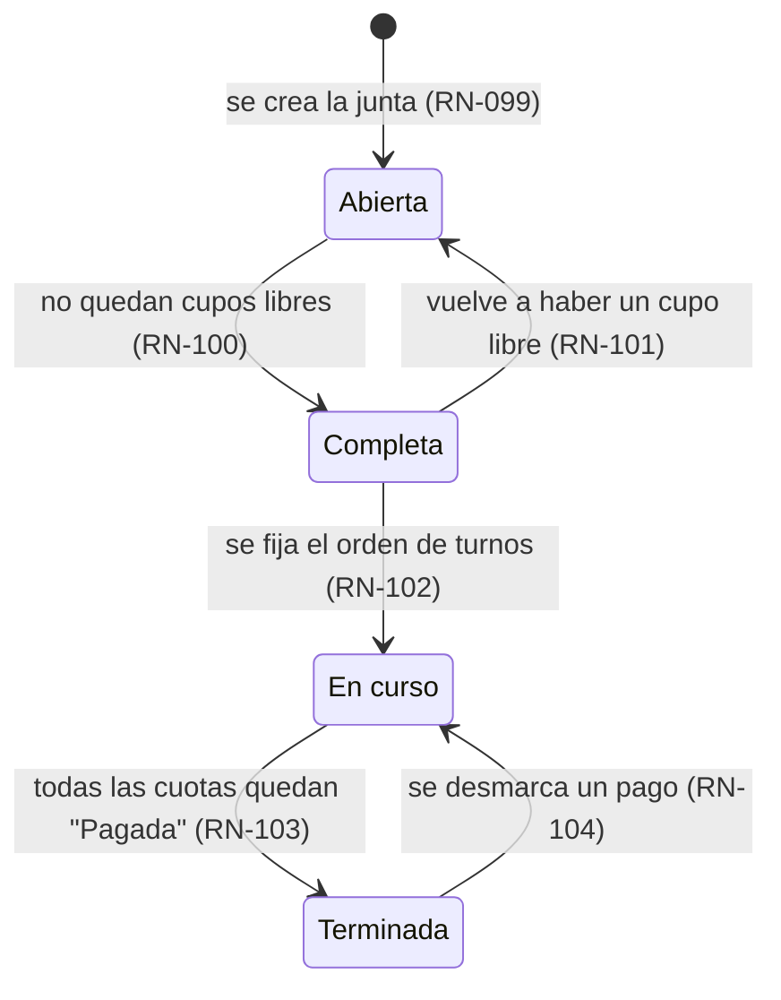

# Reglas de negocio de Mi Junta

Versión: 0.4
Fecha: 2026-11-14
Estado: Revisado

Fuente: 00-constitucion.md v0.4, 01-project-brief.md v0.4, 02-alcance.md v0.4 y las decisiones del Product Owner del 2026-11-14 (sección 1.1, sección 1.2 sobre auditorias/qa-clase1.md, sección 1.3 sobre la alineación de pendientes y sección 1.4 sobre auditorias/qa-clase2.md). Este catálogo cubre las funcionalidades Must (F-01 a F-06) y Should (F-07 a F-11) de 02-alcance.md. Las funcionalidades Could (F-12 a F-15) quedan para una versión posterior.

**Cómo leer este catálogo:**
- Cada regla tiene un solo DEBE / NO DEBE / PUEDE (PRINCIPIO-001) y necesita al menos un escenario Gherkin que cite su ID (PRINCIPIO-011).
- Los montos se escriben como `S/ 300.00` junto con su valor guardado en céntimos (`30000`), según PRINCIPIO-003.
- Las fechas de las reglas y los ejemplos van en ISO 8601 (`2026-11-30`, `2026-11-30T09:00:00-05:00`). Cuando un ejemplo cita lo que ve el usuario en pantalla, la fecha va entre comillas en DD/MM/AAAA y la hora en HH:MM de 24 horas ("30/11/2026 22:30"). Esto incluye las fechas de las decisiones y de las fuentes (2026-11-14). Los demás archivos del spec-pack escriben esas fechas en DD/MM/AAAA (14/11/2026), y las dos formas indican el mismo día.
- "En America/Lima" significa que esa zona se usa para mostrar el valor y para calcular fechas de calendario. Un instante se guarda como `timestamptz` y una fecha sin hora como `date` (PRINCIPIO-003).
- **Sujeto de las reglas:** "el sistema" es el producto completo y la regla se valida en el servidor. "La app" es el comportamiento en el dispositivo del usuario (formularios y funcionamiento sin conexión).
- **Validación:** una regla con fuente "Business Analyst" no se implementa hasta que el Product Owner la valide (PRINCIPIO-012 a). Las 7 reglas con esa fuente (RN-016, RN-021, RN-036, RN-037, RN-045, RN-061 y RN-076) quedaron validadas el 2026-11-14 (sección 1.3).
- Los términos del dominio están definidos en 04-glosario.md. Los textos que ve el usuario cuando una regla rechaza algo están en la sección 2.9.

| Patrón EARS | Plantilla |
|---|---|
| Ubiquitous | El sistema DEBE … (aplica siempre) |
| Event-driven | Cuando \<evento\>, el sistema DEBE … |
| State-driven | Mientras \<estado\>, el sistema DEBE … |
| Unwanted | Si \<situación no deseada\>, entonces el sistema DEBE … |
| Optional | Donde \<opción o configuración presente\>, el sistema DEBE … |

### Datos de ejemplo

Todos los ejemplos usan estos datos, para que los escenarios Gherkin no hereden contradicciones.

| Junta | Organizador | ¿Participa? | Participantes | Cuota | Frecuencia y ronda 1 | Código de invitación |
|---|---|---|---|---|---|---|
| Junta Familia | Carmen (`user_123`) | Sí | 12: Carmen y 11 familiares | S/ 300.00 | Mensual, vence el `2026-11-30` | `K7MP4XR2`, regenerado después a `T9QW3HZ5` |
| Junta Oficina | Jorge (`user_456`) | Sí | 10 | S/ 1,000.00 | Mensual, vence el `2026-11-30` | `M3QX7KPA` |
| Junta Ventas | Jorge (`user_456`) | No | 10 | S/ 500.00 | Quincenal, vence el `2026-12-01` | `W8RT5NHC` |

| Persona | Datos |
|---|---|
| Lucía (`user_789`) | Participa en la Junta Oficina. Turno 7. Correo `lucia@example.com` |
| Pedro (`user_234`) | Participa en la Junta Oficina. Turno 2 |
| Jorge (`user_456`) | Organiza y participa en la Junta Oficina, con el turno 4. Organiza la Junta Ventas sin participar |
| Marta (`user_610`) | Participa en la Junta Ventas |
| Rosa | Tiene cuenta y no es miembro de ninguna de estas juntas |
| Ana | No tiene cuenta |

El sorteo de la Junta Oficina lo ejecutó Jorge el `2026-11-20T19:30:12-05:00`. Su resultado empieza con `["user_501","user_234","user_502","user_456",…]`.

---

## 1. Decisiones

### 1.1 Decisiones del Product Owner del 2026-11-14

Estas decisiones dan los valores de las reglas. Las que cierran una pregunta abierta quedaron registradas en 05-preguntas-abiertas.md.

| Tema | Decisión | Pregunta |
|---|---|---|
| Unidad mínima de monto | S/ 0.10. El organizador ingresa la cuota y el pozo se calcula como cuota × participantes, así que no hay división ni redondeo | PREG-002 |
| Rango de la cuota | De S/ 10.00 a S/ 5,000.00 por participante | — |
| Beneficio del organizador | Ninguno en esta versión. Si participa, paga la misma cuota que los demás | PREG-019 |
| Cantidad de participantes | De 2 a 50. Hay una ronda por participante y cada uno recibe el pozo una sola vez | — |
| Calendario | Quincenal es cada 15 días. Si un mes no tiene el día de vencimiento, vence el último día de ese mes. "Cada N días" va de 1 a 60 (la sección 1.2 sube el mínimo a 2). La ronda 1 vence en la fecha de creación o después | PREG-027 |
| Código de invitación | 8 caracteres de `ABCDEFGHJKLMNPQRSTUVWXYZ23456789`. Sirve para todo el grupo mientras haya cupos libres y hasta que se fija el orden de turnos. El organizador puede regenerarlo, y entonces el código anterior deja de funcionar | PREG-024 |
| Sorteo | Solo con todos los cupos llenos, una sola vez por junta y con conexión. Después del sorteo nadie más se une | PREG-005 (en parte) |
| Pago a tiempo | Cuenta la fecha de pago que registra el organizador. Es a tiempo si es igual o anterior a la fecha de vencimiento. La fecha de pago no puede ser futura | PREG-020 |
| Corrección de un pago | El organizador puede desmarcar un pago. La corrección se guarda como un evento aparte y el registro original se conserva | — |
| Pago informado (F-08) | Si el organizador lo rechaza, la cuota vuelve a "Pendiente". Si no responde, sigue en "Por confirmar" sin plazo. No se adjunta evidencia | PREG-017 (en parte) |
| Aviso previo | De 1 a 7 días, con 3 por defecto, y siempre menos días que el periodo | PREG-025 |
| Recordatorios después del vencimiento | Cada 2 días, con un máximo de 5 envíos. Todos los recordatorios salen a las 09:00 America/Lima | PREG-026 |
| Contraseña | Mínimo 8 caracteres. Bloqueo de 900 s después de 5 intentos fallidos seguidos | — |
| Segundo factor | Código de 6 dígitos, válido por 600 s y anulado después de 5 intentos fallidos. Se aprobó el cambio en PRINCIPIO-005 | PREG-023 |
| DNI de los demás | No se muestra (la sección 1.3 lo vuelve definitivo) | PREG-003 |
| Nombre del rol | "Organizador" | PREG-010 |

### 1.2 Decisiones del Product Owner del 2026-11-14 sobre la auditoría QA

El Agente QA propuso estas decisiones para resolver los hallazgos de auditorias/qa-clase1.md, y el Product Owner las aprobó el 2026-11-14 junto con 00-constitucion.md v0.2 (PRINCIPIO-012).

| Tema | Decisión | Pregunta | Hallazgo |
|---|---|---|---|
| Ciclo de vida de la junta | Estados "Abierta", "Completa", "En curso" y "Terminada". Las rondas y las cuotas se generan al fijar el orden de turnos, no antes | PREG-031 | QA-02 |
| Vencimiento antes del sorteo | Las cuotas no existen antes del sorteo. Si al fijar el orden la ronda 1 ya venció, se rechaza y el organizador debe cambiar la fecha | PREG-029 | QA-02 |
| Salida de la junta | Antes del sorteo, un participante puede salir y el organizador puede quitarlo. Después del sorteo nadie sale. El organizador no puede dejar su junta ni transferir el rol | PREG-032 | QA-03 |
| Edición de la junta | Antes del sorteo se editan todos los datos con las mismas validaciones de la creación. Después del sorteo solo el nombre | PREG-033 | QA-04, QA-35 |
| Datos que recibe cada rol | El organizador recibe todas las cuotas y pagos de su junta, sin datos personales. Todo miembro ve el registro del sorteo | PREG-034 | QA-01, QA-25 |
| Sin conexión | Sin red solo se consulta y se registran, desmarcan, informan, confirman o rechazan pagos. El servidor aplica los cambios en orden y rechaza el que ya no cumple las reglas, y la app muestra el rechazo | PREG-005 | QA-05, QA-32 |
| Lista de entrada y algoritmo | Identificadores de usuario ordenados por el momento en que ocuparon su cupo. Algoritmo `fisher-yates-v1` con HMAC-SHA256 y muestreo por rechazo (anexo A) | PREG-035 | QA-06 |
| Recordatorios de cuotas "Por confirmar" | Se pausan mientras la cuota esté "Por confirmar". Al organizador le llega un aviso cuando un participante informa su pago | PREG-030 | QA-08, QA-18 |
| Cuenta | Obligatorios: nombre (2 a 80 caracteres), correo único y verificado, y contraseña. DNI y celular opcionales y únicos. No se piden la fecha de nacimiento ni la foto. Recuperación de contraseña por enlace de 3600 s. La sesión se cierra tras 30 días sin uso | PREG-036 | QA-09 |
| Código de verificación | Un solo uso. Pedir un código nuevo anula el anterior. Máximo 5 códigos cada 900 s. La activación y la desactivación se confirman con un código | PREG-037 | QA-10 |
| Código de invitación | Ningún código se reutiliza nunca. Un código inexistente se rechaza. Máximo 10 códigos inválidos por cuenta en 3600 s | PREG-038 | QA-11, QA-24 |
| Ronda actual y próxima cuota | Ronda actual: la de número más bajo que vence hoy o después. Si todas vencieron, la última. Próxima cuota: la de la ronda siguiente a la actual | PREG-039 | QA-12 |
| Orden sin sorteo (F-10) | Excluye al sorteo, exige los cupos llenos, debe ser una permutación completa, es inmutable y anula el código | PREG-018 | QA-16 |
| Casos borde de pagos | Solo se registra un pago en una cuota "Pendiente" y solo se desmarca una "Pagada". La fecha de pago no puede ser anterior a la creación de la junta. Se permiten pagos de rondas futuras. La fecha de pago no se edita: se desmarca y se vuelve a registrar | PREG-040 | QA-17 |
| Pago informado | El participante indica la fecha de pago, que se usa al confirmarlo. El organizador no informa sus propias cuotas | PREG-017 | QA-18 |
| Recordatorios | Salen entre 09:00:00 y 09:15:00. No se envía un recordatorio cuyo momento ya pasó. Correo más push cuentan como un recordatorio, y cuenta como enviado cuando el proveedor lo acepta. Llevan junta, ronda, monto y vencimiento, sin datos de otros miembros | PREG-041 | QA-19 |
| "Cada N días" | N va de 2 a 60. Si al elegir la frecuencia el aviso no es menor que el periodo, el aviso pasa a periodo − 1 | PREG-028 | QA-20 |
| Bloqueo por intentos fallidos | Al terminar el bloqueo el contador vuelve a 0. Durante el bloqueo los intentos se rechazan sin contarse | PREG-042 | QA-23 |
| Política de privacidad | Una versión nueva se acepta antes de volver a ver las juntas | PREG-043 | QA-26 |
| Formatos y textos | Nombre de la junta de 3 a 60 caracteres. El monto se ingresa con dígitos y punto decimal. Hora en HH:MM de 24 h. "Usted" y formatos de Perú también en correos y push. Catálogo de mensajes en la sección 2.9 | PREG-044 | QA-21, QA-22, QA-33 |
| Reglas escritas (F-09) | Texto libre y opcional de hasta 2,000 caracteres, editable solo antes del sorteo | PREG-016 | QA-35 |

### 1.3 Decisiones del Product Owner del 2026-11-14 sobre la alineación de pendientes

El Product Owner respondió el 2026-11-14 las preguntas abiertas y los temas pendientes de 06-user-stories.md y 07-architecture.md. Estas son las decisiones que cambian reglas. Las técnicas están en 07-architecture.md.

| Tema | Decisión | Pregunta | Reglas |
|---|---|---|---|
| Ley N.° 29733 | Aplica. Hay una sola casilla de consentimiento. Los recordatorios siguen llegando aunque el usuario no acepte todavía una versión nueva de la política. El texto de la política lo escribe el asesor legal | PREG-001 | RN-082, RN-189 |
| DNI de los demás | Nunca se muestra | PREG-003 | RN-023 |
| Foto | No se pide en esta versión | PREG-004 | RN-149 |
| Edad mínima | 18 años, confirmados con la casilla "Soy mayor de 18 años", sin pedir la fecha de nacimiento | PREG-007 | RN-181 |
| Borrar la cuenta | Se puede si el usuario no es miembro de ninguna junta "En curso". En las juntas terminadas su nombre se muestra como "Participante eliminado" y sus pagos se conservan | PREG-006 | RN-182 a RN-186 |
| Dejar de recibir recordatorios | El usuario puede desactivar los recordatorios por correo y por push. Los correos de la cuenta siempre se envían | PREG-009 | RN-067, RN-073, RN-187, RN-188 |
| Datos para préstamos | No se usan sin un consentimiento aparte, y nunca los registrados antes de ese consentimiento | PREG-015 | RN-203 |
| Carné de extranjería | No se acepta en esta versión; el DNI sigue siendo opcional | PREG-045 | RN-085, RN-148 |
| Acceso del equipo | Solo el líder técnico, solo para incidentes, con cada acceso registrado; el DNI y el celular nunca se descifran a mano | PREG-048 | RN-200 a RN-202 |
| Datos en el dispositivo | No se cifran aparte, porque no traen datos personales de otros miembros. Se borran al cerrar sesión, con un aviso si quedan cambios sin enviar | PREG-008 | RN-197, RN-198 |
| Cuota impaga sin plazo | La junta sigue "En curso" sin plazo. Se revisa con F-15 | PREG-046 | RN-103 |
| Aviso de cuotas vencidas al organizador | Funcionalidad nueva F-16 (Should): un correo por junta a las 09:00 del día siguiente al vencimiento, con quiénes faltan pagar | PREG-047 | RN-196 |
| Encuesta de KPI-05 | 3 preguntas dentro de la app, al empezar y a los 3 meses | PREG-021 | RN-204 a RN-206 |
| Reglas "Business Analyst" | Se validan RN-016, RN-021, RN-036, RN-037, RN-045, RN-061 y RN-076 | — | — |
| Reglas nuevas propuestas por QA | El organizador no recibe celular, correo ni DNI; reglas de la junta de hasta 2,000 caracteres; celular único; RN-132 también aplica al pago informado | — | RN-132, RN-178 a RN-180 |
| Casos borde | Código de invitación sin distinguir mayúsculas ni espacios; correo del inicio de sesión sin distinguir mayúsculas; un código anulado no cuenta para RN-117; un pedido rechazado no cuenta para RN-164; aviso al participante cuando se rechaza su pago informado; todos ven la asignación manual; reintento del correo hasta las 09:15:00; un recordatorio cuenta si se aceptó por correo o por push; "1 cambio sin enviar." en singular | — | RN-143, RN-174, RN-190 a RN-195, RN-199 |
| Mensajes | Textos nuevos del catálogo §2.9 | — | Sección 2.9 |
| Organizador que borra su cuenta (segunda ronda) | No puede borrarla mientras organice una junta "Abierta" o "Completa" | PREG-049 | RN-207 |
| Aviso de cuotas vencidas (segunda ronda) | El organizador puede desactivarlo y volver a activarlo | PREG-053 | RN-208, RN-209 |
| Encuesta de KPI-05 (segunda ronda) | El organizador puede cerrarla sin responder | PREG-054 | RN-205, RN-210, RN-211 |

**Textos y detalles derivados:** los textos de RN-180, RN-181, RN-182, RN-194, RN-196 y RN-198, el cálculo de `{n}` en el mensaje de RN-164, el contenido de RN-185 y RN-186 el momento "al empezar" de RN-204, el texto de RN-207, la preferencia propia de RN-208, RN-211 y el cambio de RN-205 (contar desde que se respondió o se cerró la primera encuesta) los redactó el Agente Architect a partir de estas decisiones, con el estilo de los textos ya aprobados. Están marcados "derivada" en su fuente y el Product Owner puede corregirlos sin cambiar las decisiones.

### 1.4 Decisiones del 2026-11-14 sobre la auditoría QA del backlog

El Agente QA de backlog redactó estas decisiones para resolver los hallazgos críticos y mayores de auditorias/qa-clase2.md, con la autorización explícita del Product Owner del 2026-11-14 para modificar el spec-pack (PRINCIPIO-012). Son derivadas: el Product Owner puede revertirlas.

| Tema | Decisión | Pregunta | Reglas | Hallazgo |
|---|---|---|---|---|
| Correos de la cuenta | Asunto y cuerpo del correo de verificación y del de recuperación de contraseña, en el estilo de los textos aprobados | — | Sección 2.9 (RN-152, RN-155) | C-02 |
| El organizador deja de participar | Antes de fijar el orden, si el organizador pasa de "Sí participo" a "No participo", se libera su cupo; la junta vuelve a "Abierta" si estaba "Completa" (RN-101) y él no entra en la lista de entrada (RN-030) | PREG-056 | RN-212 | M-04 |
| Bloqueo por códigos inválidos | RN-117 se aplica como está escrita: el bloqueo dura 3600 s desde el décimo código inválido. Los intentos rechazados durante el bloqueo no se validan y no cuentan como inválidos | PREG-057 | RN-117 (aclarada) | M-05 |
| Desmarcar sin conexión | Texto del `{motivo}` cuando se desmarca sin conexión un pago que ya no estaba registrado | — | Sección 2.9 (RN-172) | M-03 |
| Prioridad de RN-142 | Pasa de MUST a SHOULD, porque solo aplica cuando existe el push (F-07, Should). Su significado no cambia | — | RN-142 | M-11 |

---

## 2. Catálogo de reglas

### 2.1 Juntas

---

**RN-001** | Categoría: Juntas | Prioridad: MUST | Fuente: Product Owner (02-alcance.md §7.1, PREG-013)

Patrón EARS: Ubiquitous

El sistema NO DEBE limitar la cantidad de juntas que gestiona un mismo organizador.

✅ **Ejemplo:** Jorge ya gestiona 2 juntas (Junta Oficina y Junta Ventas). Crea una tercera, "Junta Oficina 2027", y queda creada.

❌ **Contraejemplo:** el sistema muestra "Ya alcanzó el máximo de 2 juntas" y no crea la tercera.

---

**RN-002** | Categoría: Juntas | Prioridad: MUST | Fuente: Alcance (F-02)

Patrón EARS: Unwanted

Si al crear una junta falta el nombre, la cuota, la cantidad de participantes, la frecuencia, la fecha de vencimiento de la ronda 1, los días de aviso previo o la elección de si el organizador participa, entonces el sistema NO DEBE crear la junta.

✅ **Ejemplo:** Carmen completa "Junta Familia", S/ 300.00, 12 participantes, mensual, `2026-11-30`, 3 días de aviso y "Sí participo". La junta se crea.

❌ **Contraejemplo:** Carmen deja vacía la fecha de vencimiento de la ronda 1 y la junta "Junta Familia" se crea igual.

---

**RN-003** | Categoría: Juntas | Prioridad: MUST | Fuente: Product Owner (2026-11-14)

Patrón EARS: Ubiquitous

El sistema DEBE aceptar como monto de la cuota solo un monto entre S/ 10.00 (`1000`) y S/ 5,000.00 (`500000`), ambos incluidos.

✅ **Ejemplo:** Jorge ingresa una cuota de S/ 1,000.00 y se guarda como `100000`.

❌ **Contraejemplo:** se acepta una cuota de S/ 6,000.00 (`600000`) o de S/ 5.00 (`500`).

---

**RN-004** | Categoría: Juntas | Prioridad: MUST | Fuente: Product Owner (2026-11-14, PREG-002)

Patrón EARS: Unwanted

Si el monto de la cuota ingresado no es un múltiplo de S/ 0.10, entonces el sistema DEBE rechazarlo.

✅ **Ejemplo:** la cuota S/ 20.80 (`2080`) se acepta.

❌ **Contraejemplo:** la cuota S/ 20.85 (`2085`) se acepta.

---

**RN-005** | Categoría: Juntas | Prioridad: MUST | Fuente: Product Owner (2026-11-14)

Patrón EARS: Ubiquitous

El sistema DEBE aceptar como cantidad de participantes solo un número entero entre 2 y 50, ambos incluidos.

✅ **Ejemplo:** Carmen crea una junta de 12 participantes.

❌ **Contraejemplo:** se crea una junta de 51 participantes, o una de 1 participante.

---

**RN-006** | Categoría: Juntas | Prioridad: MUST | Fuente: Product Owner (02-alcance.md §7.5)

Patrón EARS: Optional

Donde el organizador eligió participar en la junta, el sistema DEBE contarlo como uno de los participantes.

✅ **Ejemplo:** Carmen participa en una junta de 12 participantes. Quedan 11 cupos para sus familiares.

❌ **Contraejemplo:** Carmen participa y el sistema abre 12 cupos para invitados, y la junta termina con 13 participantes.

---

**RN-007** | Categoría: Juntas | Prioridad: MUST | Fuente: Product Owner (02-alcance.md §7.4)

Patrón EARS: Ubiquitous

El sistema DEBE aceptar como frecuencia solo uno de estos valores: semanal, quincenal, mensual o cada N días.

✅ **Ejemplo:** Jorge elige "mensual".

❌ **Contraejemplo:** se guarda una junta con frecuencia "bimestral".

---

**RN-008** | Categoría: Juntas | Prioridad: MUST | Fuente: Product Owner (2026-11-14, PREG-027) · Modificada: Product Owner a propuesta QA (2026-11-14, PREG-028)

Patrón EARS: Optional

Donde la frecuencia es cada N días, el sistema DEBE aceptar solo un N entero entre 2 y 60, ambos incluidos.

✅ **Ejemplo:** el organizador fija una frecuencia de cada 10 días.

❌ **Contraejemplo:** se acepta una frecuencia de cada 90 días, o de cada 1 día.

---

**RN-009** | Categoría: Juntas | Prioridad: MUST | Fuente: Product Owner (2026-11-14, PREG-027)

Patrón EARS: Unwanted

Si la fecha de vencimiento de la ronda 1 es anterior a la fecha de creación de la junta en America/Lima, entonces el sistema DEBE rechazarla.

✅ **Ejemplo:** la junta se crea el `2026-11-14` con la ronda 1 venciendo el `2026-11-30`. También se acepta que la ronda 1 venza el mismo `2026-11-14`.

❌ **Contraejemplo:** la junta se crea el `2026-11-14` y se acepta que la ronda 1 venza el `2026-11-10`.

---

**RN-010** | Categoría: Juntas | Prioridad: MUST | Fuente: Product Owner (2026-11-14, PREG-025)

Patrón EARS: Ubiquitous

El sistema DEBE aceptar como días de aviso previo solo un número entero entre 1 y 7, ambos incluidos.

✅ **Ejemplo:** Carmen fija 3 días de aviso previo.

❌ **Contraejemplo:** se aceptan 10 días, o 0 días.

---

**RN-011** | Categoría: Juntas | Prioridad: MUST | Fuente: Product Owner (2026-11-14, PREG-025) · Modificada: redacción EARS (QA-36)

Patrón EARS: Event-driven

Cuando el organizador abre el formulario para crear una junta, el sistema DEBE mostrar el valor 3 en el campo de días de aviso previo.

✅ **Ejemplo:** Jorge abre "Crear junta" y el campo "Días de aviso previo" muestra 3.

❌ **Contraejemplo:** el campo aparece vacío, o con el valor 1.

---

**RN-012** | Categoría: Juntas | Prioridad: MUST | Fuente: Product Owner (2026-11-14, PREG-025) · Aclarada: periodo mensual (QA-38)

Patrón EARS: Unwanted

Si los días de aviso previo son iguales o mayores que la cantidad de días del periodo de la junta, que en la frecuencia mensual se toma como 28, entonces el sistema DEBE rechazarlos.

✅ **Ejemplo:** una junta semanal (periodo de 7 días) con 6 días de aviso previo se acepta.

❌ **Contraejemplo:** una junta de cada 5 días con 5 días de aviso previo se acepta.

---

**RN-013** | Categoría: Juntas | Prioridad: MUST | Fuente: Product Owner (2026-11-14) · Modificada: Product Owner a propuesta QA (2026-11-14, PREG-031)

Patrón EARS: Event-driven

Cuando se fija el orden de turnos de una junta, el sistema DEBE crear una ronda por cada participante.

✅ **Ejemplo:** Jorge ejecuta el sorteo de la Junta Oficina, de 10 participantes, y la junta queda con las rondas 1 a 10.

❌ **Contraejemplo:** la Junta Oficina queda con 8 rondas, o las rondas ya existían desde que se creó la junta.

---

**RN-014** | Categoría: Juntas | Prioridad: SHOULD | Fuente: Alcance (F-09)

Patrón EARS: Optional

Donde el organizador escribió las reglas de la junta, el sistema DEBE mostrarlas a todos los miembros de esa junta.

✅ **Ejemplo:** Jorge escribe "Quien no pueda pagar avisa al grupo antes de la fecha de vencimiento", y Lucía lo lee en la pantalla de la Junta Oficina.

❌ **Contraejemplo:** Jorge guardó el texto "Quien no pueda pagar avisa al grupo antes de la fecha de vencimiento", pero `GET /juntas/{id}` le devuelve `junta_rules = null` a Lucía.

---

**RN-096** | Categoría: Juntas | Prioridad: MUST | Fuente: Product Owner a propuesta QA (2026-11-14, PREG-044)

Patrón EARS: Ubiquitous

El sistema DEBE aceptar como nombre de una junta solo un texto de 3 a 60 caracteres, ambos incluidos.

✅ **Ejemplo:** Carmen nombra su junta "Junta Familia" (13 caracteres).

❌ **Contraejemplo:** se crea una junta con el nombre "J1" (2 caracteres).

---

**RN-097** | Categoría: Juntas | Prioridad: MUST | Fuente: Product Owner a propuesta QA (2026-11-14, PREG-044)

Patrón EARS: Unwanted

Si el monto de la cuota ingresado contiene algo distinto de dígitos y un solo punto decimal seguido de hasta 2 dígitos, entonces el sistema DEBE rechazarlo.

✅ **Ejemplo:** "1000", "1000.5" y "1000.50" se aceptan como S/ 1,000.00, S/ 1,000.50 y S/ 1,000.50.

❌ **Contraejemplo:** "300,50" se acepta y se guarda como `3005000` (S/ 30,050.00), o "1,000" se acepta.

---

**RN-098** | Categoría: Juntas | Prioridad: MUST | Fuente: Product Owner a propuesta QA (2026-11-14, PREG-028)

Patrón EARS: Event-driven

Cuando el organizador elige una frecuencia cuyo periodo es igual o menor que los días de aviso previo ingresados, el sistema DEBE cambiar los días de aviso previo al periodo menos 1.

✅ **Ejemplo:** el campo muestra 3 y el organizador elige "cada 2 días". El campo pasa a 1.

❌ **Contraejemplo:** el campo sigue en 3 y el formulario muestra un error que el organizador no causó.

---

**RN-099** | Categoría: Juntas | Prioridad: MUST | Fuente: Product Owner a propuesta QA (2026-11-14, PREG-031)

Patrón EARS: Event-driven

Cuando se crea una junta, el sistema DEBE asignarle el estado "Abierta".

✅ **Ejemplo:** Carmen crea la Junta Familia y queda con `status = "open"`.

❌ **Contraejemplo:** la junta se crea sin estado, o directamente "En curso".

---

**RN-100** | Categoría: Juntas | Prioridad: MUST | Fuente: Product Owner a propuesta QA (2026-11-14, PREG-031)

Patrón EARS: Event-driven

Cuando una junta "Abierta" se queda sin cupos libres, el sistema DEBE cambiar su estado a "Completa".

✅ **Ejemplo:** el último familiar de Carmen se une, la Junta Familia llega a 12 de 12 cupos y pasa a `full`.

❌ **Contraejemplo:** con 12 de 12 cupos ocupados la junta sigue en `open`.

---

**RN-101** | Categoría: Juntas | Prioridad: MUST | Fuente: Product Owner a propuesta QA (2026-11-14, PREG-031)

Patrón EARS: Event-driven

Cuando una junta "Completa" vuelve a tener un cupo libre, el sistema DEBE cambiar su estado a "Abierta".

✅ **Ejemplo:** un familiar sale de la Junta Familia, que pasa de 12 a 11 de 12 cupos ocupados y vuelve a `open`.

❌ **Contraejemplo:** con 11 de 12 cupos ocupados la junta sigue en `full`.

---

**RN-102** | Categoría: Juntas | Prioridad: MUST | Fuente: Product Owner a propuesta QA (2026-11-14, PREG-031)

Patrón EARS: Event-driven

Cuando se fija el orden de turnos de una junta, el sistema DEBE cambiar su estado a "En curso".

✅ **Ejemplo:** Jorge ejecuta el sorteo de la Junta Oficina el `2026-11-20` y la junta pasa a `in_progress`.

❌ **Contraejemplo:** después del sorteo la junta sigue en `full`.

---

**RN-103** | Categoría: Juntas | Prioridad: MUST | Fuente: Product Owner a propuesta QA (2026-11-14, PREG-031)

Patrón EARS: Event-driven

Cuando todas las cuotas de todas las rondas de una junta quedan en el estado "Pagada", el sistema DEBE cambiar su estado a "Terminada".

✅ **Ejemplo:** Jorge registra la última cuota pendiente de la ronda 10 de la Junta Oficina y la junta pasa a `finished`.

❌ **Contraejemplo:** la junta pasa a `finished` al vencer la ronda 10, aunque Pedro todavía no pagó su cuota de la ronda 9.

---

**RN-104** | Categoría: Juntas | Prioridad: MUST | Fuente: Product Owner a propuesta QA (2026-11-14, PREG-031)

Patrón EARS: Event-driven

Cuando el organizador desmarca un pago de una junta "Terminada", el sistema DEBE devolver la junta al estado "En curso".

✅ **Ejemplo:** Jorge desmarca un pago de la ronda 10 de la Junta Oficina terminada y la junta vuelve a `in_progress`.

❌ **Contraejemplo:** la junta sigue en `finished` con una cuota en "Pendiente".

---

**RN-105** | Categoría: Juntas | Prioridad: MUST | Fuente: Product Owner a propuesta QA (2026-11-14, PREG-031, PREG-029)

Patrón EARS: State-driven

Mientras la junta esté en el estado "Abierta" o "Completa", el sistema NO DEBE generar cuotas para ella.

✅ **Ejemplo:** la Junta Familia tiene 11 de 12 cupos ocupados el `2026-11-30`, fecha de la ronda 1, y no tiene ninguna cuota ni envía ningún recordatorio.

❌ **Contraejemplo:** el `2026-11-27` sale un recordatorio de una cuota de la Junta Familia, que todavía no hizo su sorteo.

---

**RN-106** | Categoría: Juntas | Prioridad: MUST | Fuente: Product Owner a propuesta QA (2026-11-14, PREG-033)

Patrón EARS: State-driven

Mientras la junta esté en el estado "Abierta" o "Completa", el sistema DEBE permitir que el organizador edite el nombre, el monto de la cuota, la cantidad de participantes, la frecuencia, la fecha de vencimiento de la ronda 1, los días de aviso previo, su participación y las reglas de la junta.

✅ **Ejemplo:** antes del sorteo, Carmen cambia la cuota de S/ 300.00 a S/ 350.00 y se guarda `35000`.

❌ **Contraejemplo:** antes del sorteo, Carmen intenta cambiar la fecha de la ronda 1 y la app le responde que la junta no se puede editar.

---

**RN-107** | Categoría: Juntas | Prioridad: MUST | Fuente: Product Owner a propuesta QA (2026-11-14, PREG-033)

Patrón EARS: Event-driven

Cuando el organizador edita una junta, el sistema DEBE validar cada dato con las mismas reglas que se aplican al crearla.

✅ **Ejemplo:** Carmen edita la cuota a S/ 6,000.00 y se rechaza por RN-003.

❌ **Contraejemplo:** al editar se acepta una cuota de S/ 6,000.00 que no se habría aceptado al crear la junta.

---

**RN-108** | Categoría: Juntas | Prioridad: MUST | Fuente: Product Owner a propuesta QA (2026-11-14, PREG-033)

Patrón EARS: Unwanted

Si la nueva cantidad de participantes es menor que la cantidad de cupos ocupados, entonces el sistema DEBE rechazar el cambio.

✅ **Ejemplo:** la Junta Familia tiene 9 cupos ocupados. Carmen intenta bajar la cantidad a 8 y se rechaza. Bajarla a 9 se acepta.

❌ **Contraejemplo:** la cantidad baja a 8 y la junta queda con 9 participantes en 8 cupos.

---

**RN-109** | Categoría: Juntas | Prioridad: MUST | Fuente: Product Owner a propuesta QA (2026-11-14, PREG-033)

Patrón EARS: Unwanted

Si el organizador elige participar en una junta que no tiene cupos libres, entonces el sistema DEBE rechazar el cambio.

✅ **Ejemplo:** Jorge no participa en la Junta Ventas, que tiene 10 de 10 cupos ocupados. Marca "Sí participo" y se rechaza.

❌ **Contraejemplo:** Jorge pasa a participar y la Junta Ventas queda con 11 participantes en 10 cupos.

---

**RN-110** | Categoría: Juntas | Prioridad: MUST | Fuente: Product Owner a propuesta QA (2026-11-14, PREG-033, PREG-016)

Patrón EARS: State-driven

Mientras la junta esté en el estado "En curso" o "Terminada", el sistema NO DEBE permitir editar ningún dato de la junta distinto de su nombre.

✅ **Ejemplo:** después del sorteo, Jorge cambia el nombre "Junta Oficina" a "Junta Oficina 2026" y se guarda. Su intento de cambiar la cuota se rechaza.

❌ **Contraejemplo:** después del sorteo, Jorge cambia la cuota de S/ 1,000.00 a S/ 1,200.00, o edita las reglas de la junta.

---

**RN-179** | Categoría: Juntas | Prioridad: SHOULD | Fuente: Product Owner (2026-11-14, alineación de pendientes, PREG-016)

Patrón EARS: Ubiquitous

El sistema DEBE aceptar como reglas de la junta solo un texto de hasta 2,000 caracteres.

✅ **Ejemplo:** Carmen guarda unas reglas de 2,000 caracteres y se aceptan.

❌ **Contraejemplo:** se aceptan unas reglas de 2,001 caracteres.

---

**RN-212** | Categoría: Juntas | Prioridad: MUST | Fuente: decisión del 2026-11-14 sobre auditorias/qa-clase2.md (M-04, PREG-056), derivada por el Agente QA de backlog con autorización del Product Owner

Patrón EARS: Event-driven

Cuando el organizador cambia su participación de "Sí participo" a "No participo" en una junta "Abierta" o "Completa", el sistema DEBE liberar su cupo.

✅ **Ejemplo:** la Junta Familia está "Completa" con 12 de 12 cupos y Carmen participa. Carmen cambia a "No participo": la junta queda con 11 de 12 cupos y vuelve a "Abierta" (RN-101). Cuando otro familiar ocupa el cupo libre y Carmen sortea, la lista de entrada no incluye a Carmen (RN-030) y no se le generan cuotas (RN-044).

❌ **Contraejemplo:** Carmen pasa a "No participo" y sigue ocupando un cupo, o su identificador queda en la lista de entrada del sorteo.

---

### 2.2 Participantes

---

**RN-015** | Categoría: Participantes | Prioridad: MUST | Fuente: Product Owner (2026-11-14, PREG-024)

Patrón EARS: Event-driven

Cuando se crea una junta, el sistema DEBE generarle un código de invitación de 8 caracteres tomados del conjunto `ABCDEFGHJKLMNPQRSTUVWXYZ23456789`.

✅ **Ejemplo:** la Junta Familia recibe el código `K7MP4XR2`.

❌ **Contraejemplo:** se genera el código `K7M04XR1` (tiene `0` y `1`), o el código `K7MP4X` (6 caracteres).

---

**RN-016** | Categoría: Participantes | Prioridad: MUST | Fuente: Business Analyst, derivada de F-02 · Modificada: Product Owner a propuesta QA (2026-11-14, PREG-038) · Validada: Product Owner (2026-11-14)

Patrón EARS: Unwanted

Si un código generado coincide con cualquier código de invitación generado antes, para cualquier junta y esté vigente o no, entonces el sistema DEBE generar otro código.

✅ **Ejemplo:** al crear la Junta Oficina sale `K7MP4XR2`, que ya se generó para la Junta Familia, y el sistema genera `M3QX7KPA`. Tampoco se vuelve a entregar `K7MP4XR2` después de que Carmen lo regenera.

❌ **Contraejemplo:** Carmen regenera su código, `K7MP4XR2` queda anulado y una semana después se le asigna a otra junta. Un familiar con el mensaje viejo termina en esa otra junta.

---

**RN-017** | Categoría: Participantes | Prioridad: MUST | Fuente: Product Owner (02-alcance.md §7.2)

Patrón EARS: Unwanted

Si una persona sin sesión iniciada ingresa un código de invitación, entonces el sistema NO DEBE unirla a la junta.

✅ **Ejemplo:** Ana, sin cuenta, ingresa `K7MP4XR2` y ve "Inicie sesión o cree su cuenta para unirse a la junta".

❌ **Contraejemplo:** Ana, sin cuenta, ingresa `K7MP4XR2` y la Junta Familia pasa de 8 a 9 cupos ocupados, uno de ellos sin cuenta.

---

**RN-018** | Categoría: Participantes | Prioridad: MUST | Fuente: Product Owner (2026-11-14, PREG-024)

Patrón EARS: State-driven

Mientras la junta tenga todos sus cupos ocupados, el sistema DEBE rechazar su código de invitación.

✅ **Ejemplo:** la Junta Familia tiene 12 de 12 cupos ocupados. Rosa ingresa `K7MP4XR2` y ve "Esta junta ya no tiene cupos disponibles". Si después un familiar sale antes del sorteo, el mismo código vuelve a servir. Y si dos personas ingresan el código al mismo tiempo por el último cupo, solo una se une.

❌ **Contraejemplo:** Rosa se une como participante número 13.

---

**RN-019** | Categoría: Participantes | Prioridad: MUST | Fuente: Product Owner (2026-11-14, PREG-024)

Patrón EARS: Event-driven

Cuando se ejecuta el sorteo de una junta, el sistema DEBE anular su código de invitación.

✅ **Ejemplo:** el sorteo de la Junta Oficina se ejecuta el `2026-11-20T19:30:12-05:00`. Al día siguiente, alguien ingresa `M3QX7KPA` y el código ya no es válido.

❌ **Contraejemplo:** después del sorteo, la pantalla de la Junta Oficina sigue mostrando `M3QX7KPA` como código vigente.

---

**RN-020** | Categoría: Participantes | Prioridad: MUST | Fuente: Product Owner (2026-11-14, PREG-024)

Patrón EARS: Event-driven

Cuando el organizador regenera el código de invitación, el sistema DEBE anular el código anterior.

✅ **Ejemplo:** Carmen cambia `K7MP4XR2` por `T9QW3HZ5`. Rosa ingresa `K7MP4XR2` y ve "Este código ya no es válido".

❌ **Contraejemplo:** `K7MP4XR2` y `T9QW3HZ5` siguen sirviendo para unirse.

---

**RN-021** | Categoría: Participantes | Prioridad: MUST | Fuente: Business Analyst, derivada de F-02 · Validada: Product Owner (2026-11-14)

Patrón EARS: Unwanted

Si un miembro de una junta ingresa el código de esa misma junta, entonces el sistema NO DEBE ocupar otro cupo con él.

✅ **Ejemplo:** Lucía, que ya está en la Junta Oficina, vuelve a ingresar `M3QX7KPA`. La junta sigue con 8 de 10 cupos ocupados.

❌ **Contraejemplo:** la junta pasa de 8 a 9 cupos ocupados y Lucía aparece dos veces.

---

**RN-022** | Categoría: Participantes | Prioridad: MUST | Fuente: Constitución (PRINCIPIO-006) · Modificada: Product Owner a propuesta QA (2026-11-14, PREG-034, PREG-039)

Patrón EARS: Ubiquitous

El sistema DEBE entregar a un miembro que no es el organizador, de cada otro miembro de la junta, solo su nombre, su número de turno, el estado de su cuota en la ronda actual, la fecha de vencimiento de su próxima cuota y el estado de su próxima cuota.

✅ **Ejemplo:** el `2026-11-25` (la ronda actual es la 1), Lucía pide `GET /juntas/{id}/members` de la Junta Oficina y recibe para Jorge `{"name":"Jorge","turn_number":4,"current_round_status":"paid","next_due_date":"2026-12-30","next_status":"pending"}`.

❌ **Contraejemplo:** la respuesta también incluye `"phone":"987654321"` o `"paid_on":"2026-11-28"` de Jorge, y la interfaz solo lo oculta.

---

**RN-023** | Categoría: Participantes | Prioridad: MUST | Fuente: Product Owner (2026-11-14, PREG-003, resuelta: el DNI de los demás nunca se muestra)

Patrón EARS: Ubiquitous

El sistema NO DEBE entregar a ningún usuario el DNI de otro miembro.

✅ **Ejemplo:** Carmen, como organizadora, llama a `GET /juntas/{id}/members` y la respuesta no trae el campo `dni` en ninguno de sus 11 familiares.

❌ **Contraejemplo:** la lista muestra "DNI ****5678" para un familiar de Carmen.

---

**RN-024** | Categoría: Participantes | Prioridad: MUST | Fuente: Constitución (PRINCIPIO-006)

Patrón EARS: Unwanted

Si un usuario que no es miembro de una junta pide los datos de esa junta, entonces el sistema DEBE rechazar la solicitud.

✅ **Ejemplo:** Rosa, que no es miembro, llama a `GET /juntas/{id}/members` de la Junta Familia y recibe `403`.

❌ **Contraejemplo:** Rosa recibe `200` con los 12 miembros de la junta y sus estados de pago.

---

**RN-025** | Categoría: Participantes | Prioridad: MUST | Fuente: Alcance (F-05)

Patrón EARS: Ubiquitous

El sistema DEBE mostrar a cada participante su número de turno.

✅ **Ejemplo:** después del sorteo, Lucía abre la Junta Oficina y ve "Su turno: 7".

❌ **Contraejemplo:** después del sorteo del `2026-11-20`, la pantalla de Lucía muestra "Su turno: —" y ella tiene que preguntarle a Jorge.

---

**RN-026** | Categoría: Participantes | Prioridad: MUST | Fuente: Alcance (F-05)

Patrón EARS: Ubiquitous

El sistema DEBE mostrar a cada participante el estado de cada una de sus cuotas.

✅ **Ejemplo:** Lucía ve la ronda 1 "Pagada", la ronda 2 "Pagada" y la ronda 3 "Pendiente".

❌ **Contraejemplo:** Lucía está en la ronda 3 y solo ve "Ronda 3: Pendiente", sin las rondas 1 y 2.

---

**RN-111** | Categoría: Participantes | Prioridad: MUST | Fuente: Product Owner a propuesta QA (2026-11-14, PREG-032)

Patrón EARS: State-driven

Mientras la junta esté en el estado "Abierta" o "Completa", el sistema DEBE permitir que un participante distinto del organizador salga de ella.

✅ **Ejemplo:** antes del sorteo, un familiar de Carmen pulsa "Salir de la junta" y deja de ser miembro de la Junta Familia.

❌ **Contraejemplo:** antes del sorteo, el familiar no tiene cómo salir y Carmen tiene que regenerar el código y crear otra junta.

---

**RN-112** | Categoría: Participantes | Prioridad: MUST | Fuente: Product Owner a propuesta QA (2026-11-14, PREG-032)

Patrón EARS: State-driven

Mientras la junta esté en el estado "Abierta" o "Completa", el sistema DEBE permitir que el organizador quite a un participante de la junta.

✅ **Ejemplo:** antes del sorteo, Carmen quita a una persona que se unió por error a la Junta Familia.

❌ **Contraejemplo:** antes del sorteo, Carmen no puede quitar a quien se unió por error, y la junta no llega a sortearse.

---

**RN-113** | Categoría: Participantes | Prioridad: MUST | Fuente: Product Owner a propuesta QA (2026-11-14, PREG-032)

Patrón EARS: Event-driven

Cuando un participante deja una junta, el sistema DEBE liberar su cupo.

✅ **Ejemplo:** la Junta Familia pasa de 12 a 11 de 12 cupos ocupados cuando sale un familiar.

❌ **Contraejemplo:** el familiar sale y la junta sigue con 12 de 12 cupos ocupados.

---

**RN-114** | Categoría: Participantes | Prioridad: MUST | Fuente: Product Owner a propuesta QA (2026-11-14, PREG-032)

Patrón EARS: State-driven

Mientras la junta esté en el estado "En curso" o "Terminada", el sistema NO DEBE permitir que un participante deje la junta.

✅ **Ejemplo:** después del sorteo, Pedro intenta salir de la Junta Oficina y ve "La junta ya fijó su orden de turnos. Ya no es posible salir de ella".

❌ **Contraejemplo:** después de recibir el pozo de la ronda 2, Pedro sale de la Junta Oficina y sus cuotas de las rondas 3 a 10 desaparecen.

---

**RN-115** | Categoría: Participantes | Prioridad: MUST | Fuente: Product Owner a propuesta QA (2026-11-14, PREG-032)

Patrón EARS: Unwanted

Si el organizador intenta dejar de ser organizador de una junta que gestiona, entonces el sistema DEBE rechazar la acción.

✅ **Ejemplo:** Carmen pulsa "Salir de la junta" en la Junta Familia y ve "Usted es la persona organizadora de esta junta y no puede salir de ella".

❌ **Contraejemplo:** Carmen sale y la Junta Familia queda sin organizador.

---

**RN-116** | Categoría: Participantes | Prioridad: MUST | Fuente: Product Owner a propuesta QA (2026-11-14, PREG-038)

Patrón EARS: Unwanted

Si un usuario ingresa un código que no corresponde a ninguna junta, entonces el sistema DEBE rechazarlo.

✅ **Ejemplo:** Rosa ingresa `ZZZZ2222` y ve "Este código no es válido".

❌ **Contraejemplo:** la app muestra un error técnico `500`, o no muestra nada.

---

**RN-117** | Categoría: Participantes | Prioridad: MUST | Fuente: Product Owner a propuesta QA (2026-11-14, PREG-038) · Aclarada: inicio del bloqueo (2026-11-14, PREG-057, auditorias/qa-clase2.md M-05)

Patrón EARS: Unwanted

Si una cuenta ingresa 10 códigos de invitación inválidos en 3600 segundos, entonces el sistema DEBE rechazar sus intentos de unirse a una junta durante los 3600 segundos siguientes.

✅ **Ejemplo:** entre las `10:00` y las `10:20`, Rosa ingresa 10 códigos que no existen. A las `10:25` ingresa `T9QW3HZ5`, que es válido, y se rechaza. A las `11:21` se acepta.

✅ **Ejemplo (inicio del bloqueo):** Rosa ingresa 9 códigos que no existen a las `10:00` y el décimo a las `10:59:00`. Los 3600 segundos se cuentan desde ese décimo código: a las `11:30` `T9QW3HZ5` se rechaza, y desde las `11:59:00` se acepta. Los intentos rechazados durante el bloqueo no se validan, así que no cuentan como códigos inválidos.

❌ **Contraejemplo:** una cuenta prueba 5,000 códigos en una hora.

---

**RN-118** | Categoría: Participantes | Prioridad: MUST | Fuente: Product Owner a propuesta QA (2026-11-14, PREG-039)

Patrón EARS: Optional

Donde el organizador no participa en la junta, el sistema DEBE entregarlo a los demás miembros solo con su nombre y su rol de organizador.

✅ **Ejemplo:** Marta pide los miembros de la Junta Ventas y recibe para Jorge `{"name":"Jorge","role":"organizer"}`.

❌ **Contraejemplo:** Marta recibe para Jorge `"turn_number":null,"current_round_status":"pending"`, como si debiera una cuota.

---

**RN-119** | Categoría: Participantes | Prioridad: MUST | Fuente: Product Owner a propuesta QA (2026-11-14, PREG-039)

Patrón EARS: Unwanted

Si un participante no tiene próxima cuota, entonces el sistema DEBE entregar vacíos la fecha de vencimiento y el estado de su próxima cuota.

✅ **Ejemplo:** durante la ronda 10 de la Junta Oficina, Lucía recibe para Pedro `"next_due_date":null,"next_status":null`.

❌ **Contraejemplo:** la respuesta falla con un error, o inventa una ronda 11.

---

**RN-120** | Categoría: Participantes | Prioridad: MUST | Fuente: Product Owner a propuesta QA (2026-11-14, PREG-034)

Patrón EARS: Ubiquitous

El sistema DEBE entregar al organizador, de cada cuota de la junta que gestiona, el nombre del participante, la ronda, el estado, la fecha de pago, la clasificación "a tiempo" o "atrasado" y sus correcciones.

✅ **Ejemplo:** Jorge abre "Pagos" de la Junta Oficina y ve que la cuota de Lucía de la ronda 1 está "Pagada" con fecha de pago "28/11/2026", a tiempo.

❌ **Contraejemplo:** Jorge solo ve el estado de la ronda actual y no puede encontrar la cuota de la ronda 1 que necesita desmarcar.

---

**RN-121** | Categoría: Participantes | Prioridad: MUST | Fuente: Product Owner a propuesta QA (2026-11-14, PREG-034)

Patrón EARS: Ubiquitous

El sistema DEBE mostrar a cada miembro de la junta el registro del sorteo de esa junta, con la semilla, la versión del algoritmo, la lista de entrada con los nombres en su orden y el resultado.

✅ **Ejemplo:** Lucía abre "Ver sorteo" en la Junta Oficina, copia la semilla y la lista de entrada, y con el anexo A obtiene el mismo orden de turnos.

❌ **Contraejemplo:** solo el equipo técnico puede ver la semilla, y Lucía tiene que confiar en Jorge.

---

**RN-178** | Categoría: Participantes | Prioridad: MUST | Fuente: Product Owner (2026-11-14, alineación de pendientes, PRINCIPIO-006)

Patrón EARS: Ubiquitous

El sistema NO DEBE entregar al organizador el celular, el correo ni el DNI de los participantes de las juntas que gestiona.

✅ **Ejemplo:** Lucía registró el celular `987654321`. Jorge abre "Pagos" y pide `GET /juntas/{id}/members` de la Junta Oficina, y ninguna respuesta trae `phone`, `email` ni `dni` de Lucía.

❌ **Contraejemplo:** la pantalla "Pagos" de Jorge muestra `lucia@example.com` para que él le escriba.

---

**RN-190** | Categoría: Participantes | Prioridad: MUST | Fuente: Product Owner (2026-11-14, alineación de pendientes, PREG-024, PREG-038)

Patrón EARS: Event-driven

Cuando un usuario ingresa un código de invitación, el sistema DEBE quitarle los espacios y pasar sus letras a mayúsculas antes de validarlo.

✅ **Ejemplo:** Rosa ingresa ` t9qw3hz5 ` y se valida como `T9QW3HZ5`.

❌ **Contraejemplo:** Rosa ingresa `t9qw3hz5` y ve "Este código no es válido.".

---

**RN-192** | Categoría: Participantes | Prioridad: MUST | Fuente: Product Owner (2026-11-14, alineación de pendientes, PREG-038)

Patrón EARS: Ubiquitous

El sistema NO DEBE contar un código de invitación anulado como código inválido para el límite de RN-117.

✅ **Ejemplo:** Rosa ingresa 9 códigos que no existen y el código anulado `K7MP4XR2`. Su cuenta no queda bloqueada, porque solo lleva 9 códigos inválidos.

❌ **Contraejemplo:** el código anulado `K7MP4XR2` cuenta como el décimo inválido y Rosa no puede unirse durante 3600 s.

---

### 2.3 Sorteo

---

**RN-027** | Categoría: Sorteo | Prioridad: MUST | Fuente: Product Owner (2026-11-14)

Patrón EARS: State-driven

Mientras la junta tenga al menos un cupo libre, el sistema NO DEBE permitir ejecutar el sorteo.

✅ **Ejemplo:** con 11 de 12 cupos ocupados, el botón "Ejecutar sorteo" está deshabilitado. Con 12 de 12, se habilita.

❌ **Contraejemplo:** Carmen ejecuta el sorteo con 11 de 12 cupos ocupados.

---

**RN-028** | Categoría: Sorteo | Prioridad: MUST | Fuente: Product Owner (2026-11-14)

Patrón EARS: Unwanted

Si la junta ya tiene un sorteo registrado, entonces el sistema DEBE rechazar otra ejecución del sorteo.

✅ **Ejemplo:** Jorge sorteó la Junta Oficina el `2026-11-20`. El `2026-11-21` envía `POST /juntas/{id}/draw` y recibe `409`.

❌ **Contraejemplo:** el `2026-11-21` Jorge sortea por segunda vez, recibe `201` y su turno pasa de 4 a 9.

---

**RN-029** | Categoría: Sorteo | Prioridad: MUST | Fuente: Product Owner (2026-11-14, PREG-005)

Patrón EARS: State-driven

Mientras el dispositivo del organizador no tenga conexión, la app NO DEBE permitir ejecutar el sorteo.

✅ **Ejemplo:** con el navegador en modo "Offline", Carmen ve "Necesita conexión a internet para ejecutar el sorteo".

❌ **Contraejemplo:** Carmen sortea en modo "Offline" a las `2026-11-20T19:30:00-05:00`, y el resultado llega al servidor cuando reconecta a las `2026-11-20T20:05:00-05:00`.

---

**RN-030** | Categoría: Sorteo | Prioridad: MUST | Fuente: Product Owner (02-alcance.md §7.5)

Patrón EARS: Optional

Donde el organizador eligió no participar, el sistema NO DEBE incluirlo en la lista de entrada del sorteo.

✅ **Ejemplo:** Jorge no participa en la Junta Ventas, de 10 participantes. La lista de entrada tiene 10 identificadores y `user_456` no está entre ellos.

❌ **Contraejemplo:** `user_456` aparece en el resultado del sorteo de la Junta Ventas con el turno 3.

---

**RN-031** | Categoría: Sorteo | Prioridad: MUST | Fuente: Constitución (PRINCIPIO-008)

Patrón EARS: Event-driven

Cuando el organizador ejecuta el sorteo, el sistema DEBE generar una semilla de 256 bits con un generador criptográfico de números aleatorios (CSPRNG).

✅ **Ejemplo:** la semilla se obtiene con `crypto.randomBytes(32)` y vale `9f2c…e41a` (64 caracteres hexadecimales).

❌ **Contraejemplo:** la semilla sale de `Math.random()` o de la fecha actual.

---

**RN-032** | Categoría: Sorteo | Prioridad: MUST | Fuente: Constitución (PRINCIPIO-008)

Patrón EARS: Ubiquitous

El sistema DEBE obtener el orden de turnos aplicando el algoritmo Fisher–Yates determinista a la lista de entrada con la semilla del sorteo.

✅ **Ejemplo:** la función `shuffle(input, seed)` implementa Fisher–Yates con el generador derivado de la semilla que define el anexo A.

❌ **Contraejemplo:** el orden sale de `array.sort(() => Math.random() - 0.5)`.

---

**RN-033** | Categoría: Sorteo | Prioridad: MUST | Fuente: Constitución (PRINCIPIO-008)

Patrón EARS: Event-driven

Cuando se vuelve a ejecutar el algoritmo con la semilla guardada y la misma lista de entrada, el sistema DEBE obtener el mismo orden de turnos.

✅ **Ejemplo:** un test lee la semilla y la entrada del sorteo de la Junta Oficina del `2026-11-20`, ejecuta de nuevo `shuffle` y obtiene `["user_501","user_234","user_502","user_456",…]`, igual que el resultado guardado.

❌ **Contraejemplo:** con la misma semilla y la misma entrada, la segunda ejecución da `["user_234","user_501","user_502","user_456",…]`.

---

**RN-034** | Categoría: Sorteo | Prioridad: MUST | Fuente: Constitución (PRINCIPIO-008)

Patrón EARS: Event-driven

Cuando el organizador ejecuta el sorteo, el sistema DEBE guardar el registro del sorteo con la semilla, la versión del algoritmo, la lista de participantes en el orden de entrada, el resultado, el usuario que lo ejecutó y la fecha y hora en America/Lima.

✅ **Ejemplo:** se guarda `{"seed":"9f2c…e41a","algorithm_version":"fisher-yates-v1","input":["user_456","user_789","user_234",…],"result":["user_501","user_234","user_502","user_456",…],"executed_by":"user_456","executed_at":"2026-11-20T19:30:12-05:00"}`.

❌ **Contraejemplo:** solo se guarda `{"result":["user_501","user_234",…],"executed_at":"2026-11-20T19:30:12-05:00"}`, sin `seed` ni `input`.

---

**RN-035** | Categoría: Sorteo | Prioridad: MUST | Fuente: Constitución (PRINCIPIO-008)

Patrón EARS: Ubiquitous

El sistema NO DEBE modificar un registro de sorteo ya guardado.

✅ **Ejemplo:** un cambio de turno posterior se guarda como un evento aparte y el registro del sorteo de la Junta Oficina del `2026-11-20` sigue igual.

❌ **Contraejemplo:** se ejecuta `UPDATE draws SET result = …` sobre el sorteo del `2026-11-20`.

---

**RN-036** | Categoría: Sorteo | Prioridad: MUST | Fuente: Business Analyst, derivada de PRINCIPIO-008 y F-03 · Validada: Product Owner (2026-11-14)

Patrón EARS: Ubiquitous

El sistema DEBE asignar a cada participante como número de turno su posición en el resultado del sorteo.

✅ **Ejemplo:** el resultado empieza con `["user_501","user_234","user_502","user_456",…]`. `user_501` tiene el turno 1, Pedro (`user_234`) el 2 y Jorge (`user_456`) el 4.

❌ **Contraejemplo:** Pedro sale segundo en el resultado y la app le muestra el turno 5.

---

**RN-037** | Categoría: Sorteo | Prioridad: MUST | Fuente: Business Analyst, derivada de 01-project-brief.md §1 · Validada: Product Owner (2026-11-14)

Patrón EARS: Ubiquitous

El sistema DEBE asignar el pozo de la ronda k al participante con el turno k.

✅ **Ejemplo:** Pedro tiene el turno 2 y es quien recibe el pozo de la ronda 2, que vence el `2026-12-30`.

❌ **Contraejemplo:** Pedro tiene el turno 2 y la app lo muestra como receptor del pozo de la ronda 3.

---

**RN-038** | Categoría: Sorteo | Prioridad: SHOULD | Fuente: Alcance (F-10) · Modificada: patrón EARS (QA-16)

Patrón EARS: Event-driven

Cuando el organizador asigna el orden de turnos sin sorteo, el sistema DEBE guardar el usuario que asignó el orden.

✅ **Ejemplo:** en la Junta Ventas, Jorge asigna el turno 1 a Marta por necesidad, y se guarda `assigned_by = "user_456"`.

❌ **Contraejemplo:** se guarda el orden `["user_610",…]` con `assigned_by = null`.

---

**RN-039** | Categoría: Sorteo | Prioridad: SHOULD | Fuente: Alcance (F-10) · Modificada: patrón EARS (QA-16)

Patrón EARS: Event-driven

Cuando el organizador asigna el orden de turnos sin sorteo, el sistema DEBE guardar la fecha y hora de la asignación en America/Lima.

✅ **Ejemplo:** se guarda `assigned_at = "2026-11-20T19:45:03-05:00"`.

❌ **Contraejemplo:** se guarda el orden `["user_610",…]` con `assigned_at = null`.

---

**RN-122** | Categoría: Sorteo | Prioridad: MUST | Fuente: Product Owner a propuesta QA (2026-11-14, PREG-029)

Patrón EARS: Unwanted

Si al fijar el orden de turnos la fecha de vencimiento de la ronda 1 es anterior a la fecha actual en America/Lima, entonces el sistema DEBE rechazar la acción.

✅ **Ejemplo:** la ronda 1 de la Junta Familia vence el `2026-11-30` y los cupos se llenan el `2026-12-02`. Carmen intenta sortear y ve "La fecha de vencimiento de la ronda 1 ya pasó. Cámbiela antes de fijar el orden de turnos". Cambia la fecha al `2026-12-15` (RN-106) y sortea.

❌ **Contraejemplo:** el sorteo se acepta el `2026-12-02` y todas las cuotas de la ronda 1 nacen vencidas.

---

**RN-123** | Categoría: Sorteo | Prioridad: MUST | Fuente: Product Owner a propuesta QA (2026-11-14, PREG-035)

Patrón EARS: Ubiquitous

El sistema DEBE armar la lista de entrada del sorteo con los identificadores de usuario de los participantes, ordenados por el momento en que cada uno ocupó su cupo.

✅ **Ejemplo:** Jorge ocupó su cupo al crear la Junta Oficina, Lucía se unió después y Pedro después de ella. La lista de entrada empieza con `["user_456","user_789","user_234",…]`.

❌ **Contraejemplo:** la lista de entrada es `["Carmen","Lucía",…]` con nombres, que pueden repetirse, o se ordena distinto en cada ejecución.

---

**RN-124** | Categoría: Sorteo | Prioridad: MUST | Fuente: Product Owner a propuesta QA (2026-11-14, PREG-035)

Patrón EARS: Ubiquitous

El sistema DEBE implementar el algoritmo `fisher-yates-v1` exactamente como lo define el anexo A.

✅ **Ejemplo:** con la semilla y la entrada del vector de prueba del anexo A, la implementación devuelve el resultado esperado del anexo.

❌ **Contraejemplo:** la implementación usa `r % (i + 1)` sin muestreo por rechazo, u otro generador, y el vector de prueba da otro resultado.

---

**RN-125** | Categoría: Sorteo | Prioridad: SHOULD | Fuente: Product Owner a propuesta QA (2026-11-14, PREG-018)

Patrón EARS: Unwanted

Si la junta ya tiene un orden de turnos fijado, por sorteo o por asignación manual, entonces el sistema DEBE rechazar cualquier nuevo intento de fijar el orden.

✅ **Ejemplo:** Jorge sorteó la Junta Oficina y después intenta asignar el orden a mano. Recibe `409`.

❌ **Contraejemplo:** Jorge asigna el orden a mano en la Junta Ventas y después ejecuta un sorteo que lo reemplaza.

---

**RN-126** | Categoría: Sorteo | Prioridad: SHOULD | Fuente: Product Owner a propuesta QA (2026-11-14, PREG-018)

Patrón EARS: State-driven

Mientras la junta tenga al menos un cupo libre, el sistema NO DEBE permitir asignar el orden de turnos sin sorteo.

✅ **Ejemplo:** la Junta Ventas tiene 9 de 10 cupos ocupados y la opción "Asignar orden" está deshabilitada.

❌ **Contraejemplo:** Jorge asigna el orden con 9 de 10 cupos ocupados y el participante que entra después queda sin turno.

---

**RN-127** | Categoría: Sorteo | Prioridad: SHOULD | Fuente: Product Owner a propuesta QA (2026-11-14, PREG-018)

Patrón EARS: Unwanted

Si una asignación manual no da a cada participante exactamente un turno distinto entre 1 y la cantidad de participantes, entonces el sistema DEBE rechazarla.

✅ **Ejemplo:** en la Junta Ventas, Jorge asigna los turnos 1 a 10 sin repetir y se acepta.

❌ **Contraejemplo:** se acepta una asignación en la que Marta y otro participante tienen el turno 1 y nadie tiene el turno 10.

---

**RN-128** | Categoría: Sorteo | Prioridad: SHOULD | Fuente: Product Owner a propuesta QA (2026-11-14, PREG-018)

Patrón EARS: Ubiquitous

El sistema NO DEBE modificar un registro de asignación manual del orden ya guardado.

✅ **Ejemplo:** un cambio de turno posterior se guarda como un evento aparte y la asignación de la Junta Ventas del `2026-11-20` sigue igual.

❌ **Contraejemplo:** se ejecuta `UPDATE turn_assignments SET result = …` sobre la asignación del `2026-11-20`.

---

**RN-129** | Categoría: Sorteo | Prioridad: SHOULD | Fuente: Product Owner a propuesta QA (2026-11-14, PREG-018)

Patrón EARS: Event-driven

Cuando el organizador asigna el orden de turnos sin sorteo, el sistema DEBE anular el código de invitación de la junta.

✅ **Ejemplo:** Jorge asigna el orden de la Junta Ventas y `W8RT5NHC` deja de ser válido.

❌ **Contraejemplo:** después de asignar el orden, `W8RT5NHC` sigue apareciendo como código vigente.

---

**RN-195** | Categoría: Sorteo | Prioridad: SHOULD | Fuente: Product Owner (2026-11-14, alineación de pendientes, PREG-018)

Patrón EARS: Ubiquitous

El sistema DEBE mostrar a cada miembro de la junta el registro de la asignación manual del orden, con el resultado, el usuario que lo asignó y la fecha y hora en America/Lima.

✅ **Ejemplo:** Marta abre la Junta Ventas y ve que Jorge asignó el orden el "20/11/2026" a las "19:45", con ella en el turno 1.

❌ **Contraejemplo:** solo Jorge puede ver quién asignó el orden y cuándo.

---

### 2.4 Cuotas y Pagos

---

**RN-040** | Categoría: Cuotas y Pagos | Prioridad: MUST | Fuente: Constitución (PRINCIPIO-003)

Patrón EARS: Ubiquitous

El sistema DEBE guardar cada monto como un número entero de céntimos.

✅ **Ejemplo:** la cuota S/ 300.00 se guarda como `30000` en una columna `bigint`.

❌ **Contraejemplo:** se guarda `amount = 300.0` en una columna `double precision`.

---

**RN-041** | Categoría: Cuotas y Pagos | Prioridad: MUST | Fuente: Product Owner (2026-11-14, PREG-002)

Patrón EARS: Ubiquitous

El sistema DEBE calcular el pozo de cada ronda multiplicando el monto de la cuota por la cantidad de participantes.

✅ **Ejemplo:** `30000 × 12 = 360000`, y la app muestra un pozo de "S/ 3,600.00".

❌ **Contraejemplo:** el organizador escribe a mano un pozo de S/ 3,500.00 en una junta de 12 participantes con cuota de S/ 300.00.

---

**RN-042** | Categoría: Cuotas y Pagos | Prioridad: MUST | Fuente: Product Owner (2026-11-14, PREG-002, S-14) · Modificada: Product Owner a propuesta QA (2026-11-14, PREG-031)

Patrón EARS: Event-driven

Cuando se fija el orden de turnos de una junta, el sistema DEBE generar en cada ronda una cuota para cada participante, incluido el que recibe el pozo de esa ronda.

✅ **Ejemplo:** al sortear la Junta Oficina se generan 10 cuotas por ronda. En la ronda 2, Pedro recibe el pozo y también tiene su cuota de S/ 1,000.00.

❌ **Contraejemplo:** la ronda 2 tiene 9 cuotas porque a Pedro no se le genera la suya.

---

**RN-043** | Categoría: Cuotas y Pagos | Prioridad: MUST | Fuente: Product Owner (2026-11-14, PREG-019, S-14)

Patrón EARS: Ubiquitous

El sistema DEBE asignar a todas las cuotas de una junta el monto de la cuota que fijó el organizador.

✅ **Ejemplo:** Carmen participa y su cuota es de S/ 300.00 (`30000`), igual que la de sus 11 familiares.

❌ **Contraejemplo:** la cuota de Carmen es de S/ 0.00 por ser la organizadora.

---

**RN-044** | Categoría: Cuotas y Pagos | Prioridad: MUST | Fuente: Product Owner (02-alcance.md §7.5)

Patrón EARS: Optional

Donde el organizador eligió no participar, el sistema NO DEBE generarle cuotas.

✅ **Ejemplo:** Jorge no participa en la Junta Ventas, de 10 participantes, y cada ronda tiene 10 cuotas, ninguna a su nombre.

❌ **Contraejemplo:** a Jorge le llega un recordatorio de una cuota de S/ 500.00 de la Junta Ventas.

---

**RN-045** | Categoría: Cuotas y Pagos | Prioridad: MUST | Fuente: Business Analyst, derivada de F-04 · Modificada: redacción EARS (QA-36) · Validada: Product Owner (2026-11-14)

Patrón EARS: Event-driven

Cuando el sistema genera una cuota, el sistema DEBE asignarle el estado "Pendiente".

✅ **Ejemplo:** al sortear la Junta Oficina, cada una de las 100 cuotas nuevas queda con `status = "pending"`.

❌ **Contraejemplo:** una cuota nueva queda con `status = "paid"` o sin estado.

---

**RN-046** | Categoría: Cuotas y Pagos | Prioridad: MUST | Fuente: Product Owner (02-alcance.md §7.4)

Patrón EARS: Optional

Donde la frecuencia es semanal, el sistema DEBE fijar el vencimiento de cada ronda 7 días después del vencimiento de la ronda anterior.

✅ **Ejemplo:** la ronda 1 vence el `2026-12-05` y la ronda 2 el `2026-12-12`.

❌ **Contraejemplo:** la ronda 2 vence el `2026-12-14`.

---

**RN-047** | Categoría: Cuotas y Pagos | Prioridad: MUST | Fuente: Product Owner (2026-11-14, PREG-027)

Patrón EARS: Optional

Donde la frecuencia es quincenal, el sistema DEBE fijar el vencimiento de cada ronda 15 días después del vencimiento de la ronda anterior.

✅ **Ejemplo:** la ronda 1 de la Junta Ventas vence el `2026-12-01`, la ronda 2 el `2026-12-16` y la ronda 3 el `2026-12-31`.

❌ **Contraejemplo:** la ronda 2 vence el `2026-12-15` porque se usan fechas fijas los días 1 y 15.

---

**RN-048** | Categoría: Cuotas y Pagos | Prioridad: MUST | Fuente: Product Owner (2026-11-14, PREG-027)

Patrón EARS: Optional

Donde la frecuencia es cada N días, el sistema DEBE fijar el vencimiento de cada ronda N días después del vencimiento de la ronda anterior.

✅ **Ejemplo:** con N = 10, la ronda 1 vence el `2026-12-01` y la ronda 2 el `2026-12-11`.

❌ **Contraejemplo:** con N = 10, la ronda 2 vence el `2026-12-10`.

---

**RN-049** | Categoría: Cuotas y Pagos | Prioridad: MUST | Fuente: Product Owner (2026-11-14, PREG-027)

Patrón EARS: Optional

Donde la frecuencia es mensual, el sistema DEBE fijar el vencimiento de la ronda k en el mismo día del mes que la ronda 1, k − 1 meses después.

✅ **Ejemplo:** la ronda 1 vence el `2027-01-15`, la ronda 2 el `2027-02-15` y la ronda 3 el `2027-03-15`.

❌ **Contraejemplo:** la ronda 2 vence el `2027-02-14` porque se sumaron 30 días.

---

**RN-050** | Categoría: Cuotas y Pagos | Prioridad: MUST | Fuente: Product Owner (2026-11-14, PREG-027)

Patrón EARS: Unwanted

Si el mes de una ronda mensual no tiene el día del mes de la ronda 1, entonces el sistema DEBE fijar el vencimiento en el último día de ese mes.

✅ **Ejemplo:** la ronda 1 vence el `2027-01-31`, la ronda 2 el `2027-02-28`, la ronda 3 el `2027-03-31` y la ronda 4 el `2027-04-30`. En un año bisiesto, una ronda 1 del `2028-01-31` tiene la ronda 2 el `2028-02-29`.

❌ **Contraejemplo:** la ronda 2 vence el `2027-03-03`, o la ronda 3 vence el `2027-03-28` porque se tomó el día de la ronda 2.

---

**RN-051** | Categoría: Cuotas y Pagos | Prioridad: MUST | Fuente: Alcance (F-04), Constitución (PRINCIPIO-006)

Patrón EARS: Unwanted

Si un usuario que no es el organizador de la junta intenta marcar una cuota como pagada, entonces el sistema DEBE rechazar la acción.

✅ **Ejemplo:** Lucía envía `POST /contributions/{id}/payment` y recibe `403`.

❌ **Contraejemplo:** el botón está oculto para Lucía, pero `POST /contributions/{id}/payment` responde `200` y la cuota pasa a `paid`.

---

**RN-052** | Categoría: Cuotas y Pagos | Prioridad: MUST | Fuente: Alcance (F-04)

Patrón EARS: Event-driven

Cuando el organizador marca una cuota como pagada, el sistema DEBE guardar la fecha de pago que él indica.

✅ **Ejemplo:** Jorge marca la cuota de Lucía con fecha de pago `2026-11-28` y se guarda `paid_on = 2026-11-28`.

❌ **Contraejemplo:** se guarda la fecha en que Jorge hizo el registro, `2026-12-01`, en lugar de la fecha que indicó.

---

**RN-053** | Categoría: Cuotas y Pagos | Prioridad: MUST | Fuente: Alcance (F-04)

Patrón EARS: Event-driven

Cuando el organizador marca una cuota como pagada, el sistema DEBE cambiar el estado de esa cuota a "Pagada".

✅ **Ejemplo:** la cuota de Lucía pasa de `pending` a `paid`.

❌ **Contraejemplo:** la cuota sigue en `pending` después del registro.

---

**RN-054** | Categoría: Cuotas y Pagos | Prioridad: MUST | Fuente: Product Owner (2026-11-14, PREG-020) · Modificada: Product Owner a propuesta QA (2026-11-14, PREG-017)

Patrón EARS: Unwanted

Si la fecha de pago indicada al registrar o al informar un pago es posterior a la fecha actual en America/Lima, entonces el sistema DEBE rechazar el pago.

✅ **Ejemplo:** el `2026-11-28`, Jorge indica la fecha de pago `2026-11-28` y se acepta.

❌ **Contraejemplo:** el `2026-11-28`, Lucía informa un pago con fecha `2026-11-30` y se acepta.

---

**RN-055** | Categoría: Cuotas y Pagos | Prioridad: MUST | Fuente: Product Owner (2026-11-14, PREG-020)

Patrón EARS: Event-driven

Cuando se registra un pago con fecha de pago igual o anterior a la fecha de vencimiento de la cuota, el sistema DEBE clasificarlo como "a tiempo".

✅ **Ejemplo:** la cuota vence el `2026-11-30` y la fecha de pago es `2026-11-30`. El pago queda "a tiempo".

❌ **Contraejemplo:** el mismo pago queda "atrasado" porque Jorge lo registró el `2026-12-01`.

---

**RN-056** | Categoría: Cuotas y Pagos | Prioridad: MUST | Fuente: Product Owner (2026-11-14, PREG-020)

Patrón EARS: Event-driven

Cuando se registra un pago con fecha de pago posterior a la fecha de vencimiento de la cuota, el sistema DEBE clasificarlo como "atrasado".

✅ **Ejemplo:** la cuota vence el `2026-11-30` y la fecha de pago es `2026-12-02`. El pago queda "atrasado".

❌ **Contraejemplo:** el pago con fecha `2026-12-02` queda "a tiempo".

---

**RN-057** | Categoría: Cuotas y Pagos | Prioridad: MUST | Fuente: Product Owner (2026-11-14)

Patrón EARS: Event-driven

Cuando el organizador desmarca un pago, el sistema DEBE guardar un evento de corrección con la cuota, el usuario que la hizo y la fecha y hora en America/Lima.

✅ **Ejemplo:** se guarda `{"contribution_id":"c_789","corrected_by":"user_456","corrected_at":"2026-12-02T08:15:40-05:00"}`.

❌ **Contraejemplo:** el `2026-12-02` la cuota `c_789` vuelve a `pending`, y la tabla `payment_corrections` sigue con 0 filas para esa cuota.

---

**RN-058** | Categoría: Cuotas y Pagos | Prioridad: MUST | Fuente: Product Owner (2026-11-14)

Patrón EARS: Ubiquitous

El sistema NO DEBE borrar el registro original de un pago corregido.

✅ **Ejemplo:** después de la corrección, el historial muestra el pago del `2026-11-28` y, debajo, la corrección del `2026-12-02`.

❌ **Contraejemplo:** se ejecuta `DELETE FROM payments WHERE id = …` al desmarcar.

---

**RN-059** | Categoría: Cuotas y Pagos | Prioridad: MUST | Fuente: Product Owner (2026-11-14)

Patrón EARS: Event-driven

Cuando el organizador desmarca un pago, el sistema DEBE devolver la cuota al estado "Pendiente".

✅ **Ejemplo:** la cuota de Lucía pasa de `paid` a `pending`.

❌ **Contraejemplo:** la cuota sigue en `paid` después de la corrección.

---

**RN-060** | Categoría: Cuotas y Pagos | Prioridad: SHOULD | Fuente: Alcance (F-08)

Patrón EARS: Event-driven

Cuando un participante informa el pago de una de sus cuotas, el sistema DEBE cambiar el estado de esa cuota a "Por confirmar".

✅ **Ejemplo:** Lucía pulsa "Informar mi pago" en su cuota de la ronda 3 y la cuota pasa a `awaiting_confirmation`.

❌ **Contraejemplo:** la cuota pasa directo a `paid` sin que Jorge la confirme.

---

**RN-061** | Categoría: Cuotas y Pagos | Prioridad: SHOULD | Fuente: Business Analyst, derivada de F-08 · Validada: Product Owner (2026-11-14)

Patrón EARS: Unwanted

Si un participante intenta informar el pago de una cuota de otro participante, entonces el sistema DEBE rechazar la acción.

✅ **Ejemplo:** Lucía envía `POST /contributions/{id_de_Pedro}/report` y recibe `403`.

❌ **Contraejemplo:** Lucía envía `POST /contributions/{id_de_Pedro}/report`, recibe `200` y la cuota de Pedro pasa a `awaiting_confirmation`.

---

**RN-062** | Categoría: Cuotas y Pagos | Prioridad: SHOULD | Fuente: Alcance (F-08)

Patrón EARS: Event-driven

Cuando el organizador confirma un pago informado, el sistema DEBE cambiar el estado de la cuota a "Pagada".

✅ **Ejemplo:** Jorge confirma el pago que informó Lucía y la cuota pasa de `awaiting_confirmation` a `paid`.

❌ **Contraejemplo:** la cuota sigue en `awaiting_confirmation` después de la confirmación.

---

**RN-063** | Categoría: Cuotas y Pagos | Prioridad: SHOULD | Fuente: Product Owner (2026-11-14, PREG-017)

Patrón EARS: Event-driven

Cuando el organizador rechaza un pago informado, el sistema DEBE devolver la cuota al estado "Pendiente".

✅ **Ejemplo:** Jorge rechaza el pago que informó Lucía y la cuota pasa de `awaiting_confirmation` a `pending`.

❌ **Contraejemplo:** la cuota queda en un estado `rejected` que no existe en el glosario, o pasa a `paid`.

---

**RN-064** | Categoría: Cuotas y Pagos | Prioridad: SHOULD | Fuente: Product Owner (2026-11-14, PREG-017)

Patrón EARS: State-driven

Mientras el organizador no responda a un pago informado, el sistema DEBE mantener la cuota en el estado "Por confirmar".

✅ **Ejemplo:** Lucía informó su pago el `2026-11-28`. El `2027-01-10` Jorge todavía no responde y la cuota sigue en `awaiting_confirmation`.

❌ **Contraejemplo:** el `2026-12-05` la cuota pasa sola a `paid` o a `pending` porque se cumplió un plazo.

---

**RN-065** | Categoría: Cuotas y Pagos | Prioridad: SHOULD | Fuente: Product Owner (2026-11-14, PREG-017) · Modificada: sujeto y ejemplo (QA-18, QA-36)

Patrón EARS: Ubiquitous

El sistema NO DEBE aceptar archivos adjuntos al informar un pago.

✅ **Ejemplo:** el formulario "Informar mi pago" solo tiene el campo "Fecha de pago" y el botón "Informar pago", y la API ignora cualquier archivo que se le envíe.

❌ **Contraejemplo:** el formulario pide "Adjunte la captura de su Yape", o la API guarda un archivo recibido.

---

**RN-130** | Categoría: Cuotas y Pagos | Prioridad: MUST | Fuente: Product Owner a propuesta QA (2026-11-14, PREG-040)

Patrón EARS: Unwanted

Si el organizador intenta registrar el pago de una cuota que no está en el estado "Pendiente", entonces el sistema DEBE rechazar el registro.

✅ **Ejemplo:** la cuota de Lucía ya está "Pagada" y Jorge intenta registrarla otra vez. Se rechaza. Si está "Por confirmar", Jorge la confirma o la rechaza (RN-062, RN-063).

❌ **Contraejemplo:** la cuota de Lucía queda con dos pagos activos, o un pago registrado a mano reemplaza el pago informado sin dejar rastro.

---

**RN-131** | Categoría: Cuotas y Pagos | Prioridad: MUST | Fuente: Product Owner a propuesta QA (2026-11-14, PREG-040)

Patrón EARS: Unwanted

Si el organizador intenta desmarcar una cuota que no está en el estado "Pagada", entonces el sistema DEBE rechazar la acción.

✅ **Ejemplo:** Jorge intenta desmarcar la cuota "Pendiente" de Pedro y ve "Esta cuota no tiene un pago registrado".

❌ **Contraejemplo:** se guarda un evento de corrección para una cuota que nunca tuvo un pago.

---

**RN-132** | Categoría: Cuotas y Pagos | Prioridad: MUST | Fuente: Product Owner a propuesta QA (2026-11-14, PREG-040) · Modificada: incluye el pago informado (Product Owner (2026-11-14, alineación de pendientes)

Patrón EARS: Unwanted

Si la fecha de pago indicada al registrar o al informar un pago es anterior a la fecha de creación de la junta en America/Lima, entonces el sistema DEBE rechazar el pago.

✅ **Ejemplo:** la Junta Oficina se creó el `2026-11-14`. Jorge indica la fecha de pago `2026-11-14` y se acepta; Lucía informa un pago con fecha `2026-11-10` y se rechaza.

❌ **Contraejemplo:** se acepta un pago con fecha `2025-01-01` en la Junta Oficina.

---

**RN-133** | Categoría: Cuotas y Pagos | Prioridad: MUST | Fuente: Product Owner a propuesta QA (2026-11-14, PREG-040)

Patrón EARS: Ubiquitous

El sistema DEBE permitir registrar el pago de una cuota de cualquier ronda de la junta, incluidas las rondas que todavía no vencen.

✅ **Ejemplo:** el `2026-11-28`, Lucía le paga a Jorge por adelantado su cuota de la ronda 2, que vence el `2026-12-30`. Jorge la registra y queda "a tiempo".

❌ **Contraejemplo:** el sistema solo permite registrar la cuota de la ronda actual y Jorge tiene que anotar el adelanto fuera de la app.

---

**RN-134** | Categoría: Cuotas y Pagos | Prioridad: MUST | Fuente: Product Owner a propuesta QA (2026-11-14, PREG-040)

Patrón EARS: Ubiquitous

El sistema NO DEBE permitir cambiar la fecha de pago de un pago ya registrado.

✅ **Ejemplo:** Jorge se equivocó de fecha. Desmarca el pago (RN-057) y lo vuelve a registrar con la fecha correcta, y el historial muestra los dos registros.

❌ **Contraejemplo:** `PATCH /payments/{id}` cambia `paid_on` de `2026-12-02` a `2026-11-28` y el pago pasa de "atrasado" a "a tiempo" sin dejar rastro.

---

**RN-135** | Categoría: Cuotas y Pagos | Prioridad: SHOULD | Fuente: Product Owner a propuesta QA (2026-11-14, PREG-017)

Patrón EARS: Unwanted

Si un participante intenta informar el pago de una cuota que no está en el estado "Pendiente", entonces el sistema DEBE rechazar la acción.

✅ **Ejemplo:** la cuota de la ronda 1 de Lucía ya está "Pagada". Lucía intenta informarla y ve "Esta cuota ya no está pendiente".

❌ **Contraejemplo:** una cuota "Pagada" vuelve a "Por confirmar" porque Lucía la informó.

---

**RN-136** | Categoría: Cuotas y Pagos | Prioridad: SHOULD | Fuente: Product Owner a propuesta QA (2026-11-14, PREG-017)

Patrón EARS: Unwanted

Si el organizador intenta informar el pago de una de sus propias cuotas, entonces el sistema DEBE rechazar la acción.

✅ **Ejemplo:** Jorge participa en la Junta Oficina. Para su propia cuota usa "Registrar pago" (F-04), y "Informar mi pago" no está disponible para él.

❌ **Contraejemplo:** Jorge informa su propio pago y luego lo confirma él mismo.

---

**RN-137** | Categoría: Cuotas y Pagos | Prioridad: SHOULD | Fuente: Product Owner a propuesta QA (2026-11-14, PREG-017)

Patrón EARS: Event-driven

Cuando un participante informa el pago de una de sus cuotas, el sistema DEBE guardar la fecha de pago que él indica.

✅ **Ejemplo:** Lucía informa su pago con fecha `2027-01-28` y se guarda `reported_paid_on = 2027-01-28`.

❌ **Contraejemplo:** se guarda la fecha en que Jorge confirma, `2027-02-03`.

---

**RN-138** | Categoría: Cuotas y Pagos | Prioridad: SHOULD | Fuente: Product Owner a propuesta QA (2026-11-14, PREG-017)

Patrón EARS: Event-driven

Cuando el organizador confirma un pago informado, el sistema DEBE registrar el pago con la fecha de pago que indicó el participante.

✅ **Ejemplo:** Jorge confirma el `2027-02-03` el pago que Lucía informó con fecha `2027-01-28`. Se guarda `paid_on = 2027-01-28` y, como la ronda 3 vence el `2027-01-30`, el pago queda "a tiempo".

❌ **Contraejemplo:** se guarda `paid_on = 2027-02-03` y el pago queda "atrasado" porque Jorge tardó en confirmar.

---

**RN-139** | Categoría: Cuotas y Pagos | Prioridad: SHOULD | Fuente: Product Owner a propuesta QA (2026-11-14, PREG-030)

Patrón EARS: Event-driven

Cuando un participante informa el pago de una de sus cuotas, el sistema DEBE enviar un aviso al organizador de la junta.

✅ **Ejemplo:** Lucía informa su pago a las `2027-01-28T20:10:00-05:00` y Jorge recibe en ese momento un correo: "Lucía informó el pago de su cuota de la ronda 3 de la Junta Oficina. Confírmelo o recházelo en Mi Junta".

❌ **Contraejemplo:** Jorge no recibe nada y la cuota queda "Por confirmar" por semanas sin que él lo sepa.

---

### 2.5 Notificaciones

---

**RN-066** | Categoría: Notificaciones | Prioridad: MUST | Fuente: Product Owner (2026-11-14, PREG-026) · Modificada: tolerancia, Product Owner a propuesta QA (2026-11-14, PREG-041)

Patrón EARS: Ubiquitous

El sistema DEBE enviar cada recordatorio entre las 09:00:00 y las 09:15:00 en America/Lima.

✅ **Ejemplo:** el recordatorio del `2026-11-27` sale a las `2026-11-27T09:03:20-05:00`.

❌ **Contraejemplo:** el recordatorio sale a las `2026-11-27T09:00:00Z` (04:00 en Lima), o a las `09:40` en Lima.

---

**RN-067** | Categoría: Notificaciones | Prioridad: MUST | Fuente: Alcance (F-06), Constitución (PRINCIPIO-007) · Modificada: Product Owner (2026-11-14, alineación de pendientes, PREG-009)

Patrón EARS: Optional

Donde el participante no desactivó los recordatorios por correo, el sistema DEBE enviar cada recordatorio al correo de su cuenta.

✅ **Ejemplo:** Lucía creó su cuenta con `lucia@example.com`, y el recordatorio del `2026-11-27` llega a `lucia@example.com`.

❌ **Contraejemplo:** el recordatorio de Lucía del `2026-11-27` se envía a `jorge@example.com` para que Jorge se lo reenvíe, o Pedro desactivó los recordatorios por correo y le sigue llegando uno.

---

**RN-068** | Categoría: Notificaciones | Prioridad: MUST | Fuente: Product Owner (02-alcance.md §7.3, PREG-025)

Patrón EARS: Event-driven

Cuando faltan para el vencimiento de una cuota "Pendiente" tantos días como los días de aviso previo de la junta, el sistema DEBE enviar un recordatorio al participante de esa cuota.

✅ **Ejemplo:** con 3 días de aviso, una cuota que vence el `2026-11-30` genera un recordatorio el `2026-11-27`.

❌ **Contraejemplo:** el primer recordatorio sale el `2026-11-29`, o la cuota ya está "Pagada" el `2026-11-25` y el recordatorio sale igual el `2026-11-27`.

---

**RN-069** | Categoría: Notificaciones | Prioridad: MUST | Fuente: Product Owner (02-alcance.md §7.3) · Modificada: Product Owner a propuesta QA (2026-11-14, PREG-030)

Patrón EARS: Event-driven

Cuando llega la fecha de vencimiento de una cuota que está en el estado "Pendiente", el sistema DEBE enviar un recordatorio al participante de esa cuota.

✅ **Ejemplo:** la cuota de Pedro vence el `2026-11-30` y sigue "Pendiente". El `2026-11-30` Pedro recibe un recordatorio.

❌ **Contraejemplo:** el `2026-11-30` no sale ningún recordatorio para la cuota "Pendiente" de Pedro.

---

**RN-070** | Categoría: Notificaciones | Prioridad: MUST | Fuente: Product Owner (2026-11-14, PREG-026) · Modificada: Product Owner a propuesta QA (2026-11-14, PREG-030)

Patrón EARS: State-driven

Mientras una cuota vencida esté en el estado "Pendiente", el sistema DEBE enviar un recordatorio al participante cada 2 días contados desde la fecha de vencimiento.

✅ **Ejemplo:** la cuota vence el `2026-11-30` y sigue sin pagar. Salen recordatorios el `2026-12-02`, el `2026-12-04`, el `2026-12-06`, el `2026-12-08` y el `2026-12-10`.

❌ **Contraejemplo:** salen recordatorios todos los días desde el `2026-12-01`.

---

**RN-071** | Categoría: Notificaciones | Prioridad: MUST | Fuente: Product Owner (2026-11-14, PREG-026)

Patrón EARS: Unwanted

Si una cuota ya recibió 5 recordatorios después de su fecha de vencimiento, entonces el sistema NO DEBE enviar más recordatorios de esa cuota.

✅ **Ejemplo:** el último recordatorio de la cuota que venció el `2026-11-30` sale el `2026-12-10`, y el `2026-12-12` no sale ninguno.

❌ **Contraejemplo:** el `2026-12-12` sale un sexto recordatorio posterior al vencimiento.

---

**RN-072** | Categoría: Notificaciones | Prioridad: MUST | Fuente: Alcance (F-06)

Patrón EARS: Unwanted

Si una cuota está en el estado "Pagada", entonces el sistema NO DEBE enviar recordatorios de esa cuota.

✅ **Ejemplo:** Jorge registra el pago de Pedro el `2026-12-03`, y el recordatorio del `2026-12-04` ya no sale.

❌ **Contraejemplo:** Pedro recibe el `2026-12-04` "Su cuota está vencida" aunque su cuota ya figura como "Pagada".

---

**RN-073** | Categoría: Notificaciones | Prioridad: SHOULD | Fuente: Alcance (F-07)

Patrón EARS: Optional

Donde el participante activó las notificaciones push en su navegador, el sistema DEBE enviarle cada recordatorio también como notificación push.

✅ **Ejemplo:** Lucía activó el push en Chrome para Android. El `2026-11-27` a las 09:00 recibe el correo y la notificación push.

❌ **Contraejemplo:** Lucía activó el push, y el `2026-11-27` a las 09:00 solo recibe el correo.

---

**RN-140** | Categoría: Notificaciones | Prioridad: SHOULD | Fuente: Product Owner a propuesta QA (2026-11-14, PREG-030)

Patrón EARS: Unwanted

Si una cuota está en el estado "Por confirmar", entonces el sistema NO DEBE enviar recordatorios de esa cuota.

✅ **Ejemplo:** la cuota de Lucía venció el `2026-11-30` y ella la informó el `2026-12-01`. El `2026-12-02` no sale recordatorio. Jorge la rechaza el `2026-12-03`, la cuota vuelve a "Pendiente" y el recordatorio del `2026-12-04` sí sale y cuenta para el máximo de RN-071.

❌ **Contraejemplo:** Lucía recibe el `2026-12-02` "Su cuota está vencida" aunque ya informó su pago.

---

**RN-141** | Categoría: Notificaciones | Prioridad: MUST | Fuente: Product Owner a propuesta QA (2026-11-14, PREG-041)

Patrón EARS: Unwanted

Si el momento de un recordatorio ya pasó cuando se genera la cuota, entonces el sistema NO DEBE enviar ese recordatorio.

✅ **Ejemplo:** Carmen sortea la Junta Familia el `2026-12-14` a las 19:30, con la ronda 1 venciendo el `2026-12-15` y 3 días de aviso. El aviso previo del `2026-12-12` no sale, y el recordatorio del día del vencimiento sale el `2026-12-15` a las 09:00.

❌ **Contraejemplo:** a las 19:31 del `2026-12-14` sale el aviso previo que tocaba el `2026-12-12`.

---

**RN-142** | Categoría: Notificaciones | Prioridad: SHOULD | Fuente: Product Owner a propuesta QA (2026-11-14, PREG-041) · Modificada: prioridad MUST → SHOULD, porque solo aplica con el push de F-07 (2026-11-14, auditorias/qa-clase2.md M-11)

Patrón EARS: Ubiquitous

El sistema DEBE contar como un solo recordatorio el correo y la notificación push de un mismo envío.

✅ **Ejemplo:** el `2026-12-02` Lucía recibe el correo y el push del mismo recordatorio. El contador de RN-071 sube de 0 a 1.

❌ **Contraejemplo:** el contador sube de 0 a 2 y Lucía deja de recibir recordatorios a la mitad.

---

**RN-143** | Categoría: Notificaciones | Prioridad: MUST | Fuente: Product Owner a propuesta QA (2026-11-14, PREG-041) · Modificada: Product Owner (2026-11-14, alineación de pendientes)

Patrón EARS: Ubiquitous

El sistema DEBE contar un recordatorio como enviado cuando el servicio de correo acepta el mensaje o el servicio push acepta la notificación, aunque después no se entregue.

✅ **Ejemplo:** el correo del `2026-12-02` rebota porque el buzón de Pedro está lleno. El contador de RN-071 sube igual a 1. Lucía desactivó los correos y el push del `2026-12-04` se acepta: el contador también sube.

❌ **Contraejemplo:** el sistema reintenta el mismo recordatorio cada hora porque no recibió confirmación de entrega.

---

**RN-144** | Categoría: Notificaciones | Prioridad: MUST | Fuente: Product Owner a propuesta QA (2026-11-14, PREG-041)

Patrón EARS: Ubiquitous

El sistema DEBE incluir en cada recordatorio el nombre de la junta, el número de ronda, el monto de la cuota y su fecha de vencimiento.

✅ **Ejemplo:** "Junta Oficina: su cuota de la ronda 3, de S/ 1,000.00, vence el 30/01/2027".

❌ **Contraejemplo:** "Tiene un pago pendiente", sin decir de qué junta ni cuánto.

---

**RN-145** | Categoría: Notificaciones | Prioridad: MUST | Fuente: Product Owner a propuesta QA (2026-11-14, PREG-041), Constitución (PRINCIPIO-006)

Patrón EARS: Ubiquitous

El sistema NO DEBE incluir en un recordatorio datos de otros miembros de la junta.

✅ **Ejemplo:** el recordatorio de Pedro solo habla de su propia cuota.

❌ **Contraejemplo:** el recordatorio de Pedro dice "Lucía y Jorge ya pagaron, solo falta usted".

---

**RN-187** | Categoría: Notificaciones | Prioridad: MUST | Fuente: Product Owner (2026-11-14, alineación de pendientes, PREG-009)

Patrón EARS: Ubiquitous

El sistema DEBE permitir que el participante desactive y vuelva a activar los recordatorios por correo.

✅ **Ejemplo:** Lucía desactiva los recordatorios por correo el `2026-11-20` y los vuelve a activar el `2026-12-01`.

❌ **Contraejemplo:** la única forma de dejar de recibir recordatorios es borrar la cuenta.

---

**RN-188** | Categoría: Notificaciones | Prioridad: MUST | Fuente: Product Owner (2026-11-14, alineación de pendientes, PREG-009)

Patrón EARS: Ubiquitous

El sistema DEBE enviar el enlace de verificación, el enlace de recuperación de contraseña y el código de verificación aunque el usuario haya desactivado los recordatorios por correo.

✅ **Ejemplo:** Lucía desactivó los recordatorios por correo y pide recuperar su contraseña: el enlace le llega.

❌ **Contraejemplo:** Lucía no puede recuperar su contraseña porque desactivó los recordatorios.

---

**RN-189** | Categoría: Notificaciones | Prioridad: MUST | Fuente: Product Owner (2026-11-14, alineación de pendientes, PREG-001)

Patrón EARS: State-driven

Mientras el usuario no haya aceptado la versión vigente de la política de privacidad, el sistema DEBE seguir enviándole los recordatorios que le correspondan.

✅ **Ejemplo:** El `2027-03-01` se publica la política 1.1. Lucía todavía no la acepta y su recordatorio del `2027-03-02` le llega igual.

❌ **Contraejemplo:** Lucía deja de recibir recordatorios hasta que acepte la política 1.1 y se atrasa en su cuota.

---

**RN-194** | Categoría: Notificaciones | Prioridad: SHOULD | Fuente: Product Owner (2026-11-14, alineación de pendientes, PREG-017) · derivada por el Agente Architect

Patrón EARS: Event-driven

Cuando el organizador rechaza un pago informado, el sistema DEBE enviar un aviso al participante de esa cuota.

✅ **Ejemplo:** Jorge rechaza el pago que Lucía informó para la ronda 3 y a Lucía le llega "Jorge rechazó el pago que usted informó para su cuota de la ronda 3 de la Junta Oficina. Revise su cuota en Mi Junta." por correo y, si lo activó, por push.

❌ **Contraejemplo:** la cuota de Lucía vuelve a "Pendiente" sin que ella se entere hasta el siguiente recordatorio.

---

**RN-196** | Categoría: Notificaciones | Prioridad: SHOULD | Fuente: Product Owner (2026-11-14, alineación de pendientes, PREG-047) · derivada por el Agente Architect

Patrón EARS: Event-driven

Cuando llega el día siguiente a la fecha de vencimiento de una ronda que tiene cuotas en el estado "Pendiente", el sistema DEBE enviar al organizador de la junta, entre las 09:00:00 y las 09:15:00 en America/Lima, un correo con el nombre de cada participante cuya cuota de esa ronda sigue "Pendiente".

✅ **Ejemplo:** La ronda 1 de la Junta Oficina venció el `2026-11-30` y Pedro no pagó. El `2026-12-01` a las 09:00 Jorge recibe "Junta Oficina: estas cuotas de la ronda 1, que vencieron el 30/11/2026, siguen pendientes: Pedro.".

❌ **Contraejemplo:** Jorge recibe un correo por cada cuota pendiente, o no recibe nada y tiene que revisar la app para saber quién falta.

---

**RN-199** | Categoría: Notificaciones | Prioridad: MUST | Fuente: Product Owner (2026-11-14, alineación de pendientes, PREG-041)

Patrón EARS: Unwanted

Si el servicio de correo no acepta un recordatorio, entonces el sistema DEBE reintentar el envío hasta las 09:15:00 en America/Lima.

✅ **Ejemplo:** El servicio de correo no responde a las 09:02 del `2026-12-02`. El sistema reintenta y el correo se acepta a las 09:06.

❌ **Contraejemplo:** el sistema reintenta a las 11:00 y el recordatorio llega fuera de la ventana de RN-066, o no reintenta nunca.

---

**RN-208** | Categoría: Notificaciones | Prioridad: SHOULD | Fuente: Product Owner (2026-11-14, segunda ronda de la alineación, PREG-053) · preferencia propia derivada por el Agente Architect

Patrón EARS: Ubiquitous

El sistema DEBE permitir que el organizador desactive y vuelva a activar el aviso de cuotas vencidas.

✅ **Ejemplo:** Jorge desactiva el aviso de cuotas vencidas el `2026-11-20` y lo vuelve a activar el `2026-12-05`, sin cambiar los recordatorios de sus propias cuotas.

❌ **Contraejemplo:** la única forma de que Jorge deje de recibir el aviso es desactivar también los recordatorios de sus propias cuotas.

---

**RN-209** | Categoría: Notificaciones | Prioridad: SHOULD | Fuente: Product Owner (2026-11-14, segunda ronda de la alineación, PREG-053)

Patrón EARS: Optional

Donde el organizador desactivó el aviso de cuotas vencidas, el sistema NO DEBE enviárselo.

✅ **Ejemplo:** Jorge desactivó el aviso. El `2026-12-01` Pedro sigue sin pagar la ronda 1 y Jorge no recibe el correo de RN-196.

❌ **Contraejemplo:** Jorge recibe el aviso de cuotas vencidas aunque lo desactivó.

---

### 2.6 Seguridad

---

**RN-074** | Categoría: Seguridad | Prioridad: MUST | Fuente: Product Owner (2026-11-14) · Modificada: Product Owner a propuesta QA (2026-11-14, PREG-036)

Patrón EARS: Unwanted

Si la contraseña ingresada al crear la cuenta o al cambiar la contraseña tiene menos de 8 caracteres, entonces el sistema DEBE rechazarla.

✅ **Ejemplo:** la contraseña "Junta2026" (9 caracteres) se acepta.

❌ **Contraejemplo:** la contraseña "abc123" (6 caracteres) se acepta al recuperar la contraseña.

---

**RN-075** | Categoría: Seguridad | Prioridad: MUST | Fuente: Product Owner (2026-11-14)

Patrón EARS: Unwanted

Si una cuenta acumula 5 intentos fallidos de inicio de sesión seguidos, entonces el sistema DEBE bloquear el inicio de sesión de esa cuenta durante 900 segundos.

✅ **Ejemplo:** el quinto intento fallido es a las `10:00:00`. A las `10:14:59` la contraseña correcta se rechaza, y a las `10:15:00` se acepta.

❌ **Contraejemplo:** a las `10:01:00` un sexto intento con la contraseña correcta inicia sesión.

---

**RN-076** | Categoría: Seguridad | Prioridad: MUST | Fuente: Business Analyst, derivada de RN-075 · Modificada: contraejemplo (QA-23) · Validada: Product Owner (2026-11-14)

Patrón EARS: Event-driven

Cuando un usuario inicia sesión con éxito, el sistema DEBE reiniciar a 0 el contador de intentos fallidos de esa cuenta.

✅ **Ejemplo:** Lucía falla 3 veces, entra en el cuarto intento y el contador vuelve a 0. Después falla 2 veces y la cuenta no se bloquea.

❌ **Contraejemplo:** Lucía falla 3 veces, entra en el cuarto intento, después falla 2 veces y la cuenta se bloquea porque el contador sumó los 5 fallos.

---

**RN-077** | Categoría: Seguridad | Prioridad: MUST | Fuente: Constitución (PRINCIPIO-006) · Modificada: lista de acciones (QA-13)

Patrón EARS: Ubiquitous

El sistema DEBE comprobar en el servidor que el usuario es el organizador de la junta antes de ejecutar una acción de gestión de esa junta, según la lista de 04-glosario.md.

✅ **Ejemplo:** Lucía envía `POST /juntas/{id}/invite-code` para regenerar el código y recibe `403`. Lo mismo pasa si intenta desmarcar un pago o quitar a un participante.

❌ **Contraejemplo:** la interfaz oculta el botón "Regenerar código" a Lucía, pero `POST /juntas/{id}/invite-code` responde `200` y el código cambia.

---

**RN-078** | Categoría: Seguridad | Prioridad: SHOULD | Fuente: Constitución (PRINCIPIO-005), Alcance (F-11)

Patrón EARS: Optional

Donde el usuario activó el segundo factor, el sistema NO DEBE iniciar su sesión sin un código de verificación válido.

✅ **Ejemplo:** Jorge activó el segundo factor el `2026-11-14`. El `2026-11-15` ingresa su contraseña correcta y la app le pide el código de 6 dígitos antes de entrar.

❌ **Contraejemplo:** el `2026-11-15` Jorge, con el segundo factor activado, ingresa solo su contraseña y `POST /sessions` responde `200` sin pedirle el código.

---

**RN-079** | Categoría: Seguridad | Prioridad: SHOULD | Fuente: Constitución (PRINCIPIO-005), Product Owner (2026-11-14, PREG-023)

Patrón EARS: Event-driven

Cuando un usuario con el segundo factor activado ingresa su contraseña correcta, el sistema DEBE enviar a su correo un código de verificación de 6 dígitos.

✅ **Ejemplo:** Jorge recibe en su correo el código `482915`.

❌ **Contraejemplo:** Jorge recibe un código de 4 dígitos, `4829`, o lo recibe por SMS.

---

**RN-080** | Categoría: Seguridad | Prioridad: SHOULD | Fuente: Constitución (PRINCIPIO-005), Product Owner (2026-11-14, PREG-023)

Patrón EARS: Unwanted

Si pasaron más de 600 segundos desde el envío de un código de verificación, entonces el sistema DEBE rechazar ese código.

✅ **Ejemplo:** el código sale a las `10:00:00`. Se acepta a las `10:09:58` y a las `10:10:00` (600 s exactos), y se rechaza a las `10:10:01`.

❌ **Contraejemplo:** el código enviado a las `10:00:00` se acepta a las `10:25:00`.

---

**RN-081** | Categoría: Seguridad | Prioridad: SHOULD | Fuente: Constitución (PRINCIPIO-005), Product Owner (2026-11-14, PREG-023)

Patrón EARS: Unwanted

Si un código de verificación acumula 5 intentos fallidos, entonces el sistema DEBE anular ese código.

✅ **Ejemplo:** Jorge ingresa 5 códigos equivocados. En el sexto intento escribe `482915`, que era el correcto, y se rechaza porque el código está anulado.

❌ **Contraejemplo:** en el sexto intento `482915` se acepta y Jorge inicia sesión.

---

**RN-146** | Categoría: Seguridad | Prioridad: MUST | Fuente: Product Owner a propuesta QA (2026-11-14, PREG-036)

Patrón EARS: Ubiquitous

El sistema DEBE exigir el nombre, el correo y la contraseña para crear una cuenta.

✅ **Ejemplo:** Lucía completa "Lucía Quispe", `lucia@example.com` y "Junta2026", marca el consentimiento y la cuenta se crea.

❌ **Contraejemplo:** se crea una cuenta sin correo, y sus recordatorios no tienen a dónde llegar.

---

**RN-147** | Categoría: Seguridad | Prioridad: MUST | Fuente: Product Owner a propuesta QA (2026-11-14, PREG-036)

Patrón EARS: Ubiquitous

El sistema DEBE aceptar como nombre de un usuario solo un texto de 2 a 80 caracteres, ambos incluidos.

✅ **Ejemplo:** "Lucía Quispe" (12 caracteres) se acepta.

❌ **Contraejemplo:** se acepta el nombre "L" (1 carácter), o uno de 200 caracteres que rompe la lista de miembros a 360 px.

---

**RN-148** | Categoría: Seguridad | Prioridad: MUST | Fuente: Product Owner a propuesta QA (2026-11-14, PREG-036)

Patrón EARS: Ubiquitous

El sistema DEBE permitir crear una cuenta sin DNI y sin celular.

✅ **Ejemplo:** Lucía deja vacíos el DNI y el celular, y la cuenta se crea. Si los ingresa, se validan con RN-085 y RN-086 y se cifran (PRINCIPIO-005).

❌ **Contraejemplo:** la cuenta no se crea porque falta el DNI, aunque ninguna funcionalidad lo usa.

---

**RN-149** | Categoría: Seguridad | Prioridad: MUST | Fuente: Product Owner a propuesta QA (2026-11-14, PREG-036, PREG-004, PREG-007)

Patrón EARS: Ubiquitous

El sistema NO DEBE pedir ni guardar la fecha de nacimiento ni la foto del usuario en esta versión.

✅ **Ejemplo:** el formulario "Crear cuenta" no tiene los campos "Fecha de nacimiento" ni "Foto", y la tabla `users` no tiene esas columnas.

❌ **Contraejemplo:** se agrega la columna `birth_date` "por si se necesita después".

---

**RN-150** | Categoría: Seguridad | Prioridad: MUST | Fuente: Product Owner a propuesta QA (2026-11-14, PREG-036)

Patrón EARS: Unwanted

Si el correo ingresado al crear una cuenta ya pertenece a otra cuenta, sin distinguir mayúsculas de minúsculas, entonces el sistema DEBE rechazar la creación.

✅ **Ejemplo:** ya existe `lucia@example.com`. Alguien intenta crear `Lucia@Example.com` y se rechaza.

❌ **Contraejemplo:** quedan dos cuentas, `lucia@example.com` y `Lucia@Example.com`, y los recordatorios llegan a las dos.

---

**RN-151** | Categoría: Seguridad | Prioridad: MUST | Fuente: Product Owner a propuesta QA (2026-11-14, PREG-036)

Patrón EARS: Unwanted

Si el DNI ingresado ya pertenece a otra cuenta, entonces el sistema DEBE rechazarlo.

✅ **Ejemplo:** el DNI `45678912` ya está en la cuenta de Lucía. Otra cuenta intenta registrarlo y se rechaza. Como el DNI va cifrado, la comparación usa un valor derivado que se define en el diseño de arquitectura.

❌ **Contraejemplo:** dos cuentas guardan el mismo DNI `45678912`.

---

**RN-152** | Categoría: Seguridad | Prioridad: MUST | Fuente: Product Owner a propuesta QA (2026-11-14, PREG-036)

Patrón EARS: Event-driven

Cuando se crea una cuenta, el sistema DEBE enviar al correo de la cuenta un enlace de verificación válido por 86,400 segundos.

✅ **Ejemplo:** Lucía crea su cuenta a las `2026-11-14T10:32:05-05:00` y su enlace sirve hasta las `2026-11-15T10:32:05-05:00`.

❌ **Contraejemplo:** el enlace no vence nunca, o la cuenta queda verificada sin abrir ningún enlace.

---

**RN-153** | Categoría: Seguridad | Prioridad: MUST | Fuente: Product Owner a propuesta QA (2026-11-14, PREG-036)

Patrón EARS: State-driven

Mientras el correo de una cuenta no esté verificado, el sistema NO DEBE permitir que esa cuenta cree una junta ni se una a una.

✅ **Ejemplo:** Lucía todavía no abrió el enlace, ingresa `M3QX7KPA` y ve "Verifique su correo para crear una junta o unirse a una".

❌ **Contraejemplo:** una cuenta con un correo mal escrito se une a la Junta Oficina y nunca recibe un recordatorio.

---

**RN-154** | Categoría: Seguridad | Prioridad: MUST | Fuente: Product Owner a propuesta QA (2026-11-14, PREG-036)

Patrón EARS: Event-driven

Cuando el usuario pide un nuevo enlace de verificación, el sistema DEBE anular el enlace anterior.

✅ **Ejemplo:** Lucía pide un enlace nuevo. El anterior muestra "Este enlace ya se usó o venció. Pida uno nuevo".

❌ **Contraejemplo:** los dos enlaces siguen sirviendo.

---

**RN-155** | Categoría: Seguridad | Prioridad: MUST | Fuente: Product Owner a propuesta QA (2026-11-14, PREG-036)

Patrón EARS: Event-driven

Cuando un usuario pide recuperar su contraseña, el sistema DEBE enviar a su correo un enlace para cambiarla, válido por 3600 segundos.

✅ **Ejemplo:** Lucía pide recuperar su contraseña a las `10:00:00` y el enlace sirve hasta las `11:00:00`.

❌ **Contraejemplo:** la app envía una contraseña nueva en texto plano por correo.

---

**RN-156** | Categoría: Seguridad | Prioridad: MUST | Fuente: Product Owner a propuesta QA (2026-11-14, PREG-036)

Patrón EARS: Unwanted

Si alguien pide recuperar la contraseña de un correo que no corresponde a ninguna cuenta, entonces el sistema DEBE responder con el mismo mensaje que si la cuenta existiera.

✅ **Ejemplo:** con `nadie@example.com` y con `lucia@example.com` la app muestra "Si el correo está registrado, le enviamos un enlace para recuperar su contraseña".

❌ **Contraejemplo:** la app muestra "Ese correo no está registrado", y permite averiguar quién usa Mi Junta.

---

**RN-157** | Categoría: Seguridad | Prioridad: MUST | Fuente: Product Owner a propuesta QA (2026-11-14, PREG-036)

Patrón EARS: Unwanted

Si un enlace de recuperación de contraseña ya se usó, entonces el sistema DEBE rechazarlo.

✅ **Ejemplo:** Lucía cambia su contraseña con el enlace y, al abrirlo otra vez, ve "Este enlace ya se usó o venció. Pida uno nuevo".

❌ **Contraejemplo:** quien encuentre el correo después puede volver a cambiar la contraseña con el mismo enlace.

---

**RN-158** | Categoría: Seguridad | Prioridad: MUST | Fuente: Product Owner a propuesta QA (2026-11-14, PREG-036)

Patrón EARS: Event-driven

Cuando un usuario cambia su contraseña, el sistema DEBE cerrar todas sus demás sesiones abiertas.

✅ **Ejemplo:** Lucía recupera su contraseña desde su celular y la sesión que tenía abierta en una computadora compartida se cierra.

❌ **Contraejemplo:** después del cambio, la computadora compartida sigue con la sesión de Lucía abierta.

---

**RN-159** | Categoría: Seguridad | Prioridad: MUST | Fuente: Product Owner a propuesta QA (2026-11-14, PREG-036)

Patrón EARS: Unwanted

Si pasaron 2,592,000 segundos (30 días) desde la última petición de una sesión al servidor, entonces el sistema DEBE cerrar esa sesión.

✅ **Ejemplo:** Pedro usó la app por última vez el `2026-12-01` y el `2027-01-05` tiene que volver a iniciar sesión.

❌ **Contraejemplo:** una sesión iniciada en 2026 sigue abierta en 2028 sin uso.

---

**RN-160** | Categoría: Seguridad | Prioridad: MUST | Fuente: Product Owner a propuesta QA (2026-11-14, PREG-042)

Patrón EARS: Event-driven

Cuando termina el bloqueo de inicio de sesión de una cuenta, el sistema DEBE reiniciar a 0 su contador de intentos fallidos.

✅ **Ejemplo:** el bloqueo de Lucía termina a las `10:15:00`. A las `10:16:00` falla una vez y la cuenta no se vuelve a bloquear.

❌ **Contraejemplo:** a las `10:16:00` un solo fallo vuelve a bloquear la cuenta porque el contador seguía en 5.

---

**RN-161** | Categoría: Seguridad | Prioridad: MUST | Fuente: Product Owner a propuesta QA (2026-11-14, PREG-042)

Patrón EARS: State-driven

Mientras una cuenta esté bloqueada, el sistema DEBE rechazar todo intento de inicio de sesión sin contarlo como intento fallido.

✅ **Ejemplo:** durante el bloqueo, Lucía intenta 3 veces más. Las 3 se rechazan y el bloqueo igual termina a las `10:15:00`.

❌ **Contraejemplo:** cada intento durante el bloqueo lo alarga otros 900 segundos.

---

**RN-162** | Categoría: Seguridad | Prioridad: SHOULD | Fuente: Product Owner a propuesta QA (2026-11-14, PREG-037)

Patrón EARS: Unwanted

Si un código de verificación ya se usó, entonces el sistema DEBE rechazarlo.

✅ **Ejemplo:** Jorge entra con `482915` a las `10:02`. A las `10:05` alguien vuelve a usar `482915` y se rechaza.

❌ **Contraejemplo:** el mismo código sirve para abrir varias sesiones durante 600 segundos.

---

**RN-163** | Categoría: Seguridad | Prioridad: SHOULD | Fuente: Product Owner a propuesta QA (2026-11-14, PREG-037)

Patrón EARS: Event-driven

Cuando el sistema envía un código de verificación nuevo a un usuario, el sistema DEBE anular el código anterior de ese usuario.

✅ **Ejemplo:** Jorge pide otro código. Recibe `730264`, y `482915` deja de servir.

❌ **Contraejemplo:** Jorge tiene 4 códigos vigentes a la vez.

---

**RN-164** | Categoría: Seguridad | Prioridad: SHOULD | Fuente: Product Owner a propuesta QA (2026-11-14, PREG-037)

Patrón EARS: Unwanted

Si un usuario pidió 5 códigos de verificación en los últimos 900 segundos, entonces el sistema DEBE rechazar el envío de otro código.

✅ **Ejemplo:** Jorge pidió 5 códigos entre las `10:00` y las `10:04`. A las `10:05` pide el sexto y ve "Ya pidió varios códigos. Intente de nuevo en 15 minutos".

❌ **Contraejemplo:** un script hace que el sistema envíe 1,000 correos a Jorge en una hora.

---

**RN-165** | Categoría: Seguridad | Prioridad: SHOULD | Fuente: Product Owner a propuesta QA (2026-11-14, PREG-037)

Patrón EARS: Event-driven

Cuando un usuario pide activar el segundo factor, el sistema DEBE enviar un código de verificación a su correo.

✅ **Ejemplo:** Jorge pulsa "Activar segundo factor" y recibe un código de 6 dígitos.

❌ **Contraejemplo:** el segundo factor se activa sin comprobar que Jorge recibe los correos.

---

**RN-166** | Categoría: Seguridad | Prioridad: SHOULD | Fuente: Product Owner a propuesta QA (2026-11-14, PREG-037)

Patrón EARS: Event-driven

Cuando un usuario ingresa un código de verificación válido durante la activación del segundo factor, el sistema DEBE activar el segundo factor de su cuenta.

✅ **Ejemplo:** Jorge ingresa el código que recibió y su cuenta queda con `two_factor_enabled = true`.

❌ **Contraejemplo:** el segundo factor queda activo antes de que Jorge ingrese el código, y si su correo estaba mal escrito ya no puede entrar.

---

**RN-167** | Categoría: Seguridad | Prioridad: SHOULD | Fuente: Product Owner a propuesta QA (2026-11-14, PREG-037)

Patrón EARS: Unwanted

Si un usuario pide desactivar el segundo factor sin ingresar su contraseña y un código de verificación válido, entonces el sistema DEBE rechazar la desactivación.

✅ **Ejemplo:** Jorge ingresa su contraseña y el código, y el segundo factor se desactiva.

❌ **Contraejemplo:** quien encuentra la sesión de Jorge abierta desactiva el segundo factor con un clic.

---

**RN-180** | Categoría: Seguridad | Prioridad: MUST | Fuente: Product Owner (2026-11-14, alineación de pendientes, PREG-036) · derivada por el Agente Architect

Patrón EARS: Unwanted

Si el celular ingresado ya pertenece a otra cuenta, entonces el sistema DEBE rechazarlo.

✅ **Ejemplo:** Lucía registró el celular `987654321`. Otra persona intenta crear una cuenta con `987654321` y ve "Ya existe una cuenta con este celular.".

❌ **Contraejemplo:** dos cuentas quedan con el celular `987654321`.

---

**RN-181** | Categoría: Seguridad | Prioridad: MUST | Fuente: Product Owner (2026-11-14, alineación de pendientes, PREG-007) · derivada por el Agente Architect

Patrón EARS: Unwanted

Si el usuario no marcó la casilla "Soy mayor de 18 años" al crear su cuenta, entonces el sistema NO DEBE crear la cuenta.

✅ **Ejemplo:** Lucía marca "Soy mayor de 18 años" y la casilla de consentimiento, y su cuenta se crea sin que se le pida la fecha de nacimiento.

❌ **Contraejemplo:** la cuenta se crea con la casilla de edad desmarcada, o el formulario pide la fecha de nacimiento (RN-149).

---

**RN-191** | Categoría: Seguridad | Prioridad: MUST | Fuente: Product Owner (2026-11-14, alineación de pendientes, PREG-036)

Patrón EARS: Event-driven

Cuando un usuario inicia sesión, el sistema DEBE comparar su correo sin distinguir mayúsculas de minúsculas.

✅ **Ejemplo:** Lucía creó su cuenta con `lucia@example.com` e inicia sesión con `Lucia@Example.com`.

❌ **Contraejemplo:** Lucía ve que el correo o la contraseña no son correctos porque escribió una mayúscula.

---

**RN-193** | Categoría: Seguridad | Prioridad: SHOULD | Fuente: Product Owner (2026-11-14, alineación de pendientes, PREG-037)

Patrón EARS: Ubiquitous

El sistema NO DEBE contar un pedido de código de verificación rechazado por RN-164 dentro de los 5 pedidos de ese límite.

✅ **Ejemplo:** Jorge pidió 5 códigos entre las 10:00 y las 10:04 y a las 10:05 se le rechaza el sexto. A las 10:15:01 pide otro y se envía.

❌ **Contraejemplo:** el pedido rechazado de las 10:05 cuenta para el límite y Jorge recién puede pedir a las 10:20:01.

---

**RN-200** | Categoría: Seguridad | Prioridad: MUST | Fuente: Product Owner (2026-11-14, alineación de pendientes, PREG-048)

Patrón EARS: Ubiquitous

El sistema NO DEBE dar acceso a los datos de producción a ninguna persona del equipo de Mi Junta distinta del líder técnico, y a él solo para resolver un incidente.

✅ **Ejemplo:** El líder técnico entra a la base de datos de producción para revisar un error al registrar pagos.

❌ **Contraejemplo:** una persona de soporte tiene usuario propio en la base de datos de producción.

---

**RN-201** | Categoría: Seguridad | Prioridad: MUST | Fuente: Product Owner (2026-11-14, alineación de pendientes, PREG-048)

Patrón EARS: Event-driven

Cuando el líder técnico accede a los datos de producción, el sistema DEBE registrar quién accedió, la fecha y hora en America/Lima y el incidente que lo motivó.

✅ **Ejemplo:** El acceso del `2026-12-05T10:20:00-05:00` queda registrado con el incidente que lo motivó.

❌ **Contraejemplo:** el líder técnico entra a la base de datos y no queda ningún registro.

---

**RN-202** | Categoría: Seguridad | Prioridad: MUST | Fuente: Product Owner (2026-11-14, alineación de pendientes, PREG-048)

Patrón EARS: Ubiquitous

El sistema NO DEBE ofrecer ninguna forma de descifrar a mano el DNI ni el celular de un usuario.

✅ **Ejemplo:** Para revisar un incidente, el líder técnico consulta `users` y solo ve el DNI y el celular cifrados.

❌ **Contraejemplo:** existe un script o una pantalla interna que muestra el DNI de un usuario en claro.

---

### 2.7 Datos

---

**RN-082** | Categoría: Datos | Prioridad: MUST | Fuente: Constitución (PRINCIPIO-007), Alcance (F-01)

Patrón EARS: Unwanted

Si el usuario no marcó la casilla de aceptación de la política de privacidad y del consentimiento para recibir notificaciones, entonces el sistema NO DEBE crear su cuenta.

✅ **Ejemplo:** Lucía marca la casilla, pulsa "Crear cuenta" y la cuenta se crea.

❌ **Contraejemplo:** una petición directa a `POST /accounts` con `consent = false` crea la cuenta.

---

**RN-083** | Categoría: Datos | Prioridad: MUST | Fuente: Constitución (PRINCIPIO-007)

Patrón EARS: Event-driven

Cuando se crea una cuenta, el sistema DEBE guardar la versión de la política de privacidad que aceptó el usuario.

✅ **Ejemplo:** se guarda `policy_version = "1.0"`.

❌ **Contraejemplo:** la cuenta se crea sin `policy_version`.

---

**RN-084** | Categoría: Datos | Prioridad: MUST | Fuente: Constitución (PRINCIPIO-007)

Patrón EARS: Event-driven

Cuando se crea una cuenta, el sistema DEBE guardar la fecha y hora de la aceptación del consentimiento en America/Lima.

✅ **Ejemplo:** se guarda `consent_accepted_at = "2026-11-14T10:32:05-05:00"`.

❌ **Contraejemplo:** solo se guarda la fecha `2026-11-14`, sin la hora.

---

**RN-085** | Categoría: Datos | Prioridad: MUST | Fuente: Constitución (PRINCIPIO-003)

Patrón EARS: Unwanted

Si el DNI ingresado no cumple el patrón `^\d{8}$`, entonces el sistema DEBE rechazarlo.

✅ **Ejemplo:** el DNI `45678912` se acepta.

❌ **Contraejemplo:** se aceptan los DNI `4567891A` o `4567891`.

---

**RN-086** | Categoría: Datos | Prioridad: MUST | Fuente: Constitución (PRINCIPIO-003)

Patrón EARS: Unwanted

Si el celular ingresado no cumple el patrón `^9\d{8}$`, entonces el sistema DEBE rechazarlo.

✅ **Ejemplo:** el celular `987654321` se acepta.

❌ **Contraejemplo:** se acepta el celular `812345678`.

---

**RN-087** | Categoría: Datos | Prioridad: MUST | Fuente: Constitución (PRINCIPIO-009)

Patrón EARS: Event-driven

Cuando el dispositivo recupera la conexión, la app DEBE enviar al servidor los cambios guardados sin conexión en el orden en que se hicieron.

✅ **Ejemplo:** sin red, Jorge registra el pago de Lucía a las `18:40` y el de Pedro a las `18:42`. Al reconectar, el servidor recibe primero el de Lucía y después el de Pedro.

❌ **Contraejemplo:** el servidor recibe primero el pago de Pedro de las `18:42` y después el de Lucía de las `18:40`, o el pago de Lucía de las `18:40` se pierde.

---

**RN-168** | Categoría: Datos | Prioridad: MUST | Fuente: Product Owner a propuesta QA (2026-11-14, PREG-043)

Patrón EARS: State-driven

Mientras el usuario no haya aceptado la versión vigente de la política de privacidad, la app DEBE pedirle que la acepte antes de mostrarle sus juntas.

✅ **Ejemplo:** el `2027-03-01` se publica la política 1.1. Lucía abre la app, ve la política nueva con la casilla desmarcada y, al aceptarla, entra a sus juntas.

❌ **Contraejemplo:** Lucía sigue usando la app con la política 1.0 sin enterarse del cambio.

---

**RN-169** | Categoría: Datos | Prioridad: MUST | Fuente: Product Owner a propuesta QA (2026-11-14, PREG-043)

Patrón EARS: Event-driven

Cuando un usuario acepta una nueva versión de la política de privacidad, el sistema DEBE guardar esa versión y la fecha y hora de la aceptación en America/Lima.

✅ **Ejemplo:** se guarda `policy_version = "1.1"` con `consent_accepted_at = "2027-03-02T08:10:00-05:00"`, y se conserva el registro de la versión 1.0.

❌ **Contraejemplo:** se sobrescribe `policy_version` y se pierde cuándo aceptó Lucía la versión 1.0.

---

**RN-170** | Categoría: Datos | Prioridad: MUST | Fuente: Product Owner a propuesta QA (2026-11-14, PREG-005)

Patrón EARS: State-driven

Mientras el dispositivo no tenga conexión, la app DEBE permitir solo estas acciones: consultar los datos guardados, registrar un pago, desmarcar un pago, informar un pago y confirmar o rechazar un pago informado.

✅ **Ejemplo:** sin red, Jorge registra el pago de Lucía. El botón "Regenerar código" aparece deshabilitado con el texto "Necesita conexión a internet".

❌ **Contraejemplo:** sin red, Carmen crea una junta con un código que después resulta repetido, o Rosa se une a una junta que ya estaba llena.

---

**RN-171** | Categoría: Datos | Prioridad: MUST | Fuente: Product Owner a propuesta QA (2026-11-14, PREG-005)

Patrón EARS: Unwanted

Si un cambio hecho sin conexión ya no cumple las reglas de este catálogo cuando llega al servidor, entonces el sistema DEBE rechazar ese cambio.

✅ **Ejemplo:** a las `18:40`, sin red, Jorge registra en su tablet el pago de Lucía. A las `18:50`, desde su celular con red, registra el mismo pago. A las `19:00` la tablet reconecta y su cambio se rechaza por RN-130, porque la cuota ya está "Pagada".

❌ **Contraejemplo:** la cuota de Lucía queda con dos pagos, o el segundo cambio pisa al primero sin dejar rastro.

---

**RN-172** | Categoría: Datos | Prioridad: MUST | Fuente: Product Owner a propuesta QA (2026-11-14, PREG-005)

Patrón EARS: Event-driven

Cuando el servidor rechaza un cambio hecho sin conexión, la app DEBE mostrar al usuario qué cambio se rechazó y por qué.

✅ **Ejemplo:** la tablet de Jorge muestra "No se pudo guardar un cambio hecho sin conexión: el pago de Lucía de la ronda 1 ya estaba registrado".

❌ **Contraejemplo:** el cambio desaparece de la tablet sin ningún aviso.

---

**RN-173** | Categoría: Datos | Prioridad: MUST | Fuente: Product Owner a propuesta QA (2026-11-14, PREG-005), Constitución (PRINCIPIO-009)

Patrón EARS: Event-driven

Cuando el servidor recibe un cambio hecho sin conexión, el sistema DEBE guardar la fecha y hora en que el cambio se hizo en el dispositivo.

✅ **Ejemplo:** el pago que Jorge registró sin red a las `2026-11-28T18:40:00-05:00` llega a las `19:00` y se guarda con `performed_at = "2026-11-28T18:40:00-05:00"`.

❌ **Contraejemplo:** se guarda solo la hora de llegada, `19:00`.

---

**RN-174** | Categoría: Datos | Prioridad: MUST | Fuente: Product Owner a propuesta QA (2026-11-14, PREG-005)

Patrón EARS: State-driven

Mientras haya cambios hechos sin conexión que todavía no se enviaron al servidor, la app DEBE mostrar cuántos son.

✅ **Ejemplo:** Jorge registró 2 pagos sin red y ve "2 cambios sin enviar".

❌ **Contraejemplo:** Jorge cierra la pestaña creyendo que todo ya se guardó en el servidor.

---

**RN-175** | Categoría: Datos | Prioridad: MUST | Fuente: Product Owner a propuesta QA (2026-11-14, PREG-005)

Patrón EARS: Ubiquitous

La app DEBE guardar en el dispositivo los datos de todas las juntas del usuario que recibió en la última sincronización.

✅ **Ejemplo:** Jorge abre la app sin red y ve tanto la Junta Oficina como la Junta Ventas, aunque ayer solo abrió la Junta Oficina.

❌ **Contraejemplo:** sin red, la Junta Ventas aparece vacía porque Jorge no la abrió antes de perder la conexión.

---

**RN-176** | Categoría: Datos | Prioridad: MUST | Fuente: Product Owner a propuesta QA (2026-11-14, PREG-005, PREG-036)

Patrón EARS: Unwanted

Si la sesión ya se cerró cuando la app intenta enviar cambios hechos sin conexión, entonces la app DEBE conservar esos cambios hasta que el usuario vuelva a iniciar sesión.

✅ **Ejemplo:** Jorge registró un pago sin red y su sesión venció (RN-159). Al reconectar, inicia sesión y el pago se envía.

❌ **Contraejemplo:** el servidor responde `401` y la app borra el pago pendiente.

---

**RN-182** | Categoría: Datos | Prioridad: SHOULD | Fuente: Product Owner (2026-11-14, alineación de pendientes, PREG-006) · derivada por el Agente Architect

Patrón EARS: State-driven

Mientras el usuario sea miembro de una junta "En curso", el sistema NO DEBE permitir que borre su cuenta.

✅ **Ejemplo:** Pedro participa en la Junta Oficina, que está "En curso". Pide borrar su cuenta y ve "Usted es miembro de una junta en curso. Podrá borrar su cuenta cuando todas sus juntas en curso terminen.".

❌ **Contraejemplo:** Pedro borra su cuenta y la Junta Oficina queda con cuotas de alguien que ya no existe.

---

**RN-183** | Categoría: Datos | Prioridad: SHOULD | Fuente: Product Owner (2026-11-14, alineación de pendientes, PREG-006)

Patrón EARS: Event-driven

Cuando un usuario borra su cuenta, el sistema DEBE mostrar su nombre como "Participante eliminado" en las juntas "Terminada" de las que fue miembro.

✅ **Ejemplo:** Rosa borra su cuenta. En una junta terminada en la que participó, su turno y sus pagos aparecen a nombre de "Participante eliminado".

❌ **Contraejemplo:** la junta terminada sigue mostrando "Rosa".

---

**RN-184** | Categoría: Datos | Prioridad: SHOULD | Fuente: Product Owner (2026-11-14, alineación de pendientes, PREG-006)

Patrón EARS: Event-driven

Cuando un usuario borra su cuenta, el sistema NO DEBE borrar las cuotas, los pagos ni las correcciones de las juntas "Terminada" de las que fue miembro.

✅ **Ejemplo:** Rosa borra su cuenta y la junta terminada conserva sus 10 cuotas pagadas, con sus fechas de pago.

❌ **Contraejemplo:** al borrar la cuenta de Rosa desaparecen sus pagos y la junta terminada muestra cuotas pendientes.

---

**RN-185** | Categoría: Datos | Prioridad: SHOULD | Fuente: Product Owner (2026-11-14, alineación de pendientes, PREG-006) · derivada por el Agente Architect

Patrón EARS: Event-driven

Cuando un usuario borra su cuenta, el sistema DEBE borrar su nombre, su correo, su DNI, su celular y su contraseña.

✅ **Ejemplo:** Rosa borra su cuenta y `users` ya no guarda su correo, su DNI cifrado, su celular cifrado ni su contraseña.

❌ **Contraejemplo:** la cuenta queda marcada como borrada pero su correo y su DNI cifrado siguen en la base de datos.

---

**RN-186** | Categoría: Datos | Prioridad: SHOULD | Fuente: Product Owner (2026-11-14, alineación de pendientes, PREG-006) · derivada por el Agente Architect

Patrón EARS: Event-driven

Cuando un usuario borra su cuenta, el sistema DEBE sacarlo de las juntas "Abierta" o "Completa" en las que es participante, como si saliera de ellas (RN-111, RN-113).

✅ **Ejemplo:** Rosa participa en una junta "Completa" con 12 de 12 cupos. Borra su cuenta y la junta queda con 11 de 12 cupos y vuelve a "Abierta".

❌ **Contraejemplo:** la junta sigue con 12 de 12 cupos y uno de ellos es de una cuenta borrada.

---

**RN-197** | Categoría: Datos | Prioridad: MUST | Fuente: Product Owner (2026-11-14, alineación de pendientes, PREG-008)

Patrón EARS: Event-driven

Cuando el usuario cierra sesión, la app DEBE borrar del dispositivo los datos de sus juntas y sus cambios sin enviar.

✅ **Ejemplo:** Jorge cierra sesión en una computadora compartida y la siguiente persona que abre la app sin conexión no ve la Junta Oficina.

❌ **Contraejemplo:** después de cerrar sesión, la app sin conexión sigue mostrando las juntas de Jorge.

---

**RN-198** | Categoría: Datos | Prioridad: MUST | Fuente: Product Owner (2026-11-14, alineación de pendientes, PREG-008) · derivada por el Agente Architect

Patrón EARS: Unwanted

Si al cerrar sesión quedan cambios sin enviar, entonces la app DEBE avisar al usuario cuántos son antes de cerrar la sesión.

✅ **Ejemplo:** Jorge tiene 2 cambios sin enviar y pulsa "Cerrar sesión": ve "Hay cambios sin enviar (2). Si cierra sesión ahora, se perderán." y puede cancelar.

❌ **Contraejemplo:** la sesión se cierra y los 2 pagos registrados sin conexión se pierden sin aviso.

---

**RN-203** | Categoría: Datos | Prioridad: MUST | Fuente: Product Owner (2026-11-14, alineación de pendientes, PREG-015)

Patrón EARS: Ubiquitous

El sistema NO DEBE usar para evaluar créditos los datos de pagos registrados antes de que el usuario dé un consentimiento específico para ese uso.

✅ **Ejemplo:** Los pagos de Lucía de 2026 nunca se entregan a la futura línea de préstamos, aunque ella acepte ese uso en 2027.

❌ **Contraejemplo:** al lanzar la línea de préstamos se usa todo el historial de pagos de Lucía (NO-04, R-07).

---

**RN-207** | Categoría: Datos | Prioridad: SHOULD | Fuente: Product Owner (2026-11-14, segunda ronda de la alineación, PREG-049) · texto derivado por el Agente Architect

Patrón EARS: State-driven

Mientras el usuario sea organizador de una junta "Abierta" o "Completa", el sistema NO DEBE permitir que borre su cuenta.

✅ **Ejemplo:** Carmen organiza la Junta Familia, "Abierta" con 11 de 12 cupos. Pide borrar su cuenta y ve "Usted organiza una junta que todavía no fija su orden de turnos. No puede borrar su cuenta mientras la organice.".

❌ **Contraejemplo:** Carmen borra su cuenta y la Junta Familia queda sin organizador.

---

### 2.8 UX

---

**RN-088** | Categoría: UX | Prioridad: MUST | Fuente: Constitución (PRINCIPIO-007) · Modificada: patrón EARS (QA-36)

Patrón EARS: Event-driven

Cuando se abre el formulario de creación de cuenta, la app DEBE mostrar desmarcada la casilla de consentimiento.

✅ **Ejemplo:** Lucía abre "Crear cuenta" y la casilla aparece con `checked = false`.

❌ **Contraejemplo:** la casilla aparece con `checked = true` al abrir el formulario.

---

**RN-089** | Categoría: UX | Prioridad: MUST | Fuente: Constitución (PRINCIPIO-007)

Patrón EARS: State-driven

Mientras la casilla de consentimiento esté desmarcada, la app DEBE mantener deshabilitado el botón "Crear cuenta".

✅ **Ejemplo:** Lucía completa su nombre, su correo y la contraseña "Junta2026" sin marcar la casilla, y el botón "Crear cuenta" sigue con `disabled = true`.

❌ **Contraejemplo:** con la casilla en `checked = false`, el botón "Crear cuenta" tiene `disabled = false`.

---

**RN-090** | Categoría: UX | Prioridad: MUST | Fuente: Constitución (PRINCIPIO-002) · Modificada: alcance a correos y push, Product Owner a propuesta QA (2026-11-14, PREG-044)

Patrón EARS: Ubiquitous

El sistema DEBE tratar al usuario de "usted" en las pantallas, los correos y las notificaciones push.

✅ **Ejemplo:** "Registre su pago", "Su turno: 7" o el correo "Su cuota vence el 30/11/2026".

❌ **Contraejemplo:** "¿Ya pagaste tu cuota?" en la pantalla o en el asunto de un recordatorio.

---

**RN-091** | Categoría: UX | Prioridad: MUST | Fuente: Constitución (PRINCIPIO-003) · Modificada: alcance a correos y push, Product Owner a propuesta QA (2026-11-14, PREG-044)

Patrón EARS: Ubiquitous

El sistema DEBE mostrar cada monto con el formato `S/ 1,250.50` en las pantallas, los correos y las notificaciones push.

✅ **Ejemplo:** el valor guardado `360000` se muestra como "S/ 3,600.00".

❌ **Contraejemplo:** se muestra "3600", "S/3600.0" o "PEN 3,600.00", también en un correo.

---

**RN-092** | Categoría: UX | Prioridad: MUST | Fuente: Constitución (PRINCIPIO-003) · Modificada: alcance a correos y push, Product Owner a propuesta QA (2026-11-14, PREG-044)

Patrón EARS: Ubiquitous

El sistema DEBE mostrar cada fecha con el formato DD/MM/AAAA en las pantallas, los correos y las notificaciones push.

✅ **Ejemplo:** la fecha `2026-11-30` se muestra como "30/11/2026".

❌ **Contraejemplo:** se muestra "2026-11-30" o "11/30/2026".

---

**RN-093** | Categoría: UX | Prioridad: MUST | Fuente: Constitución (PRINCIPIO-003) · Modificada: alcance a correos y push, Product Owner a propuesta QA (2026-11-14, PREG-044)

Patrón EARS: Ubiquitous

El sistema DEBE mostrar cada fecha y hora convertida a la zona America/Lima en las pantallas, los correos y las notificaciones push.

✅ **Ejemplo:** el valor `2026-12-01T03:30:00Z` se muestra como "30/11/2026 22:30".

❌ **Contraejemplo:** el mismo valor se muestra como "01/12/2026 03:30".

---

**RN-094** | Categoría: UX | Prioridad: MUST | Fuente: Constitución (PRINCIPIO-009)

Patrón EARS: State-driven

Mientras el dispositivo no tenga conexión, la app DEBE mostrar los últimos datos sincronizados.

✅ **Ejemplo:** la última sincronización fue el `2027-01-20T18:45:00-05:00`. Lucía abre la app en modo "Offline" y ve "Su turno: 7" y su ronda 3 "Pendiente", tal como estaban a esa hora.

❌ **Contraejemplo:** la app muestra la pantalla de error del navegador "Sin conexión a internet".

---

**RN-095** | Categoría: UX | Prioridad: MUST | Fuente: Constitución (PRINCIPIO-009)

Patrón EARS: State-driven

Mientras el dispositivo no tenga conexión, la app DEBE mostrar la fecha y hora de la última sincronización.

✅ **Ejemplo:** la app muestra "Sin conexión. Última sincronización: 20/01/2027 18:45".

❌ **Contraejemplo:** la última sincronización fue el `2027-01-20T18:45:00-05:00`, y en modo "Offline" la app muestra los datos sin el texto "Última sincronización: 20/01/2027 18:45".

---

**RN-177** | Categoría: UX | Prioridad: MUST | Fuente: Product Owner a propuesta QA (2026-11-14, PREG-044), Constitución (PRINCIPIO-003 v0.2)

Patrón EARS: Ubiquitous

El sistema DEBE mostrar cada hora con el formato HH:MM de 24 horas.

✅ **Ejemplo:** el instante `2026-11-30T22:30:00-05:00` se muestra como "22:30".

❌ **Contraejemplo:** se muestra "10:30 p. m." o "22:30:00".

---

**RN-204** | Categoría: UX | Prioridad: SHOULD | Fuente: Product Owner (2026-11-14, alineación de pendientes, PREG-021) · derivada por el Agente Architect

Patrón EARS: Event-driven

Cuando un organizador crea su primera junta, la app DEBE mostrarle la encuesta de KPI-05.

✅ **Ejemplo:** Carmen crea la Junta Familia, su primera junta, y la app le muestra la encuesta.

❌ **Contraejemplo:** la encuesta solo se muestra a los 3 meses y KPI-05 no tiene línea base.

---

**RN-205** | Categoría: UX | Prioridad: SHOULD | Fuente: Product Owner (2026-11-14, alineación de pendientes, PREG-021) · Modificada: Product Owner (2026-11-14, PREG-054) · derivada por el Agente Architect

Patrón EARS: Event-driven

Cuando pasan 3 meses desde que un organizador respondió o cerró sin responder la primera encuesta de KPI-05, la app DEBE mostrarle la encuesta otra vez.

✅ **Ejemplo:** Carmen respondió la encuesta el `2026-11-14` y la app se la vuelve a mostrar desde el `2027-02-14`.

❌ **Contraejemplo:** la segunda encuesta se muestra a todos los organizadores el mismo día, sin importar cuándo respondieron la primera.

---

**RN-206** | Categoría: UX | Prioridad: SHOULD | Fuente: Product Owner (2026-11-14, alineación de pendientes, PREG-021)

Patrón EARS: Ubiquitous

El sistema DEBE incluir en la encuesta de KPI-05 solo estas 3 preguntas: cuántas horas al mes dedica a gestionar sus juntas, cuántos recordatorios envía a mano al mes y si reenvía por WhatsApp los recordatorios de Mi Junta.

✅ **Ejemplo:** Carmen responde 10 horas, 40 recordatorios y "Sí".

❌ **Contraejemplo:** la encuesta pide además el celular de Carmen o el nombre de sus familiares.

---

**RN-210** | Categoría: UX | Prioridad: SHOULD | Fuente: Product Owner (2026-11-14, segunda ronda de la alineación, PREG-054)

Patrón EARS: Ubiquitous

El sistema DEBE permitir que el organizador cierre la encuesta de KPI-05 sin responderla.

✅ **Ejemplo:** Carmen cierra la encuesta sin responder y sigue usando la app.

❌ **Contraejemplo:** la app no deja seguir a Carmen hasta que responda la encuesta.

---

**RN-211** | Categoría: UX | Prioridad: SHOULD | Fuente: Product Owner (2026-11-14, segunda ronda de la alineación, PREG-054) · derivada por el Agente Architect

Patrón EARS: Unwanted

Si el organizador cierra una encuesta de KPI-05 sin responderla, entonces la app NO DEBE volver a mostrarle esa misma encuesta.

✅ **Ejemplo:** Carmen cierra la primera encuesta el `2026-11-14`. No la vuelve a ver, y la encuesta de los 3 meses se le muestra desde el `2027-02-14` (RN-205).

❌ **Contraejemplo:** la app le muestra la primera encuesta cada vez que Carmen abre la app.

---

### 2.9 Mensajes al usuario

Texto exacto que ve el usuario cuando una regla rechaza algo, y texto de los correos de la cuenta. Siguen RN-090 a RN-093. `{n}`, `{nombre}`, `{enlace}`, `{fecha}` (DD/MM/AAAA) y `{hora}` (HH:MM en America/Lima) son valores que calcula el sistema. Los textos de los correos de la cuenta y el `{motivo}` de un pago que ya no estaba registrado son derivados (sección 1.4). En RN-164, `{n}` es la cantidad de minutos, redondeada hacia arriba, que faltan para que el pedido más antiguo de los últimos 900 segundos salga de esa ventana (derivado, sección 1.3). Los textos de RN-180, RN-181, RN-182, RN-198 y RN-207 son derivados (sección 1.3).

| RN | Situación | Mensaje |
|---|---|---|
| RN-002 | Falta un dato al crear la junta | "Complete los campos marcados." |
| RN-007 | Frecuencia no permitida | "Elija una frecuencia: semanal, quincenal, mensual o cada cierta cantidad de días." |
| RN-003 | Cuota fuera de rango | "Ingrese una cuota entre S/ 10.00 y S/ 5,000.00." |
| RN-004 | Cuota que no es múltiplo de S/ 0.10 | "La cuota debe ser múltiplo de S/ 0.10, por ejemplo S/ 20.80." |
| RN-005 | Participantes fuera de rango | "Ingrese entre 2 y 50 participantes." |
| RN-008 | N fuera de rango | "Ingrese un número de días entre 2 y 60." |
| RN-009 | Ronda 1 antes de la creación | "La fecha de vencimiento de la ronda 1 no puede ser anterior a hoy." |
| RN-010 | Aviso fuera de rango | "Ingrese entre 1 y 7 días de aviso previo." |
| RN-012 | Aviso no menor que el periodo | "Los días de aviso previo deben ser menos que los días entre una cuota y la siguiente." |
| RN-017 | Código sin sesión | "Inicie sesión o cree su cuenta para unirse a la junta." |
| RN-018 | Junta llena | "Esta junta ya no tiene cupos disponibles." |
| RN-019, RN-020, RN-129 | Código anulado | "Este código ya no es válido." |
| RN-027, RN-126 | Fijar el orden con cupos libres | "La junta todavía tiene cupos libres. Fije el orden de turnos cuando estén todos ocupados." |
| RN-029 | Sorteo sin conexión | "Necesita conexión a internet para ejecutar el sorteo." |
| RN-054 | Fecha de pago futura | "La fecha de pago no puede ser posterior a hoy." |
| RN-074 | Contraseña corta | "Su contraseña debe tener al menos 8 caracteres." |
| RN-075 | Correo o contraseña incorrectos | "El correo o la contraseña no son correctos." |
| RN-075, RN-161 | Cuenta bloqueada | "Demasiados intentos fallidos. Intente de nuevo en 15 minutos." |
| RN-080, RN-081, RN-162, RN-163 | Código de verificación inválido | "Este código ya no es válido. Pida uno nuevo." |
| RN-085 | DNI inválido | "Ingrese un DNI de 8 dígitos." |
| RN-086 | Celular inválido | "Ingrese un celular de 9 dígitos que empiece con 9." |
| RN-096 | Nombre de junta inválido | "El nombre de la junta debe tener entre 3 y 60 caracteres." |
| RN-097 | Monto mal escrito | "Ingrese el monto solo con números y un punto decimal, por ejemplo 1250.50." |
| RN-105 | Junta sin orden de turnos (turno y cuotas todavía no existen) | "Su turno y sus cuotas aparecerán cuando se fije el orden de turnos." |
| RN-108 | Cantidad menor que los ocupados | "La junta ya tiene {n} cupos ocupados. Ingrese al menos {n} participantes." |
| RN-109 | Organizador sin cupo para participar | "La junta no tiene cupos libres para que usted participe." |
| RN-110 | Edición después del sorteo | "La junta ya fijó su orden de turnos. Solo puede cambiar su nombre." |
| RN-114 | Salida después del sorteo | "La junta ya fijó su orden de turnos. Ya no es posible salir de ella." |
| RN-114 | Quitar a un participante después del sorteo | "La junta ya fijó su orden de turnos. Ya no es posible quitar participantes." |
| RN-115 | Organizador intenta salir | "Usted es la persona organizadora de esta junta y no puede salir de ella." |
| RN-116 | Código inexistente | "Este código no es válido." |
| RN-117 | Demasiados códigos inválidos | "Demasiados códigos no válidos. Intente de nuevo en 1 hora." |
| RN-122 | Ronda 1 vencida al fijar el orden | "La fecha de vencimiento de la ronda 1 ya pasó. Cámbiela antes de fijar el orden de turnos." |
| RN-125 | Orden ya fijado | "Esta junta ya tiene su orden de turnos." |
| RN-127 | Asignación manual inválida | "Asigne a cada participante un turno distinto, del 1 al {n}." |
| RN-130, RN-135 | Cuota que no está pendiente | "Esta cuota ya no está pendiente." |
| RN-131 | Desmarcar sin pago | "Esta cuota no tiene un pago registrado." |
| RN-132 | Fecha de pago antes de la junta | "La fecha de pago no puede ser anterior a la creación de la junta." |
| RN-136 | Organizador informa su propio pago | "Registre su propio pago con la opción 'Registrar pago'." |
| RN-146 | Falta un dato al crear la cuenta | "Complete su nombre, su correo y su contraseña." |
| RN-147 | Nombre de usuario inválido | "Su nombre debe tener entre 2 y 80 caracteres." |
| RN-150 | Correo repetido | "Ya existe una cuenta con este correo. Inicie sesión o recupere su contraseña." |
| RN-151 | DNI repetido | "Ya existe una cuenta con este DNI." |
| RN-153 | Correo sin verificar | "Verifique su correo para crear una junta o unirse a una." |
| RN-154, RN-157 | Enlace vencido o usado | "Este enlace ya se usó o venció. Pida uno nuevo." |
| RN-156 | Recuperación de contraseña | "Si el correo está registrado, le enviamos un enlace para recuperar su contraseña." |
| RN-164 | Demasiados códigos pedidos | "Ya pidió varios códigos. Intente de nuevo en {n} minutos." |
| RN-166 | Código de verificación equivocado que todavía no vence | "El código no es correcto. Revíselo e intente de nuevo." |
| RN-170 | Acción no permitida sin conexión | "Necesita conexión a internet para hacer esto." |
| RN-172 | Cambio rechazado al sincronizar | "No se pudo guardar un cambio hecho sin conexión: {motivo}." |
| RN-172 | `{motivo}` de un pago ya registrado | "el pago de {nombre} de la ronda {n} ya estaba registrado" |
| RN-172 | `{motivo}` de un pago informado sobre una cuota que ya no estaba pendiente | "su pago informado de la ronda {n} no se guardó porque la cuota ya no estaba pendiente" |
| RN-172 | `{motivo}` de un pago desmarcado sin conexión que ya no estaba registrado | "el pago de {nombre} de la ronda {n} ya no estaba registrado" |
| RN-152 | Correo de verificación: asunto | "Mi Junta: verifique su correo" |
| RN-152 | Correo de verificación: cuerpo | "Hola, {nombre}. Para terminar de crear su cuenta en Mi Junta, abra este enlace: {enlace}. El enlace sirve hasta el {fecha} a las {hora}. Si usted no creó esta cuenta, ignore este correo." |
| RN-155 | Correo de recuperación de contraseña: asunto | "Mi Junta: recupere su contraseña" |
| RN-155 | Correo de recuperación de contraseña: cuerpo | "Hola, {nombre}. Recibimos un pedido para cambiar la contraseña de su cuenta. Para cambiarla, abra este enlace: {enlace}. El enlace sirve una sola vez, hasta el {fecha} a las {hora}. Si usted no lo pidió, ignore este correo y su contraseña seguirá igual." |
| RN-174 | Un cambio pendiente | "1 cambio sin enviar." |
| RN-174 | Dos o más cambios pendientes | "{n} cambios sin enviar." |
| RN-179 | Reglas de la junta demasiado largas | "Las reglas de la junta pueden tener hasta 2,000 caracteres." |
| RN-180 | Celular repetido | "Ya existe una cuenta con este celular." |
| RN-181 | Falta confirmar la edad | "Confirme que es mayor de 18 años para crear su cuenta." |
| RN-182 | Borrar la cuenta con una junta en curso | "Usted es miembro de una junta en curso. Podrá borrar su cuenta cuando todas sus juntas en curso terminen." |
| RN-207 | Organizador que pide borrar su cuenta con una junta "Abierta" o "Completa" | "Usted organiza una junta que todavía no fija su orden de turnos. No puede borrar su cuenta mientras la organice." |
| RN-198 | Cerrar sesión con cambios sin enviar | "Hay cambios sin enviar ({n}). Si cierra sesión ahora, se perderán." |

---

## 3. Temas pendientes

Las RN nuevas toman el siguiente número libre (RN-213 en adelante). Los temas que esta sección tenía en la v0.2 se resolvieron el 2026-11-14 (sección 1.3).

| Tema | Qué falta | Estado |
|---|---|---|
| Texto de la política de privacidad | El texto lo escribe el asesor legal. F-01 no sale al mercado sin él (02-alcance.md §5) | Entregable del asesor legal (PREG-001, resuelta) |
| Plan VIP y WhatsApp | Se revisan después del lanzamiento y no bloquean ninguna regla | Abiertas a propósito (PREG-011, PREG-014) |

---

## Anexo A. Algoritmo `fisher-yates-v1`

Define RN-124. Lo aprobó el Product Owner el 2026-11-14. Cualquier cambio requiere aprobación humana, porque cambia el sorteo (PRINCIPIO-012). Una versión distinta del algoritmo tiene que usar otro valor de `algorithm_version` y nunca reemplaza a esta.

**Entrada:** la lista de entrada `L` de n elementos (RN-123), con n ≥ 2, y la semilla `S` de 32 bytes (RN-031).

**Generador derivado de la semilla:**
1. Para k = 0, 1, 2, …, calcular el bloque `B_k = HMAC-SHA256(clave = S, mensaje = k como entero sin signo de 4 bytes big-endian)`.
2. Concatenar los bloques `B_0 ‖ B_1 ‖ B_2 ‖ …` en un flujo de bytes.
3. Leer del flujo enteros `r` sin signo de 4 bytes big-endian, uno tras otro y sin saltar bytes.

**Mezcla:**
1. Para i desde n − 1 hasta 1, de uno en uno hacia abajo:
   1. m = i + 1, y límite = 2³² − (2³² mod m).
   2. Leer el siguiente `r`. Mientras r ≥ límite, descartarlo y leer otro (muestreo por rechazo, para evitar sesgo).
   3. j = r mod m.
   4. Intercambiar `L[i]` y `L[j]`.
2. El resultado es `L`. El turno de cada participante es su posición en `L` contando desde 1 (RN-036).

**Vector de prueba** (verificado con dos implementaciones independientes, en Python y en Node.js):

| Dato | Valor |
|---|---|
| Semilla (hex) | `000102030405060708090a0b0c0d0e0f101112131415161718191a1b1c1d1e1f` |
| Entrada | `["p01","p02","p03","p04","p05","p06","p07","p08","p09","p10"]` |
| Resultado esperado | `["p05","p07","p02","p01","p08","p03","p09","p10","p04","p06"]` |

**Verificación por un miembro (RN-121):** como el algoritmo solo mueve posiciones, un miembro puede reproducir el sorteo con la semilla y la lista de entrada en nombres. No necesita los identificadores internos.
