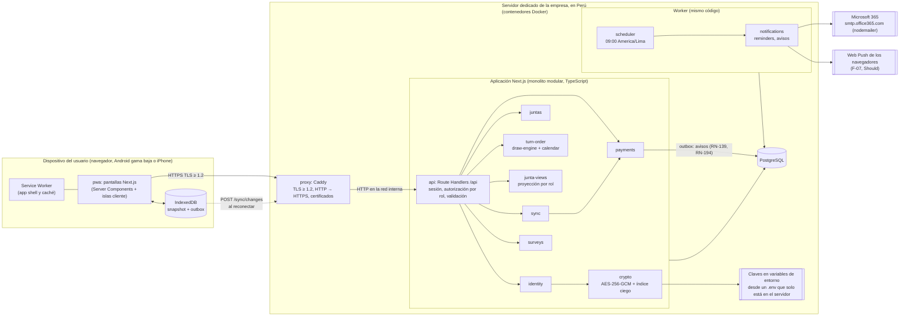
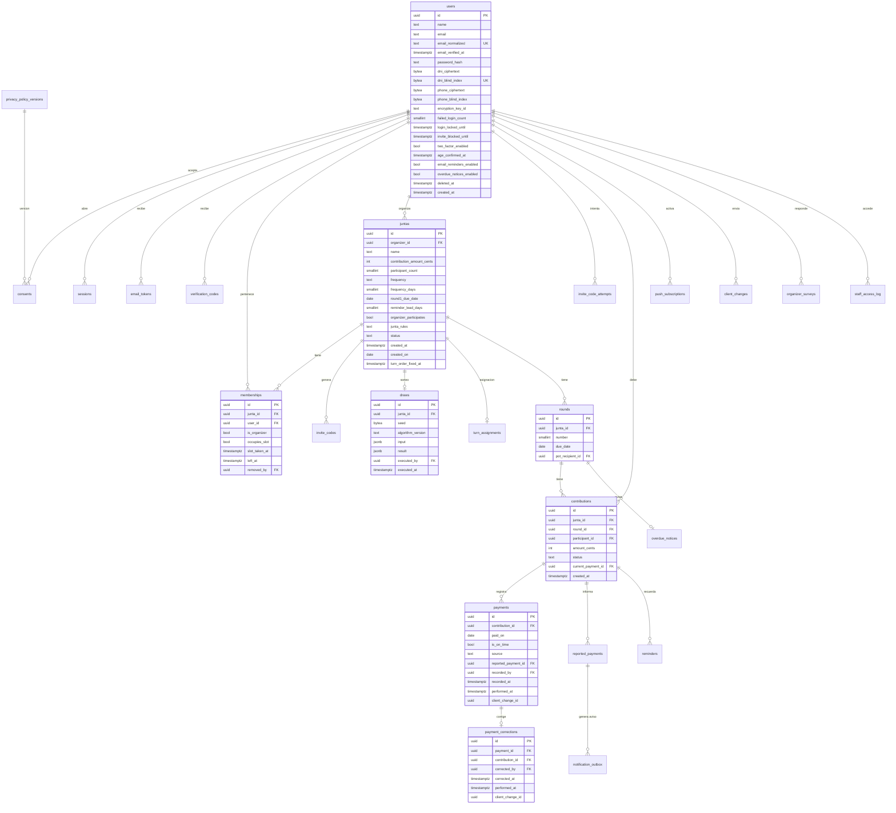
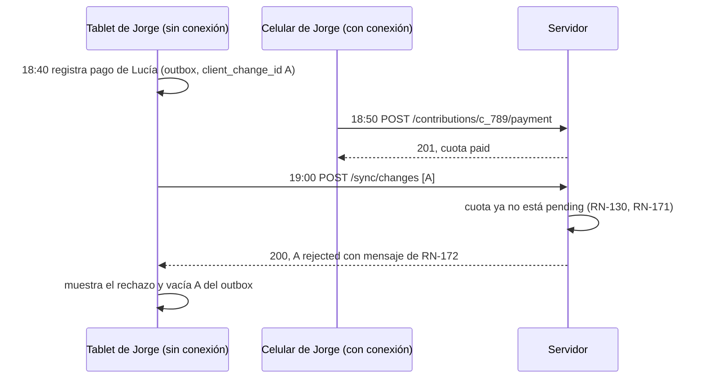

# Arquitectura de Mi Junta

Versión: 0.4
Fecha: 14/11/2026
Estado: Revisado

Fuente: 00-constitucion.md v0.4, 01-project-brief.md v0.4, 02-alcance.md v0.4, 03-reglas-de-negocio.md v0.4, 04-glosario.md v0.4, 05-preguntas-abiertas.md v0.4 y 06-user-stories.md v0.4. Lo redactó el Agente Architect (prompts/clase2/03-architect.xml). La v0.4 incorpora las decisiones del Product Owner del 14/11/2026: servidor dedicado en la nube bajo control de la empresa, correo por SMTP, ADR aceptadas y dependencias aprobadas. También incorpora la segunda ronda (PREG-049 a PREG-054): servidor en Perú, contenedores Docker, claves en variables de entorno y correo con `nodemailer` por `smtp.office365.com`. Además resuelve los hallazgos críticos y mayores de auditorias/qa-clase2.md, con autorización del Product Owner del 14/11/2026: componente `proxy` para TLS, herramientas del pipeline, convención Gherkin (PREG-055), RN-212, RN-117 aclarada, reparto del pozo en el sorteo, HU-019 en la trazabilidad y correcciones de trazabilidad.

**Cómo leer este documento:**
- Las versiones exactas se fijan el día en que empieza el desarrollo (PRINCIPIO-009). Las dependencias de la sección 6.3 quedaron aprobadas el 14/11/2026, salvo las que esa tabla marca como pendientes; cualquier otra necesita aprobación humana (PRINCIPIO-012 e y h).
- El Product Owner aprobó el 14/11/2026 las 9 ADR, incluidas las que tocan el sorteo, el cifrado, la autenticación y los permisos (ADR-004, ADR-005, ADR-006 y ADR-009), como exige PRINCIPIO-012.
- Los identificadores de código, tablas, columnas, rutas y códigos de error van en inglés, salvo `junta` (PRINCIPIO-002). Los nombres siguen la columna "Identificador en código" de 04-glosario.md.
- Los ejemplos JSON usan los datos de ejemplo de 03-reglas-de-negocio.md. Los identificadores como `user_456` o `c_789` son legibles para el ejemplo; en la base de datos son UUID.
- Los textos que ve el usuario en las respuestas de error son los del catálogo §2.9 de 03-reglas-de-negocio.md. Desde 03-reglas-de-negocio.md v0.3, el catálogo tiene el texto de todos los rechazos que ve el usuario; `message` solo va en `null` en errores que la app nunca muestra (por ejemplo, `NOT_ORGANIZER`, porque la app no ofrece la acción).
- Este documento no crea reglas de negocio. Cada comportamiento cita la RN que lo exige.

---

## 1. Overview del sistema

### 1.1 Descripción

Mi Junta es una aplicación web progresiva (PWA) hecha con Next.js y TypeScript sobre PostgreSQL, que registra juntas, el orden de turnos y los pagos que se hacen fuera de ella, sin mover dinero (PRINCIPIO-004, PRINCIPIO-009). Se despliega como un monolito modular en un servidor dedicado en la nube, bajo control total de la empresa: una sola aplicación Next.js sirve las pantallas y la API, un proceso *worker* del mismo código ejecuta las tareas programadas, como los recordatorios de las 09:00 en America/Lima, y PostgreSQL corre en el mismo servidor. El servidor es la única autoridad sobre las reglas de negocio: valida cada acción de gestión (RN-077), filtra los datos según el rol de quien los pide (PRINCIPIO-006) y aplica en orden los cambios hechos sin conexión (RN-087, RN-171). En el dispositivo, un Service Worker y una base IndexedDB permiten abrir la app sin red, consultar todas las juntas del usuario y registrar acciones de pagos que se envían al reconectar (RN-170, RN-175). El diseño apunta a celulares Android de gama baja con conexión intermitente: poco JavaScript en el cliente, respuestas compactas y sincronización idempotente que tolera cortes a mitad de una petición.

### 1.2 Diagrama de arquitectura



### 1.3 Principios de diseño

| # | Principio | Qué significa en el diseño | Origen |
|---|---|---|---|
| D-1 | El servidor es la autoridad | Toda regla de 03-reglas-de-negocio.md con sujeto "el sistema" se valida en el servidor. La app repite las validaciones de formulario solo para dar respuesta inmediata al usuario. | RN-077, PRINCIPIO-006 |
| D-2 | Sin conexión, pero acotado | Sin red la app consulta todo y solo encola las cinco acciones de pagos de RN-170. Las demás acciones muestran "Necesita conexión a internet para hacer esto.". | PRINCIPIO-009, RN-170 |
| D-3 | Los hechos auditables solo se agregan | El sorteo, la asignación manual, los pagos, las correcciones, los pagos informados y los consentimientos se guardan como filas que nunca se actualizan ni se borran. | PRINCIPIO-008, RN-035, RN-058, RN-128, RN-134, RN-169 |
| D-4 | Privacidad por proyección | Cada respuesta se arma con una lista blanca de campos según el rol de quien pide. Nunca se envía un dato para que la interfaz lo oculte. | PRINCIPIO-006, RN-022, RN-023, RN-118 a RN-121 |
| D-5 | Dinero exacto y tiempo explícito | Montos en céntimos enteros; instantes en `timestamptz`; fechas de calendario en `date`, calculadas con la zona America/Lima a través de un único módulo de reloj. | PRINCIPIO-003, RN-040 |
| D-6 | Lógica crítica en módulos puros | El sorteo y el cálculo de cuotas y vencimientos son funciones puras, sin acceso a red ni a base de datos, para lograr 100 % de cobertura de líneas y ramas. | PRINCIPIO-011, RN-124 |
| D-7 | Mínimo de dependencias y servicios | Se prefieren las APIs de la plataforma (`node:crypto`, Service Worker, IndexedDB, Web Push) antes que librerías, y el servidor propio antes que servicios externos. Cada dependencia nueva pasa por aprobación. | PRINCIPIO-012 e y h |
| D-8 | Presupuesto para gama baja | Cada pantalla pesa como máximo 170 KB de JavaScript comprimido y se mide con Lighthouse en perfil móvil, que simula una red móvil lenta y una CPU más lenta que la de escritorio. El pipeline falla si supera los límites. | PRINCIPIO-010, 02-alcance.md §5 |

---

## 2. Componentes principales

### 2.1 Resumen

| Componente | Responsabilidad | Tecnología | HU que implementa |
|---|---|---|---|
| `pwa` (cliente) | Pantallas, formularios, Service Worker, snapshot local, cola de cambios sin conexión (*outbox*), indicador de cambios sin enviar | Next.js (App Router, React Server Components), TypeScript, Service Worker, IndexedDB | HU-001 a HU-018 (pantallas); HU-009, HU-010 y HU-015 (sin conexión) |
| `api` | Route Handlers bajo `/api`: sesión, protección CSRF, validación de entrada, autorización por rol, formato de errores, límites de frecuencia | Next.js Route Handlers, TypeScript | Todas las HU |
| `identity` | Cuentas, consentimiento, mayoría de edad y versiones de la política, verificación del correo, inicio de sesión, bloqueo por intentos, recuperación de contraseña, sesiones, segundo factor, preferencias de recordatorios y borrado de la cuenta | TypeScript, PostgreSQL, `argon2` | HU-001, HU-002, HU-003, HU-011 (preferencias), HU-017 |
| `crypto` | Cifrado AES-256-GCM del DNI y el celular, índice ciego HMAC-SHA256 para la unicidad del DNI y del celular, hash de tokens y códigos, lectura de las claves desde variables de entorno (PREG-050) | `node:crypto` (sin dependencias) | HU-001, HU-019 (y HU-003 para los códigos) |
| `juntas` | Crear y editar juntas, máquina de estados de la junta, códigos de invitación, unirse, salir y quitar participantes | TypeScript, PostgreSQL (bloqueo de fila para el último cupo) | HU-004, HU-005, HU-013, HU-014, HU-017 |
| `turn-order` | Sorteo `fisher-yates-v1`, asignación manual, generación de rondas y cuotas, cálculo de vencimientos | TypeScript; submódulos puros `draw-engine` y `calendar`; `node:crypto` | HU-004 (validación del aviso), HU-006, HU-007 |
| `payments` | Registrar y desmarcar pagos, pagos informados, confirmar y rechazar, clasificación "a tiempo" o "atrasado", transición a "Terminada" | TypeScript, PostgreSQL | HU-008, HU-009, HU-015 |
| `sync` | Recibir los cambios hechos sin conexión, aplicarlos en orden, idempotencia por `client_change_id`, resultado por cambio; entregar el snapshot | TypeScript, PostgreSQL | HU-009, HU-010, HU-015 |
| `junta-views` | Proyección de lectura por rol: detalle de la junta, miembros, cuotas del organizador, registro del sorteo y de la asignación manual, ronda actual y próxima cuota | TypeScript, consultas SQL de solo lectura | HU-006 (ver sorteo), HU-007 (ver asignación), HU-008 (pantalla "Pagos"), HU-010 |
| `surveys` | Mostrar y guardar la encuesta de KPI-05 al crear la primera junta y a los 3 meses | TypeScript, PostgreSQL | HU-018 |
| `notifications` | Planificar y enviar recordatorios, avisos al organizador y al participante, aviso de cuotas vencidas, suscripciones push, conteo de envíos, correos de la cuenta | TypeScript en el worker; adaptador SMTP (`nodemailer` con `smtp.office365.com`) y adaptador Web Push (`web-push`) | HU-001 y HU-002 (correos de la cuenta), HU-003 (código), HU-009 (avisos), HU-011, HU-012, HU-016 |
| `scheduler` (worker) | Ejecutar a las 09:00:00 en America/Lima el job de recordatorios y el de avisos de cuotas vencidas, y procesar la cola de avisos | Proceso Node.js del mismo repositorio en el servidor dedicado, con la zona del cron fijada en America/Lima | HU-011, HU-012, HU-016 |
| PostgreSQL | Persistencia, restricciones de unicidad, triggers de inmutabilidad, transacciones | PostgreSQL en el servidor dedicado, operado por el líder técnico (R-14) | Todas las HU |
| `proxy` | Terminar TLS 1.2 o superior, redirigir HTTP a HTTPS, obtener y renovar el certificado del dominio y reenviar las peticiones a la app por la red interna con `X-Forwarded-Proto` | Caddy en su propio contenedor Docker, con certificados de Let's Encrypt (ACME) | Todas las HU (PRINCIPIO-005) |

### 2.2 Detalle por componente

#### `pwa` (cliente)
- **Renderizado:** las pantallas de lectura se renderizan en el servidor (React Server Components) para enviar poco JavaScript. Solo los formularios, el indicador de conexión y la cola sin conexión son componentes cliente.
- **App shell:** el Service Worker guarda en caché el HTML base, los estilos y el JavaScript de las pantallas de consulta, para que la app abra sin red y no muestre la pantalla de error del navegador (PRINCIPIO-009).
- **Snapshot local:** IndexedDB guarda la última respuesta de `GET /sync/snapshot`, con todas las juntas del usuario (RN-175), y la hora `last_synced_at`. Sin conexión, la app muestra "Sin conexión. Última sincronización: 20/01/2027 18:45" (RN-094, RN-095, RN-093, RN-177).
- **Outbox:** cada acción de RN-170 hecha sin conexión se guarda en IndexedDB con un `client_change_id` (UUID v4 generado en el dispositivo), el tipo, los datos, el `performed_at` del dispositivo y el `user_id` dueño del cambio. La app muestra "1 cambio sin enviar." o "{n} cambios sin enviar." (RN-174).
- **Cerrar sesión:** si hay cambios sin enviar, la app muestra "Hay cambios sin enviar ({n}). Si cierra sesión ahora, se perderán." (RN-198); al confirmar, borra de IndexedDB el snapshot y el outbox (RN-197). El snapshot no se cifra aparte, porque no trae datos personales de otros miembros (PREG-008, resuelta).
- **Envío:** al detectar conexión (evento `online`, `visibilitychange` o una petición que vuelve a responder), la app envía el outbox con `POST /sync/changes` en el orden en que se hicieron (RN-087). No se confía solo en `navigator.onLine`: una petición que falla por red se trata como "sin conexión". La API Background Sync se usa donde existe (Chrome para Android) y no se depende de ella, porque Safari no la tiene.
- **Sesión vencida:** si el envío recibe `401`, el outbox se conserva y se envía después de que el mismo usuario vuelva a iniciar sesión (RN-176). Un cambio nunca se envía con la sesión de otro usuario.
- **Acciones que exigen conexión:** los botones de las acciones que no están en RN-170 (crear cuenta, iniciar sesión, crear o editar la junta, regenerar el código, unirse, salir, sortear, asignar el orden, segundo factor) quedan deshabilitados sin red con "Necesita conexión a internet para hacer esto." (RN-170), y el sorteo con "Necesita conexión a internet para ejecutar el sorteo." (RN-029).
- **Crear cuenta:** la casilla de consentimiento y la de mayoría de edad aparecen desmarcadas (RN-088), y "Crear cuenta" sigue deshabilitado mientras la casilla de consentimiento esté desmarcada (RN-089).
- **Formatos:** un único módulo `format` muestra montos como `S/ 1,250.50` (RN-091), fechas como DD/MM/AAAA (RN-092) y horas como HH:MM de 24 h (RN-177), convertidas a America/Lima (RN-093).

#### `api`
- **Rutas:** todas bajo `/api` (sección 4). Las rutas que citan las HU (`/accounts`, `/sessions`, `/juntas/{id}/members`, `/juntas/{id}/draw`, `/contributions/{id}/payment`, `/contributions/{id}/report`) se conservan tal cual, relativas a `/api`.
- **Cadena de cada petición:** TLS → sesión (cookie) → protección CSRF → validación del esquema → autorización (miembro u organizador) → caso de uso del módulo → proyección por rol → respuesta.
- **Autorización:** un único guardián `requireJuntaRole(juntaId, "member" | "organizer")` se aplica a cada ruta de junta. Las acciones de gestión de 04-glosario.md exigen `organizer` (RN-077). Quien no es miembro recibe `403` (RN-024).
- **Validación:** un esquema por ruta valida tipos y formatos antes de llegar al dominio. El dominio vuelve a validar las reglas de negocio, para que el `POST /sync/changes` y las rutas individuales apliquen exactamente las mismas reglas.

#### `identity`
- Crea cuentas con consentimiento y confirmación de mayoría de edad obligatorios (RN-082 a RN-084, RN-146 a RN-151, RN-180, RN-181), envía y valida el enlace de verificación (RN-152 a RN-154), bloquea crear o unirse a juntas mientras el correo no esté verificado (RN-153).
- Inicia sesión con bloqueo de 900 s tras 5 fallos seguidos (RN-075, RN-076, RN-160, RN-161), recupera la contraseña con enlace de 3600 s (RN-155 a RN-158) y cierra sesiones tras 30 días sin peticiones (RN-159).
- Guarda cada aceptación de la política como una fila nueva (RN-168, RN-169). Compara el correo del inicio de sesión sin distinguir mayúsculas (RN-191).
- Guarda la preferencia de recordatorios por correo (RN-187) y borra la cuenta según RN-182 a RN-186 (HU-017).
- Segundo factor (HU-003, Should): códigos de 6 dígitos de un solo uso, 600 s de validez, 5 intentos y un máximo de 5 códigos en 900 s (RN-078 a RN-081, RN-162 a RN-167).

#### `crypto`
- `encryptField(plaintext) → {ciphertext, iv, key_id}` con AES-256-GCM, IV aleatorio de 96 bits por valor y el `key_id` guardado junto al dato para poder rotar claves (PRINCIPIO-005).
- `blindIndex(dni) → HMAC-SHA256(clave_indice, dni)`, con una clave distinta de la de cifrado, para buscar duplicados sin descifrar (RN-151).
- Las claves llegan al contenedor como variables de entorno, desde un archivo `.env` que solo existe en el servidor, está en `.gitignore` y solo lo lee su dueño. Se leen al iniciar el proceso y nunca se escriben en la base de datos, el repositorio ni los logs (PRINCIPIO-005, PREG-050).
- El descifrado es una función privada del módulo que solo usa el proceso de la app; ninguna ruta, script ni pantalla lo expone (RN-202, HU-019).

#### `juntas`
- Crea la junta en estado `open` (RN-099) con todas las validaciones de RN-002 a RN-012, RN-096 y RN-097, guarda la cuota en céntimos enteros convertida desde el texto sin `float` (RN-040, ADR-008), y le asigna un código de invitación (RN-015, RN-016).
- Mantiene la máquina de estados `open` → `full` → `in_progress` → `finished` (RN-099 a RN-104), siempre dentro de la misma transacción que la causa.
- Unirse por código: quita los espacios y pasa a mayúsculas el código (RN-190); un código anulado no suma al límite de RN-117 (RN-192). Bloquea la fila de la junta (`SELECT … FOR UPDATE`) para que, si dos personas piden el último cupo al mismo tiempo, solo una lo ocupe (RN-018).
- Edición antes de fijar el orden con las mismas validaciones que al crear (RN-106 a RN-109); después solo el nombre (RN-110). Si el organizador pasa a "No participo", su membresía queda con `occupies_slot = false`, se libera su cupo y la junta vuelve a `open` si estaba `full` (RN-212, RN-101). Si vuelve a "Sí participo", ocupa un cupo libre (RN-109) con un `slot_taken_at` nuevo (RN-123).
- Límite de códigos inválidos (RN-117, PREG-057): al registrar un intento `invalid`, si la cuenta suma 10 `invalid` en los 3600 s anteriores (incluido ese), se guarda `users.invite_blocked_until = attempted_at + 3600 s`. Mientras `now() < invite_blocked_until`, API-013 responde `429` antes de validar el código y no registra el intento.

#### `turn-order`
- `draw-engine` (puro): implementa `fisher-yates-v1` exactamente como el anexo A (RN-124), con `HMAC-SHA256` de `node:crypto` y muestreo por rechazo. Se prueba con el vector del anexo A.
- `calendar` (puro): calcula el vencimiento de cada ronda para semanal, quincenal, mensual y cada N días, incluido el último día del mes y el 29 de febrero (RN-046 a RN-050), y valida el aviso previo contra el periodo (RN-012, RN-098).
- Caso de uso `fixTurnOrder`: en una sola transacción bloquea la junta, comprueba los cupos llenos (RN-027, RN-126), que el orden no esté fijado (RN-028, RN-125) y que la ronda 1 no esté vencida (RN-122); arma la lista de entrada solo con las membresías que ocupan cupo, ordenadas por `slot_taken_at`, sin el organizador que no participa (RN-030, RN-123); genera la semilla con `crypto.randomBytes(32)` (RN-031); guarda el registro inmutable (RN-034, RN-035); crea las rondas y asigna `pot_recipient_id` de la ronda k al participante en la posición k de `result` (RN-036, RN-037); crea las cuotas `pending` (RN-013, RN-042 a RN-045); anula el código (RN-019, RN-129) y pasa la junta a `in_progress` (RN-102).

#### `payments`
- Registrar: solo sobre una cuota `pending` (RN-130), con fecha de pago no futura ni anterior a la creación de la junta (RN-054, RN-132), y clasifica el pago (RN-055, RN-056). Permite rondas futuras (RN-133).
- Desmarcar: solo sobre una cuota `paid` (RN-131), guarda una corrección y conserva el pago original (RN-057 a RN-059). La fecha de pago nunca se edita (RN-134).
- Pago informado (HU-009, Should): RN-060 a RN-065 y RN-135 a RN-139. Al informar, escribe en la misma transacción un aviso en la tabla `notification_outbox` (RN-139).
- Después de cada cambio recalcula si la junta pasa a `finished` o vuelve a `in_progress` (RN-103, RN-104).
- Cada caso de uso es el mismo para la ruta individual y para `POST /sync/changes`.

#### `sync`
- `GET /sync/snapshot`: entrega, con la proyección por rol, todas las juntas del usuario (RN-175) y la hora del servidor, que la app guarda como `last_synced_at`. Responde con `ETag`, y si nada cambió devuelve `304` para ahorrar datos móviles.
- `POST /sync/changes`: recibe una lista ordenada de cambios, los aplica uno por uno, cada uno en su propia transacción y en el orden recibido (RN-087), guarda el `performed_at` del dispositivo (RN-173) y rechaza el que ya no cumple las reglas (RN-171). La regla de conflicto es la de PREG-005 (resuelta): no se reordena por `performed_at` entre dispositivos; vale el estado del servidor al momento de aplicar el cambio.
- Idempotencia: si llega un `client_change_id` que ya se procesó (por ejemplo, porque se cortó la red antes de recibir la respuesta), devuelve el mismo resultado guardado sin aplicar el cambio dos veces.

#### `junta-views`
- Calcula la ronda actual y la próxima cuota con la fecha de hoy en America/Lima (definiciones de 04-glosario.md, RN-022, RN-119).
- Tiene un serializador por rol: `memberView`, `organizerView` y `nonParticipantOrganizerView` (RN-022, RN-118, RN-120). Ninguno incluye `email`, `phone` ni `dni` de otra persona (RN-023, PRINCIPIO-006).
- Entrega a cada participante su número de turno y el estado de cada una de sus cuotas (RN-025, RN-026, API-023), y el pozo como `contribution_amount_cents × participant_count` (RN-041).
- Ninguna vista, ruta ni exportación entrega pagos para evaluar créditos (RN-203, NO-04, HU-019).

#### `notifications` y `scheduler`
- Job diario `daily-reminders`: arranca a las 09:00:00 en America/Lima, decide qué cuotas reciben recordatorio hoy (sección 3.4) y debe terminar de enviarlos antes de las 09:15:00 (RN-066).
- Cada recordatorio se guarda en `reminders` con una restricción única por cuota y día, para que volver a ejecutar el job no duplique envíos.
- Un correo y su push se guardan como un solo recordatorio (RN-142, Should desde 03-reglas-de-negocio.md v0.4), y cuenta como enviado cuando el servicio de correo o el servicio push lo acepta (RN-143).
- Correos de la cuenta: el de verificación y el de recuperación usan el asunto y el cuerpo de §2.9 de 03-reglas-de-negocio.md (RN-152, RN-155) y se envían aunque el usuario haya desactivado los recordatorios (RN-188).
- El contenido trae la junta, la ronda, el monto y el vencimiento (RN-144), trata de "usted" (RN-090) y no menciona a otros miembros (RN-145).
- Aviso al organizador (RN-139) y aviso de pago rechazado al participante (RN-194): el worker procesa `notification_outbox` en cuanto se confirma la transacción.
- Job diario `overdue-notices` (F-16): a las 09:00:00 envía al organizador que no lo desactivó (RN-209) un correo por cada junta con una ronda que venció ayer y tiene cuotas `pending` (RN-196). Se guarda en `overdue_notices` con `UNIQUE (round_id)`.
- Si el servidor SMTP no acepta un correo, se reintenta hasta las 09:15:00 (RN-199). Se respeta la preferencia de RN-187, salvo para los correos de la cuenta (RN-188).

#### `proxy`
- Caddy en su propio contenedor es el único punto expuesto a internet (puertos 80 y 443). Termina TLS 1.2 o superior, redirige HTTP a HTTPS y obtiene y renueva el certificado del dominio con Let's Encrypt (PRINCIPIO-005).
- Reenvía las peticiones a la app por la red interna con `X-Forwarded-Proto`; la app agrega HSTS y solo confía en ese encabezado cuando viene del `proxy` (§4.1).

#### PostgreSQL y operación
- Los hechos auditables (`draws`, `turn_assignments`, `payments`, `payment_corrections`, `consents`) tienen el trigger que rechaza `UPDATE` y `DELETE`, y el rol de la app no tiene esos privilegios (RN-035, RN-058, RN-128, RN-134, ADR-003).
- Solo el líder técnico entra a producción, por SSH con su llave y solo para un incidente (RN-200). El script de acceso de `ops/` pide el incidente y escribe la fila de `staff_access_log` antes de abrir la consola (RN-201, T-027, HU-019).

---

## 3. Modelo de datos

### 3.1 Diagrama entidad-relación



El diagrama muestra las 24 tablas y sus relaciones, pero solo los atributos de las tablas principales; los de las tablas de soporte están en la sección 3.2.

### 3.2 Entidades y atributos clave

**Convenciones:** tablas en plural y `snake_case`, columnas en singular (04-glosario.md). Toda clave primaria es `uuid`. Todo instante es `timestamptz` y toda fecha de calendario es `date` (PRINCIPIO-003). Todo monto es `integer` en céntimos con sufijo `_cents` (RN-040); el máximo, `500000 × 50 = 25000000` para un pozo, cabe en `integer`.

#### Identidad y consentimiento

| Tabla | Atributos clave | Restricciones y notas | RN |
|---|---|---|---|
| `users` | `name` (2 a 80), `email`, `email_normalized` (en minúsculas), `email_verified_at`, `password_hash`, `dni_ciphertext`, `dni_blind_index`, `phone_ciphertext`, `phone_blind_index`, `encryption_key_id`, `failed_login_count`, `login_locked_until`, `invite_blocked_until` (RN-117), `two_factor_enabled`, `age_confirmed_at`, `email_reminders_enabled` y `overdue_notices_enabled` (por defecto `true`), `deleted_at` | `UNIQUE (email_normalized)`, `UNIQUE (dni_blind_index)` y `UNIQUE (phone_blind_index)` donde no son nulos. DNI y celular nulos permitidos. No existen columnas de fecha de nacimiento ni de foto. Al borrar la cuenta, `name`, `email`, `password_hash`, el DNI y el celular quedan en nulo y `deleted_at` se llena; las vistas muestran "Participante eliminado". | RN-146 a RN-151, RN-075, RN-149, RN-180, RN-181, RN-183, RN-185, RN-187, RN-209 |
| `privacy_policy_versions` | `version` (PK, por ejemplo `"1.0"`), `published_at`, `is_current` | Una sola fila con `is_current = true`. El texto de la política está bloqueado por PREG-001. | RN-168 |
| `consents` | `user_id`, `policy_version`, `accepted_at` | Solo se agregan filas: aceptar la 1.1 conserva la fila de la 1.0. `policy_version` y `consent_accepted_at` de la API salen de la fila más reciente. | RN-082 a RN-084, RN-169 |
| `sessions` | `user_id`, `token_hash`, `created_at`, `last_seen_at`, `revoked_at` | Se considera cerrada si `now() − last_seen_at > 2592000 s`. Cambiar la contraseña revoca las demás. | RN-158, RN-159 |
| `email_tokens` | `user_id`, `purpose` (`email_verification` o `password_reset`), `token_hash`, `expires_at`, `used_at`, `revoked_at` | Verificación: 86,400 s; recuperación: 3600 s. Pedir uno nuevo revoca el anterior del mismo propósito. | RN-152, RN-154, RN-155, RN-157 |
| `verification_codes` (F-11) | `user_id`, `purpose` (`login`, `activate`, `deactivate`), `code_hmac`, `sent_at`, `expires_at`, `failed_attempts`, `used_at`, `revoked_at` | Vence a los 600 s, se anula a los 5 intentos fallidos o al enviar otro. Se cuentan los envíos de los últimos 900 s. | RN-079 a RN-081, RN-162 a RN-164 |

#### Juntas y membresías

| Tabla | Atributos clave | Restricciones y notas | RN |
|---|---|---|---|
| `juntas` | `organizer_id`, `name` (3 a 60), `contribution_amount_cents` (1000 a 500000, múltiplo de 10), `participant_count` (2 a 50), `frequency` (`weekly`, `every_15_days`, `monthly`, `every_n_days`), `frequency_days` (2 a 60, solo para `every_n_days`), `round1_due_date`, `reminder_lead_days` (1 a 7), `organizer_participates`, `junta_rules` (F-09), `status` (`open`, `full`, `in_progress`, `finished`), `created_at`, `created_on`, `turn_order_fixed_at` | `CHECK` para cada rango. `created_on` es la fecha de creación en America/Lima, usada por RN-009 y RN-132. | RN-002 a RN-012, RN-096, RN-099 a RN-110 |
| `memberships` | `junta_id`, `user_id`, `is_organizer`, `occupies_slot`, `slot_taken_at`, `left_at`, `removed_by` | `UNIQUE (junta_id, user_id) WHERE left_at IS NULL`. El organizador que no participa tiene `occupies_slot = false`. Salir o ser quitado llena `left_at` y libera el cupo. `slot_taken_at` ordena la lista de entrada del sorteo. | RN-006, RN-021, RN-111 a RN-115, RN-123 |
| `invite_codes` | `code` (PK, 8 caracteres), `junta_id`, `created_at`, `revoked_at`, `revoke_reason` (`regenerated`, `turn_order_fixed`) | La clave primaria sobre todos los códigos, vigentes o no, impide reutilizar uno. `UNIQUE (junta_id) WHERE revoked_at IS NULL`: un solo código vigente por junta. | RN-015, RN-016, RN-019, RN-020, RN-129 |
| `invite_code_attempts` | `user_id`, `attempted_at`, `outcome` (`joined`, `already_member`, `invalid`, `revoked`, `full`) | Permite contar los códigos inválidos de los últimos 3600 s. Al llegar al décimo, se fija `users.invite_blocked_until` 3600 s después; los intentos durante el bloqueo no se registran (PREG-057). Solo `invalid` cuenta para el límite (RN-192). | RN-116, RN-117, RN-192 |

#### Orden de turnos, rondas y cuotas

| Tabla | Atributos clave | Restricciones y notas | RN |
|---|---|---|---|
| `draws` | `junta_id`, `seed` (32 bytes), `algorithm_version` (`fisher-yates-v1`), `input` (UUID ordenados por `slot_taken_at`), `result`, `executed_by`, `executed_at` | `UNIQUE (junta_id)`. Solo inserción (sección 3.3). | RN-031 a RN-035, RN-123, RN-124 |
| `turn_assignments` (F-10) | `junta_id`, `result`, `assigned_by`, `assigned_at` | `UNIQUE (junta_id)`. Solo inserción. Un trigger impide que una junta tenga a la vez una fila en `draws` y otra aquí. | RN-038, RN-039, RN-125, RN-128 |
| `rounds` | `junta_id`, `number`, `due_date`, `pot_recipient_id` | `UNIQUE (junta_id, number)`. El turno de un participante es el `number` de la ronda donde es `pot_recipient_id`. El pozo no se guarda: se calcula como `contribution_amount_cents × participant_count`. | RN-013, RN-036, RN-037, RN-041, RN-046 a RN-050 |
| `contributions` | `junta_id`, `round_id`, `participant_id`, `amount_cents`, `status` (`pending`, `awaiting_confirmation`, `paid`), `current_payment_id`, `created_at` | `UNIQUE (round_id, participant_id)`. `status` y `current_payment_id` son las únicas columnas que cambian, y solo dentro de los casos de uso de `payments`. | RN-042 a RN-045, RN-053, RN-059, RN-060, RN-062, RN-063 |

#### Pagos

| Tabla | Atributos clave | Restricciones y notas | RN |
|---|---|---|---|
| `payments` | `contribution_id`, `paid_on`, `is_on_time`, `source` (`organizer` o `reported_confirmation`), `reported_payment_id`, `recorded_by`, `recorded_at`, `performed_at`, `client_change_id` | Solo inserción. El pago vigente es el último sin corrección (04-glosario.md). No existe ruta para editarlo. | RN-052, RN-055, RN-056, RN-133, RN-134, RN-138, RN-173 |
| `payment_corrections` | `payment_id`, `contribution_id`, `corrected_by`, `corrected_at`, `performed_at`, `client_change_id` | `UNIQUE (payment_id)`: un pago se corrige una sola vez. Solo inserción. | RN-057, RN-058 |
| `reported_payments` (F-08) | `contribution_id`, `reported_by`, `reported_paid_on`, `reported_at`, `performed_at`, `resolution` (`confirmed`, `rejected` o nulo), `resolved_by`, `resolved_at` | Un trigger solo permite pasar `resolution` de nulo a un valor, una vez. No tiene columna de archivo. | RN-060 a RN-065, RN-137, RN-138 |
| `client_changes` | `client_change_id` (PK), `user_id`, `type`, `performed_at`, `received_at`, `outcome` (`applied` o `rejected`), `error_code`, `response` | Guarda el resultado de cada cambio sin conexión para responder igual si llega repetido. | RN-171 a RN-173 |

#### Notificaciones

| Tabla | Atributos clave | Restricciones y notas | RN |
|---|---|---|---|
| `reminders` | `contribution_id`, `kind` (`lead`, `due`, `after_due`), `scheduled_on`, `email_status` (`accepted`, `failed`, `expired`), `email_accepted_at`, `push_status`, `provider_message_id` | `UNIQUE (contribution_id, scheduled_on)`. Los recordatorios posteriores al vencimiento que cuentan para el máximo de 5 son las filas `after_due` con `email_status = accepted`. | RN-066 a RN-073, RN-140 a RN-143 |
| `overdue_notices` (F-16) | `junta_id`, `round_id`, `organizer_id`, `scheduled_on`, `email_status`, `email_accepted_at` | `UNIQUE (round_id)`: un solo aviso por ronda. | RN-196 |
| `notification_outbox` | `type` (`organizer_notice` o `rejection_notice`), `recipient_user_id`, `reported_payment_id`, `status`, `attempts`, `created_at`, `sent_at` | Se escribe en la misma transacción que el pago informado. No copia datos personales: el worker arma el mensaje al enviarlo. | RN-139 |
| `push_subscriptions` (F-07) | `user_id`, `endpoint`, `p256dh`, `auth`, `created_at`, `revoked_at` | Se revoca si el servicio push responde que la suscripción ya no existe, o si el usuario desactiva el push. | RN-073 |

#### Medición y operación

| Tabla | Atributos clave | Restricciones y notas | RN |
|---|---|---|---|
| `organizer_surveys` (F-18) | `organizer_id`, `wave` (`initial` o `three_months`), `hours_per_month`, `manual_reminders_per_month`, `forwards_by_whatsapp`, `answered_at` | `UNIQUE (organizer_id, wave)`. No guarda ningún dato personal. | RN-204 a RN-206 |
| `staff_access_log` | `accessed_by`, `accessed_at`, `incident`, `scope` | Solo inserción. Se escribe desde el procedimiento de acceso a producción del servidor, no desde la app. | RN-200, RN-201 |

### 3.3 Relaciones e invariantes

- Un usuario organiza muchas juntas y es miembro de muchas; cada junta tiene exactamente un organizador (`juntas.organizer_id` y una membresía con `is_organizer = true`) que no puede salir (RN-115).
- Cupos ocupados = membresías con `occupies_slot = true` y `left_at IS NULL`. Nunca supera `participant_count`; se comprueba con la fila de la junta bloqueada (RN-018, RN-100).
- Una junta tiene a lo sumo un orden de turnos: una fila en `draws` o una en `turn_assignments`, nunca las dos (RN-125).
- Rondas y cuotas existen solo si `status` es `in_progress` o `finished` (RN-105). Hay `participant_count` rondas, y cada ronda tiene una cuota por participante, incluido su receptor del pozo (RN-013, RN-042).
- `contributions.status = 'paid'` si y solo si `current_payment_id` apunta a un pago sin corrección. Un test de integración lo verifica después de cada caso de uso de pagos.
- **Inmutabilidad (PRINCIPIO-008, RN-035, RN-058, RN-128, RN-134):** `draws`, `turn_assignments`, `payments`, `payment_corrections` y `consents` tienen un trigger `BEFORE UPDATE OR DELETE` que lanza un error, y el rol de base de datos de la aplicación no tiene privilegio `UPDATE` ni `DELETE` sobre ellas. Así, un `UPDATE turn_assignments SET result = …` falla aunque venga de un error de código.

### 3.4 Reglas de cálculo que el modelo soporta

- **Hoy en America/Lima:** un único módulo `clock` entrega `nowInstant()` y `todayInLima()`, y se inyecta en los tests para fijar instantes como `2026-11-20T19:30:12-05:00`. Se usa la base de zonas horarias (`America/Lima`), no un desfase fijo.
- **Ronda actual:** la ronda de número más bajo con `due_date >= todayInLima()`; si todas vencieron, la última (04-glosario.md, PREG-039).
- **Recordatorios del día** (para cada cuota `pending` de una junta `in_progress`, creada antes del inicio del job, con `d = due_date`, `t = todayInLima()`):
  - `lead` si `t = d − reminder_lead_days` (RN-068);
  - `due` si `t = d` (RN-069);
  - `after_due` si `t > d`, `(t − d)` es par y hay menos de 5 `after_due` aceptados por correo o por push (RN-070, RN-071, RN-143).
  - El correo sale solo si `email_reminders_enabled` es `true` (RN-067, RN-187), y el push solo si hay una suscripción activa (RN-073). Si ninguno de los dos se acepta, el recordatorio no cuenta.
  - Las cuotas `paid` y `awaiting_confirmation` no entran (RN-072, RN-140). Una cuota creada después del inicio del job de hoy no recibe el recordatorio de hoy (RN-141).

### 3.5 Notas de seguridad del modelo

- **Cifrado en reposo:** `dni_ciphertext` y `phone_ciphertext` se cifran en la aplicación con AES-256-GCM; la clave llega como variable de entorno desde el `.env` del servidor y nunca está en la base de datos ni en el repositorio (PREG-050). `SELECT dni_ciphertext FROM users` devuelve bytes cifrados (PRINCIPIO-005).
- **Unicidad sin descifrar:** `dni_blind_index` y `phone_blind_index` son HMAC-SHA256 con una clave propia, distinta de la de cifrado, y tienen `UNIQUE` (RN-151, RN-180).
- **Contraseñas:** `password_hash` con Argon2id, m = 19 MiB, t = 2, p = 1 (PRINCIPIO-005). La alternativa permitida es bcrypt con costo ≥ 12.
- **Tokens y códigos:** los tokens de sesión, verificación y recuperación son valores aleatorios de 256 bits; se guarda solo su hash SHA-256 (no son contraseñas, así que PRINCIPIO-005 no aplica). Los códigos de 6 dígitos se guardan como HMAC con clave del servidor, porque su espacio es chico.
- **Logs:** el logger tiene una lista de campos prohibidos (`dni`, `phone`, `password`, `token`, `code`, `email`) que se reemplazan por `[REDACTED]`. Un test verifica que crear una cuenta con DNI `45678912` no deja ese valor en ningún log (PRINCIPIO-005).
- **Mínimo de datos:** no existen columnas para fecha de nacimiento, foto, cuentas bancarias, tarjetas ni credenciales de billeteras (RN-149, PRINCIPIO-004). Un test de esquema lo verifica.
- **Datos en el dispositivo:** el snapshot de IndexedDB nunca contiene el DNI, el celular ni el correo de otro miembro, porque el servidor no los entrega (PRINCIPIO-006, RN-178). No se cifra aparte y se borra al cerrar sesión (RN-197, RN-198).
- **Acceso del equipo:** solo el líder técnico entra a producción, por SSH con llave y solo para un incidente (RN-200). Cada acceso queda en `staff_access_log` con quién, cuándo y el incidente (RN-201). No existe ningún script ni pantalla que descifre el DNI o el celular (RN-202); la clave de cifrado solo la lee el proceso de la app. La aplicación usa un rol de base de datos sin privilegios de administración y las migraciones usan otro.
- **Datos para préstamos:** ninguna ruta ni exportación entrega pagos para evaluar créditos (RN-203, NO-04).
- **Autorización por fila:** se hace en la capa `api` con el guardián de rol. Usar además Row Level Security de PostgreSQL queda como alternativa en ADR-009.

---

## 4. API Contracts

### 4.1 Convenciones comunes

| Tema | Convención |
|---|---|
| Base | Todas las rutas son relativas a `/api`. Solo HTTPS con TLS 1.2 o superior; HTTP redirige a HTTPS (PRINCIPIO-005). El `proxy` termina TLS y hace la redirección; la app agrega HSTS y solo confía en `X-Forwarded-Proto` cuando la petición llega desde el `proxy`. |
| Formato | JSON UTF-8. Campos en `snake_case` (04-glosario.md). |
| Autenticación | Cookie `session` con `HttpOnly`, `Secure` y `SameSite=Lax`. Sin sesión válida: `401`. |
| CSRF | Toda petición que cambia datos lleva el encabezado `X-Requested-With: mi-junta` y el servidor comprueba `Origin`. |
| Montos | En la entrada, el monto que escribe el usuario va como texto (`"300.00"`) para que el servidor aplique RN-097 sin pasar por `float`. En la salida, siempre entero en céntimos (`30000`) con sufijo `_cents` (RN-040). |
| Fechas | Fecha de calendario: `"YYYY-MM-DD"`. Instante: ISO 8601 con el desfase de America/Lima, por ejemplo `"2026-11-14T10:32:05-05:00"` (PRINCIPIO-003). La app los muestra en DD/MM/AAAA y HH:MM (RN-092, RN-177). |
| Idempotencia | Las acciones que se pueden hacer sin conexión aceptan el encabezado `Idempotency-Key` con el `client_change_id`. Repetir la misma clave devuelve la misma respuesta. |
| Errores | `{"error": {"code": "…", "rule": "RN-NNN", "message": "texto de §2.9 o null", "fields": [ … ]}}`. `fields` solo aparece en `422`. |
| Junta ajena | Si la junta no existe o el usuario no es miembro, la respuesta es `403` en los dos casos (RN-024), para no revelar qué juntas existen. |
| Acción de gestión | Si quien pide no es el organizador: `403` con `code = "NOT_ORGANIZER"` (RN-077). |

**Códigos de estado usados:** `200` correcto, `201` creado, `202` aceptado sin resultado inmediato, `204` sin contenido, `304` sin cambios, `400` JSON mal formado, `401` sin sesión, `403` sin permiso, `405` método no permitido, `409` el estado actual impide la acción, `410` enlace o código vencido o usado, `415` tipo de contenido no aceptado, `422` dato inválido, `429` demasiados intentos (con `Retry-After`).

**Ejemplo de error de validación:**

```json
{
  "error": {
    "code": "VALIDATION_ERROR",
    "rule": null,
    "message": null,
    "fields": [
      { "field": "contribution_amount", "code": "AMOUNT_OUT_OF_RANGE", "rule": "RN-003", "message": "Ingrese una cuota entre S/ 10.00 y S/ 5,000.00." },
      { "field": "reminder_lead_days", "code": "LEAD_DAYS_OUT_OF_RANGE", "rule": "RN-010", "message": "Ingrese entre 1 y 7 días de aviso previo." }
    ]
  }
}
```

### 4.2 Índice de contratos

| ID | Método y ruta | HU | Prioridad | Sin conexión |
|---|---|---|---|---|
| API-001 | `POST /accounts` | HU-001 | Must | No |
| API-002 | `POST /email-verifications/confirm` | HU-001 | Must | No |
| API-003 | `POST /email-verifications` | HU-001 | Must | No |
| API-004 | `POST /sessions` | HU-002 | Must | No |
| API-005 | `DELETE /sessions/current` | HU-002 | Must | No |
| API-006 | `POST /password-resets` | HU-002 | Must | No |
| API-007 | `POST /password-resets/confirm` | HU-002 | Must | No |
| API-008 | `GET /me` y `POST /consents` | HU-002 | Must | No |
| API-009 | `POST /juntas` | HU-004 | Must | No |
| API-010 | `PATCH /juntas/{id}` | HU-014 | Must | No |
| API-011 | `POST /juntas/{id}/invite-code` | HU-014 | Must | No |
| API-012 | `DELETE /juntas/{id}/members/{user_id}` | HU-014 | Must | No |
| API-013 | `POST /memberships` | HU-005 | Must | No |
| API-014 | `DELETE /juntas/{id}/membership` | HU-005 | Must | No |
| API-015 | `POST /juntas/{id}/draw` | HU-006 | Must | No (RN-029) |
| API-016 | `GET /juntas/{id}/draw` | HU-006 | Must | Lectura desde el snapshot |
| API-017 | `POST /contributions/{id}/payment` | HU-008 | Must | Sí, por outbox |
| API-018 | `POST /contributions/{id}/payment-corrections` | HU-008 | Must | Sí, por outbox |
| API-019 | `PATCH /payments/{id}` | HU-008 | Must | — (siempre `405`) |
| API-020 | `GET /juntas/{id}/contributions` | HU-008, HU-010 | Must | Lectura desde el snapshot |
| API-021 | `POST /sync/changes` | HU-015, HU-009 | Must | Es el envío del outbox |
| API-022 | `GET /juntas` | HU-010 | Must | Lectura desde el snapshot |
| API-023 | `GET /juntas/{id}` | HU-010 | Must | Lectura desde el snapshot |
| API-024 | `GET /juntas/{id}/members` | HU-010 | Must | Lectura desde el snapshot |
| API-025 | `GET /sync/snapshot` | HU-010 | Must | Es la carga del snapshot |
| API-026 | `POST /internal/jobs/daily-reminders` | HU-011 | Must | — (servidor) |
| API-027 | `POST /contributions/{id}/report` | HU-009 | Should | Sí, por outbox |
| API-028 | `POST /reported-payments/{id}/confirmation` y `/rejection` | HU-009 | Should | Sí, por outbox |
| API-029 | `POST /juntas/{id}/turn-assignment` | HU-007 | Should | No |
| API-030 | Rutas de `/two-factor` y `POST /sessions/two-factor` | HU-003 | Should | No |
| API-031 | `POST /push-subscriptions` y `DELETE /push-subscriptions/{id}` | HU-012 | Should | No |
| API-032 | `PATCH /me/notification-preferences` | HU-011, HU-016 | Must | No |
| API-033 | `DELETE /me` | HU-017 | Should | No |
| API-034 | `GET /organizer-surveys/pending` y `POST /organizer-surveys` | HU-018 | Should | No |
| API-035 | `GET /juntas/{id}/turn-assignment` | HU-007 | Should | Lectura desde el snapshot |

### 4.3 Cuenta y acceso (HU-001, HU-002)

#### API-001 · `POST /accounts` — Crear cuenta con consentimiento

- **HU:** HU-001. **Autenticación:** ninguna. **Efecto:** crea la cuenta, guarda el consentimiento, envía el enlace de verificación y abre una sesión.

**Request**
```json
{
  "name": "Lucía Quispe",
  "email": "lucia@example.com",
  "password": "Junta2026",
  "dni": null,
  "phone": null,
  "consent": true,
  "age_confirmed": true,
  "policy_version": "1.0"
}
```

**Response `201`** (con `Set-Cookie: session=…`)
```json
{
  "user_id": "user_789",
  "name": "Lucía Quispe",
  "email": "lucia@example.com",
  "email_verified": false,
  "email_verification_expires_at": "2026-11-15T10:32:05-05:00",
  "policy_version": "1.0",
  "consent_accepted_at": "2026-11-14T10:32:05-05:00",
  "two_factor_enabled": false
}
```

| Estado | `code` | Cuándo | RN | `message` |
|---|---|---|---|---|
| `201` | — | Cuenta creada | RN-083, RN-084, RN-148, RN-152 | — |
| `422` | `CONSENT_REQUIRED` | `consent` es `false` o falta | RN-082 | `null` (la app nunca lo envía, RN-089) |
| `422` | `AGE_CONFIRMATION_REQUIRED` | `age_confirmed` es `false` o falta | RN-181 | "Confirme que es mayor de 18 años para crear su cuenta." |
| `422` | `VALIDATION_ERROR` → `REQUIRED` | Falta nombre, correo o contraseña | RN-146 | "Complete su nombre, su correo y su contraseña." |
| `422` | `VALIDATION_ERROR` → `NAME_LENGTH` | Nombre fuera de 2 a 80 caracteres | RN-147 | "Su nombre debe tener entre 2 y 80 caracteres." |
| `422` | `VALIDATION_ERROR` → `PASSWORD_TOO_SHORT` | Contraseña de menos de 8 caracteres | RN-074 | "Su contraseña debe tener al menos 8 caracteres." |
| `422` | `VALIDATION_ERROR` → `DNI_FORMAT` | DNI que no cumple `^\d{8}$` | RN-085 | "Ingrese un DNI de 8 dígitos." |
| `422` | `VALIDATION_ERROR` → `PHONE_FORMAT` | Celular que no cumple `^9\d{8}$` | RN-086 | "Ingrese un celular de 9 dígitos que empiece con 9." |
| `422` | `POLICY_VERSION_NOT_CURRENT` | `policy_version` distinta de la vigente | RN-083 | `null` |
| `409` | `EMAIL_ALREADY_REGISTERED` | El correo existe, sin distinguir mayúsculas | RN-150 | "Ya existe una cuenta con este correo. Inicie sesión o recupere su contraseña." |
| `409` | `DNI_ALREADY_REGISTERED` | El índice ciego del DNI ya existe | RN-151 | "Ya existe una cuenta con este DNI." |
| `409` | `PHONE_ALREADY_REGISTERED` | El índice ciego del celular ya existe | RN-180 | "Ya existe una cuenta con este celular." |

#### API-002 · `POST /email-verifications/confirm` — Confirmar el correo

- **HU:** HU-001. **Autenticación:** ninguna (el token del enlace identifica la cuenta).

**Request**
```json
{ "token": "b64url_256_bits_del_enlace" }
```

**Response `200`**
```json
{ "email_verified": true, "email_verified_at": "2026-11-15T10:32:05-05:00" }
```

| Estado | `code` | Cuándo | RN | `message` |
|---|---|---|---|---|
| `200` | — | Token vigente y no usado (hasta el segundo 86,400 incluido) | RN-152 | — |
| `410` | `LINK_EXPIRED_OR_USED` | Token vencido, usado o anulado por uno nuevo | RN-152, RN-154 | "Este enlace ya se usó o venció. Pida uno nuevo." |

#### API-003 · `POST /email-verifications` — Pedir un enlace nuevo

- **HU:** HU-001. **Autenticación:** sesión. **Request:** cuerpo vacío `{}`.
- **Response `202`:** `{ "email_verification_expires_at": "2026-11-15T11:00:00-05:00" }`. Anula el enlace anterior (RN-154).
- **Estados:** `202`; `401` sin sesión; `409` `EMAIL_ALREADY_VERIFIED` con `message: null`.

#### API-004 · `POST /sessions` — Iniciar sesión

- **HU:** HU-002 (y HU-003 cuando el segundo factor está activo).

**Request**
```json
{ "email": "lucia@example.com", "password": "Junta2026" }
```

**Response `201`** (con `Set-Cookie: session=…`)
```json
{
  "user_id": "user_789",
  "name": "Lucía Quispe",
  "email_verified": true,
  "policy_acceptance_required": false,
  "current_policy_version": "1.0"
}
```

**Response `202`** (segundo factor activo, sin sesión todavía; ver API-030)
```json
{ "two_factor_required": true, "challenge_id": "ch_3f9a", "code_expires_at": "2026-11-15T10:10:00-05:00" }
```

| Estado | `code` | Cuándo | RN | `message` |
|---|---|---|---|---|
| `201` | — | Credenciales correctas; el contador de fallos vuelve a 0 | RN-076 | — |
| `202` | — | Credenciales correctas con segundo factor activo; se envía el código | RN-078, RN-079 | — |
| `401` | `INVALID_CREDENTIALS` | Contraseña incorrecta, correo inexistente o cuenta borrada; suma 1 al contador si la cuenta existe | RN-075, RN-185 | "El correo o la contraseña no son correctos." |
| `429` | `ACCOUNT_LOCKED` | Quinto fallo seguido, o intento durante el bloqueo de 900 s, que no se cuenta | RN-075, RN-160, RN-161 | "Demasiados intentos fallidos. Intente de nuevo en 15 minutos." |

- Si `policy_acceptance_required` es `true`, la app muestra la política vigente con la casilla desmarcada antes de las juntas (RN-168) y la acepta con API-008.
- El correo se compara sin distinguir mayúsculas, con `email_normalized` (RN-191).

#### API-005 · `DELETE /sessions/current` — Cerrar sesión

- **HU:** HU-002. **Autenticación:** sesión. **Response `204`.** Marca `revoked_at` en la sesión actual.

#### API-006 · `POST /password-resets` — Pedir recuperación de contraseña

- **HU:** HU-002. **Autenticación:** ninguna.
- **Request:** `{ "email": "nadie@example.com" }`
- **Response `202`** (igual exista o no la cuenta, RN-156):
```json
{ "message": "Si el correo está registrado, le enviamos un enlace para recuperar su contraseña." }
```
- Si la cuenta existe, envía un enlace válido por 3600 s (RN-155). El tiempo de respuesta no depende de si la cuenta existe: el envío del correo se hace en segundo plano.

#### API-007 · `POST /password-resets/confirm` — Cambiar la contraseña con el enlace

- **HU:** HU-002.
- **Request:** `{ "token": "b64url_256_bits", "new_password": "Junta2027" }`
- **Response `204`.** Cierra todas las demás sesiones del usuario (RN-158) y marca el token como usado (RN-157).

| Estado | `code` | Cuándo | RN | `message` |
|---|---|---|---|---|
| `204` | — | Token vigente (hasta el segundo 3600 incluido) y contraseña de 8 o más | RN-155 | — |
| `422` | `PASSWORD_TOO_SHORT` | Menos de 8 caracteres; el token sigue vigente | RN-074 | "Su contraseña debe tener al menos 8 caracteres." |
| `410` | `LINK_EXPIRED_OR_USED` | Token vencido o ya usado | RN-155, RN-157 | "Este enlace ya se usó o venció. Pida uno nuevo." |

#### API-008 · `GET /me` y `POST /consents` — Estado de la cuenta y aceptación de una política nueva

- **HU:** HU-002 (RN-168, RN-169). **Autenticación:** sesión.

**`GET /me` → `200`**
```json
{
  "user_id": "user_789",
  "name": "Lucía Quispe",
  "email": "lucia@example.com",
  "email_verified": true,
  "two_factor_enabled": false,
  "policy_version": "1.0",
  "consent_accepted_at": "2026-11-14T10:32:05-05:00",
  "current_policy_version": "1.1",
  "policy_acceptance_required": true
}
```

**`POST /consents` → Request**
```json
{ "policy_version": "1.1", "consent": true }
```

**`POST /consents` → Response `201`**
```json
{ "policy_version": "1.1", "consent_accepted_at": "2027-03-02T08:10:00-05:00" }
```

- Estados: `201`; `401`; `422` `CONSENT_REQUIRED` si `consent` es `false` (RN-169); `422` `POLICY_VERSION_NOT_CURRENT`. La fila de la versión 1.0 se conserva.
- Mientras el usuario no acepta la versión vigente, la app no le muestra sus juntas (RN-168), pero el servidor no bloquea sus rutas ni su outbox y sus recordatorios siguen saliendo (RN-189).
- `GET /me` también entrega `email_reminders_enabled` (API-032).

### 4.4 Juntas e invitación (HU-004, HU-014, HU-005)

#### API-009 · `POST /juntas` — Crear una junta

- **HU:** HU-004. **Autenticación:** sesión con correo verificado (RN-153).

**Request**
```json
{
  "name": "Junta Familia",
  "contribution_amount": "300.00",
  "participant_count": 12,
  "frequency": "monthly",
  "frequency_days": null,
  "round1_due_date": "2026-11-30",
  "reminder_lead_days": 3,
  "organizer_participates": true,
  "junta_rules": null
}
```

**Response `201`**
```json
{
  "id": "j_familia",
  "name": "Junta Familia",
  "status": "open",
  "contribution_amount_cents": 30000,
  "pot_cents": 360000,
  "participant_count": 12,
  "occupied_slots": 1,
  "frequency": "monthly",
  "frequency_days": null,
  "round1_due_date": "2026-11-30",
  "reminder_lead_days": 3,
  "organizer_participates": true,
  "junta_rules": null,
  "invite_code": "K7MP4XR2",
  "created_at": "2026-11-14T09:05:00-05:00"
}
```

| Estado | `code` | Cuándo | RN | `message` |
|---|---|---|---|---|
| `201` | — | Junta creada en `open`, con el organizador en un cupo si participa | RN-001, RN-006, RN-015, RN-016, RN-099 | — |
| `403` | `EMAIL_NOT_VERIFIED` | Correo sin verificar | RN-153 | "Verifique su correo para crear una junta o unirse a una." |
| `422` | `REQUIRED` | Falta un dato obligatorio | RN-002 | "Complete los campos marcados." |
| `422` | `NAME_LENGTH` | Nombre fuera de 3 a 60 | RN-096 | "El nombre de la junta debe tener entre 3 y 60 caracteres." |
| `422` | `AMOUNT_FORMAT` | `"300,50"`, `"1,000"`, `"20.805"` | RN-097 | "Ingrese el monto solo con números y un punto decimal, por ejemplo 1250.50." |
| `422` | `AMOUNT_OUT_OF_RANGE` | Fuera de `1000` a `500000` | RN-003 | "Ingrese una cuota entre S/ 10.00 y S/ 5,000.00." |
| `422` | `AMOUNT_NOT_MULTIPLE_OF_10_CENTS` | `"20.85"` | RN-004 | "La cuota debe ser múltiplo de S/ 0.10, por ejemplo S/ 20.80." |
| `422` | `PARTICIPANTS_OUT_OF_RANGE` | Fuera de 2 a 50 | RN-005 | "Ingrese entre 2 y 50 participantes." |
| `422` | `FREQUENCY_INVALID` | Valor distinto de los cuatro permitidos | RN-007 | "Elija una frecuencia: semanal, quincenal, mensual o cada cierta cantidad de días." |
| `422` | `JUNTA_RULES_TOO_LONG` | `junta_rules` de más de 2,000 caracteres | RN-179 | "Las reglas de la junta pueden tener hasta 2,000 caracteres." |
| `422` | `FREQUENCY_DAYS_OUT_OF_RANGE` | N fuera de 2 a 60 | RN-008 | "Ingrese un número de días entre 2 y 60." |
| `422` | `ROUND1_BEFORE_TODAY` | Ronda 1 antes de hoy en America/Lima | RN-009 | "La fecha de vencimiento de la ronda 1 no puede ser anterior a hoy." |
| `422` | `LEAD_DAYS_OUT_OF_RANGE` | Aviso fuera de 1 a 7 | RN-010 | "Ingrese entre 1 y 7 días de aviso previo." |
| `422` | `LEAD_DAYS_NOT_LESS_THAN_PERIOD` | Aviso ≥ periodo (mensual = 28) | RN-012 | "Los días de aviso previo deben ser menos que los días entre una cuota y la siguiente." |

- `frequency` acepta `weekly`, `every_15_days`, `monthly` y `every_n_days` (RN-007, 04-glosario.md v0.4).
- El ajuste automático del aviso a periodo − 1 (RN-098) lo hace la app al elegir la frecuencia; el servidor solo valida RN-012.
- La conversión `"20.80"` → `2080` se hace con aritmética de enteros sobre el texto, nunca con `parseFloat` (PRINCIPIO-003).
- `junta_rules` pertenece a F-09 (Should, HU-013) y acepta hasta 2,000 caracteres (RN-179).
- **Should (HU-018):** cuando se implemente F-18, si es la primera junta del organizador, la respuesta trae `"survey_pending": true` y la app muestra la encuesta de API-034 (RN-204). En el MVP Must este campo no existe.

#### API-010 · `PATCH /juntas/{id}` — Editar la junta

- **HU:** HU-014 (y HU-013 para `junta_rules`). **Autorización:** organizador (RN-077).
- **Request:** solo los campos que cambian, con los mismos nombres y formatos de API-009. Ejemplo: `{ "contribution_amount": "350.00" }`.
- **Response `200`:** la junta completa, como en API-009, con `contribution_amount_cents: 35000`.

| Estado | `code` | Cuándo | RN | `message` |
|---|---|---|---|---|
| `200` | — | Cambio válido; si `participant_count` baja a los cupos ocupados, la junta pasa a `full`; si sube en una junta `full`, vuelve a `open` | RN-100, RN-101, RN-106, RN-107 | — |
| `200` | — | `organizer_participates` pasa a `false`: se libera el cupo del organizador y una junta `full` vuelve a `open` | RN-212, RN-101 | — |
| `403` | `NOT_ORGANIZER` | Quien pide no es el organizador | RN-077 | `null` |
| `409` | `TURN_ORDER_FIXED` | Junta `in_progress` o `finished` y el cambio no es solo `name` | RN-110 | "La junta ya fijó su orden de turnos. Solo puede cambiar su nombre." |
| `422` | `PARTICIPANTS_BELOW_OCCUPIED` | Cantidad menor que los cupos ocupados | RN-108 | "La junta ya tiene 9 cupos ocupados. Ingrese al menos 9 participantes." |
| `409` | `NO_FREE_SLOT_FOR_ORGANIZER` | El organizador marca que participa y no hay cupos libres | RN-109 | "La junta no tiene cupos libres para que usted participe." |
| `422` | (los de API-009) | Cualquier dato inválido | RN-107 | Los de API-009 |

#### API-011 · `POST /juntas/{id}/invite-code` — Regenerar el código

- **HU:** HU-014. **Autorización:** organizador (RN-077). **Request:** `{}`.

**Response `201`**
```json
{ "invite_code": "T9QW3HZ5", "previous_code_revoked": true }
```

| Estado | `code` | Cuándo | RN | `message` |
|---|---|---|---|---|
| `201` | — | Código nuevo, nunca generado antes; el anterior queda anulado | RN-016, RN-020 | — |
| `403` | `NOT_ORGANIZER` | Quien pide no es el organizador | RN-077 | `null` |
| `409` | `TURN_ORDER_FIXED` | La junta ya fijó su orden, así que no tiene código vigente | RN-019, RN-129 | `null` |

- Generación: 8 índices tomados de `crypto.randomBytes`, cada uno `byte mod 32` sobre `ABCDEFGHJKLMNPQRSTUVWXYZ23456789`. Como 256 es múltiplo de 32, no hay sesgo. Si el `INSERT` choca con la clave primaria, se genera otro (RN-016).

#### API-012 · `DELETE /juntas/{id}/members/{user_id}` — Quitar a un participante

- **HU:** HU-014. **Autorización:** organizador (RN-077). **Response `204`.** Llena `left_at` y `removed_by`, libera el cupo (RN-113) y, si la junta estaba `full`, la devuelve a `open` (RN-101). Desde ese momento, esa persona recibe `403` en las rutas de la junta (RN-024).

| Estado | `code` | Cuándo | RN | `message` |
|---|---|---|---|---|
| `204` | — | Junta `open` o `full` | RN-112, RN-113 | — |
| `403` | `NOT_ORGANIZER` | Quien pide no es el organizador | RN-077 | `null` |
| `409` | `TURN_ORDER_FIXED` | Junta `in_progress` o `finished` | RN-114 | "La junta ya fijó su orden de turnos. Ya no es posible quitar participantes." |
| `409` | `ORGANIZER_CANNOT_LEAVE` | `user_id` es el propio organizador | RN-115 | "Usted es la persona organizadora de esta junta y no puede salir de ella." |

#### API-013 · `POST /memberships` — Unirse con el código de invitación

- **HU:** HU-005. **Autenticación:** sesión con correo verificado.

**Request**
```json
{ "invite_code": "M3QX7KPA" }
```

**Response `201`**
```json
{ "junta_id": "j_oficina", "junta_name": "Junta Oficina", "status": "open", "occupied_slots": 9, "participant_count": 10 }
```

| Estado | `code` | Cuándo | RN | `message` |
|---|---|---|---|---|
| `201` | — | Ocupa un cupo; si era el último, la junta pasa a `full` | RN-100 | — |
| `200` | `ALREADY_MEMBER` | Ya es miembro de esa junta; no ocupa otro cupo | RN-021 | `null` |
| `401` | `SESSION_REQUIRED` | Sin sesión | RN-017 | "Inicie sesión o cree su cuenta para unirse a la junta." |
| `403` | `EMAIL_NOT_VERIFIED` | Correo sin verificar | RN-153 | "Verifique su correo para crear una junta o unirse a una." |
| `422` | `INVITE_CODE_INVALID` | No corresponde a ninguna junta | RN-116 | "Este código no es válido." |
| `422` | `INVITE_CODE_REVOKED` | Código regenerado o anulado al fijar el orden | RN-019, RN-020, RN-129 | "Este código ya no es válido." |
| `409` | `JUNTA_FULL` | Todos los cupos ocupados, incluida la carrera por el último cupo | RN-018 | "Esta junta ya no tiene cupos disponibles." |
| `429` | `TOO_MANY_INVALID_CODES` | Durante los 3600 s posteriores al décimo código inválido de los últimos 3600 s (`invite_blocked_until`); se evalúa antes de validar el código y no registra intento | RN-117 | "Demasiados códigos no válidos. Intente de nuevo en 1 hora." |

- El caso `401` se evalúa antes que cualquier otro y no registra intento. La app guarda el código ingresado y lo vuelve a enviar después de que la persona crea su cuenta o inicia sesión.
- Antes de validar, el servidor quita los espacios y pasa las letras a mayúsculas: ` t9qw3hz5 ` vale como `T9QW3HZ5` (RN-190). Un código anulado responde `INVITE_CODE_REVOKED` y no suma al límite de RN-117 (RN-192).

#### API-014 · `DELETE /juntas/{id}/membership` — Salir de la junta

- **HU:** HU-005. **Autorización:** miembro. **Response `204`.** Libera el cupo y devuelve la junta a `open` si estaba `full` (RN-111, RN-113, RN-101).

| Estado | `code` | Cuándo | RN | `message` |
|---|---|---|---|---|
| `204` | — | Participante de una junta `open` o `full` | RN-111 | — |
| `409` | `TURN_ORDER_FIXED` | Junta `in_progress` o `finished` | RN-114 | "La junta ya fijó su orden de turnos. Ya no es posible salir de ella." |
| `409` | `ORGANIZER_CANNOT_LEAVE` | Quien pide es el organizador | RN-115 | "Usted es la persona organizadora de esta junta y no puede salir de ella." |

### 4.5 Orden de turnos (HU-006)

#### API-015 · `POST /juntas/{id}/draw` — Ejecutar el sorteo

- **HU:** HU-006. **Autorización:** organizador (RN-077). **Conexión:** obligatoria (RN-029). **Request:** `{}`. No acepta semilla ni orden desde el cliente.

**Response `201`**
```json
{
  "draw": {
    "algorithm_version": "fisher-yates-v1",
    "seed": "9c2f…(64 caracteres hexadecimales)…e1",
    "executed_at": "2026-11-20T19:30:12-05:00",
    "executed_by_name": "Jorge",
    "input": ["Jorge", "Lucía", "Pedro", "…"],
    "result": [
      { "turn_number": 1, "name": "…" },
      { "turn_number": 2, "name": "Pedro" },
      { "turn_number": 3, "name": "…" },
      { "turn_number": 4, "name": "Jorge" }
    ]
  },
  "junta": {
    "status": "in_progress",
    "rounds_created": 10,
    "contributions_created": 100,
    "pot_cents": 1000000,
    "first_due_dates": ["2026-11-30", "2026-12-30", "2027-01-30", "2027-02-28"],
    "invite_code": null
  }
}
```

| Estado | `code` | Cuándo | RN | `message` |
|---|---|---|---|---|
| `201` | — | Sorteo guardado, rondas y cuotas `pending` creadas, código anulado | RN-013, RN-019, RN-031 a RN-034, RN-042 a RN-050, RN-102, RN-123, RN-124 | — |
| `403` | `NOT_ORGANIZER` | Quien pide no es el organizador | RN-077 | `null` |
| `409` | `SLOTS_AVAILABLE` | Queda al menos un cupo libre | RN-027 | "La junta todavía tiene cupos libres. Fije el orden de turnos cuando estén todos ocupados." |
| `409` | `TURN_ORDER_ALREADY_FIXED` | Ya existe un sorteo o una asignación manual, incluida la segunda pestaña que pulsa a la vez | RN-028, RN-035, RN-125 | "Esta junta ya tiene su orden de turnos." |
| `409` | `ROUND1_DUE_DATE_PASSED` | La ronda 1 vence antes de hoy en America/Lima | RN-122 | "La fecha de vencimiento de la ronda 1 ya pasó. Cámbiela antes de fijar el orden de turnos." |

- Transacción única: `SELECT … FROM juntas WHERE id = $1 FOR UPDATE`, validaciones, `INSERT INTO draws` (con `UNIQUE (junta_id)` como segunda barrera), rondas, cuotas, anulación del código y cambio de estado. Si algo falla, no queda nada guardado.
- La base guarda los UUID en `input` y `result` (RN-034, RN-123). La API entrega los nombres, porque el algoritmo solo mueve posiciones y el miembro puede reproducirlo sin los identificadores (anexo A).

#### API-016 · `GET /juntas/{id}/draw` — Ver el registro del sorteo

- **HU:** HU-006. **Autorización:** cualquier miembro (RN-121). **Response `200`:** el objeto `draw` de API-015.
- **Estados:** `200`; `403` si no es miembro (RN-024); `404` `DRAW_NOT_FOUND` si la junta no fijó su orden o lo fijó a mano, con `message: null`.

### 4.6 Pagos y sincronización (HU-008, HU-015)

#### API-017 · `POST /contributions/{id}/payment` — Registrar un pago

- **HU:** HU-008 (y HU-015 sin conexión). **Autorización:** organizador de la junta de la cuota (RN-051, RN-077). **Encabezado:** `Idempotency-Key: <client_change_id>`.

**Request**
```json
{ "paid_on": "2026-11-28", "performed_at": "2026-11-28T18:40:00-05:00" }
```

**Response `201`**
```json
{
  "payment_id": "p_1001",
  "contribution": {
    "id": "c_789",
    "round_number": 1,
    "participant_name": "Lucía",
    "due_date": "2026-11-30",
    "status": "paid",
    "paid_on": "2026-11-28",
    "is_on_time": true
  },
  "junta_status": "in_progress"
}
```

| Estado | `code` | Cuándo | RN | `message` |
|---|---|---|---|---|
| `201` | — | Cuota `pending` pasa a `paid`; si era la última, la junta pasa a `finished` | RN-052, RN-053, RN-055, RN-056, RN-103, RN-133 | — |
| `403` | `NOT_ORGANIZER` | Quien pide no es el organizador | RN-051, RN-077 | `null` |
| `409` | `CONTRIBUTION_NOT_PENDING` | Cuota `paid` o `awaiting_confirmation` | RN-130 | "Esta cuota ya no está pendiente." |
| `422` | `PAID_ON_IN_FUTURE` | `paid_on` posterior a hoy en America/Lima | RN-054 | "La fecha de pago no puede ser posterior a hoy." |
| `422` | `PAID_ON_BEFORE_JUNTA` | `paid_on` anterior a `created_on` de la junta | RN-132 | "La fecha de pago no puede ser anterior a la creación de la junta." |

- `performed_at` es opcional en línea (se usa la hora del servidor) y se guarda tal como llega cuando el cambio se hizo sin conexión (RN-173). No decide el orden ni la validez del pago.
- El cambio de estado usa `UPDATE contributions SET status = 'paid' … WHERE id = $1 AND status = 'pending'`; si no afecta ninguna fila, responde `409`.

#### API-018 · `POST /contributions/{id}/payment-corrections` — Desmarcar un pago

- **HU:** HU-008. **Autorización:** organizador (RN-077). **Encabezado:** `Idempotency-Key`.

**Request**
```json
{ "performed_at": "2026-12-02T08:15:40-05:00" }
```

**Response `201`**
```json
{
  "correction": {
    "contribution_id": "c_789",
    "payment_id": "p_1001",
    "corrected_by": "user_456",
    "corrected_at": "2026-12-02T08:15:40-05:00"
  },
  "contribution": { "id": "c_789", "status": "pending", "paid_on": null, "is_on_time": null },
  "junta_status": "in_progress"
}
```

| Estado | `code` | Cuándo | RN | `message` |
|---|---|---|---|---|
| `201` | — | Corrección guardada, pago original conservado, cuota en `pending`; una junta `finished` vuelve a `in_progress` | RN-057, RN-058, RN-059, RN-104 | — |
| `403` | `NOT_ORGANIZER` | Quien pide no es el organizador | RN-077 | `null` |
| `409` | `CONTRIBUTION_NOT_PAID` | La cuota no está `paid` | RN-131 | "Esta cuota no tiene un pago registrado." |

- Para cambiar una fecha equivocada, el organizador desmarca y vuelve a registrar con API-017 (RN-134).

#### API-019 · `PATCH /payments/{id}` — No existe

- **HU:** HU-008. Responde siempre `405` con `code = "PAYMENT_IMMUTABLE"`, `rule = "RN-134"` y `message: null`, y el encabezado `Allow` vacío. Lo mismo para `PUT` y `DELETE` sobre `/payments/{id}`. Un test de contrato lo verifica.

#### API-020 · `GET /juntas/{id}/contributions` — Cuotas y pagos para el organizador

- **HU:** HU-008 (pantalla "Pagos") y HU-010. **Autorización:** organizador (RN-120). Un participante recibe `403`: ve sus propias cuotas en API-023.

**Response `200`**
```json
{
  "junta_id": "j_oficina",
  "current_round": 1,
  "contributions": [
    {
      "contribution_id": "c_789",
      "participant_name": "Lucía",
      "round_number": 1,
      "due_date": "2026-11-30",
      "status": "paid",
      "paid_on": "2026-11-28",
      "is_on_time": true,
      "history": [
        { "type": "payment", "payment_id": "p_1001", "paid_on": "2026-11-25", "recorded_at": "2026-11-28T18:40:00-05:00", "recorded_by_name": "Jorge" },
        { "type": "correction", "payment_id": "p_1001", "corrected_at": "2026-12-02T08:15:40-05:00", "corrected_by_name": "Jorge" },
        { "type": "payment", "payment_id": "p_1002", "paid_on": "2026-11-28", "recorded_at": "2026-12-02T08:16:10-05:00", "recorded_by_name": "Jorge" }
      ],
      "reported_payment": null
    }
  ]
}
```

- No incluye `dni`, `phone` ni `email` de ningún participante (RN-023, PRINCIPIO-006). Antes de fijar el orden, `contributions` es una lista vacía (RN-105).

#### API-021 · `POST /sync/changes` — Enviar los cambios hechos sin conexión

- **HU:** HU-015 y HU-009. **Autenticación:** sesión del mismo usuario que hizo los cambios.

**Request**
```json
{
  "changes": [
    {
      "client_change_id": "5d0c6a1e-2f0b-4c4e-9a51-0c1d3e9b7a10",
      "type": "register_payment",
      "performed_at": "2026-11-28T18:40:00-05:00",
      "contribution_id": "c_789",
      "paid_on": "2026-11-28"
    },
    {
      "client_change_id": "a3b7e2c4-8d11-4f6a-b0e9-77c2d5f1e204",
      "type": "register_payment",
      "performed_at": "2026-11-28T18:42:00-05:00",
      "contribution_id": "c_234",
      "paid_on": "2026-11-28"
    }
  ]
}
```

**Response `200`**
```json
{
  "results": [
    {
      "client_change_id": "5d0c6a1e-2f0b-4c4e-9a51-0c1d3e9b7a10",
      "outcome": "rejected",
      "error": {
        "code": "CONTRIBUTION_NOT_PENDING",
        "rule": "RN-171",
        "message": "No se pudo guardar un cambio hecho sin conexión: el pago de Lucía de la ronda 1 ya estaba registrado."
      }
    },
    {
      "client_change_id": "a3b7e2c4-8d11-4f6a-b0e9-77c2d5f1e204",
      "outcome": "applied",
      "contribution": { "id": "c_234", "status": "paid", "paid_on": "2026-11-28", "is_on_time": true }
    }
  ],
  "server_time": "2026-11-28T19:00:03-05:00"
}
```

- `type` acepta solo las acciones de RN-170: `register_payment`, `correct_payment`, `report_payment`, `confirm_reported_payment` y `reject_reported_payment`. Cualquier otro tipo se rechaza con `CHANGE_TYPE_NOT_ALLOWED_OFFLINE` (RN-170).
- Cada cambio se aplica con el mismo caso de uso que su ruta individual, en el orden recibido (RN-087), y se responde uno por uno. Un rechazo no detiene los cambios siguientes. La app muestra cada rechazo (RN-172) y saca del outbox los cambios con resultado.
- Un `client_change_id` repetido devuelve el resultado guardado en `client_changes`, sin aplicar el cambio otra vez.
- El `{motivo}` de cada rechazo usa los textos de §2.9: "el pago de {nombre} de la ronda {n} ya estaba registrado" (`register_payment` sobre una cuota que no está `pending`, RN-130), "el pago de {nombre} de la ronda {n} ya no estaba registrado" (`correct_payment` sobre una cuota que no está `paid`, RN-131) o "su pago informado de la ronda {n} no se guardó porque la cuota ya no estaba pendiente" (RN-135) (RN-172).
- **Estados:** `200` con un resultado por cambio; `401` si la sesión venció: la app conserva el outbox (RN-176); `400` si el cuerpo no es una lista válida.



### 4.7 Estado compartido de la junta (HU-010)

#### API-022 · `GET /juntas` — Mis juntas

- **HU:** HU-010. **Autenticación:** sesión.

**Response `200`**
```json
{
  "juntas": [
    { "id": "j_oficina", "name": "Junta Oficina", "status": "in_progress", "role": "organizer", "is_participant": true, "turn_number": 4, "current_round": 3 },
    { "id": "j_ventas", "name": "Junta Ventas", "status": "in_progress", "role": "organizer", "is_participant": false, "turn_number": null, "current_round": 3 }
  ]
}
```

#### API-023 · `GET /juntas/{id}` — Detalle de la junta para el usuario

- **HU:** HU-010 (y HU-013 sugerida para `junta_rules`). **Autorización:** miembro (RN-024).

**Response `200`** (Lucía, 20/01/2027)
```json
{
  "id": "j_oficina",
  "name": "Junta Oficina",
  "status": "in_progress",
  "contribution_amount_cents": 100000,
  "pot_cents": 1000000,
  "participant_count": 10,
  "occupied_slots": 10,
  "frequency": "monthly",
  "frequency_days": null,
  "round1_due_date": "2026-11-30",
  "reminder_lead_days": 3,
  "junta_rules": null,
  "organizer_name": "Jorge",
  "current_round": 3,
  "invite_code": null,
  "me": {
    "role": "participant",
    "turn_number": 7,
    "contributions": [
      { "contribution_id": "c_789", "round_number": 1, "due_date": "2026-11-30", "status": "paid" },
      { "contribution_id": "c_790", "round_number": 2, "due_date": "2026-12-30", "status": "paid" },
      { "contribution_id": "c_791", "round_number": 3, "due_date": "2027-01-30", "status": "pending" }
    ]
  }
}
```

- `invite_code` solo se entrega al organizador y solo mientras la junta está `open` o `full`.
- Antes de fijar el orden, `current_round` y `me.turn_number` son `null` y `me.contributions` es una lista vacía; la app muestra "Su turno y sus cuotas aparecerán cuando se fije el orden de turnos." (RN-105).
- **Estados:** `200`; `401`; `403` si no es miembro (RN-024).

#### API-024 · `GET /juntas/{id}/members` — Miembros según el rol

- **HU:** HU-010. **Autorización:** miembro (RN-024). La respuesta cambia según quien pide (ADR-009).

**Response `200` para un participante que no es el organizador** (Lucía, 25/11/2026)
```json
{
  "current_round": 1,
  "members": [
    { "name": "Jorge", "turn_number": 4, "current_round_status": "paid", "next_due_date": "2026-12-30", "next_status": "pending" },
    { "name": "Pedro", "turn_number": 2, "current_round_status": "pending", "next_due_date": "2026-12-30", "next_status": "pending" }
  ]
}
```

**Organizador que no participa, visto por un participante** (Marta en la Junta Ventas, RN-118)
```json
{ "name": "Jorge", "role": "organizer" }
```

**Response `200` para el organizador** (Jorge en la Junta Oficina)
```json
{
  "current_round": 1,
  "members": [
    { "user_id": "user_789", "name": "Lucía", "is_organizer": false, "turn_number": 7, "current_round_status": "paid", "next_due_date": "2026-12-30", "next_status": "pending" }
  ]
}
```

- Lista blanca por rol: un participante recibe de cada otro miembro exactamente `name`, `turn_number`, `current_round_status`, `next_due_date` y `next_status` (RN-022). El organizador recibe además `user_id` e `is_organizer`, que necesita para quitar participantes y asignar el orden. Nadie recibe `email`, `phone`, `dni` ni `paid_on` de otro (RN-023, RN-178, PRINCIPIO-006). Quien borró su cuenta aparece como `"name": "Participante eliminado"` (RN-183).
- Sin próxima cuota (ronda actual = última): `next_due_date` y `next_status` en `null` (RN-119).
- Antes de fijar el orden, `turn_number`, `current_round_status`, `next_due_date` y `next_status` van en `null` y `current_round` en `null` (RN-105).
- **Estados:** `200`; `401`; `403` si no es miembro o fue quitado (RN-024).

#### API-025 · `GET /sync/snapshot` — Datos para usar sin conexión

- **HU:** HU-010 (RN-094, RN-095, RN-175). **Autenticación:** sesión. **Encabezado opcional:** `If-None-Match`.

**Response `200`** (con `ETag`)
```json
{
  "server_time": "2027-01-20T18:45:00-05:00",
  "user": { "user_id": "user_456", "name": "Jorge" },
  "juntas": [
    {
      "detail": { "id": "j_oficina", "name": "Junta Oficina", "status": "in_progress", "current_round": 3, "me": { "role": "organizer", "turn_number": 4, "contributions": [] } },
      "members": { "current_round": 3, "members": [] },
      "contributions": { "contributions": [] },
      "draw": { "algorithm_version": "fisher-yates-v1", "seed": "…", "input": [], "result": [] }
    },
    {
      "detail": { "id": "j_ventas", "name": "Junta Ventas", "status": "in_progress", "current_round": 3, "me": { "role": "organizer", "turn_number": null, "contributions": [] } },
      "members": { "current_round": 3, "members": [] },
      "contributions": { "contributions": [] },
      "draw": null
    }
  ]
}
```

- Cada junta reúne las respuestas de API-023, API-024, API-020 (solo para el organizador) y API-016, con la misma proyección por rol. Las listas del ejemplo van vacías solo para acortarlo.
- Incluye todas las juntas del usuario, aunque no las haya abierto antes (RN-175). La app guarda `server_time` como `last_synced_at` y muestra la hora en America/Lima (RN-093, RN-095).
- **Estados:** `200`; `304` si el `ETag` coincide; `401`.
- Mientras la app tiene cambios sin enviar, primero envía API-021 y después pide el snapshot, para no mostrar datos que pisen su propio cambio.

### 4.8 Recordatorios (HU-011)

HU-011 no tiene una ruta para el usuario: el participante solo recibe el correo. Su contrato es el del job programado.

#### API-026 · `POST /internal/jobs/daily-reminders` — Ejecutar los recordatorios del día

- **HU:** HU-011 (y HU-012 cuando hay push, HU-016 para el aviso de cuotas vencidas). **Quién llama:** solo el scheduler del servidor dedicado. Se ejecuta como comando del worker; la ruta HTTP existe solo para pruebas, solo escucha en la red interna del servidor y exige `Authorization: Bearer <secreto del job>`.
- **Cuándo:** a las 09:00:00 en America/Lima, todos los días (RN-066). El cron del servidor dedicado se configura con la zona America/Lima, y un test comprueba la hora local de inicio.
- **Request:** `{}`. La fecha del día la calcula el servidor con `todayInLima()`; no se acepta desde fuera.

**Response `202`**
```json
{
  "run_id": "run_20261127",
  "run_date": "2026-11-27",
  "started_at": "2026-11-27T09:00:00-05:00",
  "planned": 1,
  "accepted": 1,
  "failed": 0,
  "expired": 0,
  "already_sent": 0
}
```

| Estado | `code` | Cuándo | RN |
|---|---|---|---|
| `202` | — | Corrida terminada o en curso | RN-066 a RN-072, RN-140 a RN-145 |
| `401` | `JOB_UNAUTHORIZED` | Falta el secreto o no coincide | — |
| `409` | `JOB_ALREADY_RUNNING` | Hay otra corrida **en curso** para esa fecha. Una corrida que se repite después de terminar responde `202` y cuenta en `already_sent` lo que ya estaba en `reminders` | — |

- Reglas de selección: sección 3.4. Cada envío se guarda en `reminders` antes de llamar al proveedor y se actualiza con su resultado; la restricción `UNIQUE (contribution_id, scheduled_on)` impide duplicar si la corrida se repite.
- Ejemplo del correo de Pedro (asunto y primera línea): "Junta Oficina: su cuota de la ronda 1, de S/ 1,000.00, vence el 30/11/2026" (RN-144, RN-090, RN-091, RN-092). Va al correo de su cuenta (RN-067) y no nombra a otros miembros (RN-145).
- Si el servidor SMTP no acepta el correo, se reintenta hasta las 09:15:00 (RN-199); a esa hora los pendientes pasan a `expired`, no se reintentan otro día y solo cuentan si se aceptó el push (RN-143).
- Al participante que desactivó los recordatorios por correo solo le sale el push, si lo tiene activo (RN-067, RN-073, RN-187).
- La misma corrida ejecuta el job `overdue-notices` de F-16 (RN-196), que responde con sus propios contadores (`overdue_notices_accepted`).
- El scheduler es el cron del servidor dedicado, con la zona fijada en America/Lima.

### 4.9 Contratos de las HU Should

Estos contratos siguen las mismas convenciones. Se implementan cuando se aprueben sus funcionalidades.

#### API-027 · `POST /contributions/{id}/report` — Informar mi pago (HU-009)

- **Autorización:** participante dueño de la cuota (RN-061), que no sea el organizador (RN-136). **Encabezado:** `Idempotency-Key`.
- **Request:** `{ "reported_paid_on": "2027-01-28", "performed_at": "2027-01-28T20:10:00-05:00" }`. El cuerpo solo acepta JSON; no acepta archivos (RN-065).
- **Response `201`:** `{ "reported_payment_id": "rp_31", "contribution": { "id": "c_791", "status": "awaiting_confirmation", "reported_paid_on": "2027-01-28" } }`. Escribe el aviso al organizador en `notification_outbox` (RN-139): "Lucía informó el pago de su cuota de la ronda 3 de la Junta Oficina. Confírmelo o recházelo en Mi Junta".
- **Errores:** `403` `NOT_CONTRIBUTION_OWNER` (RN-061); `403` `ORGANIZER_CANNOT_REPORT` con "Registre su propio pago con la opción 'Registrar pago'." (RN-136); `409` `CONTRIBUTION_NOT_PENDING` con "Esta cuota ya no está pendiente." (RN-135); `422` `PAID_ON_IN_FUTURE` (RN-054); `422` `PAID_ON_BEFORE_JUNTA` (RN-132 v0.3); `415` si llega `multipart/form-data` (RN-065).

#### API-028 · `POST /reported-payments/{id}/confirmation` y `POST /reported-payments/{id}/rejection` (HU-009)

- **Autorización:** organizador (RN-077). **Encabezado:** `Idempotency-Key`. **Request:** `{ "performed_at": "2027-02-03T09:30:00-05:00" }`.
- **Confirmación `201`:** registra un pago con `source = "reported_confirmation"` y `paid_on = reported_paid_on`, y la cuota pasa a `paid` (RN-062, RN-138, RN-055, RN-056).
- **Rechazo `201`:** la cuota vuelve a `pending` (RN-063), vuelve a recibir recordatorios (RN-140) y se escribe en `notification_outbox` el aviso al participante (RN-194): "Jorge rechazó el pago que usted informó para su cuota de la ronda 3 de la Junta Oficina. Revise su cuota en Mi Junta."
- **Errores:** `403` `NOT_ORGANIZER`; `409` `REPORTED_PAYMENT_ALREADY_RESOLVED` con `message: null`.

#### API-029 · `POST /juntas/{id}/turn-assignment` — Asignar el orden sin sorteo (HU-007)

- **Autorización:** organizador (RN-077). **Conexión:** obligatoria (RN-170).
- **Request:** `{ "turns": [ { "user_id": "user_610", "turn_number": 1 }, { "user_id": "…", "turn_number": 2 } ] }`
- **Response `201`:** `{ "assignment": { "assigned_by": "user_456", "assigned_at": "2026-11-20T19:45:03-05:00", "result": [ { "turn_number": 1, "name": "Marta" } ] }, "junta": { "status": "in_progress", "rounds_created": 10, "invite_code": null } }` (RN-038, RN-039, RN-013, RN-042, RN-102, RN-129).
- **Errores:** `403` `NOT_ORGANIZER`; `409` `SLOTS_AVAILABLE` con "La junta todavía tiene cupos libres. Fije el orden de turnos cuando estén todos ocupados." (RN-126); `409` `TURN_ORDER_ALREADY_FIXED` con "Esta junta ya tiene su orden de turnos." (RN-125); `409` `ROUND1_DUE_DATE_PASSED` (RN-122); `422` `INVALID_TURN_PERMUTATION` con "Asigne a cada participante un turno distinto, del 1 al 10." (RN-127).
- Todos los miembros ven este registro con API-035 (RN-195).

#### API-030 · Segundo factor (HU-003)

| Método y ruta | Request | Response | Errores |
|---|---|---|---|
| `POST /two-factor/activation` | `{}` | `202` `{ "code_expires_at": "…" }`; envía el código (RN-165, RN-188) | `429` `TOO_MANY_CODES` con "Ya pidió varios códigos. Intente de nuevo en {n} minutos." (RN-164); el pedido rechazado no suma al límite (RN-193) |
| `POST /two-factor/activation/confirm` | `{ "code": "482915" }` | `200` `{ "two_factor_enabled": true }` (RN-166) | `422` `CODE_INVALID` con "El código no es correcto. Revíselo e intente de nuevo." (RN-166); `410` `CODE_EXPIRED` con "Este código ya no es válido. Pida uno nuevo." (RN-080, RN-081, RN-162, RN-163) |
| `POST /sessions/two-factor` | `{ "challenge_id": "ch_3f9a", "code": "482915" }` | `201` con `Set-Cookie: session=…` (RN-078) | Los mismos de la fila anterior |
| `POST /two-factor/verification-codes` | `{ "challenge_id": "ch_3f9a" }` | `202`; anula el código anterior (RN-163) | `429` `TOO_MANY_CODES` (RN-164) |
| `POST /two-factor/deactivation` | `{ "password": "…", "code": "730264" }` | `200` `{ "two_factor_enabled": false }` | `422` `DEACTIVATION_REQUIRES_PASSWORD_AND_CODE` (RN-167) |

#### API-031 · Suscripciones push (HU-012)

- `POST /push-subscriptions` con `{ "endpoint": "https://…", "keys": { "p256dh": "…", "auth": "…" } }` → `201` `{ "id": "ps_12" }`. `DELETE /push-subscriptions/{id}` → `204`. Con una suscripción activa, cada recordatorio sale también por push y cuenta como uno solo (RN-073, RN-142).

#### API-032 · `PATCH /me/notification-preferences` — Desactivar o activar los recordatorios por correo y el aviso de cuotas vencidas (HU-011, HU-016)

- **Autenticación:** sesión. **Request:** `{ "email_reminders_enabled": false, "overdue_notices_enabled": true }` (los dos campos son opcionales)
- **Response `200`:** `{ "email_reminders_enabled": false, "overdue_notices_enabled": true, "push_enabled": true }` (RN-187, RN-208). El push se activa y desactiva con API-031 (RN-073).
- Desactivar los recordatorios no detiene el enlace de verificación, el de recuperación ni el código de verificación (RN-188).

#### API-033 · `DELETE /me` — Borrar mi cuenta (HU-017)

- **Autenticación:** sesión. **Request:** `{ "password": "Junta2026" }`, para que una sesión abierta en otro dispositivo no baste.
- **Response `204`:** en una transacción, saca al usuario de sus juntas `open` o `full` (RN-186), deja en nulo su nombre, correo, contraseña, DNI y celular, llena `deleted_at` (RN-185) y revoca todas sus sesiones. Las cuotas y pagos de las juntas terminadas se conservan (RN-184) y se muestran a nombre de "Participante eliminado" (RN-183).
- **Errores:** `409` `MEMBER_OF_JUNTA_IN_PROGRESS` con "Usted es miembro de una junta en curso. Podrá borrar su cuenta cuando todas sus juntas en curso terminen." (RN-182); `409` `ORGANIZER_OF_JUNTA_NOT_STARTED` con "Usted organiza una junta que todavía no fija su orden de turnos. No puede borrar su cuenta mientras la organice." si organiza una junta `open` o `full` (RN-207); `401` `INVALID_CREDENTIALS` si la contraseña no coincide.

#### API-034 · Encuesta de KPI-05 (HU-018)

- `GET /organizer-surveys/pending` → `200` `{ "wave": "initial" }` o `{ "wave": null }`. La ola `initial` está pendiente desde que el organizador crea su primera junta (RN-204), y `three_months` desde los 3 meses de responder la primera (RN-205).
- `POST /organizer-surveys` con `{ "wave": "initial", "hours_per_month": 10, "manual_reminders_per_month": 40, "forwards_by_whatsapp": true }` → `201`. Solo acepta esas 3 respuestas (RN-206). `409` `SURVEY_ALREADY_ANSWERED` si esa ola ya se respondió.
- `POST /organizer-surveys/{wave}/dismissal` → `204`: el organizador cerró la encuesta sin responder (RN-210). Esa ola no vuelve a quedar pendiente (RN-211), y si es `initial`, la ola `three_months` queda pendiente a los 3 meses del cierre (RN-205).

#### API-035 · `GET /juntas/{id}/turn-assignment` — Ver la asignación manual del orden (HU-007)

- **Autorización:** cualquier miembro (RN-195). **Response `200`:** `{ "assigned_by_name": "Jorge", "assigned_at": "2026-11-20T19:45:03-05:00", "result": [ { "turn_number": 1, "name": "Marta" } ] }`.
- **Estados:** `200`; `403` si no es miembro (RN-024); `404` `TURN_ASSIGNMENT_NOT_FOUND` si la junta no fijó su orden o lo fijó por sorteo.


---

## 5. ADRs

Todas las ADR están en estado **Aceptada**: el Product Owner las aprobó el 14/11/2026. Las marcadas con 🔒 tocan el sorteo, el cifrado, la autenticación o los permisos, y por eso esa aprobación es explícita (PRINCIPIO-012).

### ADR-001: Monolito modular en Next.js con un worker del mismo código

- **Contexto:** PRINCIPIO-009 fija Next.js, TypeScript y PostgreSQL. El producto lo mantiene 1 líder técnico asistido por IA (R-08), y F-06 necesita tareas programadas en hora de America/Lima (02-alcance.md §6).
- **Decisión:** una sola aplicación Next.js sirve las pantallas y la API (Route Handlers bajo `/api`), organizada en módulos de dominio (`identity`, `juntas`, `turn-order`, `payments`, `sync`, `junta-views`, `notifications`, `crypto`) con dependencias en una sola dirección: rutas → casos de uso → dominio → infraestructura. Un proceso worker del mismo repositorio ejecuta los jobs. Estructura sugerida: `src/app/` (pantallas y rutas), `src/modules/<módulo>/{domain,application,infrastructure}`, `src/worker/`.
- **Alternativas:** (a) backend separado (por ejemplo NestJS) con el frontend en Next.js: dos despliegues y dos contratos para una sola persona; (b) microservicios por dominio: transacciones distribuidas entre el sorteo, las cuotas y los pagos, que hoy ocurren en una sola transacción (RN-013, RN-042, RN-102).
- **Hosting (decisión del 14/11/2026):** un servidor dedicado de la empresa, ubicado en Perú (PREG-051). La app Next.js, el worker, PostgreSQL y el `proxy` (Caddy) corren en contenedores Docker, orquestados con Docker Compose en el mismo servidor (PREG-050). Solo el `proxy` expone puertos hacia internet (80 y 443).
- **Consecuencias:** un despliegue y un lenguaje; las transacciones que cruzan módulos (sortear y generar cuotas) quedan en una sola base. El worker corre como proceso persistente con el cron del propio servidor. Los parches, respaldos, certificados TLS y monitoreo los opera el líder técnico (R-14, sección 6.4). Los límites entre módulos se cuidan con reglas de importación en el linter.

### ADR-002: Sin conexión con snapshot y outbox; el servidor aplica en orden de llegada y valida

- **Contexto:** PRINCIPIO-009 exige abrir la app sin red y enviar en orden los cambios hechos sin conexión. PREG-005 (resuelta) limita esos cambios a los pagos (RN-170) y fija que el servidor rechaza el que ya no cumple las reglas (RN-171). En Perú la conexión móvil se corta con frecuencia y muchos usuarios tienen planes de datos prepago.
- **Decisión:** Service Worker para el app shell; IndexedDB para el snapshot completo del usuario (API-025) y para un outbox de cambios con `client_change_id`. Al reconectar, el outbox se envía en lote con API-021; el servidor aplica cada cambio con el caso de uso normal y guarda su resultado para responder igual a un reintento. No se reordena por `performed_at` entre dispositivos.
- **Alternativas:** (a) "gana el último cambio" por `performed_at`: depende del reloj del dispositivo y puede borrar un pago real; (b) CRDT o sincronización bidireccional de la base: complejidad que no hace falta para cinco tipos de acción; (c) solo Background Sync del navegador: no existe en Safari para iPhone; (d) reenviar cada acción con su ruta individual: más peticiones en una red que se corta.
- **Consecuencias:** el modelo de conflicto es simple y verificable (HU-008, R-12). La app necesita una pantalla para los rechazos (RN-172). El snapshot puede pesar más para un organizador con juntas grandes; si un caso real supera el presupuesto de rendimiento, se agrega una versión incremental de API-025. La protección de los datos en el dispositivo sigue abierta (PREG-008).

### ADR-003: Hechos auditables solo de inserción, protegidos en la base de datos

- **Contexto:** PRINCIPIO-008 prohíbe sobrescribir el sorteo y la asignación manual; RN-058 y RN-134 conservan los pagos; RN-169 conserva cada aceptación de la política.
- **Decisión:** `draws`, `turn_assignments`, `payments`, `payment_corrections` y `consents` solo admiten `INSERT`. Lo garantizan dos barreras: un trigger que rechaza `UPDATE` y `DELETE`, y la falta de esos privilegios para el rol de la aplicación. El estado de la cuota se guarda en `contributions.status` con un puntero al pago vigente, y se actualiza en la misma transacción que el hecho.
- **Alternativas:** (a) actualizar el pago en su lugar con una columna `deleted`: pierde la historia y permite `UPDATE` sin registro (contraejemplo de PRINCIPIO-008); (b) *event sourcing* completo: reconstruir cada lectura desde eventos complica las consultas que deben responder en ≤ 500 ms.
- **Consecuencias:** la historia de cada cuota se arma con una consulta (API-020). Un error de código no puede alterar un sorteo. Una migración que necesite tocar esas tablas requiere aprobación humana (PRINCIPIO-012).

### ADR-004 🔒: Sorteo en el servidor con `node:crypto`, módulo puro y transacción con bloqueo

- **Contexto:** PRINCIPIO-008 y RN-031 a RN-035 exigen una semilla CSPRNG de 256 bits, el algoritmo `fisher-yates-v1` del anexo A, un único sorteo por junta y un registro que cualquier miembro reproduce. HU-006 pide que dos pestañas a la vez produzcan un solo sorteo.
- **Decisión:** la semilla se genera en el servidor con `crypto.randomBytes(32)`. `draw-engine` es una función pura `shuffle(seed, input) → result` que usa `crypto.createHmac('sha256', seed)` y el muestreo por rechazo del anexo A, sin dependencias externas. El caso de uso corre en una transacción con `SELECT … FOR UPDATE` sobre la junta y `UNIQUE (junta_id)` en `draws`. Los tests incluyen el vector del anexo A y cubren el 100 % de líneas y ramas (PRINCIPIO-011).
- **Alternativas:** (a) sortear en el navegador: el resultado no sería verificable por el servidor y permitiría elegir la semilla; (b) una librería de números aleatorios: suma una dependencia sin necesidad; (c) `Math.random()`: prohibido por PRINCIPIO-008.
- **Consecuencias:** el sorteo exige conexión (RN-029). Cambiar el algoritmo exige otro `algorithm_version` y aprobación humana. La API publica la semilla solo después de guardar el registro.

### ADR-005 🔒: Cifrado de campos en la aplicación con AES-256-GCM e índice ciego

- **Contexto:** PRINCIPIO-005 exige cifrar el DNI y el celular en la aplicación, con la clave fuera de la base y del repositorio. RN-151 exige rechazar un DNI repetido, lo que no se puede comparar sobre texto cifrado con IV aleatorio.
- **Decisión:** el módulo `crypto` cifra con AES-256-GCM de `node:crypto` (IV de 96 bits por valor, etiqueta de autenticación guardada con el texto cifrado) y guarda el `key_id`. Para la unicidad calcula `HMAC-SHA256(clave_indice, dni)` con otra clave y lo guarda en `dni_blind_index` con `UNIQUE`. Las dos claves llegan a los contenedores como variables de entorno desde un archivo `.env` que solo existe en el servidor, con permisos solo para su dueño y fuera del repositorio (PREG-050).
- **Alternativas:** (a) `pgcrypto` en la base: la clave viaja en cada consulta y puede quedar en logs de la base; (b) solo el cifrado de disco del proveedor: no cumple "se cifran en la aplicación"; (c) cifrado determinista para buscar: revela qué cuentas comparten DNI y debilita el cifrado.
- **Consecuencias:** el DNI no se puede buscar por partes ni ordenar, y ninguna funcionalidad lo necesita. Rotar la clave de cifrado exige recifrar por lotes usando `key_id`; rotar la del índice exige recalcularlo. Perder las claves hace ilegibles esos datos, así que el `.env` necesita un respaldo cifrado fuera del servidor. Quien puede ejecutar `docker inspect` ve las variables de entorno; por eso solo el líder técnico tiene acceso a Docker en el servidor (RN-200).

### ADR-006 🔒: Sesiones opacas guardadas en la base, con cookie HttpOnly

- **Contexto:** RN-158 cierra las demás sesiones al cambiar la contraseña, RN-159 cierra una sesión tras 30 días sin peticiones y RN-176 exige detectar la sesión vencida al sincronizar.
- **Decisión:** al iniciar sesión se genera un token aleatorio de 256 bits, se guarda su hash en `sessions` y se entrega en una cookie `HttpOnly`, `Secure`, `SameSite=Lax`. Cada petición busca la sesión, comprueba `last_seen_at` y lo actualiza. Las contraseñas usan Argon2id con m = 19 MiB, t = 2, p = 1, con la librería `argon2` aprobada el 14/11/2026.
- **Alternativas:** (a) JWT sin estado: no se puede revocar en el momento (contradice RN-158) y la inactividad de 30 días exigiría estado igual; (b) un proveedor externo de identidad: servicio externo que requiere aprobación (PRINCIPIO-012 h) y que no implementa tal cual los bloqueos y textos de RN-075 a RN-081.
- **Consecuencias:** una lectura y una escritura en `sessions` por petición, cubiertas por un índice sobre `token_hash`. El bloqueo, los enlaces y el segundo factor se implementan y prueban en el propio código. La cookie con `SameSite=Lax` más el encabezado de CSRF protegen las rutas que cambian datos.

### ADR-007: Recordatorios con un job diario idempotente a las 09:00 en America/Lima

- **Contexto:** RN-066 fija la ventana de 09:00:00 a 09:15:00; RN-068 a RN-071 fijan qué días; RN-141 prohíbe enviar un recordatorio cuyo momento ya pasó; RN-142 y RN-143 definen el conteo. 02-alcance.md §6 deja el mecanismo para este diseño.
- **Decisión:** un job diario arranca a las 09:00:00 en America/Lima con el cron del servidor dedicado, calcula los recordatorios del día con las reglas de la sección 3.4 y los envía con `nodemailer` por `smtp.office365.com` (puerto 587 con STARTTLS, TLS 1.2 o superior). Cada envío se registra en `reminders` con `UNIQUE (contribution_id, scheduled_on)`. El mismo horario ejecuta el aviso de cuotas vencidas (RN-196). Los avisos inmediatos (RN-139, RN-194) usan una tabla `notification_outbox` que el worker procesa al momento.
- **Alternativas:** (a) programar un job por cuota al generarla: miles de jobs que hay que reprogramar en cada pago o rechazo; (b) un servicio externo de colas o tareas: servicio que requiere aprobación (PRINCIPIO-012 h) y que el servidor propio no necesita; (c) enviar desde una petición del usuario: no garantiza la hora.
- **Consecuencias:** el estado de la cuota se lee a las 09:00, así que un pago registrado antes de esa hora evita el recordatorio de ese día (RN-072). El job debe terminar en 15 minutos; con las metas de KPI-01 el volumen es bajo, y se mide en cada corrida. Un correo que el servidor SMTP no acepta se reintenta hasta las 09:15:00 (RN-199). Para mitigar R-11, el dominio de envío se configura con SPF, DKIM y DMARC y se mide la tasa de entrega desde el lanzamiento con los rebotes que recibe el buzón de retorno. Microsoft 365 limita los envíos del buzón: según su documentación, 30 mensajes por minuto, lo que deja unos 450 correos en la ventana de 15 minutos (R-15). Por eso el job envía en orden de prioridad (primero los recordatorios de vencimiento y posteriores, después los avisos previos y por último los avisos al organizador) y registra cuántos quedaron `expired` por el límite. `nodemailer` se autentica con OAuth 2.0 (XOAUTH2), porque Microsoft anunció el retiro de la autenticación básica para SMTP; el identificador y el secreto de la aplicación de Microsoft van en el mismo `.env`. Los límites vigentes se confirman con el administrador de Microsoft 365.

### ADR-008: Montos como texto a la entrada y céntimos enteros en todo lo demás; fechas `date` e instantes `timestamptz`

- **Contexto:** PRINCIPIO-003 prohíbe `float` y `double` para montos y distingue fechas de calendario de instantes. RN-097 exige rechazar "300,50" o "20.805", lo que se pierde si el número llega ya convertido.
- **Decisión:** la API recibe el monto que escribe el usuario como texto y lo convierte a céntimos con una función de enteros probada al 100 %. Desde ahí todo es `integer` en céntimos: base de datos, dominio y respuestas (`*_cents`). Los vencimientos y fechas de pago son `date`; los instantes son `timestamptz` y se serializan con el desfase de America/Lima. Un único módulo `clock` calcula "hoy" en America/Lima.
- **Alternativas:** (a) `numeric` en la base y `number` decimal en TypeScript: el cliente igual opera con `float`; (b) recibir céntimos desde la app: el servidor no podría aplicar RN-097 a una petición directa.
- **Consecuencias:** el pozo se calcula multiplicando (RN-041) y nunca hay redondeo. Las comparaciones "anterior a hoy" (RN-009, RN-054, RN-122, RN-132) usan siempre `todayInLima()`, inyectable en los tests de las HU.

### ADR-009 🔒: Proyección por rol con lista blanca de campos y tests de contrato

- **Contexto:** PRINCIPIO-006 prohíbe enviar datos que la interfaz luego oculta. RN-022, RN-023 y RN-118 a RN-121 fijan exactamente qué recibe cada rol. El snapshot sin conexión (RN-175) guarda en el dispositivo lo que recibe la app.
- **Decisión:** cada respuesta de junta pasa por un serializador por rol (`memberView`, `organizerView`, `nonParticipantOrganizerView`) que construye el objeto desde cero con una lista blanca, nunca copiando la fila. El guardián `requireJuntaRole` autoriza en el servidor cada acción de gestión (RN-077). Un test de contrato por ruta y rol compara las claves de la respuesta con la lista permitida (ejemplo de cumplimiento de PRINCIPIO-006).
- **Alternativas:** (a) Row Level Security de PostgreSQL: protege filas pero no columnas por rol de la junta, y complica las consultas del worker; se puede agregar después como segunda barrera; (b) GraphQL con permisos por campo: dependencia y superficie de ataque que no hacen falta.
- **Consecuencias:** el snapshot hereda la misma proyección, así que el dispositivo nunca guarda datos personales de otros. Cada campo nuevo exige actualizar la lista blanca y su test. Mostrar el DNI de otros (PREG-003) o la foto (PREG-004) exigiría cambiar PRINCIPIO-006 con aprobación humana.

---

## 6. Restricciones técnicas

### 6.1 Alineación con la constitución

| Principio | Restricción técnica | Cómo se cumple o se verifica |
|---|---|---|
| PRINCIPIO-001 | Diagramas en Mermaid; IDs nunca se renumeran | Este documento usa Mermaid. Los contratos (`API-NNN`) y las ADR (`ADR-NNN`) toman el siguiente número libre y no se reutilizan. |
| PRINCIPIO-002 | Código, tablas, columnas, rutas y códigos de error en inglés, salvo `junta`; comentarios y commits en español; textos de usuario en español de Perú con "usted" | Linter de nombres: reglas `camelcase` e `id-match` del núcleo de ESLint, que rechazan identificadores con tildes o "ñ", y un test de esquema que exige `snake_case` ASCII en tablas y columnas (T-024); que el nombre esté en inglés se revisa en la revisión humana. Catálogo de mensajes §2.9 como única fuente de textos. Test que busca "tú" y formas de tuteo en el catálogo y en las plantillas de correo (RN-090, T-024). |
| PRINCIPIO-003 | Céntimos enteros; `date` y `timestamptz`; America/Lima; patrones de DNI y celular | ADR-008; `CHECK` en la base; módulo `format`; tests con la hora que cambia de día entre UTC y Lima (HU-010). |
| PRINCIPIO-004 | Sin pasarelas, SDK de pagos, cuentas ni tarjetas | Test de esquema que falla si aparece una columna como `bank_account_number`; revisión de dependencias. |
| PRINCIPIO-005 | AES-256-GCM en la aplicación, clave fuera de la base y del repositorio, TLS ≥ 1.2, Argon2id o bcrypt ≥ 12, logs sin DNI ni celular, acceso del equipo restringido y registrado | ADR-005 y ADR-006; escaneo de secretos con gitleaks en el pipeline; test de logs; TLS en el `proxy` (Caddy), HSTS en la app y redirección a HTTPS. Escenarios técnicos de RN-200 a RN-202: solo la llave SSH del líder técnico entra a producción, cada acceso deja una fila en `staff_access_log` a través del script de acceso (T-027) y una búsqueda en el repositorio no encuentra ninguna función que descifre fuera del proceso de la app (T-024). |
| PRINCIPIO-006 | Lista blanca por rol, validación en el servidor | ADR-009; tests de contrato por ruta y rol (API-020, API-023, API-024, API-025). Escenario técnico de RN-203: ninguna ruta ni exportación entrega pagos para evaluar créditos. |
| PRINCIPIO-007 | Consentimiento con versión y hora; solo correo y push | `consents` solo de inserción; `notifications` solo tiene adaptadores de correo y Web Push; ninguna dependencia de SMS ni WhatsApp. |
| PRINCIPIO-008 | CSPRNG de 256 bits, `fisher-yates-v1`, registro inmutable, orden manual inmutable | ADR-003 y ADR-004; vector del anexo A en los tests. |
| PRINCIPIO-009 | Next.js, TypeScript y PostgreSQL con versiones exactas, sin `^` ni `~`; funciona sin conexión | Las versiones se fijan el día en que empieza el desarrollo; el pipeline falla si `package.json` tiene `^` o `~`; ADR-002. |
| PRINCIPIO-010 | 360 a 1440 px sin scroll horizontal; WCAG 2.2 A; LCP ≤ 2.5 s, CLS ≤ 0.1, TBT ≤ 200 ms en Lighthouse móvil; API p95 ≤ 500 ms | axe-core y Lighthouse en el pipeline. axe-core corre con las reglas de nivel A y además `color-contrast` (≥ 4.5:1); un test de Playwright mide que cada control interactivo tenga al menos 44 × 44 px y que el texto base tenga al menos 16 px, porque el nivel A de WCAG no verifica esos valores (T-025). El p95 de cada ruta Must se mide en el pipeline con 100 peticiones por ruta sobre los datos de ejemplo, y en producción el logger guarda la duración de cada petición para la alerta sobre el p95 (T-026). |
| PRINCIPIO-011 | ≥ 80 % de líneas; 100 % de líneas y ramas en `draw-engine`, `calendar` y el cálculo de cuotas; Gherkin por RN; sin `.skip` ni `.only` | Umbrales de cobertura por carpeta con `@vitest/coverage-v8`; linter que prohíbe `.skip` y `.only`; un escenario por RN citando su ID. **Convención Gherkin (PREG-055):** sin ejecutor de `.feature`; cada test de Vitest o Playwright se llama `Escenario: RN-NNN <descripción>` (o `Escenario: PRINCIPIO-NNN …` para un escenario técnico) y marca sus pasos con los comentarios `// Dado`, `// Cuando` y `// Entonces`. Un script del pipeline sin dependencias falla si un test no sigue el formato (T-001). |
| PRINCIPIO-012 | Sin dependencias ni servicios externos sin aprobación | Sección 6.3: dependencias aprobadas el 14/11/2026 y las que siguen pendientes. |

### 6.2 Contexto peruano: Android de gama baja y conexión intermitente

| Tema | Decisión técnica | Relación |
|---|---|---|
| Poco JavaScript en el cliente | Pantallas de consulta como Server Components; componentes cliente solo para formularios, outbox e indicador de conexión; sin librerías de componentes pesadas; tipografía del sistema; sin imágenes de usuario (RN-149) | TBT ≤ 200 ms y LCP ≤ 2.5 s (PRINCIPIO-010). Máximo 170 KB de JavaScript comprimido por pantalla (02-alcance.md §5). |
| La app abre sin red | App shell en el Service Worker; datos desde IndexedDB; aviso "Sin conexión. Última sincronización: …" | PRINCIPIO-009, RN-094, RN-095 |
| Cortes a mitad de una petición | `client_change_id` e `Idempotency-Key`; reintentos con espera creciente; el resultado guardado se devuelve igual | RN-087, RN-171 a RN-174 |
| Datos móviles prepago | Respuestas comprimidas; `ETag` y `304` en el snapshot; JSON sin campos que el rol no recibe | API-025, ADR-009 |
| Latencia desde Perú | El servidor dedicado está en Perú, cerca de los usuarios, lo que ayuda a cumplir el p95 de ≤ 500 ms | Decidido (PREG-051) |
| Pantallas chicas | Diseño desde 360 px; áreas táctiles ≥ 44 × 44 px; texto base ≥ 16 px; la tabla de pagos se muestra como lista de tarjetas por debajo del ancho de tabla | PRINCIPIO-010 |
| Push en iPhone | El push solo llega desde iOS 16.4 con la app en la pantalla de inicio; el correo siempre se envía | R-10, RN-067, RN-073 |
| Navegadores mínimos | Las 2 últimas versiones mayores de Chrome para Android, Samsung Internet, Edge y Firefox, y Safari en iPhone desde iOS 16.4 | 02-alcance.md §5 |

### 6.3 Dependencias y servicios

| Dependencia | Para qué | Estado |
|---|---|---|
| Next.js, React, TypeScript, Node.js y PostgreSQL | Base del producto | Exigidos por PRINCIPIO-009; versiones exactas al iniciar el desarrollo |
| `pg` | Driver de PostgreSQL | Aprobada el 14/11/2026 |
| Drizzle | Migraciones y consultas tipadas | Aprobada el 14/11/2026 |
| `argon2` | Hash de contraseñas (ADR-006) | Aprobada el 14/11/2026 |
| `zod` | Validar los cuerpos de la API | Aprobada el 14/11/2026 |
| `web-push` | Firmar con VAPID y cifrar el push (solo F-07) | Aprobada el 14/11/2026 |
| Vitest y Playwright | Tests unitarios, de integración y de navegador (PRINCIPIO-011) | Aprobadas el 14/11/2026 |
| axe-core y Lighthouse CI | PRINCIPIO-010 | Aprobadas el 14/11/2026 |
| `nodemailer` | Enviar los correos por SMTP | Aprobada el 14/11/2026 |
| Microsoft 365 (`smtp.office365.com`) | Entregar los correos | Servicio externo aprobado el 14/11/2026 (PREG-052, PRINCIPIO-012 h) |
| Servidor dedicado en Perú con Docker y Docker Compose | Todo el producto | Decidido (PREG-050, PREG-051) |
| Variables de entorno desde un `.env` en el servidor | Claves de AES, del índice ciego, de los códigos, del job y de OAuth de Microsoft 365 | Decidido (PREG-050) |
| `drizzle-kit` | Generar y aplicar las migraciones de Drizzle | Aprobada el 14/11/2026, como parte de Drizzle (auditorias/qa-clase2.md, C-01) |
| ESLint y `eslint-config-next` | Linter del pipeline: reglas del núcleo para `.skip` y `.only`, límites entre módulos (ADR-001) y nombres (PRINCIPIO-002), sin plugins adicionales | Aprobada el 14/11/2026 (C-01) |
| `@vitest/coverage-v8` | Medir la cobertura de Vitest con umbrales por carpeta (PRINCIPIO-011) | Aprobada el 14/11/2026 (C-01) |
| `@axe-core/playwright` y `@lhci/cli` | Ejecutar axe-core dentro de Playwright y Lighthouse CI en el pipeline (PRINCIPIO-010) | Aprobadas el 14/11/2026, como parte de axe-core y Lighthouse CI (C-01) |
| gitleaks | Escanear el repositorio en busca de secretos en el pipeline (PRINCIPIO-005) | Aprobada el 14/11/2026 (C-01) |
| GitHub (repositorio) y GitHub Actions | Alojar el repositorio, donde ya está, y ejecutar el pipeline. No reciben datos de producción ni el `.env` | Servicio externo aprobado el 14/11/2026 (C-01, PRINCIPIO-012 h) |
| Caddy y Let's Encrypt | `proxy` que termina TLS ≥ 1.2, redirige HTTP a HTTPS y renueva el certificado del dominio por ACME | Aprobados el 14/11/2026 (auditorias/qa-clase2.md, M-09, PRINCIPIO-012 e y h) |

`node:crypto`, Service Worker, IndexedDB y la Notifications API son parte de la plataforma y no se cuentan como dependencias nuevas. Los escenarios Gherkin no usan ejecutor propio (PREG-055). El cron que dispara el worker a las 09:00 es el del sistema operativo de la imagen del contenedor, con `TZ=America/Lima`; no se usa una librería de npm para programar tareas.

### 6.4 Operación del servidor dedicado

Como la app corre en un servidor propio (R-14), el diseño incluye estas tareas de operación, a cargo del líder técnico:

| Tarea | Qué se hace | Relación |
|---|---|---|
| Respaldos | Respaldo automático de PostgreSQL, guardado fuera del servidor y cifrado, con una restauración de prueba antes del lanzamiento | R-14, RN-058 (los pagos no se pierden) |
| Certificados | Caddy obtiene y renueva el certificado TLS del dominio con Let's Encrypt y redirige HTTP a HTTPS | PRINCIPIO-005 |
| Acceso | Solo por SSH con la llave del líder técnico. El script de acceso a producción pide el incidente y escribe la fila en `staff_access_log` antes de abrir la consola de PostgreSQL (T-027) | RN-200, RN-201 |
| Red | Solo los puertos 80 y 443 del `proxy` y el puerto SSH abiertos; la app, PostgreSQL y la ruta interna de API-026 escuchan solo en la red interna | PRINCIPIO-005 |
| Parches y monitoreo | Actualizaciones de seguridad del sistema operativo y alertas de caída, de disco lleno y del p95 de la API | PRINCIPIO-010, R-14 |
| Hora | El servidor sincroniza su reloj, y el contenedor del worker usa `TZ=America/Lima` para su cron | RN-066 |
| Contenedores | La app, el worker, PostgreSQL y el `proxy` corren en contenedores Docker con Docker Compose; los datos de PostgreSQL van en un volumen que se respalda | R-14, PREG-050 |
| Secretos | El `.env` vive solo en el servidor, con permisos solo para su dueño, fuera del repositorio y con un respaldo cifrado aparte; el pipeline escanea el repositorio para detectar secretos | PRINCIPIO-005, PREG-050 |
| Correo | Se mide cada día cuántos correos salen en la ventana de 09:00 a 09:15 y cuántos quedaron `expired` por el límite de Microsoft 365 | R-11, R-15 |

---

## 7. Temas abiertos para el Product Owner

El Product Owner resolvió el 14/11/2026 todos los temas que la v0.3 tenía abiertos (03-reglas-de-negocio.md v0.3 §1.3) y, en una segunda ronda, los que dejó esa respuesta (PREG-049 a PREG-054). No queda ninguna decisión de arquitectura abierta.

Quedan dos tareas, que no son decisiones:

| Tarea | Cuándo | Relación |
|---|---|---|
| Fijar las versiones exactas de Next.js, TypeScript, Node.js, PostgreSQL y las dependencias | El día en que empieza el desarrollo | PRINCIPIO-009 |
| Confirmar con el administrador de Microsoft 365 los límites de envío y la autenticación OAuth 2.0 del buzón | Antes de implementar F-06 | R-15, ADR-007 |

---

## 8. Trazabilidad

### 8.1 HU → componentes → contratos

| HU | Prioridad | Componentes | Contratos |
|---|---|---|---|
| HU-001 | Must | `pwa`, `api`, `identity`, `crypto`, `notifications` (correo de verificación) | API-001, API-002, API-003 |
| HU-002 | Must | `pwa`, `api`, `identity`, `notifications` (correo de recuperación) | API-004, API-005, API-006, API-007, API-008 |
| HU-004 | Must | `pwa`, `api`, `juntas`, `turn-order` (`calendar` para RN-012) | API-009 |
| HU-014 | Must | `pwa`, `api`, `juntas` | API-010, API-011, API-012 |
| HU-005 | Must | `pwa`, `api`, `juntas` | API-013, API-014 |
| HU-006 | Must | `pwa`, `api`, `turn-order`, `junta-views` | API-015, API-016 |
| HU-008 | Must | `pwa`, `api`, `payments`, `junta-views` | API-017, API-018, API-019, API-020 |
| HU-015 | Must | `pwa` (outbox), `sync`, `payments` | API-017, API-018, API-021 |
| HU-010 | Must | `pwa` (snapshot), `api`, `junta-views`, `sync` | API-020, API-022, API-023, API-024, API-025 |
| HU-011 | Must | `pwa` (preferencias), `api`, `scheduler`, `notifications`, `identity` (preferencias) | API-026, API-032 |
| HU-009 | Should | `pwa`, `api`, `payments`, `sync`, `notifications` | API-021, API-027, API-028 |
| HU-012 | Should | `pwa`, `notifications` | API-026, API-031 |
| HU-016 | Should | `scheduler`, `notifications` | API-026 |
| HU-018 | Should | `pwa`, `api`, `surveys` | API-034 |
| HU-007 | Should | `pwa`, `api`, `turn-order`, `junta-views` | API-029, API-035 |
| HU-003 | Should | `pwa`, `api`, `identity`, `crypto`, `notifications` | API-004, API-030 |
| HU-013 | Should | `juntas`, `junta-views` | API-009, API-010, API-023 (`junta_rules`) |
| HU-017 | Should | `pwa`, `api`, `identity`, `juntas` | API-033 |
| HU-019 | Must | `crypto` (RN-202), `junta-views` (RN-203), PostgreSQL y operación (`staff_access_log`, script de acceso, RN-200, RN-201) | — (sin ruta: escenarios técnicos) |

### 8.2 Componentes → HU

| Componente | HU |
|---|---|
| `pwa` | HU-001 a HU-018 |
| `api` | HU-001 a HU-018 |
| `identity` | HU-001, HU-002, HU-003, HU-011, HU-017 |
| `crypto` | HU-001, HU-003, HU-019 |
| `juntas` | HU-004, HU-005, HU-013, HU-014, HU-017 |
| `turn-order` | HU-004, HU-006, HU-007 |
| `payments` | HU-008, HU-009, HU-015 |
| `sync` | HU-009, HU-010, HU-015 |
| `junta-views` | HU-006, HU-007, HU-008, HU-010, HU-019 |
| `surveys` | HU-018 |
| `notifications` | HU-001, HU-002, HU-003, HU-009, HU-011, HU-012, HU-016 |
| `scheduler` | HU-011, HU-012, HU-016 |
| PostgreSQL | HU-001 a HU-019 |
| `proxy` | HU-001 a HU-018 |
