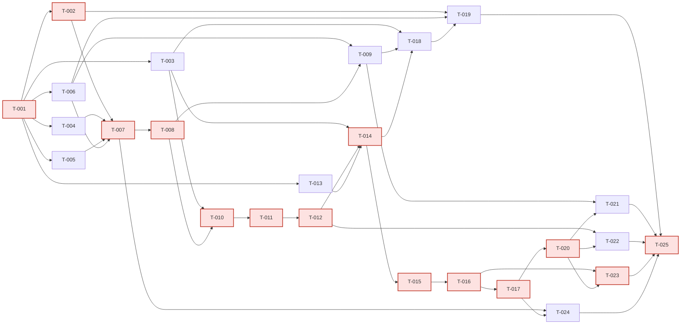

# Backlog de Mi Junta

Versión: 0.3
Fecha: 14/11/2026
Estado: Borrador

Fuente: 07-architecture.md v0.5, 06-user-stories.md v0.4.1, 02-alcance.md v0.4 y 00-constitucion.md v0.5. Lo redactó el Agente Backlog Builder (prompts/clase2/04-backlog-builder.xml).

**Cómo leer este documento:**
- Cada tarea `T-NNN` la completa un agente de desarrollo de IA en menos de 2 horas. Tamaños: **S** (< 30 min), **M** (30 min - 1 h), **L** (1-2 h).
- **Alcance de esta versión:** las 10 HU Must del MVP (F-01 a F-06, 02-alcance.md §3) y la infraestructura que necesitan. Las 8 HU Should están dentro del alcance, pero se descomponen en la próxima versión, desde T-026 (sección "Pendiente para la próxima versión"). Ninguna tarea toca el out-of-scope (NO-01 a NO-14).
- **Dependencias:** solo se listan las directas. Cada tarea depende solo de tareas con un número menor, así que el grafo no tiene ciclos.
- **Tests dentro de cada tarea:** cada tarea de dominio incluye su migración y sus tests unitarios y de integración, escritos como escenarios Gherkin que citan su RN y usan los datos de ejemplo de 06-user-stories.md (PRINCIPIO-011). Además, T-024 y T-025 son tareas de testing aparte.
- **Límites del agente (PRINCIPIO-012):** solo usa las dependencias aprobadas de 07-architecture.md §6.3, no hace commit, push ni merge sin aprobación humana, y cualquier cambio en el sorteo, el cifrado, la autenticación o los permisos que se aparte de las ADR aprobadas necesita aprobación explícita.
- Los textos que ve el usuario salen del catálogo §2.9 de 03-reglas-de-negocio.md. Si una tarea necesita un texto que no está ahí, se marca [REQUIERE DECISIÓN].

---

## Resumen

**Total de tareas:** 25. **Esfuerzo estimado:** entre 21.5 h y 43 h (18 tareas L de 1 a 2 h y 7 tareas M de 30 min a 1 h).

### Por prioridad

| Prioridad | Tareas | IDs |
|---|---|---|
| Must | 25 | T-001 a T-025 |
| Should | 0 | Próxima versión, desde T-026 |
| Could | 0 | F-12 a F-15 no tienen reglas en 03-reglas-de-negocio.md |

### Por tipo

| Tipo | Tareas | IDs |
|---|---|---|
| Setup | 3 | T-001, T-002, T-005 |
| Features (módulos de dominio y API) | 13 | T-003, T-004, T-007 a T-016, T-018 |
| Integración (SMTP, sincronización, worker y pantallas conectadas a la API) | 7 | T-006, T-017, T-019 a T-023 |
| Testing | 2 | T-024, T-025 |

### Por componente

Cada tarea se cuenta en su componente principal, el primero de su campo "Componente".

| Componente (07-architecture.md §2) | Tareas | IDs |
|---|---|---|
| Monolito modular (ADR-001) | 1 | T-001 |
| PostgreSQL | 1 | T-002 |
| `turn-order` | 3 | T-003, T-013, T-014 |
| `crypto` | 1 | T-004 |
| `api` | 1 | T-005 |
| `notifications` | 2 | T-006, T-018 |
| `identity` | 3 | T-007, T-008, T-009 |
| `juntas` | 3 | T-010, T-011, T-012 |
| `payments` | 1 | T-015 |
| `junta-views` | 2 | T-016, T-024 |
| `sync` | 1 | T-017 |
| `scheduler` | 1 | T-019 |
| `pwa` | 5 | T-020 a T-023, T-025 |
| `surveys` | 0 | Solo HU-018 (Should) |

### Por tamaño

| Tamaño | Tareas | IDs | Horas |
|---|---|---|---|
| S (< 30 min) | 0 | — | 0 |
| M (30 min - 1 h) | 7 | T-002, T-004, T-005, T-006, T-013, T-018, T-024 | 3.5 a 7 |
| L (1-2 h) | 18 | T-001, T-003, T-007 a T-012, T-014 a T-017, T-019 a T-023, T-025 | 18 a 36 |

### Cobertura de las HU Must

| HU | Prioridad | Tareas |
|---|---|---|
| HU-001 | Must | T-004, T-006, T-007, T-021, T-024, T-025 |
| HU-002 | Must | T-006, T-008, T-009, T-021, T-025 |
| HU-004 | Must | T-003, T-010, T-022, T-025 |
| HU-014 | Must | T-011, T-022, T-025 |
| HU-005 | Must | T-012, T-022, T-025 |
| HU-006 | Must | T-003, T-013, T-014, T-023, T-025 |
| HU-008 | Must | T-015, T-016, T-023, T-025 |
| HU-015 | Must | T-017, T-020, T-023, T-025 |
| HU-010 | Must | T-016, T-017, T-020, T-023, T-024, T-025 |
| HU-011 | Must | T-009, T-018, T-019, T-021, T-025 |

### Ruta crítica

La ruta crítica es la cadena de dependencias más larga, calculada con el máximo de cada tamaño (M = 1 h, L = 2 h):

**T-001 → T-002 → T-007 → T-008 → T-010 → T-011 → T-012 → T-014 → T-015 → T-016 → T-017 → T-020 → T-023 → T-025**

- 14 tareas (13 L y 1 M): entre 13.5 h y 27 h en serie.
- **Empates:** T-004, T-005 y T-006 (M, dependen solo de T-001) empatan con T-002 antes de T-007. T-021 y T-022 empatan con T-023 antes de T-025. Un retraso en cualquiera de ellas también retrasa el final.
- **Con holgura:** T-003 y T-013 (en paralelo después de T-001), T-009, T-018 y T-019 (terminan hacia la hora 18 de 27) y T-024 (hacia la hora 22).
- **Lo que más alarga la ruta:** la cadena de juntas → sorteo → pagos → vistas → sync (T-010 a T-017) es secuencial, porque cada caso de uso necesita las tablas y los datos de prueba del anterior.

### Bloqueos externos (no son tareas del agente)

| Bloqueo | Qué bloquea | Relación |
|---|---|---|
| Aprobar una herramienta de escaneo de secretos para el pipeline: 07-architecture.md §6.1 lo exige, pero §6.3 no la lista | T-001 | PRINCIPIO-005, PRINCIPIO-012 e. [REQUIERE DECISIÓN] |
| El catálogo §2.9 no tiene el asunto ni el texto de los correos de verificación y de recuperación de contraseña | T-006 | RN-090, RN-152, RN-155. [REQUIERE DECISIÓN] |
| Texto de la política de privacidad, que escribe el asesor legal | El lanzamiento de F-01, no el desarrollo de T-007 y T-021 | PREG-001, 02-alcance.md §5 |
| Confirmar con el administrador de Microsoft 365 los límites de envío y la autenticación OAuth 2.0 del buzón | Que T-019 envíe en producción | R-15, 07-architecture.md §7 |
| Dominio y certificado TLS | El despliegue en el servidor dedicado | 02-alcance.md §6, PRINCIPIO-005 |
| Operación del servidor (respaldos, certificados, SSH, monitoreo) | El lanzamiento | 07-architecture.md §6.4, R-14. La hace el líder técnico |

---

## Tareas

### T-001: Inicializar el repositorio con versiones exactas, linter, Vitest y pipeline

- **HU relacionada:** Infraestructura
- **Componente:** Monolito modular (ADR-001): `pwa`, `api` y worker del `scheduler`
- **Prioridad:** Must
- **Tamaño:** L (1-2 h)
- **Dependencias:** Ninguna
- **Descripción:** Crear la app Next.js (App Router) con TypeScript y la estructura `src/app/`, `src/modules/<módulo>/{domain,application,infrastructure}` y `src/worker/`, fijando en `package.json` y en el lockfile la versión estable vigente de cada dependencia de 07-architecture.md §6.3, sin `^` ni `~` (PRINCIPIO-009). Configurar el linter de la plantilla de Next.js, solo con reglas del núcleo (`no-restricted-imports` para que las importaciones vayan rutas → casos de uso → dominio → infraestructura, y `no-restricted-properties` para prohibir `.skip` y `.only`), y Vitest con umbral de 80 % de líneas en todo el código y 100 % de líneas y ramas en `calendar`, `draw-engine` y el cálculo de cuotas y montos. Crear el pipeline que corre el linter, los tests y la cobertura, falla si `package.json` tiene `^` o `~` y escanea el repositorio en busca de secretos (herramienta [REQUIERE DECISIÓN]).
- **Criterio de completitud:** El pipeline pasa con el repositorio inicial y falla en cada uno de estos 3 cambios de prueba: un rango con `^` en `package.json`, un `it.skip` en un test y una importación desde `domain` hacia `infrastructure`.

### T-002: Levantar los contenedores Docker y PostgreSQL con roles y protección de inmutabilidad

- **HU relacionada:** Infraestructura
- **Componente:** PostgreSQL
- **Prioridad:** Must
- **Tamaño:** M (30 min - 1 h)
- **Dependencias:** T-001
- **Descripción:** Crear el `docker-compose.yml` con los contenedores de la app, del worker (con `TZ=America/Lima`) y de PostgreSQL con su volumen de datos, que leen las variables de un `.env` incluido en `.gitignore`, y un `.env.example` solo con los nombres de las variables (PREG-050, 07-architecture.md §6.4). Configurar Drizzle con `pg`, un rol de base de datos para las migraciones y otro para la app sin privilegios de administración, y una función de trigger reutilizable que rechaza `UPDATE` y `DELETE` (ADR-003). Crear con ella la tabla `staff_access_log`, solo de inserción (RN-201).
- **Criterio de completitud:** `docker compose up` levanta los 3 contenedores, la migración inicial se aplica sin errores, `git check-ignore .env` devuelve `.env`, y con el rol de la app un `UPDATE` o un `DELETE` sobre `staff_access_log` falla.

### T-003: Implementar los módulos puros de tiempo, calendario y montos

- **HU relacionada:** HU-004, HU-006
- **Componente:** `turn-order` (submódulo `calendar`) y módulos compartidos `clock` y `format`
- **Prioridad:** Must
- **Tamaño:** L (1-2 h)
- **Dependencias:** T-001
- **Descripción:** Implementar `clock` con `nowInstant()` y `todayInLima()` inyectables, calculados con la zona `America/Lima` y no con un desfase fijo (§3.4), y `format`, que muestra montos como `S/ 1,250.50`, fechas como DD/MM/AAAA y horas como HH:MM en America/Lima (RN-091, RN-092, RN-093, RN-177). Implementar la conversión del monto escrito como texto a céntimos con aritmética de enteros, sin `parseFloat` (RN-040, RN-097, ADR-008). Implementar `calendar` con los vencimientos semanales, quincenales, mensuales y cada N días, incluidos el fin de mes y el 29 de febrero, y la validación del aviso previo contra el periodo, con 28 días para la frecuencia mensual (RN-046 a RN-050, RN-012).
- **Criterio de completitud:** Pasan los tests con estos casos y la cobertura de `calendar` y de la conversión de montos es 100 % de líneas y ramas: `"20.80"` → `2080` y `"1000.5"` → `100050`; `"300,50"`, `"1,000"` y `"20.805"` se rechazan; mensual desde el 31/01/2027 → 28/02/2027, 31/03/2027 y 30/04/2027; mensual desde el 31/01/2028 → 29/02/2028; quincenal desde el 01/12/2026 → 16/12/2026 y 31/12/2026; semanal desde el 05/12/2026 → 12/12/2026; cada 10 días desde el 01/12/2026 → 11/12/2026; y `2026-12-01T03:30:00Z` se muestra como "30/11/2026 22:30".

### T-004: Implementar el módulo `crypto` con AES-256-GCM e índice ciego

- **HU relacionada:** HU-001
- **Componente:** `crypto`
- **Prioridad:** Must
- **Tamaño:** M (30 min - 1 h)
- **Dependencias:** T-001
- **Descripción:** Implementar con `node:crypto` y sin dependencias `encryptField` (AES-256-GCM, IV aleatorio de 96 bits por valor, etiqueta de autenticación y `key_id`), `blindIndex` (HMAC-SHA256 con una clave distinta de la de cifrado) y el hash SHA-256 de los tokens aleatorios de 256 bits (ADR-005, 07-architecture.md §3.5). Las claves se leen de variables de entorno al iniciar el proceso, y el descifrado queda privado del módulo: ninguna ruta ni script lo expone (RN-202).
- **Criterio de completitud:** Pasan los tests: cifrar `45678912` dos veces da dos textos cifrados distintos que no contienen `45678912`; `blindIndex("45678912")` da siempre el mismo valor; cambiar un byte del texto cifrado hace fallar la verificación GCM; y el proceso no arranca si falta la variable de una clave.

### T-005: Implementar la cadena común de la API

- **HU relacionada:** Infraestructura
- **Componente:** `api`
- **Prioridad:** Must
- **Tamaño:** M (30 min - 1 h)
- **Dependencias:** T-001
- **Descripción:** Implementar el envoltorio de los Route Handlers bajo `/api` con el formato de error `{"error": {"code", "rule", "message", "fields"}}` de §4.1, un catálogo de mensajes que copia los textos de §2.9, la validación de cada cuerpo con `zod`, la protección CSRF (encabezado `X-Requested-With: mi-junta` y comprobación de `Origin`), `415` para tipos de contenido no aceptados y `400` para JSON mal formado. Agregar el logger con la lista de campos prohibidos (`dni`, `phone`, `password`, `token`, `code`, `email`), que se reemplazan por `[REDACTED]`, y el encabezado HSTS con la redirección de HTTP a HTTPS (PRINCIPIO-005, §3.5).
- **Criterio de completitud:** Pasan los tests: una petición `POST` sin `X-Requested-With` se rechaza sin llegar al caso de uso, un cuerpo inválido recibe `422` con `fields`, un JSON mal formado recibe `400`, y registrar `{ "dni": "45678912" }` en el logger deja `[REDACTED]` en la salida.

### T-006: Implementar el adaptador SMTP y los correos de la cuenta

- **HU relacionada:** HU-001, HU-002
- **Componente:** `notifications`
- **Prioridad:** Must
- **Tamaño:** M (30 min - 1 h)
- **Dependencias:** T-001
- **Descripción:** Implementar el adaptador de correo con `nodemailer` por `smtp.office365.com`, puerto 587 con STARTTLS y TLS 1.2 o superior, autenticado con OAuth 2.0 (XOAUTH2) con las credenciales del `.env` (ADR-007), detrás de una interfaz que los tests reemplazan por un transporte falso. Agregar las plantillas del enlace de verificación y del enlace de recuperación, en español de Perú y tratando de "usted" (RN-090), que se envían aunque el usuario haya desactivado los recordatorios (RN-188); su asunto y su texto no están en §2.9 [REQUIERE DECISIÓN].
- **Criterio de completitud:** Con el transporte falso, enviar el correo de verificación a `lucia@example.com` deja un mensaje con ese destinatario y el enlace, y un test de configuración comprueba `host = smtp.office365.com`, `port = 587`, `requireTLS = true`, versión mínima `TLSv1.2` y autenticación `OAuth2`.

### T-007: Crear la cuenta con consentimiento y verificar el correo

- **HU relacionada:** HU-001
- **Componente:** `identity`
- **Prioridad:** Must
- **Tamaño:** L (1-2 h)
- **Dependencias:** T-002, T-004, T-005, T-006
- **Descripción:** Crear las migraciones de `users`, `privacy_policy_versions` (con la versión `"1.0"` vigente), `consents` (solo inserción), `email_tokens` y `sessions`, con las restricciones de 07-architecture.md §3.2 y sin columnas de fecha de nacimiento ni de foto (RN-149). Implementar API-001 con consentimiento y mayoría de edad obligatorios, las validaciones y los mensajes de su tabla, Argon2id (m = 19 MiB, t = 2, p = 1), el cifrado y el índice ciego del DNI y del celular, y la apertura de una sesión con cookie `HttpOnly`, `Secure` y `SameSite=Lax` (RN-074, RN-082 a RN-086, RN-146 a RN-151, RN-180, RN-181, ADR-006). Implementar API-002, API-003 (enlace de 86,400 s que se anula al pedir otro, RN-152, RN-154) y el guardián `requireVerifiedEmail` (RN-153).
- **Criterio de completitud:** Pasan los tests de integración de HU-001: `consent = false` no crea ninguna cuenta; la cuenta de Lucía creada el 14/11/2026 a las 10:32:05 guarda `policy_version = "1.0"` y `consent_accepted_at = "2026-11-14T10:32:05-05:00"`; `Lucia@Example.com` y el DNI `45678912` repetidos reciben `409`; el enlace sirve el 15/11/2026 a las 10:32:05 y responde `410` a las 10:32:06; y `SELECT dni_ciphertext FROM users` no contiene `45678912`.

### T-008: Iniciar y cerrar sesión con bloqueo por intentos fallidos

- **HU relacionada:** HU-002
- **Componente:** `identity` y `api`
- **Prioridad:** Must
- **Tamaño:** L (1-2 h)
- **Dependencias:** T-007
- **Descripción:** Implementar API-004 con el correo comparado sin distinguir mayúsculas (RN-191), el contador de fallos, el bloqueo de 900 s al quinto fallo seguido sin contar los intentos durante el bloqueo, el contador en 0 al entrar (RN-075, RN-076, RN-160, RN-161) y el campo `policy_acceptance_required`, y API-005. Implementar el middleware de sesión que busca el hash del token, responde `401` sin una sesión válida, actualiza `last_seen_at` y da por cerrada la sesión tras 2,592,000 s sin peticiones (RN-159, ADR-006).
- **Criterio de completitud:** Pasan los tests con el reloj inyectado: con el quinto fallo a las 10:00:00, la contraseña correcta recibe `429` a las 10:14:59 y entra a las 10:15:00; 4 fallos seguidos de un acierto no bloquean la cuenta; `Lucia@Example.com` entra con "Junta2026"; y una sesión cuya última petición fue el 01/12/2026 a las 10:00 sigue abierta el 30/12/2026 a las 09:59 y recibe `401` el 31/12/2026 a las 10:01.

### T-009: Recuperar la contraseña, aceptar una política nueva y guardar la preferencia de recordatorios

- **HU relacionada:** HU-002, HU-011
- **Componente:** `identity`
- **Prioridad:** Must
- **Tamaño:** L (1-2 h)
- **Dependencias:** T-006, T-008
- **Descripción:** Implementar API-006 con la misma respuesta exista o no la cuenta y con el correo enviado en segundo plano (RN-156), y API-007 con un enlace de 3600 s de un solo uso que cierra las demás sesiones (RN-155, RN-157, RN-158). Implementar API-008 (`GET /me` y `POST /consents`, que agrega una fila sin tocar la anterior, RN-168, RN-169) y API-032 con `email_reminders_enabled` (RN-187); `overdue_notices_enabled` queda para HU-016 (Should).
- **Criterio de completitud:** Pasan los tests: `nadie@example.com` y `lucia@example.com` reciben la misma respuesta `202`; el enlace pedido a las 10:00:00 acepta "Junta202" a las 11:00:00 y responde `410` al usarlo otra vez; cambiar la contraseña revoca la otra sesión de Lucía; aceptar la política 1.1 deja 2 filas en `consents`; y `PATCH /me/notification-preferences` con `email_reminders_enabled = false` se refleja en `GET /me`.

### T-010: Crear una junta con su código de invitación

- **HU relacionada:** HU-004
- **Componente:** `juntas`
- **Prioridad:** Must
- **Tamaño:** L (1-2 h)
- **Dependencias:** T-003, T-008
- **Descripción:** Crear las migraciones de `juntas`, `memberships` e `invite_codes` con los `CHECK` y `UNIQUE` de 07-architecture.md §3.2. Implementar API-009 para un usuario con el correo verificado, con las validaciones y los mensajes de su tabla (RN-002 a RN-012, RN-096, RN-097), la junta en `open` y el organizador en un cupo si participa (RN-001, RN-006, RN-099); el campo `junta_rules` (HU-013) y `survey_pending` (HU-018) quedan para la próxima versión. Generar el código de 8 caracteres con `crypto.randomBytes` y `byte mod 32` sobre `ABCDEFGHJKLMNPQRSTUVWXYZ23456789`, y generar otro si choca con un código existente, vigente o no (RN-015, RN-016).
- **Criterio de completitud:** Pasan los tests de HU-004 con `todayInLima()` fijado en el 14/11/2026: la Junta Familia se crea en `open` con `contribution_amount_cents = 30000`, 1 de 12 cupos ocupados y un código del alfabeto; "5.00", "20.85", "300,50", 1 o 51 participantes, "cada 1 días", 8 días de aviso, la ronda 1 el 10/11/2026 y la frecuencia "bimestral" reciben `422` con su mensaje; un generador falso que repite `K7MP4XR2` produce otro código; y una cuenta sin verificar recibe `403` `EMAIL_NOT_VERIFIED`.

### T-011: Ajustar la junta antes de fijar el orden de turnos

- **HU relacionada:** HU-014
- **Componente:** `juntas` y `api` (guardián `requireJuntaRole`)
- **Prioridad:** Must
- **Tamaño:** L (1-2 h)
- **Dependencias:** T-010
- **Descripción:** Implementar el guardián `requireJuntaRole(juntaId, "member" | "organizer")`, que responde `403` a quien no es miembro y `403` `NOT_ORGANIZER` a quien no organiza (RN-024, RN-077). Implementar API-010 con las mismas validaciones de API-009 y solo el nombre después de fijar el orden (RN-106 a RN-110), API-011, que anula el código anterior (RN-020), y API-012, que libera el cupo y devuelve la junta a `open` si estaba `full` (RN-101, RN-112 a RN-115).
- **Criterio de completitud:** Pasan los tests de HU-014: con 9 cupos ocupados, bajar a 8 participantes recibe `422` y bajar a 9 deja la junta en `full`; Jorge con 10 de 10 cupos recibe `409` `NO_FREE_SLOT_FOR_ORGANIZER` al marcar que participa; después de regenerar, `K7MP4XR2` queda con `revoked_at`; Lucía recibe `403` en API-010, API-011 y API-012; y en una junta `in_progress`, cambiar la cuota recibe `409` `TURN_ORDER_FIXED` y cambiar el nombre se guarda.

### T-012: Unirse a una junta con el código y salir de ella

- **HU relacionada:** HU-005
- **Componente:** `juntas`
- **Prioridad:** Must
- **Tamaño:** L (1-2 h)
- **Dependencias:** T-011
- **Descripción:** Crear la migración de `invite_code_attempts` e implementar API-013: `401` antes de todo y sin registrar intento (RN-017), código normalizado (RN-190), correo verificado (RN-153), `ALREADY_MEMBER` sin ocupar otro cupo (RN-021), código anulado que no suma al límite (RN-192), límite de 10 códigos inválidos en 3600 s (RN-117) y `SELECT … FOR UPDATE` sobre la junta para el último cupo, con el paso a `full` (RN-018, RN-100). Implementar API-014 con los rechazos de RN-114 y RN-115.
- **Criterio de completitud:** Pasan los tests de HU-005: ` t9qw3hz5 ` une a Rosa a la Junta Familia; dos peticiones simultáneas por el último cupo dejan exactamente 1 membresía nueva y la otra recibe `409` `JUNTA_FULL`; con 9 códigos inexistentes y el anulado `K7MP4XR2`, Rosa se une a las 10:25, y con 10 inexistentes recibe `429`; y Carmen recibe `409` `ORGANIZER_CANNOT_LEAVE` al pedir salir.

### T-013: Implementar el `draw-engine` con `fisher-yates-v1`

- **HU relacionada:** HU-006
- **Componente:** `turn-order` (submódulo `draw-engine`)
- **Prioridad:** Must
- **Tamaño:** M (30 min - 1 h)
- **Dependencias:** T-001
- **Descripción:** Implementar la función pura `shuffle(seed, input) → result` exactamente como el anexo A de 03-reglas-de-negocio.md, con `crypto.createHmac('sha256', seed)` y muestreo por rechazo, sin red, sin base de datos y sin dependencias (RN-124, ADR-004). Cualquier cambio al algoritmo exige otro `algorithm_version` y aprobación humana (PRINCIPIO-012).
- **Criterio de completitud:** Con la semilla `000102…1e1f` y la entrada `["p01",…,"p10"]` del anexo A, la función devuelve `["p05","p07","p02","p01","p08","p03","p09","p10","p04","p06"]`; con una entrada de 2 identificadores devuelve esos mismos 2; y la cobertura del módulo es 100 % de líneas y ramas.

### T-014: Fijar el orden de turnos por sorteo y generar las rondas y las cuotas

- **HU relacionada:** HU-006
- **Componente:** `turn-order` (caso de uso `fixTurnOrder`) y `junta-views` (registro del sorteo)
- **Prioridad:** Must
- **Tamaño:** L (1-2 h)
- **Dependencias:** T-003, T-012, T-013
- **Descripción:** Crear las migraciones de `draws` (solo inserción, `UNIQUE (junta_id)`), `rounds` y `contributions`. Implementar API-015 en una sola transacción con `SELECT … FOR UPDATE`: comprueba los cupos llenos, el orden sin fijar y la ronda 1 sin vencer (RN-027, RN-028, RN-122), genera la semilla con `crypto.randomBytes(32)`, guarda el registro con la entrada ordenada por `slot_taken_at` (RN-031 a RN-034, RN-123), crea las rondas y las cuotas `pending` con `calendar` (RN-013, RN-042 a RN-050), anula el código y pasa la junta a `in_progress` (RN-019, RN-102). Implementar API-016 para todo miembro, con nombres en lugar de UUID (RN-121).
- **Criterio de completitud:** Pasan los tests de HU-006: la Junta Oficina queda en `in_progress` con 10 rondas de 10 cuotas de `100000` y las rondas 1 a 4 vencen el 30/11/2026, 30/12/2026, 30/01/2027 y 28/02/2027; en la Junta Ventas la entrada no incluye a Jorge; dos peticiones simultáneas dejan 1 fila en `draws` y la otra recibe `409`; con 11 de 12 cupos responde `409` `SLOTS_AVAILABLE`; Lucía recibe `403` `NOT_ORGANIZER`; `draw-engine` con la semilla y la entrada guardadas reproduce el `result`; y un `UPDATE draws` con el rol de la app falla.

### T-015: Registrar y desmarcar pagos

- **HU relacionada:** HU-008
- **Componente:** `payments`
- **Prioridad:** Must
- **Tamaño:** L (1-2 h)
- **Dependencias:** T-014
- **Descripción:** Crear las migraciones de `payments` y `payment_corrections` (solo inserción, `UNIQUE (payment_id)`) y de `client_changes`, que guarda el resultado de cada `Idempotency-Key`. Implementar API-017 solo sobre cuotas `pending`, con la fecha de pago no futura ni anterior a `created_on`, la clasificación "a tiempo" o "atrasado" y el pago adelantado (RN-052 a RN-056, RN-130, RN-132, RN-133), API-018, que guarda la corrección y conserva el pago (RN-057 a RN-059, RN-131), y API-019, que responde siempre `405` (RN-134). Después de cada cambio se recalcula si la junta pasa a `finished` o vuelve a `in_progress` (RN-103, RN-104), con casos de uso que también usará `sync`.
- **Criterio de completitud:** Pasan los tests de HU-008: el 28/11/2026 la cuota de Lucía queda `paid` "a tiempo" y la de Pedro, pagada el 02/12/2026, queda "atrasado"; con hoy 28/11/2026, `paid_on` 30/11/2026 y 01/01/2025 reciben `422`; registrar dos veces recibe `409` `CONTRIBUTION_NOT_PENDING`; desmarcar conserva el pago original y agrega una corrección; `PATCH /payments/{id}` responde `405`; registrar la última cuota pasa la junta a `finished` y desmarcarla la devuelve a `in_progress`; repetir la misma `Idempotency-Key` no crea un segundo pago; y después de cada caso, `status = 'paid'` solo si `current_payment_id` apunta a un pago sin corrección.

### T-016: Proyectar los datos por rol en las rutas de lectura

- **HU relacionada:** HU-010, HU-008
- **Componente:** `junta-views`
- **Prioridad:** Must
- **Tamaño:** L (1-2 h)
- **Dependencias:** T-015
- **Descripción:** Implementar los serializadores `memberView`, `organizerView` y `nonParticipantOrganizerView`, que arman cada objeto desde cero con una lista blanca de campos (ADR-009, RN-022, RN-023, RN-118, RN-178), y el cálculo de la ronda actual y de la próxima cuota con `todayInLima()` (RN-119, 04-glosario.md). Implementar API-022, API-023, API-024 y API-020 (solo para el organizador, con el historial de pagos y correcciones, RN-120), con listas vacías y valores `null` antes de fijar el orden (RN-105).
- **Criterio de completitud:** Pasan los tests de HU-010: el 25/11/2026 Lucía recibe para Jorge exactamente las claves `name`, `turn_number`, `current_round_status`, `next_due_date` y `next_status`; el 30/11/2026 `next_due_date` es `"2026-12-30"` y el 01/12/2026 es `"2027-01-30"`; Marta recibe para Jorge solo `{"name":"Jorge","role":"organizer"}`; Lucía recibe `403` en API-020; y Rosa, que no es miembro, recibe `403` en API-024.

### T-017: Sincronizar el snapshot y los cambios hechos sin conexión

- **HU relacionada:** HU-015, HU-010
- **Componente:** `sync`
- **Prioridad:** Must
- **Tamaño:** L (1-2 h)
- **Dependencias:** T-016
- **Descripción:** Implementar API-025, que reúne por junta las respuestas de API-023, API-024, API-020 (solo para el organizador) y API-016 con la misma proyección por rol, incluye todas las juntas del usuario (RN-175) y responde `304` si el `ETag` coincide. Implementar API-021, que aplica los cambios en el orden recibido, cada uno en su propia transacción y con el caso de uso de `payments` (RN-087, RN-171), acepta solo los tipos de RN-170, guarda `performed_at` (RN-173), devuelve el resultado guardado si un `client_change_id` se repite y arma el mensaje de rechazo de RN-172. Los tres tipos del pago informado se conectan cuando se implemente HU-009 (Should).
- **Criterio de completitud:** Pasan los tests de HU-015: si el pago de Lucía ya se registró desde otro dispositivo, el cambio de la tablet vuelve `rejected` con "No se pudo guardar un cambio hecho sin conexión: el pago de Lucía de la ronda 1 ya estaba registrado." y el siguiente cambio de la lista se aplica; el pago de Lucía guarda `performed_at = "2026-11-28T18:40:00-05:00"`; reenviar el mismo `client_change_id` no crea otro pago; un tipo de cambio fuera de RN-170 vuelve `rejected` con `CHANGE_TYPE_NOT_ALLOWED_OFFLINE`; y un `If-None-Match` igual al `ETag` recibe `304`.

### T-018: Seleccionar los recordatorios del día y armar su correo

- **HU relacionada:** HU-011
- **Componente:** `notifications`
- **Prioridad:** Must
- **Tamaño:** M (30 min - 1 h)
- **Dependencias:** T-003, T-009, T-014
- **Descripción:** Crear la migración de `reminders` con `UNIQUE (contribution_id, scheduled_on)` e implementar como función pura la selección de 07-architecture.md §3.4: `lead` el día `due_date − reminder_lead_days`, `due` el día del vencimiento y `after_due` cada 2 días hasta 5 aceptados, solo para cuotas `pending` de juntas `in_progress` creadas antes del inicio del job, y por correo solo si `email_reminders_enabled` es `true` (RN-067 a RN-072, RN-141, RN-143, RN-187). Agregar la plantilla con la junta, la ronda, el monto y el vencimiento, que trata de "usted" y no menciona a otros miembros (RN-090, RN-144, RN-145).
- **Criterio de completitud:** Pasan los tests de HU-011: la cuota "Pendiente" de Pedro que vence el 30/11/2026, con 3 días de aviso, se selecciona el 27/11, el 30/11, el 02/12, el 04/12, el 06/12, el 08/12 y el 10/12/2026, y no el 12/12/2026; pagada el 03/12/2026, no se selecciona el 04/12/2026; las cuotas creadas el 14/12/2026 a las 19:30 con la ronda 1 el 15/12/2026 no reciben el aviso del 12/12 y sí el del 15/12; con `email_reminders_enabled = false` y sin push no se selecciona; una política nueva sin aceptar no la excluye (RN-189); y el asunto es "Junta Oficina: su cuota de la ronda 1, de S/ 1,000.00, vence el 30/11/2026".

### T-019: Ejecutar el job `daily-reminders` en el worker

- **HU relacionada:** HU-011
- **Componente:** `scheduler` (worker) y `notifications`
- **Prioridad:** Must
- **Tamaño:** L (1-2 h)
- **Dependencias:** T-002, T-006, T-018
- **Descripción:** Implementar el comando del worker que el cron del contenedor ejecuta a las 09:00:00 en America/Lima: guarda cada recordatorio en `reminders` antes de enviarlo, envía primero los del vencimiento y los posteriores y después los avisos previos, reintenta hasta las 09:15:00 y a esa hora marca `expired` los que no se aceptaron (RN-066, RN-143, RN-199, ADR-007). Exponer API-026 solo en la red interna, con `Authorization: Bearer`, `409` `JOB_ALREADY_RUNNING` y los contadores `planned`, `accepted`, `failed`, `expired` y `already_sent`.
- **Criterio de completitud:** Pasan los tests con reloj y transporte falsos: correr dos veces la corrida del 27/11/2026 deja 1 sola fila de la cuota de Pedro en `reminders` y la segunda devuelve `already_sent = 1`; un correo rechazado a las 09:02 y aceptado a las 09:06 queda `accepted`; uno que no se aceptó a las 09:15:00 queda `expired` y no suma a los 5 `after_due`; el instante de envío está entre `2026-11-27T09:00:00-05:00` y `2026-11-27T09:15:00-05:00`; y API-026 sin el secreto responde `401`.

### T-020: Abrir la app sin conexión con el snapshot y el outbox

- **HU relacionada:** HU-010, HU-015
- **Componente:** `pwa` (Service Worker e IndexedDB)
- **Prioridad:** Must
- **Tamaño:** L (1-2 h)
- **Dependencias:** T-017
- **Descripción:** Registrar un Service Worker que guarda en caché el app shell y las pantallas de consulta, y guardar en IndexedDB la respuesta de API-025 con `last_synced_at`, con el aviso "Sin conexión. Última sincronización: 20/01/2027 18:45" en America/Lima (RN-093, RN-094, RN-095, RN-177). Implementar el outbox con `client_change_id` (UUID v4), `performed_at` y `user_id`, el contador "1 cambio sin enviar." o "{n} cambios sin enviar." (RN-174), el envío en orden con API-021 al volver la red sin depender solo de `navigator.onLine` (RN-087), la conservación del outbox ante un `401` (RN-176) y un hook de conexión que deshabilita las acciones fuera de RN-170 con "Necesita conexión a internet para hacer esto.".
- **Criterio de completitud:** En Playwright con el navegador en modo "Offline": la app abre sin la pantalla de error del navegador y muestra la fecha y hora de la última sincronización en America/Lima; encolar 2 cambios `register_payment` muestra "2 cambios sin enviar."; al reconectar, el servidor recibe los 2 cambios en el orden en que se hicieron; y con la sesión vencida, el outbox conserva los cambios hasta que el mismo usuario vuelve a iniciar sesión.

### T-021: Integrar las pantallas de cuenta y acceso

- **HU relacionada:** HU-001, HU-002, HU-011
- **Componente:** `pwa`
- **Prioridad:** Must
- **Tamaño:** L (1-2 h)
- **Dependencias:** T-009, T-020
- **Descripción:** Construir "Crear cuenta" (casillas de consentimiento y de mayoría de edad desmarcadas, botón deshabilitado hasta marcar el consentimiento y sin campos de fecha de nacimiento ni foto), la verificación del correo, "Iniciar sesión", la recuperación de la contraseña, la aceptación de una política nueva antes de ver las juntas y la preferencia de recordatorios por correo, conectadas a API-001 a API-008 y API-032 (RN-088, RN-089, RN-149, RN-168, RN-181, RN-187). Implementar "Cerrar sesión" con el aviso "Hay cambios sin enviar ({n}). Si cierra sesión ahora, se perderán." y el borrado del snapshot y del outbox al confirmar (RN-197, RN-198).
- **Criterio de completitud:** En Playwright: la casilla de consentimiento aparece con `checked = false` y "Crear cuenta" pasa de `disabled = true` a `disabled = false` al marcarla y vuelve a `disabled = true` al desmarcarla; sin red, "Crear cuenta" e "Iniciar sesión" muestran "Necesita conexión a internet para hacer esto."; con 2 cambios sin enviar, "Cerrar sesión" muestra "Hay cambios sin enviar (2). Si cierra sesión ahora, se perderán."; y después de confirmar, IndexedDB no tiene ninguna junta del usuario.

### T-022: Integrar las pantallas de creación y conformación de la junta

- **HU relacionada:** HU-004, HU-014, HU-005
- **Componente:** `pwa`
- **Prioridad:** Must
- **Tamaño:** L (1-2 h)
- **Dependencias:** T-012, T-020
- **Descripción:** Construir "Mis juntas", "Crear junta" (aviso previo en 3 por defecto y ajustado a periodo − 1 al elegir la frecuencia, RN-011, RN-098), la edición antes de fijar el orden con regenerar el código y quitar participantes, y "Unirse a una junta" y "Salir de la junta", conectadas a API-009 a API-014 y API-022. La app guarda el código que se ingresó sin sesión y lo vuelve a enviar después de iniciar sesión (API-013), y muestra los mensajes de §2.9 que devuelve el servidor.
- **Criterio de completitud:** En Playwright: "Crear junta" abre con "Días de aviso previo" en 3 y pasa a 1 al elegir "cada 2 días"; la cuota "20.85" muestra "La cuota debe ser múltiplo de S/ 0.10, por ejemplo S/ 20.80."; Ana sin sesión que ingresa `K7MP4XR2` ve "Inicie sesión o cree su cuenta para unirse a la junta." y queda unida al iniciar sesión con una cuenta verificada; y sin red, "Crear junta", "Unirse a una junta" y "Salir de la junta" muestran "Necesita conexión a internet para hacer esto.".

### T-023: Integrar las pantallas de sorteo, estado de la junta y pagos

- **HU relacionada:** HU-006, HU-008, HU-010, HU-015
- **Componente:** `pwa`
- **Prioridad:** Must
- **Tamaño:** L (1-2 h)
- **Dependencias:** T-016, T-020
- **Descripción:** Construir el detalle de la junta (turno, cuotas propias y miembros con los cuatro datos permitidos), "Ejecutar sorteo" (deshabilitado con cupos libres y, sin red, con "Necesita conexión a internet para ejecutar el sorteo."), "Ver sorteo" con semilla, versión, entrada y resultado, y "Pagos" para el organizador con registrar y desmarcar, que sin red pasan por el outbox de T-020 (RN-027, RN-029, RN-121, RN-170). La lista de pagos se muestra como tarjetas por debajo del ancho de tabla para no tener scroll horizontal a 360 px (07-architecture.md §6.2), y cada rechazo de la sincronización se muestra con su mensaje (RN-172).
- **Criterio de completitud:** En Playwright con los datos de ejemplo: el 20/01/2027 Lucía ve "Su turno: 7" y sus rondas 1 "Pagada", 2 "Pagada" y 3 "Pendiente"; con 11 de 12 cupos, "Ejecutar sorteo" está deshabilitado; la Junta Familia sorteada muestra el pozo "S/ 3,600.00"; sin red, Jorge registra el pago de Lucía y al reconectar la cuota aparece "Pagada"; y a 360 px ninguna de estas pantallas tiene scroll horizontal.

### T-024: Escribir los tests de contrato de privacidad, mínimo de datos y logs

- **HU relacionada:** HU-010, HU-001
- **Componente:** `junta-views` y `api`
- **Prioridad:** Must
- **Tamaño:** M (30 min - 1 h)
- **Dependencias:** T-007, T-017
- **Descripción:** Escribir un test de contrato por ruta y por rol (participante, organizador que participa, organizador que no participa y no miembro) para API-016, API-020, API-022, API-023, API-024 y API-025, que compara las claves de cada respuesta con su lista blanca y falla si aparece `email`, `phone` o `dni` de otro miembro, o `paid_on` de otro miembro en la respuesta de un participante (PRINCIPIO-006, RN-022, RN-023, RN-118, RN-178). Agregar el test de esquema que falla si existe una columna de fecha de nacimiento, foto, cuenta bancaria, tarjeta o credencial de billetera (RN-149, PRINCIPIO-004), el test que crea una cuenta con el DNI `45678912` y el celular `987654321` y no encuentra esos valores en los logs ni en claro en la base (PRINCIPIO-005), y las búsquedas en el repositorio de los escenarios técnicos de RN-202 y RN-203.
- **Criterio de completitud:** Los tests corren en el pipeline y pasan, y en una rama de prueba que agrega `email` a `memberView`, el test de contrato de API-024 falla.

### T-025: Escribir los escenarios end-to-end del MVP y medir accesibilidad y rendimiento

- **HU relacionada:** HU-001, HU-002, HU-004, HU-014, HU-005, HU-006, HU-008, HU-015, HU-010, HU-011
- **Componente:** `pwa` (con `api` y `scheduler`)
- **Prioridad:** Must
- **Tamaño:** L (1-2 h)
- **Dependencias:** T-019, T-021, T-022, T-023, T-024
- **Descripción:** Escribir en Playwright el recorrido del MVP como escenarios Gherkin que citan sus RN: Jorge crea su cuenta y la Junta Oficina, Lucía y Pedro se unen con `M3QX7KPA`, Jorge sortea y registra pagos con y sin conexión, incluido el choque entre dos dispositivos de R-12, Lucía ve su turno, y el job de las 09:00 envía el recordatorio a Pedro por el transporte falso. Agregar al pipeline axe-core (0 violaciones de WCAG 2.2 nivel A), Lighthouse CI con perfil móvil (LCP ≤ 2.5 s, CLS ≤ 0.1, TBT ≤ 200 ms), la revisión de scroll horizontal a 360 px y a 1440 px y el límite de 170 KB de JavaScript comprimido por pantalla (PRINCIPIO-010, D-8).
- **Criterio de completitud:** El pipeline ejecuta los escenarios, axe-core y Lighthouse en cada pantalla del MVP y pasa, y falla en una rama de prueba que agrega a una pantalla un botón sin nombre accesible o más de 170 KB de JavaScript comprimido.

---

## Pendiente para la próxima versión

Estas HU Should están dentro del alcance (02-alcance.md §1) y se descomponen desde T-026, en el orden de 06-user-stories.md. Esta versión no crea sus tablas (`organizer_surveys`, `reported_payments`, `notification_outbox`, `overdue_notices`, `push_subscriptions`, `turn_assignments` y `verification_codes`).

| Orden | HU | Funcionalidad | Componentes | Nota |
|---|---|---|---|---|
| 1 | HU-018 | F-18 Encuesta de KPI-05 | `surveys`, `pwa` | Conviene publicarla con el MVP para medir la línea base de KPI-05 (02-alcance.md §3) |
| 2 | HU-009 | F-08 Pago informado | `payments`, `sync`, `notifications` | Conecta los 3 tipos pendientes de API-021 |
| 3 | HU-016 | F-16 Aviso de cuotas vencidas | `scheduler`, `notifications` | Agrega `overdue_notices_enabled` a API-032 |
| 4 | HU-012 | F-07 Notificaciones push | `notifications`, `pwa` | Usa `web-push`, aprobada |
| 5 | HU-007 | F-10 Orden sin sorteo | `turn-order`, `junta-views` | Agrega el trigger que impide tener `draws` y `turn_assignments` a la vez |
| 6 | HU-013 | F-09 Reglas escritas | `juntas`, `junta-views` | Agrega `junta_rules` a API-009 y API-010 |
| 7 | HU-017 | F-17 Borrar la cuenta | `identity`, `juntas` | Agrega "Participante eliminado" a las vistas |
| 8 | HU-003 | F-11 Segundo factor | `identity`, `crypto`, `notifications` | Toca la autenticación: requiere aprobación humana explícita (PRINCIPIO-012) |
