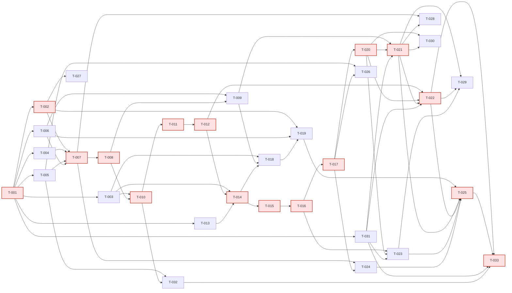

# Backlog de Mi Junta

Versión: 0.6
Fecha: 15/11/2026
Estado: Borrador

Fuente: 07-architecture.md v0.4, 06-user-stories.md v0.4, 03-reglas-de-negocio.md v0.4, 02-alcance.md v0.4 y 00-constitucion.md v0.4. Lo redactó el Agente Backlog Builder (prompts/clase2/04-backlog-builder.xml). La v0.4 resuelve los hallazgos críticos y mayores de auditorias/qa-clase2.md, con autorización del Product Owner del 14/11/2026: herramientas aprobadas para T-001, textos de los correos de cuenta, reparto del pozo en T-014, criterios que faltaban, dependencias corregidas y las tareas nuevas T-026 y T-027.

La v0.5 agrega las tareas T-028 a T-030, que salen de las observaciones ⏳ BACKLOG de 10-validation-log.md v1.0, y suma al criterio de T-011 el caso de RN-007 en API-010 (fila 19 del log). Lo autorizó el usuario el 15/11/2026. Las tres tareas nuevas usaban textos que todavía no estaban aprobados y los marcaban [REQUIERE DECISIÓN].

La v0.6 aplica las decisiones del 15/11/2026 sobre auditorias/spec-finalizer.md, con la autorización del usuario:
- Los textos que esperaban T-018 y T-028 a T-030 ya están en 03-reglas-de-negocio.md v0.5 §2.9 y en 09-ui-spec.md v1.2 §6, así que ninguna tarea queda bloqueada por un texto.
- Cada tarea de pantallas cita sus pantallas de 09 en el campo **Pantallas**.
- Se agregan T-031 (base de UI) y T-032 y T-033 (HU-018, que el MVP necesita para salir al mercado).
- "Cerrar sesión" exige conexión (T-021), y T-011 prueba RN-009 en la edición.
- Las demás HU Should se descomponen desde T-034.

**Cómo leer este documento:**
- Cada tarea `T-NNN` la completa un agente de desarrollo de IA en menos de 2 horas. Tamaños: **S** (< 30 min), **M** (30 min - 1 h), **L** (1-2 h).
- **Alcance de esta versión:** las 11 HU Must del MVP (F-01 a F-06, 02-alcance.md §3), la infraestructura que necesitan y HU-018 (Should), porque el MVP no sale al mercado sin ella (02-alcance.md §3). Las otras 7 HU Should están dentro del alcance, pero se descomponen en la próxima versión, desde T-034 (sección "Pendiente para la próxima versión"). Ninguna tarea toca el out-of-scope (NO-01 a NO-14).
- **Dependencias:** solo se listan las directas, y el grafo no tiene ciclos. Hasta T-030, cada tarea depende solo de tareas con un número menor. Desde la v0.6, una tarea agregada después puede ser dependencia de una anterior, porque los IDs nunca se renumeran (PRINCIPIO-001). Es el caso de T-031, de la que dependen T-021, T-022 y T-023. El orden de ejecución lo da el grafo, no el número.
- **Pantallas:** las tareas que construyen interfaz citan sus pantallas (`P-NNN`) y componentes (`C-NN`) de 09-ui-spec.md. Se implementan con los campos, acciones, estados, wireframes y tokens de 09.
- **Tests dentro de cada tarea:** cada tarea de dominio incluye su migración y sus tests unitarios y de integración, escritos como escenarios Gherkin que citan su RN y usan los datos de ejemplo de 06-user-stories.md (PRINCIPIO-011). Los escenarios siguen la convención de PREG-055 (07-architecture.md §6.1): el test se llama `Escenario: RN-NNN <descripción>` y marca sus pasos con `// Dado`, `// Cuando` y `// Entonces`, sin ejecutor de Gherkin. Además, T-024, T-025 y T-026 son tareas de testing aparte.
- **Límites del agente (PRINCIPIO-012):** solo usa las dependencias aprobadas de 07-architecture.md §6.3, no hace commit, push ni merge sin aprobación humana, y cualquier cambio en el sorteo, el cifrado, la autenticación o los permisos que se aparte de las ADR aprobadas necesita aprobación explícita.
- **Textos que ve el usuario:**
  1. Primero, el catálogo §2.9 de 03-reglas-de-negocio.md.
  2. Si no está ahí, los textos [TEXTO UI] de 09-ui-spec.md, que rigen para la implementación desde 09 v1.2. Si contradicen el catálogo, gana el catálogo.
  3. Solo si el texto no está en ninguno de los dos, la tarea lo marca [REQUIERE DECISIÓN] (decisión del 15/11/2026, auditorias/spec-finalizer.md SF-06).

---

## Resumen

**Total de tareas:** 33. **Esfuerzo estimado:** entre 26.5 h y 53 h (20 tareas L de 1 a 2 h y 13 tareas M de 30 min a 1 h).

### Por prioridad

| Prioridad | Tareas | IDs |
|---|---|---|
| Must | 31 | T-001 a T-031 |
| Should | 2 | T-032 y T-033 (HU-018, necesarias para el lanzamiento). Las demás HU Should, desde T-034 |
| Could | 0 | F-12 a F-15 no tienen reglas en 03-reglas-de-negocio.md |

### Por tipo

| Tipo | Tareas | IDs |
|---|---|---|
| Setup | 5 | T-001, T-002, T-005, T-027, T-031 |
| Features (módulos de dominio y API) | 15 | T-003, T-004, T-007 a T-016, T-018, T-028, T-032 |
| Integración (SMTP, sincronización, worker y pantallas conectadas a la API) | 10 | T-006, T-017, T-019 a T-023, T-029, T-030, T-033 |
| Testing | 3 | T-024, T-025, T-026 |

### Por componente

Cada tarea se cuenta en su componente principal, el primero de su campo "Componente".

| Componente (07-architecture.md §2) | Tareas | IDs |
|---|---|---|
| Monolito modular (ADR-001) | 1 | T-001 |
| PostgreSQL | 2 | T-002, T-027 |
| `proxy` | 0 | Se configura dentro de T-002 |
| `turn-order` | 3 | T-003, T-013, T-014 |
| `crypto` | 1 | T-004 |
| `api` | 2 | T-005, T-026 |
| `notifications` | 2 | T-006, T-018 |
| `identity` | 4 | T-007, T-008, T-009, T-028 |
| `juntas` | 3 | T-010, T-011, T-012 |
| `payments` | 1 | T-015 |
| `junta-views` | 2 | T-016, T-024 |
| `sync` | 1 | T-017 |
| `scheduler` | 1 | T-019 |
| `pwa` | 9 | T-020 a T-023, T-025, T-029, T-030, T-031, T-033 |
| `surveys` | 1 | T-032 |

### Por tamaño

| Tamaño | Tareas | IDs | Horas |
|---|---|---|---|
| S (< 30 min) | 0 | — | 0 |
| M (30 min - 1 h) | 13 | T-002, T-004, T-005, T-006, T-013, T-018, T-024, T-026 a T-030, T-033 | 6.5 a 13 |
| L (1-2 h) | 20 | T-001, T-003, T-007 a T-012, T-014 a T-017, T-019 a T-023, T-025, T-031, T-032 | 20 a 40 |

### Cobertura de las HU Must

| HU | Prioridad | Tareas |
|---|---|---|
| HU-001 | Must | T-004, T-006, T-007, T-021, T-024, T-025, T-028, T-029 |
| HU-002 | Must | T-006, T-007, T-008, T-009, T-021, T-025, T-029 |
| HU-004 | Must | T-003, T-010, T-022, T-025 |
| HU-014 | Must | T-011, T-022, T-025 |
| HU-005 | Must | T-012, T-022, T-025 |
| HU-006 | Must | T-003, T-013, T-014, T-023, T-025 |
| HU-008 | Must | T-015, T-016, T-023, T-025 |
| HU-015 | Must | T-017, T-020, T-021, T-023, T-025, T-030 |
| HU-010 | Must | T-016, T-017, T-020, T-023, T-024, T-025, T-029 |
| HU-011 | Must | T-009, T-018, T-019, T-021, T-025 |
| HU-019 | Must | T-004 (RN-202), T-024 (RN-202, RN-203), T-027 (RN-200, RN-201) |
| HU-018 | Should (bloquea el lanzamiento) | T-032, T-033 |

Además, T-026 mide el p95 de las rutas de todas las HU Must (PRINCIPIO-010), y T-031 da la base de UI (tokens y componentes C-01 a C-10 de 09) de todas las pantallas.

### Ruta crítica

La ruta crítica es la cadena de dependencias más larga, calculada con el máximo de cada tamaño (M = 1 h, L = 2 h):

**T-001 → T-002 → T-007 → T-008 → T-010 → T-011 → T-012 → T-014 → T-015 → T-016 → T-017 → T-020 → T-021 → T-022 → T-025 → T-033**

- 16 tareas (14 L y 2 M): entre 15 h y 30 h en serie. T-033 termina la ruta porque el MVP no sale al mercado sin la encuesta.
- **Con holgura (v0.6):** T-031 (después de T-001, hacia la hora 4) y T-032 (después de T-010, hacia la hora 10).
- **Empates:** T-004, T-005 y T-006 (M, dependen solo de T-001) empatan con T-002 antes de T-007. Un retraso en cualquiera de ellas también retrasa el final.
- **Con holgura:** T-027 (termina hacia la hora 4 de 29), T-003 y T-013 (en paralelo después de T-001), T-009 (hacia la hora 9), T-018 y T-019 (hacia las horas 16 y 18), T-024 y T-026 (hacia la hora 22), T-023 (hacia la hora 25), T-028 y T-030 (hacia la hora 26) y T-029 (hacia la hora 28).
- **Lo que más alarga la ruta:** la cadena de juntas → sorteo → pagos → vistas → sync (T-010 a T-017) es secuencial, porque cada caso de uso necesita las tablas y los datos de prueba del anterior. Además, las pantallas de cuenta (T-021) van antes que las de la junta (T-022), porque unirse con un código guardado necesita la pantalla de inicio de sesión.

### Bloqueos externos (no son tareas del agente)

Las herramientas de T-001 (ESLint, `@vitest/coverage-v8`, gitleaks, GitHub Actions) y el `proxy` de T-002 (Caddy con Let's Encrypt) quedaron aprobados el 14/11/2026 (07-architecture.md §6.3), y los textos de los correos de T-006 están en 03-reglas-de-negocio.md §2.9. Desde la v0.6, los textos de T-018 (recordatorio), T-028 (RN-213), T-029, T-030 y T-033 también están en 03 §2.9 o en 09 §6, así que ninguna tarea queda bloqueada por una decisión del Product Owner. Las decisiones del 15/11/2026 las puede revertir el Product Owner (PREG-079).

| Bloqueo | Qué bloquea | Relación |
|---|---|---|
| Texto de la política de privacidad, que escribe el asesor legal | El lanzamiento de F-01, no el desarrollo de T-007 y T-021 | PREG-001, 02-alcance.md §5 |
| HU-018 (Should) implementada con T-032 y T-033 | El lanzamiento del MVP | 02-alcance.md §3, KPI-05 |
| Confirmar con el administrador de Microsoft 365 los límites de envío y la autenticación OAuth 2.0 del buzón | Que T-019 envíe en producción | R-15, 07-architecture.md §7 |
| Dominio del producto | Que el `proxy` de T-002 obtenga el certificado de producción, y el despliegue | 02-alcance.md §6, PRINCIPIO-005 |
| Operación del servidor (respaldos, certificados, SSH, monitoreo). El acceso registrado lo implementa T-027 | El lanzamiento | 07-architecture.md §6.4, R-14. La hace el líder técnico |
| Revisión del Product Owner de 08, 09 y 10 y prueba de los prototipos en un navegador | Cerrar el Spec Pack como v1.0 aprobada, no el desarrollo | PREG-083 |

---

## Tareas

### T-001: Inicializar el repositorio con versiones exactas, linter, Vitest y pipeline

- **HU relacionada:** Infraestructura
- **Componente:** Monolito modular (ADR-001): `pwa`, `api` y worker del `scheduler`
- **Prioridad:** Must
- **Tamaño:** L (1-2 h)
- **Dependencias:** Ninguna
- **Descripción:** Crear la app Next.js (App Router) con TypeScript y la estructura `src/app/`, `src/modules/<módulo>/{domain,application,infrastructure}` y `src/worker/`, fijando en `package.json` y en el lockfile la versión estable vigente de cada dependencia de 07-architecture.md §6.3, sin `^` ni `~` (PRINCIPIO-009). Configurar ESLint con `eslint-config-next`, solo con reglas del núcleo: `no-restricted-imports` para que las importaciones vayan rutas → casos de uso → dominio → infraestructura, `no-restricted-properties` para prohibir `.skip` y `.only`, y `camelcase` e `id-match` para identificadores ASCII (PRINCIPIO-002). Configurar Vitest con `@vitest/coverage-v8`, con umbral de 80 % de líneas en todo el código y 100 % de líneas y ramas en `calendar`, `draw-engine` y el cálculo de cuotas y montos. Escribir un script sin dependencias que falla si un test de Vitest o Playwright no se llama `Escenario: RN-NNN …` o `Escenario: PRINCIPIO-NNN …`, o si le falta alguno de los comentarios `// Dado`, `// Cuando` y `// Entonces` (PREG-055). Crear el pipeline en GitHub Actions, que corre el linter, ese script, los tests y la cobertura, falla si `package.json` tiene `^` o `~` y escanea el repositorio con gitleaks (PRINCIPIO-005).
- **Criterio de completitud:** El pipeline pasa con el repositorio inicial y falla en cada uno de estos 5 cambios de prueba: un rango con `^` en `package.json`, un `it.skip` en un test, una importación desde `domain` hacia `infrastructure`, un test llamado `calcula cuota` y un archivo con un secreto de prueba que gitleaks detecta.

### T-002: Levantar los contenedores Docker, el proxy TLS y PostgreSQL con roles y protección de inmutabilidad

- **HU relacionada:** Infraestructura
- **Componente:** PostgreSQL y `proxy`
- **Prioridad:** Must
- **Tamaño:** M (30 min - 1 h)
- **Dependencias:** T-001
- **Descripción:** Crear el `docker-compose.yml` con 4 contenedores: la app, el worker (con `TZ=America/Lima`), PostgreSQL con su volumen de datos y el `proxy` con Caddy. Leen las variables de un `.env` incluido en `.gitignore`, y hay un `.env.example` solo con los nombres de las variables (PREG-050, 07-architecture.md §6.4). El `proxy` es el único contenedor que expone puertos (80 y 443): termina TLS 1.2 o superior, redirige HTTP a HTTPS, obtiene el certificado con Let's Encrypt en producción y con su autoridad interna en desarrollo, y reenvía a la app con `X-Forwarded-Proto` (PRINCIPIO-005, 07-architecture.md §2.1). Configurar Drizzle con `pg` y `drizzle-kit`, un rol de base de datos para las migraciones y otro para la app sin privilegios de administración, y una función de trigger reutilizable que rechaza `UPDATE` y `DELETE` (ADR-003). Crear con ella la tabla `staff_access_log`, solo de inserción (RN-201).
- **Criterio de completitud:** `docker compose up` levanta los 4 contenedores; `curl -I http://localhost` responde `308` hacia `https://`; una conexión forzada a TLS 1.1 se rechaza; la app y PostgreSQL no tienen puertos publicados fuera de la red interna; la migración inicial se aplica sin errores; `git check-ignore .env` devuelve `.env`; y con el rol de la app un `UPDATE` o un `DELETE` sobre `staff_access_log` falla.

### T-003: Implementar los módulos puros de tiempo, calendario y montos

- **HU relacionada:** HU-004, HU-006
- **Componente:** `turn-order` (submódulo `calendar`) y módulos compartidos `clock` y `format`
- **Prioridad:** Must
- **Tamaño:** L (1-2 h)
- **Dependencias:** T-001
- **Descripción:** Implementar `clock` con `nowInstant()` y `todayInLima()` inyectables, calculados con la zona `America/Lima` y no con un desfase fijo (§3.4), y `format`, que muestra montos como `S/ 1,250.50`, fechas como DD/MM/AAAA y horas como HH:MM en America/Lima (RN-091, RN-092, RN-093, RN-177). Implementar la conversión del monto escrito como texto a céntimos con aritmética de enteros, sin `parseFloat` (RN-040, RN-097, ADR-008), y el pozo `potCents(contributionCents, participantCount)` como multiplicación de enteros (RN-041). Implementar `calendar` con los vencimientos semanales, quincenales, mensuales y cada N días, incluidos el fin de mes y el 29 de febrero, y la validación del aviso previo contra el periodo, con 28 días para la frecuencia mensual (RN-046 a RN-050, RN-012).
- **Criterio de completitud:** Pasan los tests con estos casos y la cobertura de `calendar`, de la conversión de montos y del pozo es 100 % de líneas y ramas: `"20.80"` → `2080` y `"1000.5"` → `100050`; `"300,50"`, `"1,000"` y `"20.805"` se rechazan; `potCents(30000, 12)` → `360000` y `potCents(1000, 2)` → `2000`; mensual desde el 31/01/2027 → 28/02/2027, 31/03/2027 y 30/04/2027; mensual desde el 31/01/2028 → 29/02/2028; quincenal desde el 01/12/2026 → 16/12/2026 y 31/12/2026; semanal desde el 05/12/2026 → 12/12/2026; cada 10 días desde el 01/12/2026 → 11/12/2026; y `2026-12-01T03:30:00Z` se muestra como "30/11/2026 22:30".

### T-004: Implementar el módulo `crypto` con AES-256-GCM e índice ciego

- **HU relacionada:** HU-001, HU-019 (RN-202)
- **Componente:** `crypto`
- **Prioridad:** Must
- **Tamaño:** M (30 min - 1 h)
- **Dependencias:** T-001
- **Descripción:** Implementar con `node:crypto` y sin dependencias `encryptField` (AES-256-GCM, IV aleatorio de 96 bits por valor, etiqueta de autenticación y `key_id`), `blindIndex` (HMAC-SHA256 con una clave distinta de la de cifrado) y el hash SHA-256 de los tokens aleatorios de 256 bits (ADR-005, 07-architecture.md §3.5). Las claves se leen de variables de entorno al iniciar el proceso, y el descifrado queda privado del módulo: ninguna ruta ni script lo expone (RN-202).
- **Criterio de completitud:** Pasan los tests: cifrar `45678912` dos veces da dos textos cifrados distintos que no contienen `45678912`; `blindIndex("45678912")` da siempre el mismo valor; cambiar un byte del texto cifrado hace fallar la verificación GCM; y el proceso no arranca si falta la variable de una clave.

### T-005: Implementar la cadena común de la API

- **HU relacionada:** Infraestructura
- **Componente:** `api`
- **Prioridad:** Must
- **Tamaño:** M (30 min - 1 h)
- **Dependencias:** T-001
- **Descripción:** Implementar el envoltorio de los Route Handlers bajo `/api` con el formato de error `{"error": {"code", "rule", "message", "fields"}}` de §4.1, un catálogo de mensajes que copia los textos de §2.9, la validación de cada cuerpo con `zod`, la protección CSRF (encabezado `X-Requested-With: mi-junta` y comprobación de `Origin`), `415` para tipos de contenido no aceptados y `400` para JSON mal formado. Agregar el logger con la lista de campos prohibidos (`dni`, `phone`, `password`, `token`, `code`, `email`), que se reemplazan por `[REDACTED]`, y el encabezado HSTS. La redirección de HTTP a HTTPS la hace el `proxy` de T-002; la app solo confía en `X-Forwarded-Proto` cuando la petición llega desde la red interna del `proxy` (PRINCIPIO-005, §4.1).
- **Criterio de completitud:** Pasan los tests: una petición `POST` sin `X-Requested-With` se rechaza sin llegar al caso de uso, un cuerpo inválido recibe `422` con `fields`, un JSON mal formado recibe `400`, cada respuesta trae `Strict-Transport-Security`, y registrar `{ "dni": "45678912" }` en el logger deja `[REDACTED]` en la salida.

### T-006: Implementar el adaptador SMTP y los correos de la cuenta

- **HU relacionada:** HU-001, HU-002
- **Componente:** `notifications`
- **Prioridad:** Must
- **Tamaño:** M (30 min - 1 h)
- **Dependencias:** T-001
- **Descripción:** Implementar el adaptador de correo con `nodemailer` por `smtp.office365.com`, puerto 587 con STARTTLS y TLS 1.2 o superior, autenticado con OAuth 2.0 (XOAUTH2) con las credenciales del `.env` (ADR-007), detrás de una interfaz que los tests reemplazan por un transporte falso. Agregar las plantillas del enlace de verificación y del enlace de recuperación con el asunto y el cuerpo de §2.9 (RN-152, RN-155), en español de Perú, tratando de "usted" (RN-090) y con la fecha y la hora de vencimiento en America/Lima (RN-092, RN-093, RN-177). Se envían aunque el usuario haya desactivado los recordatorios (RN-188).
- **Criterio de completitud:** Con el transporte falso, el correo de verificación de un enlace creado el 14/11/2026 a las 10:32:05 para `lucia@example.com` deja un mensaje con ese destinatario, el asunto "Mi Junta: verifique su correo" y un cuerpo con el enlace y "hasta el 15/11/2026 a las 10:32"; el de recuperación tiene el asunto "Mi Junta: recupere su contraseña"; y un test de configuración comprueba `host = smtp.office365.com`, `port = 587`, `requireTLS = true`, versión mínima `TLSv1.2` y autenticación `OAuth2`.

### T-007: Crear la cuenta con consentimiento, verificar el correo y validar la sesión

- **HU relacionada:** HU-001 (y HU-002 para el vencimiento de la sesión)
- **Componente:** `identity` y `api`
- **Prioridad:** Must
- **Tamaño:** L (1-2 h)
- **Dependencias:** T-002, T-004, T-005, T-006
- **Descripción:** Crear las migraciones de `users`, `privacy_policy_versions` (con la versión `"1.0"` vigente), `consents` (solo inserción), `email_tokens` y `sessions`, con las restricciones de 07-architecture.md §3.2 y sin columnas de fecha de nacimiento ni de foto (RN-149). Implementar el middleware de sesión que busca el hash del token, responde `401` sin una sesión válida, actualiza `last_seen_at` y da por cerrada la sesión tras 2,592,000 s sin peticiones (RN-159, ADR-006). Implementar API-001 con consentimiento y mayoría de edad obligatorios, las validaciones y los mensajes de su tabla, Argon2id (m = 19 MiB, t = 2, p = 1), el cifrado y el índice ciego del DNI y del celular, y la apertura de una sesión con cookie `HttpOnly`, `Secure` y `SameSite=Lax` (RN-074, RN-082 a RN-086, RN-146 a RN-151, RN-180, RN-181, ADR-006). Implementar API-002, API-003 con sesión (enlace de 86,400 s que se anula al pedir otro, RN-152, RN-154) y el guardián `requireVerifiedEmail` (RN-153).
- **Criterio de completitud:** Pasan los tests de integración de HU-001: `consent = false` no crea ninguna cuenta; la cuenta de Lucía creada el 14/11/2026 a las 10:32:05 guarda `policy_version = "1.0"` y `consent_accepted_at = "2026-11-14T10:32:05-05:00"`; `Lucia@Example.com` y el DNI `45678912` repetidos reciben `409`; el enlace sirve el 15/11/2026 a las 10:32:05 y responde `410` a las 10:32:06; API-003 sin sesión responde `401`; `SELECT dni_ciphertext FROM users` no contiene `45678912`; y, con el reloj inyectado, una sesión cuya última petición fue el 01/12/2026 a las 10:00 sigue abierta el 30/12/2026 a las 09:59 y recibe `401` el 31/12/2026 a las 10:01.

### T-008: Iniciar y cerrar sesión con bloqueo por intentos fallidos

- **HU relacionada:** HU-002
- **Componente:** `identity` y `api`
- **Prioridad:** Must
- **Tamaño:** L (1-2 h)
- **Dependencias:** T-007
- **Descripción:** Implementar API-004 con el correo comparado sin distinguir mayúsculas (RN-191), el contador de fallos, el bloqueo de 900 s al quinto fallo seguido sin contar los intentos durante el bloqueo, el contador en 0 al entrar (RN-075, RN-076, RN-160, RN-161) y el campo `policy_acceptance_required`. Implementar API-005, que marca `revoked_at` en la sesión actual, sobre el middleware de sesión de T-007.
- **Criterio de completitud:** Pasan los tests con el reloj inyectado: con el quinto fallo a las 10:00:00, la contraseña correcta recibe `429` a las 10:14:59 y entra a las 10:15:00; 4 fallos seguidos de un acierto no bloquean la cuenta; `Lucia@Example.com` entra con "Junta2026"; y después de API-005, la siguiente petición con la misma cookie recibe `401`.

### T-009: Recuperar la contraseña, aceptar una política nueva y guardar la preferencia de recordatorios

- **HU relacionada:** HU-002, HU-011
- **Componente:** `identity`
- **Prioridad:** Must
- **Tamaño:** L (1-2 h)
- **Dependencias:** T-006, T-008
- **Descripción:** Implementar API-006 con la misma respuesta exista o no la cuenta y con el correo enviado en segundo plano (RN-156), y API-007 con un enlace de 3600 s de un solo uso que cierra las demás sesiones (RN-155, RN-157, RN-158). Implementar API-008 (`GET /me` y `POST /consents`, que agrega una fila sin tocar la anterior, RN-168, RN-169) y API-032 con `email_reminders_enabled` (RN-187); `overdue_notices_enabled` queda para HU-016 (Should).
- **Criterio de completitud:** Pasan los tests: `nadie@example.com` y `lucia@example.com` reciben la misma respuesta `202`; el enlace pedido a las 10:00:00 acepta "Junta202" a las 11:00:00 y responde `410` al usarlo otra vez; cambiar la contraseña revoca la otra sesión de Lucía; aceptar la política 1.1 deja 2 filas en `consents`; y `PATCH /me/notification-preferences` con `email_reminders_enabled = false` se refleja en `GET /me`.

### T-010: Crear una junta con su código de invitación

- **HU relacionada:** HU-004
- **Componente:** `juntas`
- **Prioridad:** Must
- **Tamaño:** L (1-2 h)
- **Dependencias:** T-003, T-008
- **Descripción:** Crear las migraciones de `juntas`, `memberships` e `invite_codes` con los `CHECK` y `UNIQUE` de 07-architecture.md §3.2. Implementar API-009 para un usuario con el correo verificado, con las validaciones y los mensajes de su tabla (RN-002 a RN-012, RN-096, RN-097), la junta en `open` y el organizador en un cupo si participa (RN-001, RN-006, RN-099); el campo `junta_rules` (HU-013) y `survey_pending` (HU-018) quedan para la próxima versión. Generar el código de 8 caracteres con `crypto.randomBytes` y `byte mod 32` sobre `ABCDEFGHJKLMNPQRSTUVWXYZ23456789`, y generar otro si choca con un código existente, vigente o no (RN-015, RN-016).
- **Criterio de completitud:** Pasan los tests de HU-004 con `todayInLima()` fijado en el 14/11/2026: la Junta Familia se crea en `open` con `contribution_amount_cents = 30000`, 1 de 12 cupos ocupados y un código del alfabeto; "5.00", "20.85", "300,50", 1 o 51 participantes, "cada 1 días", 8 días de aviso, la ronda 1 el 10/11/2026 y la frecuencia "bimestral" reciben `422` con su mensaje; un generador falso que repite `K7MP4XR2` produce otro código; y una cuenta sin verificar recibe `403` `EMAIL_NOT_VERIFIED`.

### T-011: Ajustar la junta antes de fijar el orden de turnos

- **HU relacionada:** HU-014
- **Componente:** `juntas` y `api` (guardián `requireJuntaRole`)
- **Prioridad:** Must
- **Tamaño:** L (1-2 h)
- **Dependencias:** T-010
- **Descripción:** Implementar el guardián `requireJuntaRole(juntaId, "member" | "organizer")`, que responde `403` a quien no es miembro y `403` `NOT_ORGANIZER` a quien no organiza (RN-024, RN-077). Implementar API-010 con las mismas validaciones de API-009 y solo el nombre después de fijar el orden (RN-106 a RN-110). Al pasar a "No participo", la membresía del organizador queda con `occupies_slot = false` y se libera su cupo (RN-212); al subir la cantidad de participantes o liberar un cupo, una junta `full` vuelve a `open` (RN-101). Implementar API-011, que anula el código anterior (RN-020), y API-012, que libera el cupo y devuelve la junta a `open` si estaba `full` (RN-101, RN-112 a RN-115).
- **Criterio de completitud:** Pasan los tests de HU-014: con 9 cupos ocupados, bajar a 8 participantes recibe `422` y bajar a 9 deja la junta en `full`; con la Junta Familia en `full` con 12 de 12 cupos, quitar a un familiar la deja con 11 de 12 en `open`, subir a 13 participantes la deja en `open`, y Carmen en "No participo" libera su cupo y la deja en `open`; Jorge con 10 de 10 cupos recibe `409` `NO_FREE_SLOT_FOR_ORGANIZER` al marcar que participa; después de regenerar, `K7MP4XR2` queda con `revoked_at`; Lucía recibe `403` en API-010, API-011 y API-012; en una junta `in_progress`, cambiar la cuota y quitar a Pedro reciben `409` `TURN_ORDER_FIXED`, y cambiar el nombre se guarda; una petición directa a API-010 con la frecuencia "bimestral" recibe `422` con "Elija una frecuencia: semanal, quincenal, mensual o cada cierta cantidad de días." (RN-007), un caso que la pantalla no puede producir (09 P-012; 10-validation-log.md fila 19); y con `todayInLima()` en el 20/11/2026, en la Junta Familia creada el 14/11/2026, la ronda 1 el 18/11/2026 se guarda y el sorteo posterior recibe `409` `ROUND1_DUE_DATE_PASSED`, mientras que la ronda 1 el 10/11/2026 recibe `422` `ROUND1_BEFORE_CREATION` con "La fecha de vencimiento de la ronda 1 no puede ser anterior a la fecha de creación de la junta." (RN-009, RN-122, PREG-073).

### T-012: Unirse a una junta con el código y salir de ella

- **HU relacionada:** HU-005
- **Componente:** `juntas`
- **Prioridad:** Must
- **Tamaño:** L (1-2 h)
- **Dependencias:** T-011
- **Descripción:** Crear la migración de `invite_code_attempts` y de la columna `users.invite_blocked_until`. Implementar API-013: `401` antes de todo y sin registrar intento (RN-017), código normalizado (RN-190), correo verificado (RN-153), `ALREADY_MEMBER` sin ocupar otro cupo (RN-021), código inexistente rechazado (RN-116), código anulado que no suma al límite (RN-192), y `SELECT … FOR UPDATE` sobre la junta para el último cupo, con el paso a `full` (RN-018, RN-100). El límite de RN-117 sigue PREG-057: el décimo código inválido de los últimos 3600 s fija `invite_blocked_until` 3600 s después, y durante el bloqueo la ruta responde `429` antes de validar el código y sin registrar el intento. Implementar API-014, que libera el cupo y devuelve la junta a `open` si estaba `full` (RN-111, RN-113, RN-101), con los rechazos de RN-114 y RN-115.
- **Criterio de completitud:** Pasan los tests de HU-005: ` t9qw3hz5 ` une a Rosa a la Junta Familia; `ZZZZ2222` recibe `422` con "Este código no es válido."; dos peticiones simultáneas por el último cupo dejan exactamente 1 membresía nueva y la otra recibe `409` `JUNTA_FULL`; con 9 códigos inexistentes y el anulado `K7MP4XR2`, Rosa se une a las 10:25, y con 10 inexistentes recibe `429`; con 9 inexistentes a las 10:00 y el décimo a las 10:59:00, `T9QW3HZ5` recibe `429` a las 11:30 y une a Rosa a las 11:59:00; un familiar que sale de la Junta Familia con 12 de 12 cupos la deja con 11 de 12 en `open`; Pedro recibe `409` `TURN_ORDER_FIXED` al pedir salir de la Junta Oficina `in_progress`; y Carmen recibe `409` `ORGANIZER_CANNOT_LEAVE` al pedir salir.

### T-013: Implementar el `draw-engine` con `fisher-yates-v1`

- **HU relacionada:** HU-006
- **Componente:** `turn-order` (submódulo `draw-engine`)
- **Prioridad:** Must
- **Tamaño:** M (30 min - 1 h)
- **Dependencias:** T-001
- **Descripción:** Implementar la función pura `shuffle(seed, input) → result` exactamente como el anexo A de 03-reglas-de-negocio.md, con `crypto.createHmac('sha256', seed)` y muestreo por rechazo, sin red, sin base de datos y sin dependencias (RN-124, ADR-004). Cualquier cambio al algoritmo exige otro `algorithm_version` y aprobación humana (PRINCIPIO-012).
- **Criterio de completitud:** Con la semilla `000102…1e1f` y la entrada `["p01",…,"p10"]` del anexo A, la función devuelve `["p05","p07","p02","p01","p08","p03","p09","p10","p04","p06"]`; con una entrada de 2 identificadores devuelve esos mismos 2; y la cobertura del módulo es 100 % de líneas y ramas.

### T-014: Fijar el orden de turnos por sorteo y generar las rondas y las cuotas

- **HU relacionada:** HU-006
- **Componente:** `turn-order` (caso de uso `fixTurnOrder`) y `junta-views` (registro del sorteo)
- **Prioridad:** Must
- **Tamaño:** L (1-2 h)
- **Dependencias:** T-003, T-012, T-013
- **Descripción:** Crear las migraciones de `draws` (solo inserción, `UNIQUE (junta_id)`, RN-035), `rounds` y `contributions`. Implementar API-015 en una sola transacción con `SELECT … FOR UPDATE`: comprueba los cupos llenos, el orden sin fijar y la ronda 1 sin vencer (RN-027, RN-028, RN-122); genera la semilla con `crypto.randomBytes(32)` detrás de un generador que los tests reemplazan; guarda el registro con la entrada formada solo por las membresías que ocupan cupo, ordenadas por `slot_taken_at` y sin el organizador que no participa (RN-030, RN-031 a RN-034, RN-123); crea las rondas con `pot_recipient_id` de la ronda k igual al participante en la posición k de `result` (RN-036, RN-037) y las cuotas `pending` con `calendar` (RN-013, RN-042 a RN-050); anula el código y pasa la junta a `in_progress` (RN-019, RN-102). Implementar API-016 para todo miembro, con nombres en lugar de UUID (RN-121).
- **Criterio de completitud:** Pasan los tests de HU-006: la Junta Oficina queda en `in_progress` con 10 rondas de 10 cuotas de `100000` y las rondas 1 a 4 vencen el 30/11/2026, 30/12/2026, 30/01/2027 y 28/02/2027; con una semilla inyectada, para k = 1 a 10 la ronda k tiene como `pot_recipient_id` al participante en la posición k de `result`; en la Junta Ventas la entrada no incluye a Jorge y ninguna cuota está a nombre de `user_456`; dos peticiones simultáneas dejan 1 fila en `draws` y la otra recibe `409`; con 11 de 12 cupos responde `409` `SLOTS_AVAILABLE`; sortear el 02/12/2026 con la ronda 1 el 30/11/2026 recibe `409` `ROUND1_DUE_DATE_PASSED`; Lucía recibe `403` `NOT_ORGANIZER`; `draw-engine` con la semilla y la entrada guardadas reproduce el `result`; y un `UPDATE draws` con el rol de la app falla.

### T-015: Registrar y desmarcar pagos

- **HU relacionada:** HU-008
- **Componente:** `payments`
- **Prioridad:** Must
- **Tamaño:** L (1-2 h)
- **Dependencias:** T-014
- **Descripción:** Crear las migraciones de `payments` y `payment_corrections` (solo inserción, `UNIQUE (payment_id)`) y de `client_changes`, que guarda el resultado de cada `Idempotency-Key`. Las rutas de pagos aplican `requireJuntaRole(juntaId, "organizer")` sobre la junta de la cuota (RN-051, RN-077). Implementar API-017 solo sobre cuotas `pending`, con la fecha de pago no futura ni anterior a `created_on`, la clasificación "a tiempo" o "atrasado" y el pago adelantado (RN-052 a RN-056, RN-130, RN-132, RN-133), API-018, que guarda la corrección y conserva el pago (RN-057 a RN-059, RN-131), y API-019, que responde siempre `405` (RN-134). Después de cada cambio se recalcula si la junta pasa a `finished` o vuelve a `in_progress` (RN-103, RN-104), con casos de uso que también usará `sync`.
- **Criterio de completitud:** Pasan los tests de HU-008: con hoy 28/11/2026, la cuota de Lucía queda `paid` "a tiempo"; con hoy 02/12/2026, la de Pedro, pagada el 02/12/2026, queda "atrasado"; con hoy 28/11/2026, `paid_on` 30/11/2026 y 01/01/2025 reciben `422`; registrar dos veces recibe `409` `CONTRIBUTION_NOT_PENDING`; Lucía recibe `403` `NOT_ORGANIZER` en API-017 y en API-018 y la cuota no cambia; desmarcar conserva el pago original y agrega una corrección; `PATCH /payments/{id}` responde `405`; registrar la última cuota pasa la junta a `finished` y desmarcarla la devuelve a `in_progress`; repetir la misma `Idempotency-Key` no crea un segundo pago; y después de cada caso, `status = 'paid'` solo si `current_payment_id` apunta a un pago sin corrección.

### T-016: Proyectar los datos por rol en las rutas de lectura

- **HU relacionada:** HU-010, HU-008
- **Componente:** `junta-views`
- **Prioridad:** Must
- **Tamaño:** L (1-2 h)
- **Dependencias:** T-015
- **Descripción:** Implementar los serializadores `memberView`, `organizerView` y `nonParticipantOrganizerView`, que arman cada objeto desde cero con una lista blanca de campos (ADR-009, RN-022, RN-023, RN-118, RN-178), y el cálculo de la ronda actual y de la próxima cuota con `todayInLima()` (RN-119, 04-glosario.md). Implementar API-022, API-023 (turno y estado de cada cuota propia, RN-025, RN-026), API-024 y API-020 (solo para el organizador, con el historial de pagos y correcciones, RN-120), con listas vacías y valores `null` antes de fijar el orden (RN-105).
- **Criterio de completitud:** Pasan los tests de HU-010: el 25/11/2026 Lucía recibe para Jorge exactamente las claves `name`, `turn_number`, `current_round_status`, `next_due_date` y `next_status`; el 30/11/2026 `next_due_date` es `"2026-12-30"` y el 01/12/2026 es `"2027-01-30"`; cuando la ronda actual es la 10, Lucía recibe para Pedro `next_due_date: null` y `next_status: null`; Marta recibe para Jorge solo `{"name":"Jorge","role":"organizer"}`; Lucía recibe `403` en API-020; y Rosa, que no es miembro, recibe `403` en API-024.

### T-017: Sincronizar el snapshot y los cambios hechos sin conexión

- **HU relacionada:** HU-015, HU-010
- **Componente:** `sync`
- **Prioridad:** Must
- **Tamaño:** L (1-2 h)
- **Dependencias:** T-016
- **Descripción:** Implementar API-025, que reúne por junta las respuestas de API-023, API-024, API-020 (solo para el organizador) y API-016 con la misma proyección por rol, incluye todas las juntas del usuario (RN-175) y responde `304` si el `ETag` coincide. Implementar API-021, que aplica los cambios en el orden recibido, cada uno en su propia transacción y con el caso de uso de `payments` (RN-087, RN-171), acepta solo los tipos de RN-170, guarda `performed_at` (RN-173), devuelve el resultado guardado si un `client_change_id` se repite y arma el mensaje de rechazo de RN-172 con los `{motivo}` de §2.9 para `register_payment` y `correct_payment`. Los tres tipos del pago informado se conectan cuando se implemente HU-009 (Should).
- **Criterio de completitud:** Pasan los tests de HU-015: si el pago de Lucía ya se registró desde otro dispositivo, el cambio de la tablet vuelve `rejected` con "No se pudo guardar un cambio hecho sin conexión: el pago de Lucía de la ronda 1 ya estaba registrado." y el siguiente cambio de la lista se aplica; el pago de Lucía guarda `performed_at = "2026-11-28T18:40:00-05:00"`; un `correct_payment` aplicado guarda la corrección con `performed_at = "2026-11-28T18:45:00-05:00"`; si el pago ya se desmarcó desde otro dispositivo, el `correct_payment` vuelve `rejected` con "No se pudo guardar un cambio hecho sin conexión: el pago de Lucía de la ronda 1 ya no estaba registrado." y no se guarda una segunda corrección; reenviar el mismo `client_change_id` no crea otro pago; un tipo de cambio fuera de RN-170 vuelve `rejected` con `CHANGE_TYPE_NOT_ALLOWED_OFFLINE`; y un `If-None-Match` igual al `ETag` recibe `304`.

### T-018: Seleccionar los recordatorios del día y armar su correo

- **HU relacionada:** HU-011
- **Componente:** `notifications`
- **Prioridad:** Must
- **Tamaño:** M (30 min - 1 h)
- **Dependencias:** T-003, T-009, T-014
- **Descripción:** Crear la migración de `reminders` con `UNIQUE (contribution_id, scheduled_on)` e implementar como función pura la selección de 07-architecture.md §3.4: `lead` el día `due_date − reminder_lead_days`, `due` el día del vencimiento y `after_due` cada 2 días hasta 5 aceptados, solo para cuotas `pending` de juntas `in_progress` creadas antes del inicio del job, y por correo solo si `email_reminders_enabled` es `true` (RN-067 a RN-072, RN-141, RN-143, RN-187). Agregar la plantilla con el asunto y el cuerpo de 03 §2.9 (RN-144): "vence el" para `lead` y `due`, y "venció el" para `after_due`. La plantilla trae la junta, la ronda, el monto y el vencimiento, trata de "usted" y no menciona a otros miembros (RN-090, RN-144, RN-145). El `{enlace}` lleva a P-010 de esa junta.
- **Criterio de completitud:** Pasan los tests de HU-011: la cuota "Pendiente" de Pedro que vence el 30/11/2026, con 3 días de aviso, se selecciona el 27/11, el 30/11, el 02/12, el 04/12, el 06/12, el 08/12 y el 10/12/2026, y no el 12/12/2026; pagada el 03/12/2026, no se selecciona el 04/12/2026; las cuotas creadas el 14/12/2026 a las 19:30 con la ronda 1 el 15/12/2026 no reciben el aviso del 12/12 y sí el del 15/12; con `email_reminders_enabled = false` y sin push no se selecciona; una política nueva sin aceptar no la excluye (RN-189); el asunto del 27/11/2026 es "Junta Oficina: su cuota de la ronda 1, de S/ 1,000.00, vence el 30/11/2026" y el del 02/12/2026 es "Junta Oficina: su cuota de la ronda 1, de S/ 1,000.00, venció el 30/11/2026"; y el cuerpo empieza con "Hola, Pedro. Su cuota de la ronda 1 de la Junta Oficina, de S/ 1,000.00, vence el 30/11/2026." y no contiene el nombre de ningún otro miembro.

### T-019: Ejecutar el job `daily-reminders` en el worker

- **HU relacionada:** HU-011
- **Componente:** `scheduler` (worker) y `notifications`
- **Prioridad:** Must
- **Tamaño:** L (1-2 h)
- **Dependencias:** T-002, T-006, T-018
- **Descripción:** Implementar el comando del worker que el cron del contenedor ejecuta a las 09:00:00 en America/Lima: guarda cada recordatorio en `reminders` antes de enviarlo, envía primero los del vencimiento y los posteriores y después los avisos previos, reintenta hasta las 09:15:00 y a esa hora marca `expired` los que no se aceptaron (RN-066, RN-143, RN-199, ADR-007). Exponer API-026 solo en la red interna, con `Authorization: Bearer`, `409` `JOB_ALREADY_RUNNING` solo mientras otra corrida de esa fecha está en curso, y los contadores `planned`, `accepted`, `failed`, `expired` y `already_sent`.
- **Criterio de completitud:** Pasan los tests con reloj y transporte falsos: correr otra vez la corrida del 27/11/2026 después de que la primera terminó deja 1 sola fila de la cuota de Pedro en `reminders` y la segunda devuelve `202` con `already_sent = 1`; una corrida lanzada mientras la primera sigue en curso recibe `409` `JOB_ALREADY_RUNNING`; un correo rechazado a las 09:02 y aceptado a las 09:06 queda `accepted`; uno que no se aceptó a las 09:15:00 queda `expired` y no suma a los 5 `after_due`; el instante de envío está entre `2026-11-27T09:00:00-05:00` y `2026-11-27T09:15:00-05:00`; y API-026 sin el secreto responde `401`.

### T-020: Abrir la app sin conexión con el snapshot y el outbox

- **HU relacionada:** HU-010, HU-015
- **Componente:** `pwa` (Service Worker e IndexedDB)
- **Pantallas:** C-02 y C-03 de 09-ui-spec.md, con el estado de rechazo de C-03 ("Un cambio no se pudo guardar." seguido del contador)
- **Prioridad:** Must
- **Tamaño:** L (1-2 h)
- **Dependencias:** T-017
- **Descripción:** Registrar un Service Worker que guarda en caché el app shell y las pantallas de consulta, y guardar en IndexedDB la respuesta de API-025 con `last_synced_at`, con el aviso "Sin conexión. Última sincronización: 20/01/2027 18:45" en America/Lima (RN-093, RN-094, RN-095, RN-177). Implementar el outbox con `client_change_id` (UUID v4), `performed_at` y `user_id`, el contador "1 cambio sin enviar." o "{n} cambios sin enviar." (RN-174), el envío en orden con API-021 al volver la red sin depender solo de `navigator.onLine` (RN-087), la conservación del outbox ante un `401` (RN-176) y un hook de conexión que deshabilita las acciones fuera de RN-170 con "Necesita conexión a internet para hacer esto.". Las pantallas de cuenta y de pagos llegan en T-021 y T-023, así que esta tarea se prueba con un arnés.
- **Criterio de completitud:** En Playwright con el navegador en modo "Offline", con un arnés que crea la sesión con la API y agrega cambios con la función pública del outbox: la app abre sin la pantalla de error del navegador y muestra la fecha y hora de la última sincronización en America/Lima; con 1 cambio muestra "1 cambio sin enviar." y con 2 cambios `register_payment` muestra "2 cambios sin enviar."; al reconectar, el servidor recibe los cambios en el orden en que se hicieron, incluido un `correct_payment`; y con la sesión vencida, el outbox conserva los cambios y los envía después de que el arnés abre otra sesión del mismo usuario.

### T-021: Integrar las pantallas de cuenta y acceso

- **HU relacionada:** HU-001, HU-002, HU-011, HU-015 (cerrar sesión con cambios sin enviar)
- **Componente:** `pwa`
- **Pantallas:** P-001, P-002, P-003, P-004, P-005, P-006 (modo lectura y modo aceptación) y P-017 (datos de la cuenta, versión de la política aceptada, preferencia de recordatorios por correo y cerrar sesión)
- **Prioridad:** Must
- **Tamaño:** L (1-2 h)
- **Dependencias:** T-009, T-020, T-031
- **Descripción:** Construir "Crear cuenta" (casillas de consentimiento y de mayoría de edad desmarcadas, botón deshabilitado hasta marcar el consentimiento y sin campos de fecha de nacimiento ni foto), la verificación del correo, "Iniciar sesión", la recuperación de la contraseña, la aceptación de una política nueva antes de ver las juntas y la preferencia de recordatorios por correo, conectadas a API-001 a API-008 y API-032 (RN-088, RN-089, RN-149, RN-168, RN-181, RN-187). Implementar "Cerrar sesión" con el aviso "Hay cambios sin enviar ({n}). Si cierra sesión ahora, se perderán." y el borrado del snapshot y del outbox al confirmar (RN-197, RN-198), solo después de que API-005 responda `204` o `401`. Sin conexión, "Cerrar sesión" se muestra como C-04 con "Necesita conexión a internet para hacer esto.", porque no está entre las acciones de RN-170 y solo el servidor invalida la cookie (07 §2.2, auditorias/spec-finalizer.md SF-04).
- **Criterio de completitud:** En Playwright: la casilla de consentimiento aparece con `checked = false` y "Crear cuenta" pasa de `disabled = true` a `disabled = false` al marcarla y vuelve a `disabled = true` al desmarcarla; sin red, "Crear cuenta" e "Iniciar sesión" muestran "Necesita conexión a internet para hacer esto."; con 2 cambios sin enviar, "Cerrar sesión" muestra "Hay cambios sin enviar (2). Si cierra sesión ahora, se perderán."; después de confirmar, IndexedDB no tiene ninguna junta del usuario y la siguiente petición con la cookie anterior recibe `401`; sin red, "Cerrar sesión" muestra "Necesita conexión a internet para hacer esto." y la sesión sigue abierta; y P-017 muestra "Versión 1.0, aceptada el 14/11/2026 a las 10:32" para Lucía.

### T-022: Integrar las pantallas de creación y conformación de la junta

- **HU relacionada:** HU-004, HU-014, HU-005
- **Componente:** `pwa`
- **Pantallas:** P-007, P-008, P-009, P-011 (código de invitación, "Copiar código", "Regenerar código" y "Quitar"), P-012 (incluido el aviso no bloqueante de RN-122) y P-010 ("Salir de la junta")
- **Prioridad:** Must
- **Tamaño:** L (1-2 h)
- **Dependencias:** T-012, T-020, T-021, T-031
- **Descripción:** Construir "Mis juntas", "Crear junta" (aviso previo en 3 por defecto y ajustado a periodo − 1 al elegir la frecuencia, RN-011, RN-098), la edición antes de fijar el orden con "Sí participo" o "No participo", regenerar el código y quitar participantes, y "Unirse a una junta" y "Salir de la junta", conectadas a API-009 a API-014 y API-022. La app guarda el código que se ingresó sin sesión y lo vuelve a enviar después de iniciar sesión en la pantalla de T-021 (API-013), y muestra los mensajes de §2.9 que devuelve el servidor.
- **Criterio de completitud:** En Playwright: "Crear junta" abre con "Días de aviso previo" en 3 y pasa a 1 al elegir "cada 2 días"; la cuota "20.85" muestra "La cuota debe ser múltiplo de S/ 0.10, por ejemplo S/ 20.80."; Ana sin sesión que ingresa `K7MP4XR2` ve "Inicie sesión o cree su cuenta para unirse a la junta." y queda unida al iniciar sesión con una cuenta verificada; sin red, "Crear junta", "Unirse a una junta" y "Salir de la junta" muestran "Necesita conexión a internet para hacer esto."; y en P-012, una ronda 1 vencida que no es anterior a la creación se guarda y muestra "La fecha de vencimiento de la ronda 1 ya pasó. Cámbiela antes de fijar el orden de turnos." sin impedir "Guardar cambios".

### T-023: Integrar las pantallas de sorteo, estado de la junta y pagos

- **HU relacionada:** HU-006, HU-008, HU-010, HU-015
- **Componente:** `pwa`
- **Pantallas:** P-010, P-011 (ronda actual y diálogo del sorteo), P-013, P-014, P-015 (incluido el historial) y P-016
- **Prioridad:** Must
- **Tamaño:** L (1-2 h)
- **Dependencias:** T-016, T-020, T-031
- **Descripción:** Construir el detalle de la junta (turno, cuotas propias y miembros con los cuatro datos permitidos, RN-025, RN-026), con "Su turno y sus cuotas aparecerán cuando se fije el orden de turnos." antes del sorteo (RN-105); "Ejecutar sorteo" (deshabilitado con cupos libres y, sin red, con "Necesita conexión a internet para ejecutar el sorteo."); "Ver sorteo" con semilla, versión, entrada y resultado; y "Pagos" para el organizador con registrar y desmarcar, que sin red pasan por el outbox de T-020 (RN-027, RN-029, RN-121, RN-170). La lista de pagos se muestra como tarjetas por debajo del ancho de tabla para no tener scroll horizontal a 360 px (07-architecture.md §6.2), y cada rechazo de la sincronización se muestra con su mensaje (RN-172). "Detalle de la cuota" muestra el historial de pagos y correcciones en orden cronológico (RN-058, RN-120), y "Cambios sin enviar" (P-016) lista los cambios por enviar en orden (RN-087), los rechazos con "Ver cuota" y "Entendido", y el botón "Enviar ahora".
- **Criterio de completitud:** En Playwright con los datos de ejemplo: el 20/01/2027 Lucía ve "Su turno: 7" y sus rondas 1 "Pagada", 2 "Pagada" y 3 "Pendiente"; un familiar de la Junta Familia sin sortear ve "Su turno y sus cuotas aparecerán cuando se fije el orden de turnos."; con 11 de 12 cupos, "Ejecutar sorteo" está deshabilitado; la Junta Familia sorteada muestra el pozo "S/ 3,600.00"; sin red, Jorge registra el pago de Lucía y al reconectar la cuota aparece "Pagada", y sin red la desmarca y al reconectar aparece "Pendiente"; después de desmarcar y volver a registrar, el historial de P-015 muestra el pago original, la corrección y el pago nuevo; con un cambio rechazado, P-016 lo muestra con su mensaje y "Entendido" lo saca de la lista; y a 360 px ninguna de estas pantallas tiene scroll horizontal.

### T-024: Escribir los tests de contrato de privacidad, mínimo de datos, textos y logs

- **HU relacionada:** HU-010, HU-001, HU-019 (RN-202, RN-203)
- **Componente:** `junta-views` y `api`
- **Prioridad:** Must
- **Tamaño:** M (30 min - 1 h)
- **Dependencias:** T-007, T-017
- **Descripción:** Escribir un test de contrato por ruta y por rol (participante, organizador que participa, organizador que no participa y no miembro) para API-016, API-020, API-022, API-023, API-024 y API-025, que compara las claves de cada respuesta con su lista blanca y falla si aparece `email`, `phone` o `dni` de otro miembro, o `paid_on` de otro miembro en la respuesta de un participante (PRINCIPIO-006, RN-022, RN-023, RN-118, RN-178). Agregar el test de esquema que falla si existe una columna de fecha de nacimiento, foto, cuenta bancaria, tarjeta o credencial de billetera (RN-149, PRINCIPIO-004), o una tabla o columna que no esté en `snake_case` ASCII (PRINCIPIO-002); el test de tuteo, que falla si el catálogo de mensajes, una plantilla de correo o un texto [TEXTO UI] de 09 §6 contiene "tú", "tu ", "te ", "tienes" o "puedes" (RN-090); el test que crea una cuenta con el DNI `45678912` y el celular `987654321` y no encuentra esos valores en los logs ni en claro en la base (PRINCIPIO-005); y las búsquedas en el repositorio de los escenarios técnicos de RN-202 y RN-203.
- **Criterio de completitud:** Los tests corren en el pipeline y pasan; en una rama de prueba que agrega `email` a `memberView`, el test de contrato de API-024 falla; y en otra que agrega al catálogo un texto con "tu cuota", el test de tuteo falla.

### T-025: Escribir los escenarios end-to-end del MVP y medir accesibilidad y rendimiento de las pantallas

- **HU relacionada:** HU-001, HU-002, HU-004, HU-014, HU-005, HU-006, HU-008, HU-015, HU-010, HU-011 (HU-019 no tiene pantallas)
- **Componente:** `pwa` (con `api` y `scheduler`)
- **Pantallas:** P-001 a P-017 de 09-ui-spec.md, con las verificaciones de 09 §4.7
- **Prioridad:** Must
- **Tamaño:** L (1-2 h)
- **Dependencias:** T-019, T-021, T-022, T-023, T-024
- **Descripción:** Escribir en Playwright el recorrido del MVP como escenarios Gherkin que citan sus RN: Jorge crea su cuenta y la Junta Oficina, Lucía y Pedro se unen con `M3QX7KPA`, Jorge sortea y registra pagos con y sin conexión, incluido el choque entre dos dispositivos de R-12, Lucía ve su turno, y el job de las 09:00 envía el recordatorio a Pedro por el transporte falso. Agregar al pipeline axe-core con `@axe-core/playwright`, con las reglas de nivel A de WCAG 2.2 y la regla `color-contrast` (contraste ≥ 4.5:1); un test que mide que cada control interactivo tenga al menos 44 × 44 px y que el texto base tenga al menos 16 px; Lighthouse CI con perfil móvil (LCP ≤ 2.5 s, CLS ≤ 0.1, TBT ≤ 200 ms); la revisión de scroll horizontal a 360 px y a 1440 px; y el límite de 170 KB de JavaScript comprimido por pantalla (PRINCIPIO-010, D-8).
- **Criterio de completitud:** El pipeline ejecuta los escenarios, axe-core, la medición de tamaños y Lighthouse en cada pantalla del MVP y pasa, y falla en una rama de prueba que agrega a una pantalla un botón sin nombre accesible, un texto con contraste 3:1, un botón de 30 × 30 px o más de 170 KB de JavaScript comprimido.

### T-026: Medir el p95 de las rutas de la API y registrar la duración de cada petición

- **HU relacionada:** Todas las HU Must (PRINCIPIO-010)
- **Componente:** `api`
- **Prioridad:** Must
- **Tamaño:** M (30 min - 1 h)
- **Dependencias:** T-005, T-017
- **Descripción:** Agregar al logger de T-005 una línea por petición con `route`, `status` y `duration_ms`, sin datos personales, para la alerta sobre el p95 en producción (07-architecture.md §6.1 y §6.4). Escribir un script sin dependencias, con `fetch` y `performance.now()`, que en el pipeline levanta la app con los datos de ejemplo de 03-reglas-de-negocio.md, hace 100 peticiones a cada ruta Must (API-001 a API-025 y API-032, salvo API-019, que siempre responde `405`), con datos nuevos en cada escritura, y falla si el percentil 95 de alguna ruta supera 500 ms (PRINCIPIO-010).
- **Criterio de completitud:** El pipeline corre la medición y pasa; en una rama de prueba que agrega una espera de 600 ms a API-024, la medición falla e indica esa ruta; y cada línea de duración del log tiene `route`, `status` y `duration_ms`, y no tiene `email`, `dni` ni `phone`.

### T-027: Implementar el script de acceso a producción con registro del incidente

- **HU relacionada:** HU-019 (RN-200, RN-201)
- **Componente:** PostgreSQL (`staff_access_log`) y operación del servidor
- **Prioridad:** Must
- **Tamaño:** M (30 min - 1 h)
- **Dependencias:** T-002
- **Descripción:** Escribir en `ops/` el script de acceso a producción del servidor dedicado (07-architecture.md §6.4). El script pide el identificador del incidente, inserta en `staff_access_log` quién accede, la fecha y hora en America/Lima y el incidente, con un rol de base de datos que solo puede insertar en esa tabla (RN-201), y recién después abre la consola de PostgreSQL. No ofrece ninguna forma de descifrar el DNI ni el celular (RN-202). Versionar en `ops/` la configuración de SSH del servidor, que solo acepta la llave del líder técnico y no acepta contraseñas (RN-200). Escribir los escenarios técnicos `Escenario: RN-200 …` y `Escenario: RN-201 …` (PREG-055). Aplicar la configuración en el servidor le corresponde al líder técnico.
- **Criterio de completitud:** Pasan los escenarios de HU-019 contra el PostgreSQL de T-002: ejecutar el script con el incidente `INC-001` deja 1 fila en `staff_access_log` con quién accedió, `accessed_at` con desfase `-05:00` e `INC-001`; sin incidente, el script termina sin abrir la consola y sin dejar fila; el rol con el que inserta no puede hacer `UPDATE` ni `DELETE` sobre `staff_access_log`; y la configuración versionada de SSH tiene `PasswordAuthentication no` y una sola llave autorizada.

### T-028: Validar el formato del correo al crear la cuenta

- **HU relacionada:** HU-001
- **Componente:** `identity`, `api` y `pwa`
- **Prioridad:** Must
- **Tamaño:** M (30 min - 1 h)
- **Dependencias:** T-007, T-021
- **Pantallas:** P-001
- **Descripción:** Agregar a API-001 la validación del formato del correo con la regla RN-213 (patrón `^[^\s@]+@[^\s@]+\.[^\s@]+$`) y su mensaje del catálogo §2.9: "Ingrese un correo válido, por ejemplo lucia@example.com." (PREG-076, resuelta el 15/11/2026). El esquema `zod` de API-001 rechaza el correo mal formado con `422` y el mensaje en `fields.email`, antes de buscar si el correo ya existe (RN-150). "Crear cuenta" muestra el mismo mensaje debajo del campo "Correo" (C-05) al salir del campo y al enviar. La comparación sin distinguir mayúsculas de RN-191 no cambia.
- **Criterio de completitud:** Pasan los tests con los casos de RN-213 y, como mínimo, estos: `lucia@example.com` y `Lucia@Example.com` se aceptan; `lucia.example.com` (sin `@`) recibe `422` con el mensaje de RN-213 en `fields.email` y no crea ninguna cuenta; y en Playwright, escribir `lucia.example.com` en "Crear cuenta" y salir del campo muestra ese mensaje con `aria-invalid="true"`.

### T-029: Mostrar los textos nuevos de 09 §6 en la verificación del correo, Mis juntas y los errores de carga

- **HU relacionada:** HU-001, HU-002, HU-010
- **Componente:** `pwa`
- **Prioridad:** Must
- **Tamaño:** M (30 min - 1 h)
- **Dependencias:** T-021, T-022, T-023
- **Pantallas:** P-002, P-006, P-007 y P-010
- **Descripción:** Agregar a las pantallas tres textos de interfaz de 09 v1.2 §6 (10-validation-log.md, filas 26, 28 y 32):
  - **P-002:** en el estado de enlace vencido o usado, "Cada enlace sirve por 24 horas desde que se envió." (RN-152).
  - **P-007:** en la tarjeta de una junta "Terminada", el rol: "Usted organizó esta junta" o "Usted participó en esta junta".
  - **P-006 y P-010:** el error de red al cargar datos sin snapshot: "No pudimos cargar estos datos. Revise su conexión e intente de nuevo.", con el botón "Intentar de nuevo", en lugar del texto de RN-170, que habla de una acción.

  No agrega reglas, montos ni plazos (PRINCIPIO-012 a).
- **Criterio de completitud:** En Playwright: con un enlace de verificación vencido, P-002 muestra "Cada enlace sirve por 24 horas desde que se envió."; un participante de una junta `finished` ve "Usted participó en esta junta" en la tarjeta de P-007; con la red cortada y sin snapshot, P-006 y P-010 muestran "No pudimos cargar estos datos. Revise su conexión e intente de nuevo." y no el texto de RN-170, y "Intentar de nuevo" vuelve a pedir los datos; y el test de tuteo de T-024 pasa con los textos nuevos.

### T-030: Avisar en "Iniciar sesión" de quién son los cambios sin enviar

- **HU relacionada:** HU-015
- **Componente:** `pwa` (outbox)
- **Pantallas:** P-003
- **Prioridad:** Must
- **Tamaño:** M (30 min - 1 h)
- **Dependencias:** T-020, T-021
- **Descripción:** El outbox de T-020 guarda el `user_id` de cada cambio y los conserva cuando la sesión vence (RN-176). En "Iniciar sesión", el aviso "Tiene {n} cambios sin enviar. Inicie sesión para enviarlos." (09 §6) se muestra antes de iniciar sesión. Si inicia sesión otra cuenta, la app no envía los cambios de la cuenta anterior con esa sesión, los conserva para cuando vuelva esa cuenta y muestra "Hay cambios sin enviar de otra cuenta. Se enviarán cuando esa cuenta vuelva a iniciar sesión en este dispositivo." (09 v1.2 §6; 10-validation-log.md, fila 22). No cambia el borrado del dispositivo al cerrar sesión (RN-197).
- **Criterio de completitud:** En Playwright: Jorge registra 2 pagos sin red y su sesión vence; Lucía inicia sesión en el mismo navegador, API-021 no recibe ningún cambio de Jorge y se ve "Hay cambios sin enviar de otra cuenta. Se enviarán cuando esa cuenta vuelva a iniciar sesión en este dispositivo."; después Jorge inicia sesión y API-021 recibe sus 2 cambios en el orden en que se hicieron (RN-087).

### T-031: Construir la base de UI con los tokens y los componentes comunes de 09

- **HU relacionada:** Infraestructura de UI (todas las HU con pantalla)
- **Componente:** `pwa`
- **Pantallas:** C-01 a C-10 de 09-ui-spec.md §3.0, tokens de §4 y reglas de navegación de §5.3
- **Prioridad:** Must
- **Tamaño:** L (1-2 h)
- **Dependencias:** T-001
- **Descripción:** Definir los tokens de 09 §4 como variables CSS en `:root` (colores, tipografía del sistema, espaciado, radios, sombras y anillo de foco), sin fuentes web ni librerías de componentes o íconos (07 D-7, PRINCIPIO-012 e). Construir los componentes:
  - C-01: marco con `lang="es-PE"`, "Ir al contenido", encabezado de 56 px, barra inferior de 64 px por debajo de 768 px y enlaces en el encabezado desde 768 px.
  - C-04: botón no disponible con `aria-disabled` y el motivo visible.
  - C-05: campo con rótulo, ayuda, error con `aria-invalid` y resumen de errores con `role="alert"`; el campo de fecha en DD/MM/AAAA con el mensaje de PREG-072.
  - C-06: etiquetas de estado con texto e ícono.
  - C-07: diálogo modal con foco atrapado y botón principal deshabilitado mientras espera.
  - C-08: toast de 6 s.
  - C-09: pestañas como `<nav>`.
  - C-10: esqueleto de carga.

  Además, la redirección a P-003 sin sesión y la vuelta a la ruta pedida (09 §5.3). C-02 y C-03 los construye T-020.
- **Criterio de completitud:** Pasan los tests con una página de prueba que usa todos los componentes:
  - axe-core con las reglas de nivel A de WCAG 2.2 y `color-contrast` no da ninguna violación, y cada control mide al menos 44 × 44 px con texto de al menos 16 px;
  - a 360, 768, 1024 y 1440 px no hay scroll horizontal, y la barra inferior solo aparece por debajo de 768 px;
  - al abrir C-07 el foco entra al título y `Esc` lo cierra devolviendo el foco al botón que lo abrió;
  - un C-04 enfocado anuncia su motivo con `aria-describedby`;
  - con `prefers-reduced-motion: reduce` no hay transiciones;
  - y una ruta con sesión pedida sin sesión redirige a `/login` con la ruta pedida como parámetro de retorno, y con una sesión que crea un arnés por la API (como en T-020) esa misma URL de retorno abre la ruta pedida. Lo que ve el usuario al volver desde P-003 se prueba en T-021.

### T-032: Implementar el módulo `surveys` con la encuesta de KPI-05

- **HU relacionada:** HU-018
- **Componente:** `surveys` y `api`
- **Prioridad:** Should (el MVP no sale al mercado sin ella, 02-alcance.md §3)
- **Tamaño:** L (1-2 h)
- **Dependencias:** T-005, T-010
- **Descripción:**
  - Crear la migración de `organizer_surveys` con `UNIQUE (organizer_id, wave)`, sin datos personales (07 §3.2).
  - Implementar API-034:
    - `GET /organizer-surveys/pending`: la ola `initial` queda pendiente desde que el organizador crea su primera junta (RN-204), y `three_months` desde los 3 meses calendario de responder o cerrar la primera, calculados con `todayInLima()` (RN-205).
    - `POST /organizer-surveys`: solo las 3 respuestas de RN-206, enteros desde 0 (RN-214) y las 3 obligatorias (RN-215), con los mensajes de 03 §2.9.
    - `POST /organizer-surveys/{wave}/dismissal`: cierra la ola sin respuesta (RN-210), y esa ola no vuelve a quedar pendiente (RN-211).
  - Agregar `survey_pending` a la respuesta de API-009 (RN-204).
- **Criterio de completitud:** Pasan los tests de HU-018 con el reloj inyectado:
  - Carmen crea la Junta Familia el 14/11/2026, su primera junta: API-009 trae `survey_pending: true` y `GET /organizer-surveys/pending` devuelve `{"wave":"initial"}`.
  - Jorge, que ya organiza la Junta Oficina, crea la Junta Ventas: recibe `survey_pending: false`.
  - Respuestas válidas:
    - `{"hours_per_month":10,"manual_reminders_per_month":40,"forwards_by_whatsapp":true}` responde `201`;
    - con 0 horas y 0 recordatorios también responde `201`.
  - Respuestas inválidas:
    - `-3` o `2.5` en las horas responden `422` con "Ingrese un número entero desde 0, por ejemplo 10.";
    - sin `forwards_by_whatsapp`, `422` con "Responda las 3 preguntas, o cierre la encuesta sin responder.";
    - un campo de celular o correo en el cuerpo se rechaza con `422` y no se guarda.
  - Encuesta de los 3 meses:
    - respondida el 14/11/2026, la ola `three_months` no está pendiente el 13/02/2027 y sí el 14/02/2027;
    - cerrada sin responder el 14/11/2026, la ola `initial` no vuelve a estar pendiente y `three_months` lo está el 14/02/2027.
  - Repetir la ola `initial` responde `409` `SURVEY_ALREADY_ANSWERED`.

### T-033: Integrar la pantalla de la encuesta de KPI-05

- **HU relacionada:** HU-018
- **Componente:** `pwa`
- **Pantallas:** P-024, sobre P-007 y P-011
- **Prioridad:** Should (el MVP no sale al mercado sin ella, 02-alcance.md §3)
- **Tamaño:** M (30 min - 1 h)
- **Dependencias:** T-022, T-025, T-031, T-032
- **Descripción:** Construir P-024 como diálogo C-07 ampliado. Se abre sobre P-011 después de crear la primera junta si API-009 trae `survey_pending: true`, y sobre P-007 al abrir la app con una ola pendiente (API-034). Tiene las 3 preguntas de 09 P-024, "Enviar respuestas" y "Cerrar sin responder" con su botón de cierre de 44 × 44 px. Los errores van en C-05 y en el resumen con los mensajes de RN-214 y RN-215. Sin conexión no se abre, y queda pendiente para la próxima vez que haya red.
- **Criterio de completitud:**
  - En Playwright:
    - Carmen crea su primera junta y ve el diálogo sobre P-011;
    - "Enviar respuestas" sin elegir la pregunta de WhatsApp muestra "Responda las 3 preguntas, o cierre la encuesta sin responder.";
    - con las 3 respuestas, el diálogo se cierra con "Gracias por responder.";
    - "Cerrar sin responder" cierra el diálogo y al recargar P-007 no vuelve a aparecer;
    - si la red se corta después de crear la primera junta, el diálogo no se abre, y al volver la red P-007 lo abre (RN-204, RN-170).
  - El pipeline de T-025 pasa con P-024 abierta: axe-core sin violaciones, controles de 44 × 44 px y sin scroll horizontal a 360 px.

---

## Pendiente para la próxima versión

HU-018 ya se descompuso en T-032 y T-033 (v0.6). Estas otras HU Should están dentro del alcance (02-alcance.md §1) y se descomponen desde T-034, en el orden de 06-user-stories.md. Las tareas de HU-003 y HU-017 incluyen las observaciones ⏳ BACKLOG de 10-validation-log.md que no tienen ID propio: el código equivocado al iniciar sesión (fila 30) y el aviso después de activar o desactivar el segundo factor (fila 31) en HU-003, y el orden entre la contraseña y el diálogo de P-023 (fila 29) en HU-017. Esta versión no crea sus tablas (`reported_payments`, `notification_outbox`, `overdue_notices`, `push_subscriptions`, `turn_assignments` y `verification_codes`).

| Orden | HU | Funcionalidad | Componentes | Nota |
|---|---|---|---|---|
| 1 | HU-018 | F-18 Encuesta de KPI-05 | `surveys`, `pwa` | **Descompuesta en la v0.6:** T-032 y T-033 |
| 2 | HU-009 | F-08 Pago informado | `payments`, `sync`, `notifications` | Conecta los 3 tipos pendientes de API-021 |
| 3 | HU-016 | F-16 Aviso de cuotas vencidas | `scheduler`, `notifications` | Agrega `overdue_notices_enabled` a API-032 |
| 4 | HU-012 | F-07 Notificaciones push | `notifications`, `pwa` | Usa `web-push`, aprobada. Implementa RN-142, Should desde 03-reglas-de-negocio.md v0.4 |
| 5 | HU-007 | F-10 Orden sin sorteo | `turn-order`, `junta-views` | Agrega el trigger que impide tener `draws` y `turn_assignments` a la vez |
| 6 | HU-013 | F-09 Reglas escritas | `juntas`, `junta-views` | Agrega `junta_rules` a API-009 y API-010 |
| 7 | HU-017 | F-17 Borrar la cuenta | `identity`, `juntas` | Agrega "Participante eliminado" a las vistas |
| 8 | HU-003 | F-11 Segundo factor | `identity`, `crypto`, `notifications` | Toca la autenticación: requiere aprobación humana explícita (PRINCIPIO-012) |
