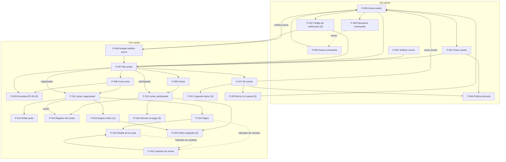

# Especificación de UI de Mi Junta

Versión: 1.1
Fecha: 15/11/2026
Estado: Borrador

Fuente: 00-constitucion.md v0.4, 02-alcance.md v0.4, 06-user-stories.md v0.4 y 07-architecture.md v0.4. Los textos de rechazo y de estado vienen del catálogo §2.9 de 03-reglas-de-negocio.md v0.4, y los nombres de los estados vienen de 04-glosario.md v0.4. La redactó el Agente UI Designer (prompts/clase3/01-ui-designer.xml).

La v1.1 aplica las observaciones ✅ APLICADA de 10-validation-log.md v1.0, con la autorización del usuario del 15/11/2026: C-03 muestra a la vez el rechazo y el contador (fila 1), y P-012 agrega el aviso no bloqueante de la ronda 1 vencida (fila 10) y la nota sobre RN-007 (fila 19). No cambia ninguna RN ni ningún texto del catálogo.

**Cómo leer este documento:**
- `P-NNN` identifica una pantalla y `UF-NN` un flujo de usuario. Los IDs nunca se renumeran ni se reutilizan (PRINCIPIO-001).
- Cada pantalla traza a al menos una HU de 06-user-stories.md. Las HU Should dentro de una pantalla Must se marcan con **(S)**.
- Los textos entre comillas seguidos de una RN, por ejemplo "Esta cuota ya no está pendiente." (RN-130), son **textos del catálogo** y se copian tal cual.
- Los textos marcados con **[TEXTO UI]** son textos de interfaz que este documento propone (títulos, ayudas, estados vacíos y diálogos). No crean reglas, montos ni plazos (PRINCIPIO-012 a). Están reunidos en la sección 6. Esta especificación los adopta, y pasarlos al catálogo §2.9 lo decide el Product Owner. Los rótulos de botones y campos cortos que no traen marca son de diseño.
- **[REQUIERE DECISIÓN]** marca un valor que el spec-pack no define y que este agente no puede decidir. Cada uno tiene una pregunta propuesta en la sección 7.
- Los datos de ejemplo son los de 03-reglas-de-negocio.md (Junta Familia, Junta Oficina, Junta Ventas, Carmen, Jorge, Lucía, Pedro, Marta, Rosa y Ana).
- Todo texto que ve el usuario está en español de Perú y lo trata de "usted" (PRINCIPIO-002, RN-090). Los montos se muestran como `S/ 1,250.50` (RN-091), las fechas como DD/MM/AAAA (RN-092) y las horas como HH:MM de 24 horas (RN-177), en America/Lima (RN-093).
- Las rutas de las pantallas son identificadores de código y van en inglés, salvo `junta` (PRINCIPIO-002).

---

## 1. Inventario de pantallas

### 1.1 Pantallas

Ordenadas por prioridad: primero las Must y después las Should. Ninguna pantalla es Could, porque F-12 a F-15 no tienen HU (06-user-stories.md, "Cobertura"). Ninguna pantalla implementa algo del out-of-scope de 02-alcance.md §2.

| ID | Nombre | Actor principal | HU que implementa | Prioridad | Ruta |
|---|---|---|---|---|---|
| P-001 | Crear cuenta | Persona sin cuenta (invitada u organizadora) | HU-001 | Must | `/signup` |
| P-002 | Verificar correo | Usuario con correo sin verificar | HU-001 | Must | `/verify-email` |
| P-003 | Iniciar sesión | Usuario con cuenta | HU-002, HU-015 (RN-176) | Must | `/login` |
| P-004 | Recuperar contraseña | Usuario con cuenta | HU-002 | Must | `/password-reset` |
| P-005 | Nueva contraseña | Usuario con cuenta | HU-002 | Must | `/password-reset/confirm` |
| P-006 | Política de privacidad | Usuario (lectura) y usuario con una versión nueva por aceptar | HU-001, HU-002 | Must | `/privacy` |
| P-007 | Mis juntas | Organizador y participante | HU-010, HU-001, HU-004, HU-005, HU-018 (S) | Must | `/juntas` |
| P-008 | Crear junta | Organizador | HU-004, HU-013 (S), HU-018 (S) | Must | `/juntas/new` |
| P-009 | Unirse a una junta | Participante invitado | HU-005 | Must | `/join` |
| P-010 | Junta: vista del participante | Participante | HU-010, HU-005, HU-006, HU-013 (S), HU-009 (S), HU-007 (S) | Must | `/juntas/{id}` |
| P-011 | Junta: vista del organizador | Organizador | HU-014, HU-006, HU-010, HU-008, HU-005, HU-007 (S), HU-013 (S) | Must | `/juntas/{id}` |
| P-012 | Editar junta | Organizador | HU-014, HU-013 (S) | Must | `/juntas/{id}/edit` |
| P-013 | Registro del sorteo | Todo miembro | HU-006 | Must | `/juntas/{id}/draw` |
| P-014 | Pagos de la junta | Organizador | HU-008, HU-015, HU-010, HU-009 (S) | Must | `/juntas/{id}/payments` |
| P-015 | Detalle de la cuota | Organizador | HU-008, HU-015, HU-009 (S) | Must | `/juntas/{id}/contributions/{contributionId}` |
| P-016 | Cambios sin enviar | Organizador y participante con cambios hechos sin conexión | HU-015, HU-009 (S) | Must | `/sync` |
| P-017 | Mi cuenta | Usuario | HU-011, HU-002, HU-015, HU-012 (S), HU-016 (S), HU-003 (S), HU-017 (S) | Must | `/account` |
| P-018 | Informar mi pago | Participante | HU-009 | Should | `/juntas/{id}/contributions/{contributionId}/report` |
| P-019 | Asignar orden de turnos | Organizador | HU-007 | Should | `/juntas/{id}/turn-assignment/new` |
| P-020 | Registro del orden asignado | Todo miembro | HU-007 | Should | `/juntas/{id}/turn-assignment` |
| P-021 | Segundo factor | Usuario | HU-003 | Should | `/account/two-factor` |
| P-022 | Código de verificación al iniciar sesión | Usuario con segundo factor activo | HU-003 | Should | `/login/code` |
| P-023 | Borrar mi cuenta | Usuario | HU-017 | Should | `/account/delete` |
| P-024 | Encuesta de KPI-05 | Organizador | HU-018 | Should | Diálogo sobre P-007 o P-011 |

P-010 y P-011 comparten la ruta `/juntas/{id}`: el servidor entrega una u otra según el rol de quien la pide (ADR-009).

### 1.2 Cobertura de las HU

| HU | Prioridad | Pantallas |
|---|---|---|
| HU-001 | Must | P-001, P-002, P-006, P-007 (aviso de correo sin verificar) |
| HU-002 | Must | P-003, P-004, P-005, P-006, P-017 (cerrar sesión) |
| HU-004 | Must | P-007, P-008 |
| HU-014 | Must | P-011, P-012 |
| HU-005 | Must | P-007, P-009, P-010, P-011 (salir) |
| HU-006 | Must | P-010, P-011, P-013 |
| HU-008 | Must | P-011, P-014, P-015 |
| HU-015 | Must | P-003, P-014, P-015, P-016, P-017, componentes C-02 y C-03 |
| HU-010 | Must | P-007, P-010, P-011, P-013, P-014, componente C-02 |
| HU-011 | Must | P-017 (preferencia de recordatorios por correo). El recordatorio es un correo, sin pantalla. |
| HU-019 | Must | Sin pantalla (escenarios técnicos, PREG-055). Ninguna pantalla muestra el DNI, el celular ni el correo de otro miembro, ni ofrece descifrarlos (RN-202, PRINCIPIO-006). |
| HU-009 | Should | P-010, P-014, P-015, P-016, P-018 |
| HU-012 | Should | P-017 (activar el push) |
| HU-016 | Should | P-017 (preferencia del aviso de cuotas vencidas). El aviso es un correo, sin pantalla. |
| HU-018 | Should | P-024, que se abre sobre P-007 o P-011 |
| HU-007 | Should | P-011, P-019, P-020 |
| HU-013 | Should | P-008, P-010, P-011, P-012 |
| HU-017 | Should | P-017, P-023 |
| HU-003 | Should | P-017, P-021, P-022 |

---

## 2. User Flows

Cada flujo indica la pantalla, la acción del usuario y lo que pasa después. Entre corchetes van los pasos que solo ocurren en algunos casos.

### UF-01 · Crear la cuenta y verificar el correo (Lucía) — Must

| Paso | Pantalla | Acción del usuario | Resultado |
|---|---|---|---|
| 1 | P-003 | Pulsa "Crear cuenta" | Abre P-001 |
| 2 | P-001 | Completa nombre, correo y contraseña. [Opcional: DNI y celular] | Validación en el formulario al salir de cada campo |
| 3 | P-001 | [Pulsa "política de privacidad"] | Abre P-006 en modo lectura y vuelve a P-001 sin perder los datos |
| 4 | P-001 | Marca la casilla de consentimiento y "Soy mayor de 18 años" | "Crear cuenta" se habilita al marcar el consentimiento (RN-089) |
| 5 | P-001 | Pulsa "Crear cuenta" | Se crea la cuenta y la sesión (API-001). Abre P-007 con el aviso de correo sin verificar |
| 6 | Correo | Abre el enlace "Mi Junta: verifique su correo" (RN-152) | Abre P-002 |
| 7 | P-002 | Pulsa "Verificar mi correo" | Correo verificado (API-002). Pulsa "Ir a Mis juntas" y vuelve a P-007 sin el aviso |
| 7b | P-002 | [El enlace venció o se usó] | Ve "Este enlace ya se usó o venció. Pida uno nuevo." (RN-154) y "Pedir un enlace nuevo" (API-003) |

### UF-02 · Iniciar sesión — Must (paso 3 Should)

| Paso | Pantalla | Acción del usuario | Resultado |
|---|---|---|---|
| 1 | P-003 | Ingresa correo y contraseña y pulsa "Iniciar sesión" | API-004 |
| 2 | P-003 | [Datos incorrectos o cuenta bloqueada] | Ve "El correo o la contraseña no son correctos." (RN-075) o "Demasiados intentos fallidos. Intente de nuevo en 15 minutos." (RN-075, RN-161) |
| 3 | P-022 **(S)** | [Tiene el segundo factor activo] Ingresa el código de 6 dígitos de su correo | Se abre la sesión (API-030) |
| 4 | P-006 | [Hay una política nueva] Lee la política, marca la casilla y pulsa "Aceptar y continuar" | Se guarda la versión (API-008). Mientras no la acepte, no ve sus juntas (RN-168) |
| 5 | P-007 | — | Ve sus juntas |
| 6 | P-003 | [Tenía cambios sin enviar y su sesión venció] | Ve el aviso de cambios pendientes. Al iniciar sesión, la app envía los cambios (RN-176) |

### UF-03 · Recuperar la contraseña — Must

| Paso | Pantalla | Acción del usuario | Resultado |
|---|---|---|---|
| 1 | P-003 | Pulsa "¿Olvidó su contraseña?" | Abre P-004 |
| 2 | P-004 | Ingresa su correo y pulsa "Enviar enlace" | Ve siempre "Si el correo está registrado, le enviamos un enlace para recuperar su contraseña." (RN-156) |
| 3 | Correo | Abre el enlace "Mi Junta: recupere su contraseña" (RN-155) | Abre P-005 |
| 4 | P-005 | Escribe la nueva contraseña y pulsa "Cambiar contraseña" | Se cambia y se cierran sus demás sesiones (RN-158). Va a P-003 con un aviso de éxito |
| 4b | P-005 | [Enlace vencido o usado] | Ve "Este enlace ya se usó o venció. Pida uno nuevo." (RN-157) y un enlace a P-004 |

### UF-04 · Crear una junta y compartir el código (Carmen) — Must (paso 4 Should)

| Paso | Pantalla | Acción del usuario | Resultado |
|---|---|---|---|
| 1 | P-007 | Pulsa "Crear junta" | Abre P-008. [Correo sin verificar: ve "Verifique su correo para crear una junta o unirse a una." (RN-153)] |
| 2 | P-008 | Completa nombre, cuota, participantes, frecuencia, ronda 1, días de aviso y si participa. [Reglas de la junta **(S)**] | Ve el pozo por ronda calculado (RN-041) |
| 3 | P-008 | Pulsa "Crear junta" | Junta "Abierta" con código (API-009). Abre P-011 |
| 4 | P-024 **(S)** | [Es su primera junta] Responde la encuesta o pulsa "Cerrar sin responder" | Vuelve a P-011 (RN-204, RN-210) |
| 5 | P-011 | Pulsa "Copiar código" | El código queda en el portapapeles. Carmen lo comparte por sus propios medios (S-15) |

### UF-05 · Unirse a una junta con el código (Pedro, Ana) — Must

| Paso | Pantalla | Acción del usuario | Resultado |
|---|---|---|---|
| 1 | P-009 | Escribe el código y pulsa "Unirse" | API-013 |
| 2 | P-009 | [Sin sesión, como Ana] | Ve "Inicie sesión o cree su cuenta para unirse a la junta." (RN-017) con "Iniciar sesión" y "Crear cuenta". La app guarda el código |
| 3 | P-003 o P-001 | [Inicia sesión o crea su cuenta] | La app vuelve a enviar el código guardado (API-013) |
| 4 | P-010 | — | Ve la junta, sus condiciones y "Su turno y sus cuotas aparecerán cuando se fije el orden de turnos." (RN-105) |
| 4b | P-009 | [Código inválido, anulado, junta llena, correo sin verificar o demasiados intentos] | Ve el mensaje del caso (RN-116, RN-020, RN-018, RN-153, RN-117) y sigue en P-009 |

### UF-06 · Ajustar la junta antes de fijar el orden (Carmen) — Must

| Paso | Pantalla | Acción del usuario | Resultado |
|---|---|---|---|
| 1 | P-011 | Pulsa "Editar junta" | Abre P-012 con los datos actuales |
| 2 | P-012 | Cambia la cuota u otro dato y pulsa "Guardar cambios" | API-010. Vuelve a P-011 |
| 3 | P-011 | Pulsa "Quitar" junto a un participante y confirma | El cupo queda libre (API-012, RN-113) |
| 4 | P-011 | Pulsa "Regenerar código" y confirma | Ve el código nuevo. El anterior deja de servir (API-011, RN-020) |

### UF-07 · Ejecutar el sorteo (Jorge) — Must

| Paso | Pantalla | Acción del usuario | Resultado |
|---|---|---|---|
| 1 | P-011 | Con todos los cupos ocupados, pulsa "Ejecutar sorteo" | Abre el diálogo de confirmación del sorteo |
| 2 | P-011 | Pulsa "Ejecutar sorteo" en el diálogo | API-015. La junta pasa a "En curso" |
| 3 | P-013 | — | Ve el orden de turnos y los datos del registro del sorteo |
| 3b | P-011 | [Ronda 1 vencida, sin conexión o el orden ya existe] | Ve el mensaje del caso (RN-122, RN-029, RN-125) |

### UF-08 · Registrar y desmarcar un pago, con o sin conexión (Jorge) — Must

| Paso | Pantalla | Acción del usuario | Resultado |
|---|---|---|---|
| 1 | P-011 | Pulsa "Pagos" | Abre P-014 en la ronda actual |
| 2 | P-014 | Pulsa "Registrar pago" en la cuota de Lucía | Abre P-015 con el formulario de pago |
| 3 | P-015 | Indica la fecha de pago y pulsa "Registrar pago" | Cuota "Pagada", "a tiempo" o "atrasado" (API-017). Vuelve a P-014 |
| 3b | P-015 | [Sin conexión] | El cambio se guarda en el dispositivo; la barra de estado muestra "1 cambio sin enviar." (RN-174) y la cuota lleva la marca "Sin enviar" |
| 4 | P-015 | [Se equivocó] Pulsa "Desmarcar pago" y confirma | Cuota "Pendiente"; el historial conserva el pago y la corrección (API-018) |
| 5 | P-016 | [Al reconectar, un cambio se rechaza] Abre "Cambios sin enviar" desde la barra de estado | Ve "No se pudo guardar un cambio hecho sin conexión: {motivo}." (RN-172) |

### UF-09 · Consultar el estado de la junta, con o sin conexión (Lucía) — Must

| Paso | Pantalla | Acción del usuario | Resultado |
|---|---|---|---|
| 1 | P-007 | Abre la app [sin conexión: ve "Sin conexión. Última sincronización: 20/01/2027 18:45" (RN-095)] | Ve sus juntas desde el último snapshot (RN-094, RN-175) |
| 2 | P-007 | Pulsa "Junta Oficina" | Abre P-010: "Su turno: 7" y el estado de sus cuotas (RN-025, RN-026) |
| 3 | P-010 | Pulsa la pestaña "Miembros" | Ve quién falta pagar la ronda actual (RN-022) |
| 4 | P-010 | Pulsa "Ver sorteo" | Abre P-013 |

### UF-10 · Informar y confirmar un pago (Lucía y Jorge) — Should

| Paso | Pantalla | Acción del usuario | Resultado |
|---|---|---|---|
| 1 | P-010 | Pulsa "Informar mi pago" en su cuota "Pendiente" | Abre P-018 |
| 2 | P-018 | Indica la fecha de pago y pulsa "Informar pago" | Cuota "Por confirmar" (API-027). Jorge recibe el aviso (RN-139) |
| 3 | P-014 | Jorge abre "Pagos" y filtra "Por confirmar" | Ve la cuota de Lucía |
| 4 | P-015 | Pulsa "Confirmar pago" o "Rechazar pago" | "Pagada" con la fecha informada (RN-138), o "Pendiente" con aviso a Lucía (RN-194) |

### UF-11 · Asignar el orden de turnos sin sorteo (Jorge) — Should

| Paso | Pantalla | Acción del usuario | Resultado |
|---|---|---|---|
| 1 | P-011 | Con todos los cupos ocupados, pulsa "Asignar orden" | Abre P-019 |
| 2 | P-019 | Elige un turno distinto para cada participante y pulsa "Guardar orden" | Diálogo de confirmación |
| 3 | P-019 | Confirma | API-029. La junta pasa a "En curso". Abre P-020 |

### UF-12 · Preferencias de notificación y cerrar sesión — Must (push y aviso de cuotas vencidas Should)

| Paso | Pantalla | Acción del usuario | Resultado |
|---|---|---|---|
| 1 | P-007 | Pulsa "Mi cuenta" en la barra de navegación | Abre P-017 |
| 2 | P-017 | Cambia "Recordatorios por correo" [o "Aviso de cuotas vencidas" **(S)**] | API-032 |
| 3 | P-017 | [Pulsa "Activar notificaciones push" **(S)**] | El navegador pide permiso; si lo da, API-031 |
| 4 | P-017 | Pulsa "Cerrar sesión" | [Con cambios sin enviar: diálogo "Hay cambios sin enviar ({n}). Si cierra sesión ahora, se perderán." (RN-198)] La app borra los datos del dispositivo (RN-197) y abre P-003 |

### UF-13 · Salir de una junta antes del orden de turnos (familiar de Carmen) — Must

| Paso | Pantalla | Acción del usuario | Resultado |
|---|---|---|---|
| 1 | P-010 | Pulsa "Salir de la junta" | Diálogo de confirmación |
| 2 | P-010 | Confirma | API-014. Vuelve a P-007 sin esa junta |
| 2b | P-010 | [La junta ya fijó su orden] | Ve "La junta ya fijó su orden de turnos. Ya no es posible salir de ella." (RN-114), sin diálogo |

### UF-14 · Activar el segundo factor — Should

| Paso | Pantalla | Acción del usuario | Resultado |
|---|---|---|---|
| 1 | P-017 | Pulsa "Segundo factor" | Abre P-021 |
| 2 | P-021 | Pulsa "Activar segundo factor" | Llega un código a su correo (API-030) |
| 3 | P-021 | Ingresa el código y pulsa "Confirmar código" | Segundo factor activo (RN-166) |

### UF-15 · Borrar la cuenta (Rosa) — Should

| Paso | Pantalla | Acción del usuario | Resultado |
|---|---|---|---|
| 1 | P-017 | Pulsa "Borrar mi cuenta" | Abre P-023 |
| 2 | P-023 | Lee qué pasa con sus datos, escribe su contraseña y pulsa "Borrar mi cuenta" | API-033. La sesión se cierra y la app abre P-003 |
| 2b | P-023 | [Es miembro de una junta en curso u organiza una junta que no fijó su orden] | Ve el mensaje de RN-182 o RN-207 y su cuenta sigue igual |

---

## 3. Screen Specs

### 3.0 Componentes comunes

Las pantallas de la sección 3 se arman con estos componentes. Sus medidas están en la sección 4.

#### C-01 · Marco de la app (shell)

- `<html lang="es-PE">` (WCAG 3.1.1). Cada pantalla tiene un `<title>` propio con el formato "{Título de la pantalla} · Mi Junta" (WCAG 2.4.2).
- Primer elemento con foco: enlace "Ir al contenido", visible solo al recibir el foco (WCAG 2.4.1).
- **Encabezado** (56 px de alto, `--color-surface`, borde inferior `--color-border`): a la izquierda el texto "Mi Junta" en `--font-weight-bold` 20 px, que lleva a P-007 con sesión o a P-003 sin sesión. Desde 768 px, a la derecha, los enlaces "Mis juntas", "Unirse" y "Mi cuenta".
- **Barra de navegación inferior** (solo con sesión y por debajo de 768 px, 64 px de alto, fija): tres botones de igual ancho con ícono y texto: "Mis juntas" (P-007), "Unirse" (P-009) y "Mi cuenta" (P-017). El activo lleva `aria-current="page"`, texto `--color-primary` y una barra superior de 3 px.
- **Barra de estado** (C-02 y C-03), entre el encabezado y el contenido.
- **Contenido**: `<main id="contenido">`, con ancho máximo de 720 px para formularios y lectura, y de 1200 px para P-014 desde 1024 px. Margen lateral según la sección 4.4.
- Sin sesión (P-001 a P-006, P-009 sin sesión y P-022) no hay barra inferior ni enlaces de navegación.

```
360 px
┌──────────────────────────────────────┐
│ Mi Junta                             │ ← encabezado 56 px
├──────────────────────────────────────┤
│ ⚠ Sin conexión. Última               │ ← C-02 (solo sin red)
│   sincronización: 20/01/2027 18:45   │
├──────────────────────────────────────┤
│ ⟳ 2 cambios sin enviar.      [Ver ›] │ ← C-03 (solo con cambios)
├──────────────────────────────────────┤
│                                      │
│              <main>                  │
│                                      │
├──────────────────────────────────────┤
│ [🏠 Mis juntas] [＋ Unirse] [👤 Mi cuenta]│ ← barra inferior 64 px
└──────────────────────────────────────┘
```

#### C-02 · Aviso sin conexión

- Se muestra mientras el dispositivo no tiene conexión: cuando falla una petición por red o llega el evento `offline` (07-architecture.md §2.2).
- Texto exacto: "Sin conexión. Última sincronización: {fecha} {hora}" (RN-094, RN-095, RN-093, RN-177), con la hora de America/Lima.
- Fondo `--color-offline-bg`, texto `--color-on-dark`, ícono de nube tachada decorativo (`aria-hidden="true"`). Contenedor con `role="status"` para que el lector de pantalla lo anuncie una vez.
- Al volver la conexión desaparece sin mover el contenido de golpe: su altura se reserva y se anima en 150 ms (sin animación con `prefers-reduced-motion`), para no sumar CLS (PRINCIPIO-010).

#### C-03 · Indicador de cambios sin enviar

- Se muestra mientras hay cambios en el outbox. Texto exacto: "1 cambio sin enviar." o "{n} cambios sin enviar." (RN-174).
- A la derecha, el enlace "Ver" lleva a P-016. Fondo `--color-info-soft`, texto `--color-info`.
- Si hay un cambio rechazado sin revisar, el indicador pasa a fondo `--color-danger-soft` con el texto "Un cambio no se pudo guardar." **[TEXTO UI]**, seguido del contador "1 cambio sin enviar." o "{n} cambios sin enviar." (RN-174) mientras queden cambios en el outbox, y del enlace "Ver". Ejemplo: "Un cambio no se pudo guardar. 1 cambio sin enviar. [Ver]". El contador no se oculta, porque RN-174 pide mostrarlo siempre (10-validation-log.md, fila 1).

#### C-04 · Botón no disponible

Se usa cuando una acción existe pero hoy no se puede hacer, y el usuario necesita saber por qué:
- Se ve como el botón deshabilitado (`--color-disabled-bg`, `--color-disabled-text`), pero sigue enfocable y lleva `aria-disabled="true"` y `aria-describedby` hacia el motivo.
- El motivo se muestra siempre debajo del botón, en texto `--color-text-muted` de 16 px, con el texto del catálogo. Por ejemplo, sin conexión: "Necesita conexión a internet para hacer esto." (RN-170).
- Al pulsarlo no llama a la API; mueve el foco al motivo.
- Excepción: "Crear cuenta" en P-001 usa el atributo `disabled` real, porque HU-001 exige `disabled = true` (RN-089).

#### C-05 · Campo de formulario

- Rótulo visible encima del campo (`<label for>`), en 16 px `--font-weight-semibold`. Nunca solo un placeholder (WCAG 1.3.1, 3.3.2).
- Ayuda opcional debajo del rótulo, en `--color-text-muted`, unida con `aria-describedby`.
- Error: debajo del campo, con ícono de alerta y texto `--color-danger`; el campo lleva borde de 2 px `--color-danger` y `aria-invalid="true"`. El texto del error es el del catálogo (WCAG 3.3.1).
- Al enviar un formulario con errores, aparece arriba un resumen con `role="alert"`, la lista de errores como enlaces a cada campo, y el foco pasa al resumen.
- Campos de fecha: texto con formato DD/MM/AAAA, `inputmode="numeric"`, la ayuda "Formato DD/MM/AAAA" **[TEXTO UI]** y un botón de calendario de 44 × 44 px que abre el selector nativo. El valor que se muestra siempre está en DD/MM/AAAA (RN-092), sin depender del idioma del navegador. Si la fecha no existe o no tiene ese formato, el error es "Ingrese la fecha con el formato DD/MM/AAAA, por ejemplo 30/11/2026." **[TEXTO UI]** (PREG-072, sección 7). Si el campo está vacío, se usa el mensaje de campo vacío de cada formulario (por ejemplo RN-002).
- Campos de monto: `inputmode="decimal"`, con el prefijo visual "S/" fuera del campo. El texto se envía tal como lo escribe el usuario (API-009, RN-097).

#### C-06 · Etiqueta de estado

Etiqueta no interactiva con ícono y texto. El color nunca es la única señal (WCAG 1.4.1): siempre lleva el texto del estado.

| Estado | Texto | Ícono | Fondo / texto |
|---|---|---|---|
| Cuota `pending` | "Pendiente" | Reloj | `--color-warning-soft` / `--color-warning` |
| Cuota `awaiting_confirmation` | "Por confirmar" | Reloj de arena | `--color-info-soft` / `--color-info` |
| Cuota `paid` | "Pagada" | Check | `--color-success-soft` / `--color-success` |
| Cambio local sin enviar | "Sin enviar" **[TEXTO UI]** | Flechas circulares | `--color-surface` con borde punteado `--color-border-strong` / `--color-text-muted` |
| Junta `open` | "Abierta" | — | `--color-info-soft` / `--color-info` |
| Junta `full` | "Completa" | — | `--color-primary-soft` / `--color-primary` |
| Junta `in_progress` | "En curso" | — | `--color-success-soft` / `--color-success` |
| Junta `finished` | "Terminada" | — | `--color-neutral-soft` / `--color-text` |
| Pago `is_on_time = true` | "a tiempo" | — | sin fondo / `--color-success` |
| Pago `is_on_time = false` | "atrasado" | — | sin fondo / `--color-warning` |

Los nombres de los estados son los de 04-glosario.md. No se usan "Cancelada", "Rechazada", "activa", "cerrada" ni "moroso".

#### C-07 · Diálogo de confirmación

- `<dialog>` modal con título, texto, botón principal y "Cancelar". El foco entra al título, queda atrapado en el diálogo y vuelve al botón que lo abrió al cerrarse. `Esc` equivale a "Cancelar".
- Se usa antes de una acción que no se puede deshacer o que afecta a otros: ejecutar el sorteo, guardar el orden asignado, quitar a un participante, regenerar el código, salir de la junta, desmarcar un pago, rechazar un pago informado, cerrar sesión con cambios sin enviar y borrar la cuenta.
- Mientras espera la respuesta, el botón principal muestra un indicador de carga y queda con `disabled` para evitar una segunda pulsación (RN-028).
- Por debajo de 768 px el diálogo ocupa el ancho de la pantalla menos 16 px por lado, anclado abajo. Desde 768 px va centrado con 480 px de ancho.

#### C-08 · Aviso de resultado (toast)

- Mensaje breve tras una acción correcta, por ejemplo "Pago registrado." **[TEXTO UI]**. Aparece arriba del contenido, con `role="status"`, y se cierra solo a los 6 segundos o con su botón "Cerrar" de 44 × 44 px. No se usa para errores, que van en el campo o en el resumen (C-05).

#### C-09 · Pestañas de la junta

- En P-010 y P-011: "Resumen", "Miembros" y "Turnos"; en P-011 además "Pagos", que lleva a P-014. Son enlaces de navegación (`<nav aria-label="Secciones de la junta">`) con `aria-current="page"` en la activa, no un `tablist`.
- 48 px de alto, desplazables en horizontal dentro de su propio contenedor si no caben, sin desplazar la página (PRINCIPIO-010).
- "Turnos" lleva a P-013 si el orden salió del sorteo y a P-020 si se asignó a mano **(S)**. Antes de fijar el orden muestra el texto de RN-105 dentro de la pestaña.

#### C-10 · Esqueleto de carga

- Bloques grises (`--color-neutral-soft`) con la misma altura que el contenido final, para que el LCP y el CLS cumplan PRINCIPIO-010. Con datos del snapshot, la pantalla se pinta primero con ellos y no muestra esqueleto.

---

### P-001 · Crear cuenta

| Campo | Detalle |
|---|---|
| Propósito | Crear la cuenta con nombre, correo y contraseña, aceptando la política y confirmando la mayoría de edad |
| Actor | Persona sin cuenta, invitada a una junta o que quiere organizar una |
| HU | HU-001 |
| Prioridad | Must |
| Ruta y título | `/signup` · "Crear cuenta · Mi Junta" |
| API | API-001 |
| Sin conexión | El formulario se ve, pero "Crear cuenta" no envía nada y muestra "Necesita conexión a internet para hacer esto." (RN-170). La app no guarda la cuenta para enviarla después |

**Datos que muestra:** el formulario vacío y, si viene de P-009, el aviso de que después de crear la cuenta se unirá a la junta con el código guardado.

**Acciones:**

| Acción | Control | Condición | Resultado |
|---|---|---|---|
| Leer la política | Enlace "política de privacidad" dentro del rótulo de la casilla | Siempre | Abre P-006 en modo lectura; al volver, los datos siguen en el formulario |
| Mostrar u ocultar la contraseña | Botón de ícono "Mostrar contraseña" de 44 × 44 px dentro del campo | Siempre | Alterna `type="password"` y `type="text"`; `aria-pressed` refleja el estado |
| Crear cuenta | Botón principal "Crear cuenta" | `disabled` mientras la casilla de consentimiento esté desmarcada (RN-089) | API-001. Si responde `201`, abre P-007 con el aviso de correo sin verificar; si venía con un código, abre P-009 y lo envía |
| Ir a iniciar sesión | Enlace "Ya tengo una cuenta" | Siempre | Abre P-003 |

**Reglas de negocio:**
- La casilla de consentimiento y la de "Soy mayor de 18 años" aparecen desmarcadas (RN-088, PRINCIPIO-007).
- No existen los campos "Fecha de nacimiento" ni "Foto" (RN-149, NO-14).
- Nombre de 2 a 80 caracteres (RN-147), contraseña de al menos 8 (RN-074), DNI `^\d{8}$` (RN-085) y celular `^9\d{8}$` (RN-086). DNI y celular son opcionales (RN-148).
- Mensajes: "Complete su nombre, su correo y su contraseña." (RN-146), "Su nombre debe tener entre 2 y 80 caracteres." (RN-147), "Su contraseña debe tener al menos 8 caracteres." (RN-074), "Ingrese un DNI de 8 dígitos." (RN-085), "Ingrese un celular de 9 dígitos que empiece con 9." (RN-086), "Confirme que es mayor de 18 años para crear su cuenta." (RN-181), "Ya existe una cuenta con este correo. Inicie sesión o recupere su contraseña." (RN-150), "Ya existe una cuenta con este DNI." (RN-151) y "Ya existe una cuenta con este celular." (RN-180).
- Una sola casilla cubre la política y las notificaciones (PREG-001). Su rótulo es "Acepto la política de privacidad y recibir notificaciones por correo y push." **[TEXTO UI]** (PREG-069, sección 7). El asesor legal lo revisa junto con el texto de la política.

**Wireframe (360 px):**

```
┌──────────────────────────────────────┐
│ Mi Junta                             │
├──────────────────────────────────────┤
│ Crear cuenta                    (h1) │
│ Con su cuenta podrá crear juntas o   │
│ unirse a una con su código. [TEXTO UI]│
│                                      │
│ Nombre                               │
│ ┌──────────────────────────────────┐ │
│ │ Lucía Quispe                     │ │ autocomplete="name"
│ └──────────────────────────────────┘ │
│ Correo                               │
│ ┌──────────────────────────────────┐ │
│ │ lucia@example.com                │ │ type="email"
│ └──────────────────────────────────┘ │ autocomplete="email"
│ Contraseña                           │
│ Al menos 8 caracteres.   [TEXTO UI]  │
│ ┌────────────────────────────┬─────┐ │
│ │ ••••••••                   │ 👁  │ │ autocomplete="new-password"
│ └────────────────────────────┴─────┘ │
│ DNI (opcional)                       │
│ ┌──────────────────────────────────┐ │ inputmode="numeric"
│ │                                  │ │ maxlength="8"
│ └──────────────────────────────────┘ │
│ Celular (opcional)                   │
│ ┌──────────────────────────────────┐ │ inputmode="numeric"
│ │                                  │ │ maxlength="9"
│ └──────────────────────────────────┘ │ autocomplete="tel-national"
│                                      │
│ ☐ Acepto la política de privacidad   │ ← casilla 24 px, área 44 px
│   y recibir notificaciones por       │   enlace en "política de
│   correo y push.  [TEXTO UI]         │   privacidad" → P-006
│ ☐ Soy mayor de 18 años               │
│                                      │
│ ┌──────────────────────────────────┐ │
│ │          Crear cuenta            │ │ ← disabled hasta marcar
│ └──────────────────────────────────┘ │   el consentimiento
│                                      │
│ Ya tengo una cuenta (enlace) → P-003 │
└──────────────────────────────────────┘
```

**Desde 768 px:** el formulario va en una tarjeta centrada de 480 px de ancho sobre `--color-bg`.

**Estados:**
- **Inicial:** campos vacíos, casillas desmarcadas, botón `disabled`.
- **Error de campo:** C-05 en el campo, sin borrar lo escrito (salvo la contraseña si el servidor rechaza la cuenta por correo repetido: se conserva igual).
- **Error de duplicado (`409`):** mensaje del caso debajo del campo correspondiente (correo, DNI o celular).
- **Enviando:** botón con indicador de carga y `disabled`.
- **Sin conexión:** C-02 arriba y el mensaje de RN-170 debajo del botón al pulsarlo.

---

### P-002 · Verificar correo

| Campo | Detalle |
|---|---|
| Propósito | Confirmar el correo con el enlace que llegó por correo |
| Actor | Usuario con correo sin verificar |
| HU | HU-001 |
| Prioridad | Must |
| Ruta y título | `/verify-email?token=…` · "Verificar correo · Mi Junta" |
| API | API-002 (confirmar), API-003 (pedir un enlace nuevo) |
| Sin conexión | "Verificar mi correo" se muestra como C-04 con "Necesita conexión a internet para hacer esto." (RN-170) |

**Datos que muestra:** el título y un botón. El token no se muestra.

**Acciones:**

| Acción | Control | Condición | Resultado |
|---|---|---|---|
| Verificar | Botón principal "Verificar mi correo" | Token presente en la URL | API-002. Con `200`, estado de éxito |
| Pedir un enlace nuevo | Botón secundario "Pedir un enlace nuevo" | Solo en el estado de error. Exige sesión (API-003); sin sesión, el botón lleva a P-003 | API-003. Muestra "Le enviamos un enlace nuevo a su correo." **[TEXTO UI]** |
| Ir a Mis juntas | Botón principal "Ir a Mis juntas" | Estado de éxito | Abre P-007 |

**Reglas de negocio:**
- El enlace vale 86,400 segundos (RN-152). Uno nuevo anula el anterior (RN-154).
- La verificación se hace al pulsar el botón, no al abrir la página: así un antivirus o un revisor de enlaces del correo que abra la URL antes que el usuario no consume el enlace.
- Error: "Este enlace ya se usó o venció. Pida uno nuevo." (RN-154).

**Wireframe (360 px):**

```
┌──────────────────────────────────────┐
│ Mi Junta                             │
├──────────────────────────────────────┤
│ Verifique su correo             (h1) │
│ Pulse el botón para terminar de      │
│ crear su cuenta.         [TEXTO UI]  │
│ ┌──────────────────────────────────┐ │
│ │       Verificar mi correo        │ │
│ └──────────────────────────────────┘ │
└──────────────────────────────────────┘

Éxito:                                  Error (410):
┌──────────────────────────────────────┐ ┌──────────────────────────────────────┐
│ ✓ Su correo quedó verificado.        │ │ ⚠ Este enlace ya se usó o venció.    │
│   [TEXTO UI]                         │ │   Pida uno nuevo.          (RN-154)  │
│ ┌──────────────────────────────────┐ │ │ ┌──────────────────────────────────┐ │
│ │        Ir a Mis juntas           │ │ │ │      Pedir un enlace nuevo       │ │
│ └──────────────────────────────────┘ │ │ └──────────────────────────────────┘ │
└──────────────────────────────────────┘ └──────────────────────────────────────┘
```

**Estados:** inicial, enviando (botón con carga), éxito (ícono check `--color-success`, mensaje con `role="status"`), error (`role="alert"`), sin conexión.

---

### P-003 · Iniciar sesión

| Campo | Detalle |
|---|---|
| Propósito | Entrar a la cuenta con correo y contraseña |
| Actor | Usuario con cuenta |
| HU | HU-002, HU-015 (RN-176) |
| Prioridad | Must |
| Ruta y título | `/login` · "Iniciar sesión · Mi Junta" |
| API | API-004 |
| Sin conexión | "Iniciar sesión" se muestra como C-04 con "Necesita conexión a internet para hacer esto." (RN-170) |

**Datos que muestra:** el formulario; si hay cambios sin enviar de una sesión vencida, el aviso de cambios pendientes; si viene de P-009 sin sesión, el aviso de RN-017; si viene de P-005, el aviso de contraseña cambiada.

**Acciones:**

| Acción | Control | Condición | Resultado |
|---|---|---|---|
| Iniciar sesión | Botón principal "Iniciar sesión" | Siempre | API-004. `201`: P-006 si `policy_acceptance_required` es `true`, si no P-007 (o P-009 con el código guardado). `202`: abre P-022 **(S)** |
| Recuperar contraseña | Enlace "¿Olvidó su contraseña?" | Siempre | Abre P-004 |
| Crear cuenta | Botón secundario "Crear cuenta" | Siempre | Abre P-001 |

**Reglas de negocio:**
- El correo se compara sin distinguir mayúsculas (RN-191).
- Errores: "El correo o la contraseña no son correctos." (RN-075) y "Demasiados intentos fallidos. Intente de nuevo en 15 minutos." (RN-075, RN-160, RN-161). El mensaje va en un resumen arriba del formulario, sin decir cuál de los dos datos falló.
- Si quedaron cambios sin enviar porque la sesión venció, la app los conserva y los envía después de que el mismo usuario inicie sesión (RN-176). Si inicia sesión otra cuenta, no se envían con esa sesión (07-architecture.md §2.2).

**Wireframe (360 px):**

```
┌──────────────────────────────────────┐
│ Mi Junta                             │
├──────────────────────────────────────┤
│ ┌──────────────────────────────────┐ │ ← solo si hay outbox de una
│ │ ⟳ Tiene 2 cambios sin enviar.    │ │   sesión vencida (RN-176)
│ │ Inicie sesión para enviarlos.    │ │   [TEXTO UI]
│ └──────────────────────────────────┘ │
│ Iniciar sesión                  (h1) │
│                                      │
│ Correo                               │
│ ┌──────────────────────────────────┐ │ autocomplete="email"
│ │                                  │ │
│ └──────────────────────────────────┘ │
│ Contraseña                           │
│ ┌────────────────────────────┬─────┐ │ autocomplete=
│ │                            │ 👁  │ │ "current-password"
│ └────────────────────────────┴─────┘ │
│ ¿Olvidó su contraseña? (enlace)      │
│                                      │
│ ┌──────────────────────────────────┐ │
│ │         Iniciar sesión           │ │
│ └──────────────────────────────────┘ │
│ ──────────────── o ───────────────── │
│ ┌──────────────────────────────────┐ │
│ │          Crear cuenta            │ │ ← secundario
│ └──────────────────────────────────┘ │
└──────────────────────────────────────┘
```

**Estados:** inicial, enviando, error (resumen con `role="alert"`, foco al resumen), bloqueada (mismo resumen con el mensaje de bloqueo), sin conexión, con aviso de outbox, con aviso de código pendiente ("Inicie sesión o cree su cuenta para unirse a la junta." (RN-017)), con aviso de contraseña cambiada ("Su contraseña se cambió. Inicie sesión con la nueva." **[TEXTO UI]**).

---

### P-004 · Recuperar contraseña

| Campo | Detalle |
|---|---|
| Propósito | Pedir el enlace para cambiar la contraseña |
| Actor | Usuario con cuenta que olvidó su contraseña |
| HU | HU-002 |
| Prioridad | Must |
| Ruta y título | `/password-reset` · "Recuperar contraseña · Mi Junta" |
| API | API-006 |
| Sin conexión | "Enviar enlace" se muestra como C-04 con "Necesita conexión a internet para hacer esto." (RN-170) |

**Datos que muestra:** el campo de correo y, después de enviar, el mensaje de RN-156.

**Acciones:**

| Acción | Control | Condición | Resultado |
|---|---|---|---|
| Enviar enlace | Botón principal "Enviar enlace" | Correo escrito | API-006. Siempre muestra "Si el correo está registrado, le enviamos un enlace para recuperar su contraseña." (RN-156) |
| Volver | Enlace "Volver a iniciar sesión" | Siempre | Abre P-003 |

**Reglas de negocio:** la respuesta es igual exista o no la cuenta (RN-156). El enlace vale 3600 segundos (RN-155) y llega aunque el usuario haya desactivado los recordatorios por correo (RN-188).

**Wireframe (360 px):**

```
┌──────────────────────────────────────┐
│ Mi Junta                             │
├──────────────────────────────────────┤
│ Recuperar contraseña            (h1) │
│ Le enviaremos un enlace a su correo. │
│ El enlace sirve por 1 hora. [TEXTO UI]│
│ Correo                               │
│ ┌──────────────────────────────────┐ │
│ │                                  │ │
│ └──────────────────────────────────┘ │
│ ┌──────────────────────────────────┐ │
│ │          Enviar enlace           │ │
│ └──────────────────────────────────┘ │
│ Volver a iniciar sesión (enlace)     │
└──────────────────────────────────────┘

Después de enviar (role="status"):
│ ✉ Si el correo está registrado, le   │
│   enviamos un enlace para recuperar  │
│   su contraseña.           (RN-156)  │
```

**Estados:** inicial, enviando, enviado (el campo y el botón se ocultan; queda el mensaje y el enlace "Volver a iniciar sesión"), sin conexión.

---

### P-005 · Nueva contraseña

| Campo | Detalle |
|---|---|
| Propósito | Elegir una contraseña nueva con el enlace de recuperación |
| Actor | Usuario con cuenta |
| HU | HU-002 |
| Prioridad | Must |
| Ruta y título | `/password-reset/confirm?token=…` · "Nueva contraseña · Mi Junta" |
| API | API-007 |
| Sin conexión | "Cambiar contraseña" se muestra como C-04 con "Necesita conexión a internet para hacer esto." (RN-170) |

**Datos que muestra:** el campo "Nueva contraseña" con su ayuda y el aviso de que se cerrarán las demás sesiones. El token del enlace no se muestra.

**Acciones:**

| Acción | Control | Condición | Resultado |
|---|---|---|---|
| Cambiar contraseña | Botón principal "Cambiar contraseña" | Campo con texto | API-007. `204`: abre P-003 con el aviso de contraseña cambiada |
| Mostrar u ocultar | Botón de ícono de 44 × 44 px | Siempre | Igual que en P-001 |
| Pedir otro enlace | Enlace "Pedir otro enlace" | Solo en el estado de error | Abre P-004 |

**Reglas de negocio:** al menos 8 caracteres, con "Su contraseña debe tener al menos 8 caracteres." (RN-074), y el enlace sigue vigente después de ese error. Enlace vencido o usado: "Este enlace ya se usó o venció. Pida uno nuevo." (RN-155, RN-157). Cambiar la contraseña cierra las demás sesiones (RN-158).

**Wireframe (360 px):**

```
┌──────────────────────────────────────┐
│ Mi Junta                             │
├──────────────────────────────────────┤
│ Nueva contraseña                (h1) │
│ Nueva contraseña                     │
│ Al menos 8 caracteres.   [TEXTO UI]  │
│ ┌────────────────────────────┬─────┐ │ autocomplete="new-password"
│ │                            │ 👁  │ │
│ └────────────────────────────┴─────┘ │
│ Al cambiarla, se cerrará su sesión   │
│ en los demás dispositivos. [TEXTO UI]│
│ ┌──────────────────────────────────┐ │
│ │        Cambiar contraseña        │ │
│ └──────────────────────────────────┘ │
└──────────────────────────────────────┘
```

**Estados:** inicial, enviando, error de longitud (C-05), enlace vencido (`role="alert"` y "Pedir otro enlace"), sin conexión.

---

### P-006 · Política de privacidad

| Campo | Detalle |
|---|---|
| Propósito | Leer la política vigente, y aceptar una versión nueva antes de ver las juntas |
| Actor | Cualquier persona (lectura) y usuario con una versión nueva por aceptar |
| HU | HU-001, HU-002 |
| Prioridad | Must |
| Ruta y título | `/privacy` · "Política de privacidad · Mi Junta". Modo aceptación: `/privacy/accept` |
| API | API-008 (`GET /me`, `POST /consents`) |
| Sin conexión | La lectura funciona si la página está en la caché del Service Worker. "Aceptar y continuar" se muestra como C-04 con el mensaje de RN-170 |

**Datos que muestra:** la versión de la política (por ejemplo "Versión 1.1") y su texto. En el pie, en modo lectura con sesión: "Usted aceptó la versión {versión} el {fecha} a las {hora}." **[TEXTO UI]** (RN-084).

> El texto de la política lo escribe el asesor legal y F-01 no sale al mercado sin él (PREG-001, 02-alcance.md §5). Hasta entonces la pantalla usa un texto de relleno marcado "Borrador".

**Acciones (modo aceptación):**

| Acción | Control | Condición | Resultado |
|---|---|---|---|
| Aceptar | Casilla desmarcada "Acepto la política de privacidad, versión {versión}." **[TEXTO UI]** (PREG-069) y botón principal "Aceptar y continuar" | El botón queda `disabled` mientras la casilla esté desmarcada | API-008 `POST /consents`. Abre P-007 |
| Salir | Botón secundario "Cerrar sesión" | Siempre | Cierra la sesión (API-005) con las mismas reglas de P-017 |

**Reglas de negocio:**
- La versión nueva se muestra con la casilla desmarcada antes de las juntas (RN-168). Si no la acepta, no ve sus juntas y su versión aceptada no cambia (RN-169).
- Mientras no la acepte, la app sigue enviando su outbox y sus recordatorios siguen llegando (RN-189).

**Wireframe (360 px, modo aceptación):**

```
┌──────────────────────────────────────┐
│ Mi Junta                             │
├──────────────────────────────────────┤
│ Política de privacidad          (h1) │
│ Versión 1.1                          │
│ Actualizamos la política. Léala y    │
│ acéptela para ver sus juntas.        │
│                         [TEXTO UI]   │
│ ┌──────────────────────────────────┐ │
│ │ (texto de la política, h2/h3 y   │ │ ← texto con desplazamiento
│ │  párrafos de 16 px, interlineado │ │   normal de la página, sin
│ │  1.5, ancho máximo 65 caracteres)│ │   caja con scroll propio
│ └──────────────────────────────────┘ │
│ ☐ Acepto la política de privacidad,  │
│   versión 1.1. [TEXTO UI]            │
│ ┌──────────────────────────────────┐ │
│ │       Aceptar y continuar        │ │ ← disabled sin la casilla
│ └──────────────────────────────────┘ │
│ ┌──────────────────────────────────┐ │
│ │          Cerrar sesión           │ │ ← secundario
│ └──────────────────────────────────┘ │
└──────────────────────────────────────┘
```

**Estados:** lectura (sin casilla ni botones, con enlace "Volver"), aceptación, enviando, error de red, sin conexión.

---

### P-007 · Mis juntas

| Campo | Detalle |
|---|---|
| Propósito | Ver todas las juntas del usuario y entrar a cada una, crear una junta o unirse a una |
| Actor | Organizador y participante |
| HU | HU-010, HU-001 (aviso de correo sin verificar), HU-004, HU-005, HU-018 (S) |
| Prioridad | Must |
| Ruta y título | `/juntas` · "Mis juntas · Mi Junta" |
| API | API-022, API-025 (snapshot), API-003 (pedir otro enlace), API-034 **(S)** |
| Sin conexión | Muestra todas las juntas del snapshot, aunque nunca las haya abierto (RN-175), con C-02. "Crear junta" y "Unirse con un código" se muestran como C-04 |

**Datos que muestra, por junta:** nombre, etiqueta de estado (C-06), rol y, según el estado:

| Caso | Datos de la tarjeta |
|---|---|
| Participante, junta "Abierta" o "Completa" | "{ocupados} de {total} cupos" **[TEXTO UI]** |
| Participante, junta "En curso" | "Su turno: {n}" (RN-025), "Ronda actual: {n}" y la etiqueta del estado de su cuota de la ronda actual |
| Organizador que participa | "Usted organiza esta junta" **[TEXTO UI]** y los datos de participante |
| Organizador que no participa | "Usted organiza esta junta y no participa" **[TEXTO UI]** y, en curso, "Ronda actual: {n}" |
| Junta "Terminada" | Solo nombre, estado y rol |

**Acciones:**

| Acción | Control | Condición | Resultado |
|---|---|---|---|
| Abrir una junta | Toda la tarjeta es un enlace (mínimo 72 px de alto) | Siempre | Abre P-010 o P-011 según el rol |
| Crear junta | Botón principal "Crear junta" | Con conexión. Correo sin verificar: al pulsarlo ve "Verifique su correo para crear una junta o unirse a una." (RN-153) | Abre P-008 |
| Unirse | Botón secundario "Unirse con un código" | Con conexión | Abre P-009 |
| Pedir otro enlace de verificación | Botón de texto "Pedir otro enlace" dentro del aviso | Correo sin verificar | API-003; el aviso muestra "Le enviamos un enlace nuevo a su correo." **[TEXTO UI]** |
| Responder la encuesta **(S)** | Diálogo P-024 | `GET /organizer-surveys/pending` trae una ola pendiente | Ver P-024 |

**Reglas de negocio:**
- Lista ordenada así: primero "En curso", después "Abierta" y "Completa", al final "Terminada"; dentro de cada grupo, por nombre. Es una decisión de diseño, sin regla de negocio.
- No muestra datos personales de nadie (PRINCIPIO-006).

**Wireframe (360 px):**

```
┌──────────────────────────────────────┐
│ Mi Junta                             │
├──────────────────────────────────────┤
│ ┌──────────────────────────────────┐ │ ← aviso de correo sin
│ │ ✉ Verifique su correo para crear │ │   verificar (fondo
│ │ una junta o unirse a una.        │ │   --color-warning-soft)
│ │                         (RN-153) │ │
│ │ [Pedir otro enlace]              │ │
│ └──────────────────────────────────┘ │
│ Mis juntas                      (h1) │
│ ┌────────────────┐┌────────────────┐ │
│ │  Crear junta   ││ Unirse con un  │ │ ← 2 botones de 48 px;
│ │                ││    código      │ │   apilados si no caben
│ └────────────────┘└────────────────┘ │
│                                      │
│ ┌──────────────────────────────────┐ │
│ │ Junta Oficina        [En curso]  │ │ ← tarjeta-enlace
│ │ Usted organiza esta junta        │ │
│ │ Su turno: 4 · Ronda actual: 2    │ │
│ │ Su cuota: [⏱ Pendiente]       ›  │ │
│ └──────────────────────────────────┘ │
│ ┌──────────────────────────────────┐ │
│ │ Junta Ventas         [En curso]  │ │
│ │ Usted organiza esta junta y no   │ │
│ │ participa · Ronda actual: 2   ›  │ │
│ └──────────────────────────────────┘ │
│ ┌──────────────────────────────────┐ │
│ │ Junta Familia        [Abierta]   │ │
│ │ 11 de 12 cupos                ›  │ │
│ └──────────────────────────────────┘ │
├──────────────────────────────────────┤
│ [Mis juntas]  [Unirse]  [Mi cuenta]  │
└──────────────────────────────────────┘
```

**Desde 768 px:** las tarjetas van en una cuadrícula de 2 columnas con 16 px de separación; desde 1024 px, 3 columnas.

**Estados:**
- **Cargando:** 3 tarjetas C-10.
- **Vacío:** "Todavía no tiene juntas. Cree una o únase con el código que le compartió el organizador." **[TEXTO UI]** con los dos botones.
- **Sin conexión:** C-02 y las juntas del snapshot.
- **Error de red sin snapshot:** "No pudimos cargar sus juntas. Revise su conexión e intente de nuevo." **[TEXTO UI]** y botón "Intentar de nuevo".

---

### P-008 · Crear junta

| Campo | Detalle |
|---|---|
| Propósito | Crear una junta con sus condiciones y obtener su código de invitación |
| Actor | Organizador (cualquier usuario con correo verificado) |
| HU | HU-004, HU-013 (S) (campo "Reglas de la junta"), HU-018 (S) (encuesta al terminar) |
| Prioridad | Must |
| Ruta y título | `/juntas/new` · "Crear junta · Mi Junta" |
| API | API-009 |
| Sin conexión | El formulario se ve, pero "Crear junta" se muestra como C-04 con "Necesita conexión a internet para hacer esto." (RN-170). No se crea ninguna junta ni se genera ningún código |

**Campos:**

| Campo | Control | Valor inicial | Validación y mensaje |
|---|---|---|---|
| Nombre de la junta | Texto, `maxlength="60"` | Vacío | 3 a 60 caracteres: "El nombre de la junta debe tener entre 3 y 60 caracteres." (RN-096) |
| Cuota | Monto (C-05), prefijo "S/", placeholder "300.00" | Vacío | "Ingrese el monto solo con números y un punto decimal, por ejemplo 1250.50." (RN-097); "Ingrese una cuota entre S/ 10.00 y S/ 5,000.00." (RN-003); "La cuota debe ser múltiplo de S/ 0.10, por ejemplo S/ 20.80." (RN-004) |
| Cantidad de participantes | Número con botones "−" y "+" de 44 × 44 px, `inputmode="numeric"` | Vacío | 2 a 50: "Ingrese entre 2 y 50 participantes." (RN-005) |
| Frecuencia | Grupo de opciones (`fieldset` y `legend`): "Semanal", "Quincenal", "Mensual", "Cada cierta cantidad de días" | Ninguna elegida | Obligatoria (RN-002, RN-007) |
| Cada cuántos días | Número, solo visible con "Cada cierta cantidad de días" | Vacío | 2 a 60: "Ingrese un número de días entre 2 y 60." (RN-008) |
| Vencimiento de la ronda 1 | Fecha (C-05) | Vacío | No anterior a hoy en America/Lima: "La fecha de vencimiento de la ronda 1 no puede ser anterior a hoy." (RN-009) |
| Días de aviso previo | Número con "−" y "+" | 3 (RN-011) | 1 a 7: "Ingrese entre 1 y 7 días de aviso previo." (RN-010); menor que el periodo: "Los días de aviso previo deben ser menos que los días entre una cuota y la siguiente." (RN-012) |
| ¿Usted participa? | Grupo de opciones: "Sí participo" / "No participo" | Ninguna elegida | Obligatoria (RN-002, RN-006) |
| Reglas de la junta (opcional) **(S)** | Área de texto de 6 líneas con contador "{n} / 2,000" | Vacío | Hasta 2,000 caracteres: "Las reglas de la junta pueden tener hasta 2,000 caracteres." (RN-179) |

**Datos que muestra además:**
- **Pozo por ronda:** "Pozo por ronda: S/ 3,600.00" **[TEXTO UI]**, calculado en el cliente como cuota × participantes en céntimos enteros (RN-041), visible solo cuando los dos campos son válidos. Es un dato informativo; el servidor vuelve a calcular el pozo.
- Ayuda de "Días de aviso previo": "El primer recordatorio llega por correo esa cantidad de días antes del vencimiento." **[TEXTO UI]** (RN-068).
- Ayuda de "Reglas de la junta": "Todos los miembros podrán leerlas. Mi Junta no las aplica ni calcula multas." **[TEXTO UI]** (F-09, NO-06).

**Acciones:**

| Acción | Control | Condición | Resultado |
|---|---|---|---|
| Elegir frecuencia | Opción del grupo | Siempre | Si el periodo (7, 15, 28 para mensual o N) es igual o menor que los días de aviso ingresados, el campo de aviso pasa a periodo − 1 y se anuncia con `aria-live="polite"` (RN-098) |
| Crear junta | Botón principal "Crear junta" | Con conexión | API-009. `201`: abre P-011 con C-08 "Junta creada. Comparta el código con sus invitados." **[TEXTO UI]**; si `survey_pending` es `true`, abre P-024 **(S)** |
| Cancelar | Botón secundario "Cancelar" | Siempre | Vuelve a P-007 sin guardar |

**Reglas de negocio:** sin límite de juntas por organizador (RN-001). Falta un dato obligatorio: "Complete los campos marcados." (RN-002) en el resumen y cada campo vacío marcado con C-05. Correo sin verificar: "Verifique su correo para crear una junta o unirse a una." (RN-153). El código lo genera el servidor (RN-015, RN-016).

**Wireframe (360 px):**

```
┌──────────────────────────────────────┐
│ Mi Junta                             │
├──────────────────────────────────────┤
│ ‹ Mis juntas                         │ ← enlace de regreso
│ Crear junta                     (h1) │
│                                      │
│ Nombre de la junta                   │
│ ┌──────────────────────────────────┐ │
│ │ Junta Familia                    │ │
│ └──────────────────────────────────┘ │
│ Cuota                                │
│ Lo que paga cada participante en     │
│ cada ronda.              [TEXTO UI]  │
│ S/ ┌───────────────────────────────┐ │
│    │ 300.00                        │ │
│    └───────────────────────────────┘ │
│ Cantidad de participantes            │
│ ┌────┐┌──────────────────────┐┌────┐ │
│ │ −  ││          12          ││ +  │ │
│ └────┘└──────────────────────┘└────┘ │
│ ┌──────────────────────────────────┐ │
│ │ Pozo por ronda: S/ 3,600.00      │ │ ← aria-live="polite"
│ └──────────────────────────────────┘ │
│ Frecuencia                (legend)   │
│ ○ Semanal                            │ ← cada opción 48 px de alto
│ ○ Quincenal                          │
│ ● Mensual                            │
│ ○ Cada cierta cantidad de días       │
│   └ Cada cuántos días [   ]          │ ← solo con la 4.ª opción
│ Vencimiento de la ronda 1            │
│ Formato DD/MM/AAAA                   │
│ ┌────────────────────────────┬─────┐ │
│ │ 30/11/2026                 │ 📅  │ │
│ └────────────────────────────┴─────┘ │
│ Días de aviso previo                 │
│ ┌────┐┌──────────────────────┐┌────┐ │
│ │ −  ││          3           ││ +  │ │
│ └────┘└──────────────────────┘└────┘ │
│ ¿Usted participa?         (legend)   │
│ ● Sí participo                       │
│   Paga cuota y entra al sorteo.      │
│                          [TEXTO UI]  │
│ ○ No participo                       │
│ Reglas de la junta (opcional)   (S)  │
│ ┌──────────────────────────────────┐ │
│ │                                  │ │
│ │                                  │ │
│ └──────────────────────────────────┘ │
│                          0 / 2,000   │
│ ┌──────────────────────────────────┐ │
│ │           Crear junta            │ │
│ └──────────────────────────────────┘ │
│ ┌──────────────────────────────────┐ │
│ │            Cancelar              │ │
│ └──────────────────────────────────┘ │
└──────────────────────────────────────┘
```

**Desde 768 px:** el formulario ocupa 640 px centrados; cuota y cantidad de participantes van en dos columnas.

**Estados:** inicial, con errores (resumen y C-05), enviando, sin conexión, correo sin verificar (mensaje en el resumen al pulsar "Crear junta").

---

### P-009 · Unirse a una junta

| Campo | Detalle |
|---|---|
| Propósito | Ocupar un cupo en una junta con el código de invitación |
| Actor | Participante invitado |
| HU | HU-005 |
| Prioridad | Must |
| Ruta y título | `/join` · "Unirse a una junta · Mi Junta" |
| API | API-013 |
| Sin conexión | "Unirse" se muestra como C-04 con "Necesita conexión a internet para hacer esto." (RN-170) |

**Datos que muestra:** el campo del código y, sin sesión, el aviso de RN-017 con los botones "Iniciar sesión" y "Crear cuenta". Antes de unirse no muestra ningún dato de la junta.

**Campo:** "Código de invitación", texto de 8 caracteres, `autocapitalize="characters"`, `autocomplete="off"`, `spellcheck="false"`, fuente monoespaciada de 24 px con espaciado de 0.15 em. La ayuda dice "Son 8 letras y números. Se lo comparte el organizador." **[TEXTO UI]**. El campo acepta minúsculas y espacios; el servidor los normaliza (RN-190).

**Acciones:**

| Acción | Control | Condición | Resultado |
|---|---|---|---|
| Unirse | Botón principal "Unirse" | Campo con texto | API-013. `201`: abre P-010 con C-08 "Se unió a la {junta}." **[TEXTO UI]**. `200 ALREADY_MEMBER`: abre P-010 sin mensaje de error (RN-021) |
| Iniciar sesión o crear cuenta | Botones "Iniciar sesión" y "Crear cuenta" | Solo sin sesión | Abren P-003 o P-001 y la app guarda el código para enviarlo después (API-013) |

**Mensajes:** "Inicie sesión o cree su cuenta para unirse a la junta." (RN-017), "Verifique su correo para crear una junta o unirse a una." (RN-153), "Este código no es válido." (RN-116), "Este código ya no es válido." (RN-019, RN-020, RN-129), "Esta junta ya no tiene cupos disponibles." (RN-018) y "Demasiados códigos no válidos. Intente de nuevo en 1 hora." (RN-117).

**Wireframe (360 px):**

```
┌──────────────────────────────────────┐
│ Mi Junta                             │
├──────────────────────────────────────┤
│ Unirse a una junta              (h1) │
│ Código de invitación                 │
│ Son 8 letras y números. Se lo        │
│ comparte el organizador. [TEXTO UI]  │
│ ┌──────────────────────────────────┐ │
│ │   M 3 Q X 7 K P A                │ │ ← monoespaciada 24 px
│ └──────────────────────────────────┘ │
│ ┌──────────────────────────────────┐ │
│ │             Unirse               │ │
│ └──────────────────────────────────┘ │
│                                      │
│ Sin sesión (role="alert"):           │
│ ┌──────────────────────────────────┐ │
│ │ Inicie sesión o cree su cuenta   │ │
│ │ para unirse a la junta. (RN-017) │ │
│ │ [ Iniciar sesión ] [Crear cuenta]│ │
│ └──────────────────────────────────┘ │
├──────────────────────────────────────┤
│ [Mis juntas]  [Unirse]  [Mi cuenta]  │
└──────────────────────────────────────┘
```

**Estados:** inicial, enviando, error de código (C-05 en el campo, el código escrito se conserva), sin sesión, sin conexión.

---

### P-010 · Junta: vista del participante

| Campo | Detalle |
|---|---|
| Propósito | Ver el turno propio, el estado de las cuotas propias y quién falta pagar, sin preguntarle al organizador |
| Actor | Participante que no es el organizador |
| HU | HU-010, HU-005 (salir), HU-006 (ver sorteo), HU-013 (S) (leer reglas), HU-009 (S) (informar pago), HU-007 (S) (ver orden asignado) |
| Prioridad | Must |
| Ruta y título | `/juntas/{id}` y `/juntas/{id}/members` · "{nombre de la junta} · Mi Junta" |
| API | API-023, API-024, API-014, API-025 (snapshot) |
| Sin conexión | Toda la consulta funciona con el snapshot y C-02 (RN-094, RN-095). "Informar mi pago" funciona sin conexión **(S)** (RN-170). "Salir de la junta" se muestra como C-04 con el mensaje de RN-170 |

**Datos que muestra:**

*Pestaña "Resumen"*
- Encabezado: nombre de la junta, etiqueta de estado (C-06) y "Organiza: {nombre}" **[TEXTO UI]**.
- **Antes de fijar el orden** ("Abierta" o "Completa"): "{ocupados} de {total} cupos" y el texto "Su turno y sus cuotas aparecerán cuando se fije el orden de turnos." (RN-105).
- **Después de fijar el orden:**
  - Tarjeta destacada "Su turno: {n}" (RN-025), con el texto "Recibe el pozo en la ronda {n}, que vence el {fecha}." **[TEXTO UI]** (RN-037; la fecha sale de su propia cuota de esa ronda).
  - Tarjeta "Ronda actual: {n} de {total}" **[TEXTO UI]**: vencimiento, "Pozo: S/ {monto}" (RN-041), "Recibe el pozo: {nombre} (turno {n})" (dato derivado del turno de cada miembro, RN-022) y la etiqueta del estado de su cuota.
  - Lista "Sus cuotas": una fila por ronda con "Ronda {n}", "Vence {fecha}" y la etiqueta de estado (RN-026). La ronda actual va resaltada con borde `--color-primary` de 2 px.
- **Condiciones de la junta** (sección plegable `<details>`): cuota, pozo, cantidad de participantes, frecuencia, vencimiento de la ronda 1 y días de aviso previo.
- **Reglas de la junta (S):** el texto tal cual, con saltos de línea, o "El organizador no escribió reglas para esta junta." **[TEXTO UI]** (RN-014).

*Pestaña "Miembros"*
- Título "Ronda actual: {n}" y, por miembro, solo: nombre, número de turno, estado de su cuota en la ronda actual, y fecha de vencimiento y estado de su próxima cuota (RN-022). En la última ronda, la próxima cuota se muestra como "—" con el texto accesible "Sin próxima cuota" **[TEXTO UI]** (RN-119).
- El organizador que no participa aparece solo con su nombre y la etiqueta "Organizador" **[TEXTO UI]** (RN-118).
- Arriba de la lista, el resumen "Faltan pagar la ronda {n}: {cantidad}" **[TEXTO UI]**, contado con el estado de la ronda actual de cada miembro.
- Antes de fijar el orden: solo los nombres de los miembros.
- Quien borró su cuenta aparece como "Participante eliminado" (RN-183).
- **Nunca** muestra el correo, el celular, el DNI ni las fechas de pago de otros miembros (RN-023, PRINCIPIO-006): el servidor no los envía.

*Pestaña "Turnos"*: enlace a P-013, o a P-020 si el orden se asignó a mano **(S)**.

**Acciones:**

| Acción | Control | Condición | Resultado |
|---|---|---|---|
| Informar mi pago **(S)** | Botón secundario "Informar mi pago" en la fila de cada cuota "Pendiente" | Cuota propia en "Pendiente" (RN-061, RN-135) | Abre P-018 |
| Ver sorteo | Enlace "Ver sorteo" en la tarjeta de la ronda y pestaña "Turnos" | Orden fijado por sorteo | Abre P-013 |
| Ver orden de turnos **(S)** | Enlace "Ver orden de turnos" | Orden asignado a mano | Abre P-020 |
| Salir de la junta | Botón de texto `--color-danger` "Salir de la junta", al final de "Resumen" | Siempre visible. Antes de fijar el orden abre C-07; después muestra "La junta ya fijó su orden de turnos. Ya no es posible salir de ella." (RN-114) debajo del botón, sin diálogo | API-014. `204`: abre P-007 con C-08 "Salió de la {junta}." **[TEXTO UI]** |

**Diálogo "Salir de la junta" (C-07):** título "¿Salir de la {junta}?", texto "Su cupo quedará libre y necesitará un código nuevo para volver a unirse." **[TEXTO UI]** (RN-111, RN-113), botones "Salir de la junta" (`--color-danger`) y "Cancelar".

**Wireframe (360 px, pestaña "Resumen", junta "En curso"):**

```
┌──────────────────────────────────────┐
│ Mi Junta                             │
├──────────────────────────────────────┤
│ ‹ Mis juntas                         │
│ Junta Oficina                   (h1) │
│ [En curso] · Organiza: Jorge         │
│ ┌─────────┬─────────┬─────────┐      │ ← C-09, 48 px
│ │ Resumen │Miembros │ Turnos  │      │
│ └━━━━━━━━━┴─────────┴─────────┘      │
│ ┌──────────────────────────────────┐ │ ← tarjeta destacada
│ │ Su turno: 7               (36px) │ │   fondo --color-primary-soft
│ │ Recibe el pozo en la ronda 7,    │ │
│ │ que vence el 30/05/2027.         │ │
│ └──────────────────────────────────┘ │
│ ┌──────────────────────────────────┐ │
│ │ Ronda actual: 2 de 10            │ │
│ │ Vence el 30/12/2026              │ │
│ │ Pozo: S/ 10,000.00               │ │
│ │ Recibe el pozo: Pedro (turno 2)  │ │
│ │ Su cuota: [⏱ Pendiente]          │ │
│ │ ┌──────────────────────────────┐ │ │
│ │ │      Informar mi pago   (S)  │ │ │
│ │ └──────────────────────────────┘ │ │
│ │ Ver sorteo ›                     │ │
│ └──────────────────────────────────┘ │
│ Sus cuotas                      (h2) │
│ ┌──────────────────────────────────┐ │
│ │ Ronda 1 · Vence 30/11/2026       │ │
│ │                    [✓ Pagada]    │ │
│ ├──────────────────────────────────┤ │
│ ┃ Ronda 2 · Vence 30/12/2026       ┃ │ ← ronda actual resaltada
│ ┃                  [⏱ Pendiente]   ┃ │
│ ├──────────────────────────────────┤ │
│ │ Ronda 3 · Vence 30/01/2027       │ │
│ │                  [⏱ Pendiente]   │ │
│ │ …                                │ │
│ └──────────────────────────────────┘ │
│ ▸ Condiciones de la junta            │ ← <details>
│ ▸ Reglas de la junta            (S)  │ ← <details>
│                                      │
│ Salir de la junta (texto rojo)       │
│ La junta ya fijó su orden de turnos. │ ← solo tras pulsarlo con
│ Ya no es posible salir de ella.      │   el orden fijado (RN-114)
├──────────────────────────────────────┤
│ [Mis juntas]  [Unirse]  [Mi cuenta]  │
└──────────────────────────────────────┘
```

**Wireframe (360 px, pestaña "Miembros"):**

```
│ Ronda actual: 2                 (h2) │
│ Faltan pagar la ronda 2: 3           │
│ ┌──────────────────────────────────┐ │
│ │ 1 · (nombre)                     │ │
│ │ Ronda 2: [✓ Pagada]              │ │
│ │ Próxima: 30/01/2027 [⏱ Pendiente]│ │
│ ├──────────────────────────────────┤ │
│ │ 2 · Pedro                        │ │
│ │ Ronda 2: [⏱ Pendiente]           │ │
│ │ Próxima: 30/01/2027 [⏱ Pendiente]│ │
│ ├──────────────────────────────────┤ │
│ │ 4 · Jorge                        │ │
│ │ Ronda 2: [✓ Pagada]              │ │
│ │ Próxima: 30/01/2027 [⏱ Pendiente]│ │
│ ├──────────────────────────────────┤ │
│ │ 7 · Lucía (usted)                │ │ ← fila propia con
│ │ …                                │ │   "(usted)" [TEXTO UI]
│ └──────────────────────────────────┘ │
```

La lista va ordenada por número de turno. Desde 768 px, cada fila pone sus tres datos en una sola línea: turno y nombre, "Ronda {n}" y "Próxima".

**Wireframe (360 px, antes de fijar el orden):**

```
│ Junta Familia                   (h1) │
│ [Abierta] · Organiza: Carmen         │
│ 11 de 12 cupos                       │
│ ┌──────────────────────────────────┐ │
│ │ ⓘ Su turno y sus cuotas          │ │
│ │ aparecerán cuando se fije el     │ │
│ │ orden de turnos.        (RN-105) │ │
│ └──────────────────────────────────┘ │
│ ▸ Condiciones de la junta            │
│ ▸ Reglas de la junta            (S)  │
│ Salir de la junta (texto rojo)       │
```

**Estados:** cargando (C-10), antes del orden, en curso, terminada (sin "Informar mi pago" ni "Salir"; todas las cuotas "Pagada"), sin conexión, cuota con cambio sin enviar (etiqueta "Sin enviar" junto a la de estado), sin permiso (`403`: "No tiene acceso a esta junta." **[TEXTO UI]** y enlace a P-007).

---

### P-011 · Junta: vista del organizador

| Campo | Detalle |
|---|---|
| Propósito | Gestionar la junta: compartir el código, ver y quitar miembros, editarla, fijar el orden de turnos y seguir la ronda actual |
| Actor | Organizador |
| HU | HU-014, HU-006, HU-010, HU-008 (acceso a "Pagos"), HU-005 (el organizador no puede salir), HU-007 (S), HU-013 (S) |
| Prioridad | Must |
| Ruta y título | `/juntas/{id}` y `/juntas/{id}/members` · "{nombre de la junta} · Mi Junta" |
| API | API-023, API-024 (vista de organizador), API-011, API-012, API-015, API-025 |
| Sin conexión | Consulta con el snapshot y C-02. "Copiar código" funciona. "Regenerar código", "Quitar", "Editar junta", "Ejecutar sorteo" y "Asignar orden" se muestran como C-04: el sorteo con "Necesita conexión a internet para ejecutar el sorteo." (RN-029) y los demás con "Necesita conexión a internet para hacer esto." (RN-170) |

**Datos que muestra:**

*Antes de fijar el orden ("Abierta" o "Completa")*
- Encabezado: nombre, etiqueta de estado y "{ocupados} de {total} cupos" con una barra de progreso (`<progress>` con texto visible).
- **Tarjeta "Código de invitación"**: el código en monoespaciada de 32 px, partido en dos grupos de 4 para leerlo en voz alta (`K7MP 4XR2`, con `aria-label` que lo deletrea), y el texto "Compártalo por sus propios medios, por ejemplo por WhatsApp. Mi Junta no lo envía." **[TEXTO UI]** (S-15, PRINCIPIO-007). El código solo lo recibe el organizador (API-023).
- **Condiciones de la junta**: cuota, pozo, participantes, frecuencia, vencimiento de la ronda 1, días de aviso previo y "Usted participa: Sí / No" **[TEXTO UI]**.
- **Miembros**: nombre de cada miembro y, para el organizador, la etiqueta "Usted, organizador" **[TEXTO UI]**. Sin correo, celular ni DNI (RN-178).
- **Fijar el orden de turnos**: botón "Ejecutar sorteo" y, **(S)**, "Asignar orden".
- **Reglas de la junta (S):** texto, o "Todavía no escribió reglas para esta junta." **[TEXTO UI]** con el enlace "Escribir reglas" a P-012.

*Después de fijar el orden ("En curso" o "Terminada")*
- **Tarjeta "Ronda actual: {n} de {total}"**: vencimiento, pozo, receptor del pozo, "{pagadas} de {total} cuotas pagadas" **[TEXTO UI]** con barra de progreso, y la lista "Faltan pagar" con los nombres de las cuotas "Pendiente" y "Por confirmar" de la ronda actual, cada uno con su etiqueta. Botón "Ver pagos" a P-014.
- Si participa: tarjeta "Su turno: {n}" y "Sus cuotas" igual que en P-010, sin "Informar mi pago": el organizador registra su propio pago en P-015 (RN-136).
- **Miembros** (pestaña): igual que P-010 más los datos de gestión que recibe el organizador (`user_id`, `is_organizer`, API-024). Nunca datos personales (RN-178).
- El código ya no se muestra: quedó anulado (RN-019, RN-129).

**Acciones:**

| Acción | Control | Condición | Resultado |
|---|---|---|---|
| Copiar código | Botón secundario "Copiar código" | Antes del orden | Copia al portapapeles y muestra C-08 "Código copiado." **[TEXTO UI]** |
| Regenerar código | Botón de texto "Regenerar código" | Antes del orden, con conexión | C-07: "¿Regenerar el código?" / "El código {código} dejará de servir. Quienes todavía no se unieron necesitarán el código nuevo." **[TEXTO UI]** (RN-020). API-011 |
| Editar junta | Botón secundario "Editar junta" | Con conexión. Después del orden, solo el nombre (RN-110) | Abre P-012 |
| Quitar a un participante | Botón de texto "Quitar" en cada fila, salvo la propia | Antes del orden, con conexión | C-07: "¿Quitar a {nombre}?" / "Su cupo quedará libre." **[TEXTO UI]**. API-012. Después del orden no se muestra; una petición directa recibe "La junta ya fijó su orden de turnos. Ya no es posible quitar participantes." (RN-114) |
| Ejecutar sorteo | Botón principal "Ejecutar sorteo" | Con cupos libres: C-04 con "La junta todavía tiene cupos libres. Fije el orden de turnos cuando estén todos ocupados." (RN-027). Con todos ocupados: habilitado | Abre el diálogo del sorteo |
| Asignar orden **(S)** | Botón secundario "Asignar orden" | Igual que el sorteo (RN-126) | Abre P-019 |
| Ver pagos | Botón principal "Ver pagos" y pestaña "Pagos" | Después del orden | Abre P-014 |
| Ver sorteo / orden | Pestaña "Turnos" | Después del orden | Abre P-013 o P-020 **(S)** |
| Salir de la junta | Botón de texto "Salir de la junta" | Siempre, como C-04 con "Usted es la persona organizadora de esta junta y no puede salir de ella." (RN-115) | No llama a la API |

**Diálogo del sorteo (C-07):**
- Título: "¿Ejecutar el sorteo ahora?" **[TEXTO UI]**.
- Texto: "El sorteo se hace una sola vez y su resultado no se puede cambiar. Se crearán las {n} rondas con sus cuotas y el código de invitación dejará de servir." **[TEXTO UI]** (RN-028, RN-035, RN-013, RN-019).
- Dato: "La ronda 1 vence el {fecha}." **[TEXTO UI]**.
- Botones: "Ejecutar sorteo" (principal) y "Cancelar".
- Errores dentro del diálogo: "La fecha de vencimiento de la ronda 1 ya pasó. Cámbiela antes de fijar el orden de turnos." (RN-122) con el enlace "Editar junta"; "Esta junta ya tiene su orden de turnos." (RN-125), que al cerrar recarga la junta.
- Con `201`, abre P-013 con C-08 "Sorteo guardado." **[TEXTO UI]**.

**Wireframe (360 px, junta "Completa"):**

```
┌──────────────────────────────────────┐
│ Mi Junta                             │
├──────────────────────────────────────┤
│ ‹ Mis juntas                         │
│ Junta Familia                   (h1) │
│ [Completa] · 12 de 12 cupos          │
│ ████████████████████████████ 12/12   │
│ ┌─────────┬─────────┬─────────┐      │
│ │ Resumen │Miembros │ Turnos  │      │
│ └━━━━━━━━━┴─────────┴─────────┘      │
│ ┌──────────────────────────────────┐ │
│ │ Código de invitación             │ │
│ │      T9QW 3HZ5           (32 px) │ │
│ │ Compártalo por sus propios       │ │
│ │ medios, por ejemplo por WhatsApp.│ │
│ │ Mi Junta no lo envía.            │ │
│ │ ┌──────────────────────────────┐ │ │
│ │ │        Copiar código         │ │ │
│ │ └──────────────────────────────┘ │ │
│ │ Regenerar código (texto)         │ │
│ └──────────────────────────────────┘ │
│ Fijar el orden de turnos        (h2) │
│ ┌──────────────────────────────────┐ │
│ │         Ejecutar sorteo          │ │ ← habilitado con 12/12
│ └──────────────────────────────────┘ │
│ ┌──────────────────────────────────┐ │
│ │       Asignar orden     (S)      │ │
│ └──────────────────────────────────┘ │
│ Miembros (12)                   (h2) │
│ ┌──────────────────────────────────┐ │
│ │ Carmen · Usted, organizador      │ │
│ ├──────────────────────────────────┤ │
│ │ (familiar 1)            [Quitar] │ │ ← botón de texto 44 px
│ │ …                                │ │
│ └──────────────────────────────────┘ │
│ ▸ Condiciones de la junta            │
│ ▸ Reglas de la junta            (S)  │
│ ┌──────────────────────────────────┐ │
│ │          Editar junta            │ │
│ └──────────────────────────────────┘ │
│ Salir de la junta (C-04)             │
│ Usted es la persona organizadora de  │
│ esta junta y no puede salir de ella. │
├──────────────────────────────────────┤
│ [Mis juntas]  [Unirse]  [Mi cuenta]  │
└──────────────────────────────────────┘
```

**Wireframe (360 px, junta "En curso"):**

```
│ Junta Oficina                   (h1) │
│ [En curso]                           │
│ ┌──────┬────────┬───────┬───────┐    │
│ │Resum.│Miembros│ Pagos │Turnos │    │
│ └━━━━━━┴────────┴───────┴───────┘    │
│ ┌──────────────────────────────────┐ │
│ │ Ronda actual: 2 de 10            │ │
│ │ Vence el 30/12/2026              │ │
│ │ Pozo: S/ 10,000.00               │ │
│ │ Recibe el pozo: Pedro (turno 2)  │ │
│ │ 7 de 10 cuotas pagadas           │ │
│ │ ███████████████████░░░░░░░░      │ │
│ │ Faltan pagar:                    │ │
│ │ · Pedro          [⏱ Pendiente]   │ │
│ │ · Lucía          [⌛ Por confirmar]│ │
│ │ · (nombre)       [⏱ Pendiente]   │ │
│ │ ┌──────────────────────────────┐ │ │
│ │ │          Ver pagos           │ │ │
│ │ └──────────────────────────────┘ │ │
│ └──────────────────────────────────┘ │
│ ┌──────────────────────────────────┐ │
│ │ Su turno: 4                      │ │ ← solo si participa
│ └──────────────────────────────────┘ │
│ Sus cuotas                      (h2) │
│ … (igual que P-010, sin "Informar")  │
│ ▸ Condiciones de la junta            │
│ ┌──────────────────────────────────┐ │
│ │   Editar junta (solo el nombre)  │ │
│ └──────────────────────────────────┘ │
```

**Desde 1024 px:** dos columnas: a la izquierda (60 %) la ronda actual o el código y los miembros; a la derecha (40 %) las condiciones, las reglas y las acciones de gestión.

**Estados:** cargando, "Abierta" (sorteo como C-04), "Completa", "En curso", "Terminada" (sin acciones de gestión salvo editar el nombre), sin conexión, sin permiso (`403`).

---

### P-012 · Editar junta

| Campo | Detalle |
|---|---|
| Propósito | Corregir las condiciones de la junta antes de fijar el orden, o su nombre después |
| Actor | Organizador |
| HU | HU-014, HU-013 (S) |
| Prioridad | Must |
| Ruta y título | `/juntas/{id}/edit` · "Editar {nombre de la junta} · Mi Junta" |
| API | API-010 |
| Sin conexión | "Guardar cambios" se muestra como C-04 con "Necesita conexión a internet para hacer esto." (RN-170) |

**Datos que muestra:** los mismos campos de P-008, con los valores actuales.

- **Antes de fijar el orden:** todos los campos se pueden cambiar (RN-106) con las mismas validaciones de P-008 (RN-107).
- **Después de fijar el orden:** solo "Nombre de la junta" se puede cambiar. Los demás datos se muestran como texto, no como campos, bajo el aviso "La junta ya fijó su orden de turnos. Solo puede cambiar su nombre." (RN-110). "Reglas de la junta" **(S)** también queda como texto (RN-110).

**Acciones:**

| Acción | Control | Condición | Resultado |
|---|---|---|---|
| Guardar cambios | Botón principal "Guardar cambios" | Con conexión | API-010. `200`: vuelve a P-011 con C-08 "Cambios guardados." **[TEXTO UI]** |
| Cancelar | Botón secundario "Cancelar" | Siempre | Vuelve a P-011 sin guardar |

**Reglas de negocio y mensajes:**
- Cantidad menor que los cupos ocupados: "La junta ya tiene {n} cupos ocupados. Ingrese al menos {n} participantes." (RN-108). La ayuda del campo dice "Hoy hay {n} cupos ocupados." **[TEXTO UI]**.
- Pasar a "Sí participo" sin cupos libres: "La junta no tiene cupos libres para que usted participe." (RN-109).
- Pasar a "No participo" libera el cupo del organizador (RN-212). La opción muestra la ayuda "Si deja de participar, su cupo quedará libre." **[TEXTO UI]**.
- Bajar la cantidad a los cupos ocupados pasa la junta a "Completa"; subirla en una junta "Completa" la devuelve a "Abierta" (RN-100, RN-101). P-011 lo refleja al volver.
- **Ronda 1 ya vencida (antes de fijar el orden):** si la fecha escrita es anterior a hoy y no es anterior a la creación de la junta, se puede guardar (RN-009), pero no deja fijar el orden. Debajo del campo "Vencimiento de la ronda 1" aparece un aviso no bloqueante (`--color-warning-soft`, `role="status"`) con el texto "La fecha de vencimiento de la ronda 1 ya pasó. Cámbiela antes de fijar el orden de turnos." (RN-122). El aviso no impide "Guardar cambios" (10-validation-log.md, fila 10).
- **RN-007 en la edición:** el grupo "Frecuencia" siempre tiene un valor elegido y no se puede desmarcar, así que el mensaje de RN-007 no aparece en esta pantalla. La regla se aplica en el servidor y se prueba con una petición directa a API-010 (10-validation-log.md, fila 19; T-011).

**Wireframe (360 px, después de fijar el orden):**

```
┌──────────────────────────────────────┐
│ Mi Junta                             │
├──────────────────────────────────────┤
│ ‹ Junta Oficina                      │
│ Editar junta                    (h1) │
│ ┌──────────────────────────────────┐ │
│ │ ⓘ La junta ya fijó su orden de   │ │
│ │ turnos. Solo puede cambiar su    │ │
│ │ nombre.                 (RN-110) │ │
│ └──────────────────────────────────┘ │
│ Nombre de la junta                   │
│ ┌──────────────────────────────────┐ │
│ │ Junta Oficina                    │ │
│ └──────────────────────────────────┘ │
│ Cuota            S/ 1,000.00         │ ← texto, no campo
│ Participantes    10                  │
│ Frecuencia       Mensual             │
│ Ronda 1          30/11/2026          │
│ Aviso previo     3 días              │
│ ┌──────────────────────────────────┐ │
│ │         Guardar cambios          │ │
│ └──────────────────────────────────┘ │
│ ┌──────────────────────────────────┐ │
│ │            Cancelar              │ │
│ └──────────────────────────────────┘ │
└──────────────────────────────────────┘
```

Antes de fijar el orden, el wireframe es el de P-008 con los valores cargados, el título "Editar junta" y los botones "Guardar cambios" y "Cancelar".

**Estados:** cargando, antes del orden, con la ronda 1 vencida (aviso de RN-122), después del orden, con errores, enviando, sin conexión, sin permiso (`403`).

---

### P-013 · Registro del sorteo

| Campo | Detalle |
|---|---|
| Propósito | Ver el orden de turnos que salió del sorteo y los datos para reproducirlo |
| Actor | Todo miembro de la junta |
| HU | HU-006 |
| Prioridad | Must |
| Ruta y título | `/juntas/{id}/draw` · "Sorteo de {nombre de la junta} · Mi Junta" |
| API | API-016 (y el objeto `draw` del snapshot, API-025) |
| Sin conexión | Se lee completo desde el snapshot, con C-02 |

**Datos que muestra:**
- **Orden de turnos:** lista numerada con turno y nombre, ordenada por turno. La fila del usuario lleva "(usted)" **[TEXTO UI]**.
- **Datos del registro** (PRINCIPIO-008, RN-121, RN-034):
  - "Ejecutado por {nombre} el {fecha} a las {hora}" **[TEXTO UI]** (por ejemplo "Ejecutado por Jorge el 20/11/2026 a las 19:30").
  - "Versión del algoritmo: fisher-yates-v1".
  - "Semilla": 64 caracteres hexadecimales en monoespaciada de 16 px, en bloques de 8 separados por un espacio y con `overflow-wrap: anywhere`, para que no genere scroll horizontal a 360 px (PRINCIPIO-010).
  - "Lista de entrada": lista numerada con los nombres en el orden en que cada uno ocupó su cupo (RN-123).
  - "Resultado": la misma lista reordenada.
- Texto de ayuda: "Con la semilla, la versión del algoritmo y la lista de entrada, cualquier persona obtiene el mismo orden de turnos." **[TEXTO UI]** (RN-033).

**Acciones:**

| Acción | Control | Condición | Resultado |
|---|---|---|---|
| Copiar datos del sorteo | Botón secundario "Copiar datos del sorteo" | Siempre | Copia en texto plano la versión, la semilla, la lista de entrada y el resultado, uno por línea. C-08 "Datos copiados." **[TEXTO UI]** |
| Volver | Enlace "‹ {nombre de la junta}" | Siempre | Abre P-010 o P-011 |

**Reglas de negocio:** el registro es de solo lectura y no tiene ninguna acción que lo cambie (RN-035). Quien no es miembro recibe `403` (RN-024). Si la junta no tiene sorteo, la pestaña "Turnos" no lleva a esta pantalla (API-016 `404`).

**Wireframe (360 px):**

```
┌──────────────────────────────────────┐
│ Mi Junta                             │
├──────────────────────────────────────┤
│ ‹ Junta Oficina                      │
│ Sorteo de turnos                (h1) │
│ Ejecutado por Jorge el 20/11/2026    │
│ a las 19:30                          │
│ Orden de turnos                 (h2) │
│ ┌──────────────────────────────────┐ │
│ │ 1  (nombre)                      │ │
│ │ 2  Pedro                         │ │
│ │ 3  (nombre)                      │ │
│ │ 4  Jorge                         │ │
│ │ …                                │ │
│ │ 7  Lucía (usted)                 │ │ ← resaltada
│ │ …                                │ │
│ └──────────────────────────────────┘ │
│ Datos para verificar el sorteo  (h2) │
│ Con la semilla, la versión del       │
│ algoritmo y la lista de entrada,     │
│ cualquier persona obtiene el mismo   │
│ orden de turnos.         [TEXTO UI]  │
│ Versión del algoritmo                │
│ fisher-yates-v1                      │
│ Semilla                              │
│ ┌──────────────────────────────────┐ │
│ │ 9c2f41ab 07de… (8 bloques de 8,  │ │ ← monoespaciada, se parte
│ │ en 2 o 3 líneas)                 │ │   en varias líneas
│ └──────────────────────────────────┘ │
│ ▸ Lista de entrada (10)              │ ← <details>
│ ▸ Resultado (10)                     │ ← <details>
│ ┌──────────────────────────────────┐ │
│ │     Copiar datos del sorteo      │ │
│ └──────────────────────────────────┘ │
├──────────────────────────────────────┤
│ [Mis juntas]  [Unirse]  [Mi cuenta]  │
└──────────────────────────────────────┘
```

**Estados:** cargando, con datos, sin conexión, sin permiso (`403`).

---

### P-014 · Pagos de la junta

| Campo | Detalle |
|---|---|
| Propósito | Ver cada cuota de cada ronda con su estado y registrar los pagos que el organizador recibe fuera de la app |
| Actor | Organizador |
| HU | HU-008, HU-015, HU-010, HU-009 (S) |
| Prioridad | Must |
| Ruta y título | `/juntas/{id}/payments?round={n}` · "Pagos de {nombre de la junta} · Mi Junta" |
| API | API-020, API-025; las acciones abren P-015 |
| Sin conexión | Consulta con el snapshot. Registrar, desmarcar, confirmar y rechazar funcionan sin conexión (RN-170) y se encolan (C-03) |

**Datos que muestra:**
- Selector "Ronda" (`<select>` de 48 px) con "Ronda {n} · vence {fecha}" **[TEXTO UI]** para cada ronda. Por defecto, la ronda actual.
- Resumen de la ronda: "Pozo: S/ {monto}", "Recibe el pozo: {nombre}" y "{pagadas} de {total} cuotas pagadas".
- Filtro por estado: botones de alternancia de 44 px "Todas", "Pendiente", "Por confirmar" **(S)** y "Pagada", con `aria-pressed`.
- Por cuota (RN-120): nombre del participante, estado (C-06), fecha de pago (por ejemplo "28/11/2026"), "a tiempo" o "atrasado", y "Corregido" **[TEXTO UI]** si el historial tiene correcciones. Una cuota con un cambio local sin enviar lleva también la etiqueta "Sin enviar".
- Nunca muestra correo, celular ni DNI (RN-023, RN-178).

**Acciones:**

| Acción | Control | Condición | Resultado |
|---|---|---|---|
| Cambiar de ronda | Selector "Ronda" | Siempre | Actualiza la lista y la URL (`?round=`) |
| Filtrar | Botones de estado | Siempre | Filtra la lista; el contador "{n} cuotas" **[TEXTO UI]** se anuncia con `aria-live="polite"` |
| Registrar pago | Botón secundario "Registrar pago" en cada cuota "Pendiente" | Cuota `pending` (RN-130) | Abre P-015 con el formulario de pago |
| Revisar pago informado **(S)** | Botón secundario "Revisar" en cada cuota "Por confirmar" | Cuota `awaiting_confirmation` | Abre P-015 |
| Ver detalle | Toda la fila es un enlace | Siempre | Abre P-015 |

**Reglas de negocio:**
- Sin cuotas antes de fijar el orden (RN-105): estado vacío "Las cuotas aparecerán cuando se fije el orden de turnos." **[TEXTO UI]**.
- Se pueden registrar cuotas de rondas futuras (RN-133): el selector permite cualquier ronda.
- Si el organizador participa, su propia cuota aparece en la lista y la registra aquí (RN-136).

**Wireframe (360 px, tarjetas):**

```
┌──────────────────────────────────────┐
│ Mi Junta                             │
├──────────────────────────────────────┤
│ ⟳ 1 cambio sin enviar.       [Ver ›] │ ← C-03
├──────────────────────────────────────┤
│ ‹ Junta Oficina                      │
│ Pagos                           (h1) │
│ Ronda                                │
│ ┌────────────────────────────────┬─┐ │
│ │ Ronda 2 · vence 30/12/2026     │▾│ │
│ └────────────────────────────────┴─┘ │
│ Pozo: S/ 10,000.00 · Recibe: Pedro   │
│ 7 de 10 cuotas pagadas               │
│ ┌─────┐┌─────────┐┌──────────┐┌────┐ │ ← filtros 44 px,
│ │Todas││Pendiente││Por conf. ││Pag.│ │   en 2 filas si no caben
│ └─────┘└─────────┘└──────────┘└────┘ │
│ ┌──────────────────────────────────┐ │
│ │ Pedro              [⏱ Pendiente] │ │
│ │ ┌──────────────────────────────┐ │ │
│ │ │        Registrar pago        │ │ │
│ │ └──────────────────────────────┘ │ │
│ ├──────────────────────────────────┤ │
│ │ Lucía          [⌛ Por confirmar]│ │
│ │ Informó que pagó el 28/12/2026   │ │ [TEXTO UI]
│ │ ┌──────────────────────────────┐ │ │
│ │ │          Revisar        (S)  │ │ │
│ │ └──────────────────────────────┘ │ │
│ ├──────────────────────────────────┤ │
│ │ Jorge (usted)         [✓ Pagada] │ │
│ │ Pagó el 26/12/2026 · a tiempo  › │ │
│ ├──────────────────────────────────┤ │
│ │ (nombre)  [✓ Pagada] [Sin enviar]│ │
│ │ Pagó el 28/12/2026 · a tiempo  › │ │
│ └──────────────────────────────────┘ │
├──────────────────────────────────────┤
│ [Mis juntas]  [Unirse]  [Mi cuenta]  │
└──────────────────────────────────────┘
```

**Desde 1024 px (tabla):** `<table>` con `<caption>` "Cuotas de la ronda {n}" y estas columnas: Participante · Estado · Fecha de pago · A tiempo · Correcciones · Acción. Encabezados con `scope="col"`, filas de 56 px, ancho máximo de 1200 px. Por debajo de 1024 px se muestran las tarjetas, sin scroll horizontal (07-architecture.md §6.2, PRINCIPIO-010).

**Estados:** cargando, antes del orden (vacío), con datos, filtro sin resultados ("No hay cuotas con este estado en la ronda {n}." **[TEXTO UI]**), sin conexión, cuotas con cambios sin enviar, sin permiso (`403` para quien no es el organizador, RN-120).

---

### P-015 · Detalle de la cuota

| Campo | Detalle |
|---|---|
| Propósito | Registrar, desmarcar, confirmar o rechazar el pago de una cuota y ver su historial |
| Actor | Organizador |
| HU | HU-008, HU-015, HU-009 (S) |
| Prioridad | Must |
| Ruta y título | `/juntas/{id}/contributions/{contributionId}` · "Cuota de {nombre}, ronda {n} · Mi Junta" |
| API | API-017, API-018, API-028 **(S)**, API-020 (historial), API-021 (envío sin conexión) |
| Sin conexión | Todas las acciones de esta pantalla funcionan sin conexión (RN-170). El cambio se guarda en el outbox con su hora (RN-173), la cuota muestra el estado nuevo con la etiqueta "Sin enviar" y C-03 cuenta el cambio (RN-174) |

**Datos que muestra:**
- Encabezado: "{nombre} · Ronda {n}" **[TEXTO UI]**, "Vence el {fecha}", "Cuota: S/ {monto}" y la etiqueta de estado.
- Recordatorio fijo: "El dinero se paga fuera de Mi Junta, por ejemplo por Yape, Plin o en efectivo. Aquí solo se registra." **[TEXTO UI]** (PRINCIPIO-004).
- **Historial**, en orden cronológico (RN-058, RN-134), una entrada por evento:
  - "Pago registrado · fecha de pago {fecha} · registrado el {fecha} {hora} por {nombre}" **[TEXTO UI]**;
  - "Pago desmarcado el {fecha} {hora} por {nombre}" **[TEXTO UI]**;
  - **(S)** "Pago informado por {nombre} · fecha de pago {fecha}" y su resolución "Confirmado" o "Rechazado" con fecha y hora **[TEXTO UI]**.

**Acciones según el estado:**

| Estado de la cuota | Acción | Control | Resultado |
|---|---|---|---|
| "Pendiente" | Registrar pago | Campo "Fecha de pago" (C-05, valor inicial: hoy en America/Lima) y botón principal "Registrar pago" | API-017. Cuota "Pagada", "a tiempo" o "atrasado" (RN-052, RN-055, RN-056). C-08 "Pago registrado." **[TEXTO UI]** y vuelve a P-014 |
| "Pagada" | Desmarcar pago | Botón secundario "Desmarcar pago" | C-07: "¿Desmarcar este pago?" / "La cuota volverá a Pendiente. El historial guardará el pago y la corrección. Para cambiar la fecha, desmarque y vuelva a registrar." **[TEXTO UI]** (RN-057, RN-058, RN-134). API-018 |
| "Por confirmar" **(S)** | Confirmar pago | Botón principal "Confirmar pago" | API-028. "Pagada" con la fecha informada (RN-062, RN-138) |
| "Por confirmar" **(S)** | Rechazar pago | Botón secundario "Rechazar pago" | C-07: "¿Rechazar el pago informado?" / "La cuota volverá a Pendiente y {nombre} recibirá un aviso." **[TEXTO UI]** (RN-063, RN-194). API-028 |

**Reglas de negocio y mensajes:**
- "La fecha de pago no puede ser posterior a hoy." (RN-054) y "La fecha de pago no puede ser anterior a la creación de la junta." (RN-132).
- "Esta cuota ya no está pendiente." (RN-130) y "Esta cuota no tiene un pago registrado." (RN-131), por ejemplo si otro dispositivo la cambió antes.
- La fecha de pago no se edita: no existe un control para cambiarla (RN-134, API-019).
- Registrar el último pago pasa la junta a "Terminada", y desmarcarlo la devuelve a "En curso" (RN-103, RN-104). Al volver a P-011 se ve el estado nuevo.
- Una cuota "Por confirmar" no se puede registrar con "Registrar pago" (RN-130): ese control no aparece en ese estado.

**Wireframe (360 px, cuota "Pendiente"):**

```
┌──────────────────────────────────────┐
│ Mi Junta                             │
├──────────────────────────────────────┤
│ ‹ Pagos                              │
│ Lucía · Ronda 1                 (h1) │
│ Vence el 30/11/2026                  │
│ Cuota: S/ 1,000.00   [⏱ Pendiente]   │
│ ┌──────────────────────────────────┐ │
│ │ ⓘ El dinero se paga fuera de Mi  │ │
│ │ Junta, por ejemplo por Yape,     │ │
│ │ Plin o en efectivo. Aquí solo se │ │
│ │ registra.          [TEXTO UI]    │ │
│ └──────────────────────────────────┘ │
│ Fecha de pago                        │
│ Formato DD/MM/AAAA                   │
│ ┌────────────────────────────┬─────┐ │
│ │ 28/11/2026                 │ 📅  │ │
│ └────────────────────────────┴─────┘ │
│ ┌──────────────────────────────────┐ │
│ │          Registrar pago          │ │
│ └──────────────────────────────────┘ │
│ Historial                       (h2) │
│ Todavía no hay pagos registrados.    │ [TEXTO UI]
└──────────────────────────────────────┘
```

**Wireframe (360 px, cuota "Pagada" con corrección):**

```
│ Lucía · Ronda 1                 (h1) │
│ Vence el 30/11/2026                  │
│ Cuota: S/ 1,000.00      [✓ Pagada]   │
│ Pagó el 28/11/2026 · a tiempo        │
│ ┌──────────────────────────────────┐ │
│ │          Desmarcar pago          │ │ ← secundario
│ └──────────────────────────────────┘ │
│ Historial                       (h2) │
│ ● Pago registrado · fecha de pago    │
│   25/11/2026 · registrado el         │
│   28/11/2026 18:40 por Jorge         │
│ ● Pago desmarcado el 02/12/2026      │
│   08:15 por Jorge                    │
│ ● Pago registrado · fecha de pago    │
│   28/11/2026 · registrado el         │
│   02/12/2026 08:16 por Jorge         │
```

**Estados:** cargando, "Pendiente", "Pagada", "Por confirmar" **(S)**, con cambio sin enviar (etiqueta "Sin enviar" y el texto "Se enviará cuando vuelva la conexión." **[TEXTO UI]**), error de validación, sin permiso (`403`).

---

### P-016 · Cambios sin enviar

| Campo | Detalle |
|---|---|
| Propósito | Ver qué cambios hechos sin conexión faltan enviar y cuáles rechazó el servidor, y por qué |
| Actor | Organizador y, **(S)**, participante que informó un pago sin conexión |
| HU | HU-015, HU-009 (S) |
| Prioridad | Must |
| Ruta y título | `/sync` · "Cambios sin enviar · Mi Junta" |
| API | API-021 |
| Sin conexión | Funciona; "Enviar ahora" se muestra como C-04 con "Necesita conexión a internet para hacer esto." (RN-170) |

**Datos que muestra:**
- **Por enviar**, en el orden en que se hicieron (RN-087): por cambio, el tipo ("Pago registrado", "Pago desmarcado", "Pago informado" **(S)**, "Pago confirmado" **(S)**, "Pago rechazado" **(S)** **[TEXTO UI]**), la junta, "{nombre} · ronda {n}" y "Hecho el {fecha} {hora}" **[TEXTO UI]** (RN-173).
- **No se pudieron guardar**: cada rechazo con el texto exacto "No se pudo guardar un cambio hecho sin conexión: {motivo}." (RN-172), con los `{motivo}` de §2.9:
  - "el pago de {nombre} de la ronda {n} ya estaba registrado";
  - "el pago de {nombre} de la ronda {n} ya no estaba registrado";
  - **(S)** "su pago informado de la ronda {n} no se guardó porque la cuota ya no estaba pendiente".
- Encabezado de la lista con C-03 ("{n} cambios sin enviar.", RN-174).

**Acciones:**

| Acción | Control | Condición | Resultado |
|---|---|---|---|
| Enviar ahora | Botón principal "Enviar ahora" | Con conexión y con cambios por enviar | API-021 con todos los cambios en orden. La app también los envía sola al reconectar |
| Revisar la cuota | Enlace "Ver cuota" en cada rechazo | Siempre | Abre P-015 (organizador) o P-010 (participante) |
| Entendido | Botón de texto "Entendido" en cada rechazo | Siempre | Saca el rechazo de la lista |

**Reglas de negocio:** un rechazo no detiene los cambios siguientes (API-021). Con la sesión vencida, los cambios quedan aquí hasta que el mismo usuario inicie sesión (RN-176). La app no deja editar ni borrar un cambio pendiente: solo se envía o se pierde al cerrar sesión con confirmación (RN-198).

**Wireframe (360 px):**

```
┌──────────────────────────────────────┐
│ Mi Junta                             │
├──────────────────────────────────────┤
│ ⚠ Sin conexión. Última               │
│   sincronización: 28/11/2026 18:30   │
├──────────────────────────────────────┤
│ Cambios sin enviar              (h1) │
│ 2 cambios sin enviar.       (RN-174) │
│ Se enviarán solos cuando vuelva la   │
│ conexión.                [TEXTO UI]  │
│ Por enviar                      (h2) │
│ ┌──────────────────────────────────┐ │
│ │ 1. Pago registrado               │ │
│ │ Junta Oficina · Lucía · ronda 1  │ │
│ │ Hecho el 28/11/2026 18:40        │ │
│ ├──────────────────────────────────┤ │
│ │ 2. Pago registrado               │ │
│ │ Junta Oficina · Pedro · ronda 1  │ │
│ │ Hecho el 28/11/2026 18:42        │ │
│ └──────────────────────────────────┘ │
│ ┌──────────────────────────────────┐ │
│ │ Enviar ahora (C-04 sin conexión) │ │
│ └──────────────────────────────────┘ │
│ Necesita conexión a internet para    │
│ hacer esto.                 (RN-170) │
│                                      │
│ No se pudieron guardar          (h2) │
│ ┌──────────────────────────────────┐ │ ← fondo --color-danger-soft
│ │ ⚠ No se pudo guardar un cambio   │ │
│ │ hecho sin conexión: el pago de   │ │
│ │ Lucía de la ronda 1 ya estaba    │ │
│ │ registrado.             (RN-172) │ │
│ │ [Ver cuota]        [Entendido]   │ │
│ └──────────────────────────────────┘ │
├──────────────────────────────────────┤
│ [Mis juntas]  [Unirse]  [Mi cuenta]  │
└──────────────────────────────────────┘
```

**Estados:** sin cambios ("No tiene cambios sin enviar." **[TEXTO UI]**), con cambios por enviar, enviando (indicador de carga y `aria-busy="true"` en la lista), con rechazos, sin conexión.

---

### P-017 · Mi cuenta

| Campo | Detalle |
|---|---|
| Propósito | Ver los datos de la cuenta, elegir las notificaciones, gestionar la seguridad y cerrar sesión |
| Actor | Usuario |
| HU | HU-011, HU-002, HU-015, HU-012 (S), HU-016 (S), HU-003 (S), HU-017 (S) |
| Prioridad | Must |
| Ruta y título | `/account` · "Mi cuenta · Mi Junta" |
| API | API-008 (`GET /me`), API-032, API-031 **(S)**, API-005 |
| Sin conexión | Los datos se ven desde la última carga. Los interruptores y los enlaces a P-021 y P-023 se muestran como C-04 con "Necesita conexión a internet para hacer esto." (RN-170). "Cerrar sesión" funciona y borra los datos del dispositivo (RN-197) |

**Datos que muestra:** el nombre y el correo del propio usuario (API-008), la política aceptada ("Versión {versión}, aceptada el {fecha} a las {hora}" **[TEXTO UI]**) y el estado de cada preferencia. No muestra el DNI ni el celular: `GET /me` no los entrega.

**Secciones y acciones:**

| Sección | Control | Condición | Resultado |
|---|---|---|---|
| Notificaciones | Interruptor "Recordatorios por correo" (`role="switch"`, `aria-checked`) con la ayuda "Le avisamos antes de cada vencimiento, ese día y después, mientras su cuota siga pendiente." **[TEXTO UI]** | Siempre | API-032 `email_reminders_enabled` (RN-187). El enlace de verificación, el de recuperación y el código de verificación llegan siempre (RN-188); la ayuda lo dice: "Los correos de su cuenta le llegarán igual." **[TEXTO UI]** |
| Notificaciones **(S)** | Interruptor "Notificaciones push en este dispositivo" | Navegador con push. En iPhone sin la app en la pantalla de inicio: el interruptor es C-04 con "Para recibir notificaciones en iPhone, agregue Mi Junta a su pantalla de inicio. Necesita iOS 16.4 o posterior." **[TEXTO UI]** (R-10) | Al activarlo, el navegador pide permiso; con permiso, API-031 `POST`. Al desactivarlo, API-031 `DELETE` (RN-073) |
| Notificaciones **(S)** | Interruptor "Aviso de cuotas vencidas" con la ayuda "Un correo por junta, el día después del vencimiento, con quién falta pagar." **[TEXTO UI]** | Solo si organiza al menos una junta (API-022) | API-032 `overdue_notices_enabled` (RN-208, RN-209) |
| Seguridad **(S)** | Fila-enlace "Segundo factor" con el estado "Activado" o "Desactivado" **[TEXTO UI]** | Siempre | Abre P-021 |
| Privacidad | Fila-enlace "Política de privacidad" | Siempre | Abre P-006 en modo lectura |
| Sesión | Botón secundario "Cerrar sesión" | Siempre | Sin cambios sin enviar: API-005, borra los datos del dispositivo (RN-197) y abre P-003. Con cambios: C-07 con "Hay cambios sin enviar ({n}). Si cierra sesión ahora, se perderán." (RN-198) y los botones "Cerrar sesión" (`--color-danger`) y "Cancelar" |
| Cuenta **(S)** | Botón de texto `--color-danger` "Borrar mi cuenta" | Siempre | Abre P-023 |

**Reglas de negocio:** solo correo y push, nunca SMS ni WhatsApp (PRINCIPIO-007): no existe un interruptor para otros canales. Cerrar sesión sin conexión borra el snapshot y el outbox del dispositivo (RN-197); la sesión del servidor vence sola a los 30 días sin peticiones (RN-159).

**Wireframe (360 px):**

```
┌──────────────────────────────────────┐
│ Mi Junta                             │
├──────────────────────────────────────┤
│ Mi cuenta                       (h1) │
│ Lucía Quispe                         │
│ lucia@example.com                    │
│                                      │
│ Notificaciones                  (h2) │
│ ┌──────────────────────────────────┐ │
│ │ Recordatorios por correo  [●──]  │ │ ← switch 44 px de alto
│ │ Le avisamos antes de cada        │ │
│ │ vencimiento, ese día y después,  │ │
│ │ mientras su cuota siga pendiente.│ │
│ │ Los correos de su cuenta le      │ │
│ │ llegarán igual.                  │ │
│ ├──────────────────────────────────┤ │
│ │ Notificaciones push en    [──○]  │ │ (S)
│ │ este dispositivo                 │ │
│ ├──────────────────────────────────┤ │
│ │ Aviso de cuotas vencidas  [●──]  │ │ (S) solo organizadores
│ │ Un correo por junta, el día      │ │
│ │ después del vencimiento, con     │ │
│ │ quién falta pagar.               │ │
│ └──────────────────────────────────┘ │
│ Seguridad y privacidad          (h2) │
│ ┌──────────────────────────────────┐ │
│ │ Segundo factor   Desactivado   › │ │ (S)
│ ├──────────────────────────────────┤ │
│ │ Política de privacidad         › │ │
│ │ Versión 1.0, aceptada el         │ │
│ │ 14/11/2026 a las 10:32           │ │
│ └──────────────────────────────────┘ │
│ ┌──────────────────────────────────┐ │
│ │          Cerrar sesión           │ │
│ └──────────────────────────────────┘ │
│ Borrar mi cuenta (texto rojo)   (S)  │
├──────────────────────────────────────┤
│ [Mis juntas]  [Unirse]  [Mi cuenta]  │
└──────────────────────────────────────┘
```

**Estados:** cargando, con datos, guardando una preferencia (el interruptor muestra carga y vuelve a su valor anterior si falla, con el error debajo), sin conexión, diálogo de cerrar sesión con cambios.

---

### P-018 · Informar mi pago (Should)

| Campo | Detalle |
|---|---|
| Propósito | Avisar al organizador que el participante ya pagó su cuota fuera de la app |
| Actor | Participante que no es el organizador |
| HU | HU-009 |
| Prioridad | Should |
| Ruta y título | `/juntas/{id}/contributions/{contributionId}/report` · "Informar mi pago · Mi Junta" |
| API | API-027 (en línea) o API-021 (sin conexión) |
| Sin conexión | Funciona (RN-170): el informe se guarda en el outbox y C-03 lo cuenta |

**Datos que muestra:** "{junta} · Ronda {n}", "Cuota: S/ {monto}", "Vence el {fecha}" y la ayuda "Informe su pago solo después de pagar al organizador. Su cuota quedará Por confirmar hasta que él o ella lo revise." **[TEXTO UI]**.

**Campo y acción:** el formulario solo tiene el campo "Fecha de pago" (C-05, valor inicial: hoy) y el botón "Informar pago" (RN-065). No hay campo de archivo ni de comprobante (RN-065, PRINCIPIO-004).

| Acción | Control | Condición | Resultado |
|---|---|---|---|
| Informar pago | Botón principal "Informar pago" | Cuota propia "Pendiente" | API-027. Cuota "Por confirmar" (RN-060). Vuelve a P-010 con C-08 "Su pago quedó por confirmar." **[TEXTO UI]** |
| Cancelar | Botón secundario "Cancelar" | Siempre | Vuelve a P-010 |

**Mensajes:** "La fecha de pago no puede ser posterior a hoy." (RN-054), "La fecha de pago no puede ser anterior a la creación de la junta." (RN-132) y "Esta cuota ya no está pendiente." (RN-135). El organizador no ve esta pantalla; si una petición suya llega, recibe "Registre su propio pago con la opción 'Registrar pago'." (RN-136).

**Wireframe (360 px):**

```
┌──────────────────────────────────────┐
│ Mi Junta                             │
├──────────────────────────────────────┤
│ ‹ Junta Oficina                      │
│ Informar mi pago                (h1) │
│ Junta Oficina · Ronda 3              │
│ Cuota: S/ 1,000.00                   │
│ Vence el 30/01/2027                  │
│ Informe su pago solo después de      │
│ pagar al organizador. Su cuota       │
│ quedará Por confirmar hasta que él   │
│ o ella lo revise.        [TEXTO UI]  │
│ Fecha de pago                        │
│ Formato DD/MM/AAAA                   │
│ ┌────────────────────────────┬─────┐ │
│ │ 28/01/2027                 │ 📅  │ │
│ └────────────────────────────┴─────┘ │
│ ┌──────────────────────────────────┐ │
│ │          Informar pago           │ │
│ └──────────────────────────────────┘ │
│ ┌──────────────────────────────────┐ │
│ │            Cancelar              │ │
│ └──────────────────────────────────┘ │
└──────────────────────────────────────┘
```

**Estados:** inicial, con error, enviando, guardado sin conexión (C-03 y la cuota con "Por confirmar" y "Sin enviar" en P-010).

---

### P-019 · Asignar orden de turnos (Should)

| Campo | Detalle |
|---|---|
| Propósito | Fijar el orden de turnos a mano, sin sorteo |
| Actor | Organizador |
| HU | HU-007 |
| Prioridad | Should |
| Ruta y título | `/juntas/{id}/turn-assignment/new` · "Asignar orden · Mi Junta" |
| API | API-029, API-024 (lista de participantes con `user_id`) |
| Sin conexión | "Guardar orden" se muestra como C-04 con "Necesita conexión a internet para hacer esto." (RN-170) |

**Datos que muestra:** la lista de participantes que ocupan un cupo (sin el organizador que no participa, RN-030), en el orden en que se unieron, cada uno con un selector "Turno" de 1 a {n}. Arriba, la ayuda "Elija un turno distinto para cada participante. El orden no se podrá cambiar después." **[TEXTO UI]** (RN-127, RN-128).

**Acciones:**

| Acción | Control | Condición | Resultado |
|---|---|---|---|
| Elegir turno | `<select>` de 48 px por participante, con rótulo accesible "Turno de {nombre}" | Siempre | Si un turno se repite, los dos selectores se marcan con C-05 al guardar |
| Guardar orden | Botón principal "Guardar orden" | Con conexión y con todos los cupos ocupados (RN-126) | C-07: "¿Guardar este orden de turnos?" / "Quedará registrado a su nombre y no se podrá cambiar. Se crearán las rondas con sus cuotas y el código de invitación dejará de servir." **[TEXTO UI]** (RN-039, RN-128, RN-129). API-029. `201`: abre P-020 |
| Cancelar | Botón secundario "Cancelar" | Siempre | Vuelve a P-011 |

**Mensajes:** "Asigne a cada participante un turno distinto, del 1 al {n}." (RN-127), "La junta todavía tiene cupos libres. Fije el orden de turnos cuando estén todos ocupados." (RN-126), "Esta junta ya tiene su orden de turnos." (RN-125) y "La fecha de vencimiento de la ronda 1 ya pasó. Cámbiela antes de fijar el orden de turnos." (RN-122).

**Wireframe (360 px):**

```
┌──────────────────────────────────────┐
│ Mi Junta                             │
├──────────────────────────────────────┤
│ ‹ Junta Ventas                       │
│ Asignar orden de turnos         (h1) │
│ Elija un turno distinto para cada    │
│ participante. El orden no se podrá   │
│ cambiar después.         [TEXTO UI]  │
│ ┌──────────────────────────────────┐ │
│ │ Marta              Turno [ 1 ▾]  │ │ ← select 48 px
│ ├──────────────────────────────────┤ │
│ │ (participante 2)   Turno [ 2 ▾]  │ │
│ ├──────────────────────────────────┤ │
│ │ …                                │ │
│ └──────────────────────────────────┘ │
│ ┌──────────────────────────────────┐ │
│ │           Guardar orden          │ │
│ └──────────────────────────────────┘ │
│ ┌──────────────────────────────────┐ │
│ │            Cancelar              │ │
│ └──────────────────────────────────┘ │
└──────────────────────────────────────┘
```

**Estados:** inicial (selectores sin valor), con turnos repetidos o faltantes (resumen y C-05), enviando, sin conexión, sin permiso (`403`).

---

### P-020 · Registro del orden asignado (Should)

| Campo | Detalle |
|---|---|
| Propósito | Ver el orden de turnos que asignó el organizador, quién lo asignó y cuándo |
| Actor | Todo miembro |
| HU | HU-007 |
| Prioridad | Should |
| Ruta y título | `/juntas/{id}/turn-assignment` · "Orden de turnos de {nombre de la junta} · Mi Junta" |
| API | API-035 |
| Sin conexión | Se lee desde el snapshot, con C-02 |

**Datos que muestra:** "Asignado por {nombre} el {fecha} a las {hora}" **[TEXTO UI]** (por ejemplo "Asignado por Jorge el 20/11/2026 a las 19:45", RN-195, RN-093, RN-177), la frase "Este orden lo asignó el organizador, sin sorteo." **[TEXTO UI]** y la lista numerada de turno y nombre, con "(usted)" en la fila propia.

**Acciones:** solo "‹ {nombre de la junta}" para volver. El registro no se puede cambiar (RN-128).

**Wireframe (360 px):**

```
┌──────────────────────────────────────┐
│ Mi Junta                             │
├──────────────────────────────────────┤
│ ‹ Junta Ventas                       │
│ Orden de turnos                 (h1) │
│ Este orden lo asignó el organizador, │
│ sin sorteo.              [TEXTO UI]  │
│ Asignado por Jorge el 20/11/2026     │
│ a las 19:45                          │
│ ┌──────────────────────────────────┐ │
│ │ 1  Marta (usted)                 │ │
│ │ 2  (nombre)                      │ │
│ │ …                                │ │
│ └──────────────────────────────────┘ │
└──────────────────────────────────────┘
```

**Estados:** cargando, con datos, sin conexión, sin permiso (`403`).

---

### P-021 · Segundo factor (Should)

| Campo | Detalle |
|---|---|
| Propósito | Activar o desactivar el código de verificación por correo al iniciar sesión |
| Actor | Usuario |
| HU | HU-003 |
| Prioridad | Should |
| Ruta y título | `/account/two-factor` · "Segundo factor · Mi Junta" |
| API | API-030 |
| Sin conexión | Todos los botones se muestran como C-04 con "Necesita conexión a internet para hacer esto." (RN-170) |

**Datos que muestra:** el estado actual y la explicación "Cada vez que inicie sesión, le enviaremos a su correo un código de 6 dígitos que vale 10 minutos." **[TEXTO UI]** (RN-079, RN-080).

**Acciones:**

| Estado | Acción | Control | Resultado |
|---|---|---|---|
| Desactivado | Activar | Botón principal "Activar segundo factor" | API-030 `POST /two-factor/activation`. Aparece el campo "Código de verificación" |
| Código enviado | Confirmar | Campo de 6 dígitos (`inputmode="numeric"`, `autocomplete="one-time-code"`, `maxlength="6"`) y botón "Confirmar código" | API-030. Estado "Activado" (RN-166) |
| Código enviado | Pedir otro código | Botón de texto "Pedir otro código" | Anula el anterior (RN-163) |
| Activado | Desactivar | Campos "Contraseña" y "Código de verificación", botón "Enviar código" y botón "Desactivar segundo factor" | API-030 `POST /two-factor/deactivation`. Exige los dos datos (RN-167) |

**Mensajes:** "El código no es correcto. Revíselo e intente de nuevo." (RN-166), "Este código ya no es válido. Pida uno nuevo." (RN-080, RN-081, RN-162, RN-163) y "Ya pidió varios códigos. Intente de nuevo en {n} minutos." (RN-164).

**Wireframe (360 px, activando):**

```
┌──────────────────────────────────────┐
│ Mi Junta                             │
├──────────────────────────────────────┤
│ ‹ Mi cuenta                          │
│ Segundo factor                  (h1) │
│ Estado: Desactivado                  │
│ Cada vez que inicie sesión, le       │
│ enviaremos a su correo un código de  │
│ 6 dígitos que vale 10 minutos.       │
│                          [TEXTO UI]  │
│ ✉ Le enviamos un código a            │
│   lucia@example.com.     [TEXTO UI]  │
│ Código de verificación               │
│ ┌──────────────────────────────────┐ │
│ │ 4 8 2 9 1 5                      │ │ ← monoespaciada 24 px
│ └──────────────────────────────────┘ │
│ ┌──────────────────────────────────┐ │
│ │         Confirmar código         │ │
│ └──────────────────────────────────┘ │
│ Pedir otro código (texto)            │
└──────────────────────────────────────┘
```

**Estados:** desactivado, código enviado, con error de código, límite de pedidos, activado, desactivando, sin conexión.

---

### P-022 · Código de verificación al iniciar sesión (Should)

| Campo | Detalle |
|---|---|
| Propósito | Terminar de iniciar sesión con el código que llegó al correo |
| Actor | Usuario con segundo factor activo |
| HU | HU-003 |
| Prioridad | Should |
| Ruta y título | `/login/code` · "Código de verificación · Mi Junta" |
| API | API-030 (`POST /sessions/two-factor`, `POST /two-factor/verification-codes`) |
| Sin conexión | "Entrar" se muestra como C-04 con "Necesita conexión a internet para hacer esto." (RN-170) |

**Datos que muestra:** "Le enviamos un código de 6 dígitos a su correo. Vale hasta las {hora}." **[TEXTO UI]** con la hora de `code_expires_at` en America/Lima (API-004 `202`).

**Acciones:** campo "Código de verificación" (igual que en P-021) y botón principal "Entrar"; botón de texto "Pedir otro código"; enlace "Volver a iniciar sesión" a P-003. Con `201`, sigue el mismo camino que P-003 (P-006 o P-007).

**Mensajes:** los mismos de P-021.

**Wireframe (360 px):**

```
┌──────────────────────────────────────┐
│ Mi Junta                             │
├──────────────────────────────────────┤
│ Código de verificación          (h1) │
│ Le enviamos un código de 6 dígitos a │
│ su correo. Vale hasta las 10:10.     │
│                          [TEXTO UI]  │
│ Código de verificación               │
│ ┌──────────────────────────────────┐ │
│ │                                  │ │
│ └──────────────────────────────────┘ │
│ ┌──────────────────────────────────┐ │
│ │             Entrar               │ │
│ └──────────────────────────────────┘ │
│ Pedir otro código (texto)            │
│ Volver a iniciar sesión (enlace)     │
└──────────────────────────────────────┘
```

**Estados:** inicial, enviando, código equivocado, código vencido o anulado, límite de pedidos, sin conexión.

---

### P-023 · Borrar mi cuenta (Should)

| Campo | Detalle |
|---|---|
| Propósito | Borrar la cuenta y los datos personales cuando ya no hay juntas en curso |
| Actor | Usuario |
| HU | HU-017 |
| Prioridad | Should |
| Ruta y título | `/account/delete` · "Borrar mi cuenta · Mi Junta" |
| API | API-033 |
| Sin conexión | "Borrar mi cuenta" se muestra como C-04 con "Necesita conexión a internet para hacer esto." (RN-170) |

**Datos que muestra:** qué pasa al borrar la cuenta **[TEXTO UI]**, sin agregar reglas:
- "Se borrarán su nombre, su correo, su contraseña, su DNI y su celular." (RN-185)
- "Saldrá de las juntas que todavía no fijaron su orden de turnos." (RN-186)
- "En las juntas terminadas, sus pagos se conservan a nombre de "Participante eliminado"." (RN-183, RN-184)
- "No podrá borrarla si es miembro de una junta en curso o si organiza una junta que todavía no fija su orden de turnos." (RN-182, RN-207)

**Acciones:**

| Acción | Control | Condición | Resultado |
|---|---|---|---|
| Borrar | Campo "Contraseña" y botón `--color-danger` "Borrar mi cuenta" | Con conexión | C-07: "¿Borrar su cuenta?" / "Esta acción no se puede deshacer." **[TEXTO UI]**. API-033. `204`: borra los datos del dispositivo y abre P-003 con el aviso "Su cuenta fue borrada." **[TEXTO UI]** |
| Cancelar | Botón secundario "Cancelar" | Siempre | Vuelve a P-017 |

**Mensajes:** "Usted es miembro de una junta en curso. Podrá borrar su cuenta cuando todas sus juntas en curso terminen." (RN-182) y "Usted organiza una junta que todavía no fija su orden de turnos. No puede borrar su cuenta mientras la organice." (RN-207). Contraseña incorrecta (`401`): "La contraseña no es correcta." **[TEXTO UI]** (PREG-070, sección 7), debajo del campo "Contraseña".

**Wireframe (360 px):**

```
┌──────────────────────────────────────┐
│ Mi Junta                             │
├──────────────────────────────────────┤
│ ‹ Mi cuenta                          │
│ Borrar mi cuenta                (h1) │
│ ┌──────────────────────────────────┐ │ ← fondo --color-danger-soft
│ │ · Se borrarán su nombre, su      │ │
│ │   correo, su contraseña, su DNI  │ │
│ │   y su celular.                  │ │
│ │ · Saldrá de las juntas que       │ │
│ │   todavía no fijaron su orden.   │ │
│ │ · En las juntas terminadas, sus  │ │
│ │   pagos se conservan a nombre de │ │
│ │   "Participante eliminado".      │ │
│ │ · No podrá borrarla si es        │ │
│ │   miembro de una junta en curso  │ │
│ │   o si organiza una junta que    │ │
│ │   todavía no fija su orden.      │ │
│ └──────────────────────────────────┘ │
│ Contraseña                           │
│ ┌────────────────────────────┬─────┐ │
│ │                            │ 👁  │ │
│ └────────────────────────────┴─────┘ │
│ ┌──────────────────────────────────┐ │
│ │        Borrar mi cuenta          │ │ ← --color-danger
│ └──────────────────────────────────┘ │
│ ┌──────────────────────────────────┐ │
│ │            Cancelar              │ │
│ └──────────────────────────────────┘ │
└──────────────────────────────────────┘
```

**Estados:** inicial, diálogo de confirmación, enviando, rechazo por junta en curso u organizada, contraseña incorrecta, sin conexión.

---

### P-024 · Encuesta de KPI-05 (Should)

| Campo | Detalle |
|---|---|
| Propósito | Medir las horas que el organizador dedica a sus juntas y los recordatorios que envía a mano |
| Actor | Organizador |
| HU | HU-018 |
| Prioridad | Should |
| Ruta y título | Diálogo modal (C-07 ampliado) sobre P-011, al crear la primera junta, o sobre P-007, al abrir la app con una ola pendiente. Título del diálogo: "Una encuesta de 3 preguntas" **[TEXTO UI]** |
| API | API-034 |
| Sin conexión | No se abre sin conexión; queda pendiente para la próxima vez que la app tenga red |

**Preguntas (RN-206, solo estas 3):**

| Pregunta | Control |
|---|---|
| "¿Cuántas horas al mes dedica a gestionar sus juntas?" | Número entero, `inputmode="numeric"` **[REQUIERE DECISIÓN]** (rango, sección 7) |
| "¿Cuántos recordatorios envía a mano al mes?" | Número entero, `inputmode="numeric"` **[REQUIERE DECISIÓN]** (rango, sección 7) |
| "¿Reenvía por WhatsApp los recordatorios de Mi Junta?" | Grupo de opciones "Sí" / "No" |

Los textos de las preguntas son **[TEXTO UI]** redactados a partir de RN-206. La encuesta no pide celular, correo ni datos de otros miembros (RN-206).

**Acciones:**

| Acción | Control | Resultado |
|---|---|---|
| Enviar respuestas | Botón principal "Enviar respuestas" | `POST /organizer-surveys`. Cierra el diálogo con C-08 "Gracias por responder." **[TEXTO UI]** |
| Cerrar sin responder | Botón secundario "Cerrar sin responder" y botón de cierre de 44 × 44 px | `POST /organizer-surveys/{wave}/dismissal` (RN-210). Esa encuesta no vuelve a mostrarse (RN-211) |

**Wireframe (360 px):**

```
┌──────────────────────────────────────┐
│ ░░░░░░░ (P-011 detrás, atenuada) ░░░ │
│ ┌──────────────────────────────────┐ │
│ │ Una encuesta de 3 preguntas   [✕]│ │
│ │ Nos ayuda a medir si Mi Junta le │ │
│ │ ahorra tiempo.      [TEXTO UI]   │ │
│ │ ¿Cuántas horas al mes dedica a   │ │
│ │ gestionar sus juntas?            │ │
│ │ ┌──────────────────────────────┐ │ │
│ │ │ 10                           │ │ │
│ │ └──────────────────────────────┘ │ │
│ │ ¿Cuántos recordatorios envía a   │ │
│ │ mano al mes?                     │ │
│ │ ┌──────────────────────────────┐ │ │
│ │ │ 40                           │ │ │
│ │ └──────────────────────────────┘ │ │
│ │ ¿Reenvía por WhatsApp los        │ │
│ │ recordatorios de Mi Junta?       │ │
│ │ ● Sí   ○ No                      │ │
│ │ ┌──────────────────────────────┐ │ │
│ │ │       Enviar respuestas      │ │ │
│ │ └──────────────────────────────┘ │ │
│ │ ┌──────────────────────────────┐ │ │
│ │ │     Cerrar sin responder     │ │ │
│ │ └──────────────────────────────┘ │ │
│ └──────────────────────────────────┘ │
└──────────────────────────────────────┘
```

**Estados:** abierta, con error de validación, enviando, cerrada.

---

## 4. Design Tokens

Los tokens se definen como variables CSS en `:root` (por ejemplo `--color-primary`). El Agente UI Designer eligió la paleta y la tipografía el 14/11/2026, porque el usuario lo autorizó a tomar las decisiones de diseño. El Product Owner puede cambiarlas sin tocar ninguna regla. Esta versión define solo el tema claro.

### 4.1 Colores

Contrastes calculados con la fórmula de luminancia relativa de WCAG 2.2. Todo texto cumple ≥ 4.5:1 sobre su fondo (PRINCIPIO-010).

| Token | Valor | Uso | Contraste |
|---|---|---|---|
| `--color-primary` | `#0F5C4D` | Botón principal, enlaces, pestaña activa, foco de marca | 7.90:1 con `#FFFFFF`; 7.35:1 sobre `--color-bg` |
| `--color-primary-hover` | `#0B4A3E` | Botón principal al pasar el cursor o al pulsar | 10.18:1 con `#FFFFFF` |
| `--color-primary-soft` | `#E3F1EE` | Tarjeta "Su turno", etiqueta "Completa" | 6.80:1 con `--color-primary` |
| `--color-secondary` | `#26456E` | Botón secundario (borde y texto), enlaces de texto | 9.73:1 sobre `#FFFFFF`; 9.05:1 sobre `--color-bg` |
| `--color-accent` | `#F4B740` | Acento decorativo: borde de la ronda actual en listas, barra de progreso | 9.28:1 con `--color-text` encima |
| `--color-accent-soft` | `#FFF6DF` | Fondo de la tarjeta del código de invitación | 15.47:1 con `--color-text` |
| `--color-bg` | `#F6F7F5` | Fondo de la página | — |
| `--color-surface` | `#FFFFFF` | Tarjetas, encabezado, diálogos, campos | — |
| `--color-text` | `#1B1F1D` | Texto principal | 16.66:1 sobre `--color-surface`; 15.50:1 sobre `--color-bg` |
| `--color-text-muted` | `#4D5652` | Ayudas, datos secundarios | 7.59:1 sobre `--color-surface`; 7.06:1 sobre `--color-bg` |
| `--color-on-dark` | `#FFFFFF` | Texto sobre `--color-primary`, `--color-danger` y `--color-offline-bg` | Ver cada fondo |
| `--color-border` | `#D5DAD7` | Separadores y bordes de tarjeta (decorativos) | — |
| `--color-border-strong` | `#6B7570` | Borde de campos, casillas e interruptores | 4.77:1 sobre `--color-surface` |
| `--color-success` / `--color-success-soft` | `#17663A` / `#E4F4EA` | "Pagada", "En curso", "a tiempo", éxito | 6.15:1 |
| `--color-warning` / `--color-warning-soft` | `#8A4B00` / `#FDF1DC` | "Pendiente", "atrasado", aviso de correo sin verificar | 6.09:1 |
| `--color-info` / `--color-info-soft` | `#1D4E89` / `#E3EDF9` | "Por confirmar", "Abierta", C-03 | 7.09:1 |
| `--color-danger` / `--color-danger-soft` | `#B3261E` / `#FBE9E7` | Errores, acciones destructivas, rechazos de sincronización | 5.58:1 sobre el suave; 6.54:1 sobre `#FFFFFF` y con `#FFFFFF` encima |
| `--color-neutral-soft` | `#EEF0EE` | "Terminada", esqueleto de carga | 14.55:1 con `--color-text` |
| `--color-disabled-bg` / `--color-disabled-text` | `#EEF0EE` / `#4D5652` | Botón deshabilitado y C-04 | 6.62:1 |
| `--color-offline-bg` | `#2D3330` | C-02 | 12.90:1 con `#FFFFFF` |
| `--color-focus` | `#1D4E89` | Anillo de foco | — |

El color nunca es la única señal de un estado: cada estado lleva texto y, en las etiquetas, un ícono (WCAG 1.4.1).

### 4.2 Tipografía

- **Familia:** la del sistema, sin fuentes web, para no sumar peso ni CLS (07-architecture.md §6.2): `--font-sans: system-ui, -apple-system, "Segoe UI", Roboto, "Noto Sans", Arial, sans-serif`.
- **Monoespaciada** (códigos de invitación, códigos de verificación y semilla): `--font-mono: ui-monospace, "SF Mono", Menlo, Consolas, "Liberation Mono", monospace`.
- **Tamaño mínimo:** 16 px para todo texto, incluidas ayudas, etiquetas y la barra inferior (PRINCIPIO-010). Los tamaños van en `rem` con `html { font-size: 100% }`, para respetar el tamaño que elija el usuario.

| Token | Tamaño / interlineado | Peso | Uso |
|---|---|---|---|
| `--text-display` | 36 px / 1.2 | 700 | "Su turno: 7" |
| `--text-h1` | 28 px / 1.25 | 700 | Título de la pantalla |
| `--text-h2` | 22 px / 1.3 | 700 | Secciones |
| `--text-h3` | 18 px / 1.4 | 600 | Títulos de tarjeta |
| `--text-body` | 16 px / 1.5 | 400 | Texto base, campos y botones |
| `--text-body-strong` | 16 px / 1.5 | 600 | Rótulos, montos, etiquetas de estado |
| `--text-code-lg` | 32 px / 1.2, espaciado 0.15 em | 700, mono | Código de invitación en P-011 |
| `--text-code` | 24 px / 1.3, espaciado 0.15 em | 500, mono | Campos de código en P-009, P-021 y P-022 |
| `--text-mono` | 16 px / 1.5 | 400, mono | Semilla en P-013 |

- **Pesos:** `--font-weight-regular: 400`, `--font-weight-semibold: 600`, `--font-weight-bold: 700`.
- Los montos usan `font-variant-numeric: tabular-nums` para que las cifras se alineen en listas y tablas.
- Largo de línea máximo de 65 caracteres en textos largos (P-006, reglas de la junta).

### 4.3 Espaciado, bordes y sombras

| Token | Valor | Uso |
|---|---|---|
| `--space-1` | 4 px | Separación entre ícono y texto |
| `--space-2` | 8 px | Separación dentro de un control |
| `--space-3` | 12 px | Separación entre rótulo y campo |
| `--space-4` | 16 px | Margen lateral a 360 px, relleno de tarjeta, separación entre campos |
| `--space-5` | 24 px | Separación entre secciones; margen lateral desde 768 px |
| `--space-6` | 32 px | Margen lateral desde 1024 px |
| `--space-7` | 48 px | Separación antes del pie de la página |
| `--radius-sm` | 8 px | Botones, campos, selectores |
| `--radius-md` | 12 px | Tarjetas, diálogos |
| `--radius-pill` | 999 px | Etiquetas de estado, interruptores |
| `--border-width` | 1 px | Bordes de tarjeta y campo |
| `--border-width-strong` | 2 px | Campo con error, ronda actual resaltada |
| `--shadow-dialog` | `0 8px 24px rgba(27, 31, 29, 0.18)` | Diálogos y C-08 |
| `--focus-ring` | `outline: 3px solid var(--color-focus); outline-offset: 2px` | Todo elemento enfocable con `:focus-visible` |

### 4.4 Anchos de pantalla y disposición

Diseño desde 360 px (mobile-first). Ninguna pantalla tiene scroll horizontal entre 360 px y 1440 px (PRINCIPIO-010).

| Rango | Nombre | Margen lateral | Disposición |
|---|---|---|---|
| 360 a 767 px | base | 16 px | Una columna; barra de navegación inferior; diálogos anclados abajo |
| 768 a 1023 px | `md` | 24 px | Navegación en el encabezado; formularios de 640 px centrados; tarjetas de P-007 en 2 columnas |
| 1024 a 1440 px | `lg` | 32 px | P-011 en 2 columnas; P-014 como tabla; tarjetas de P-007 en 3 columnas |
| Más de 1440 px | — | Automático | El contenido queda centrado con su ancho máximo (720 px o 1200 px) |

- Las palabras y los códigos largos usan `overflow-wrap: anywhere` dentro de su contenedor.
- Las pestañas (C-09) y los filtros de P-014 pasan a una segunda línea o se desplazan dentro de su propio contenedor; nunca empujan el ancho de la página.

### 4.5 Tamaños de componentes

Toda área táctil mide al menos 44 × 44 px CSS (PRINCIPIO-010).

| Componente | Medidas | Notas |
|---|---|---|
| Botón principal | Alto 48 px, ancho completo en la base y automático (mínimo 160 px) desde 768 px, relleno horizontal 24 px, `--radius-sm` | Fondo `--color-primary`, texto `--color-on-dark` 16 px 600 |
| Botón secundario | Igual al principal | Fondo `--color-surface`, borde 2 px y texto `--color-secondary` |
| Botón de peligro | Igual al principal | Fondo `--color-danger`, texto `--color-on-dark` |
| Botón de texto | Alto mínimo 44 px, relleno 12 px, subrayado | Texto `--color-secondary` o `--color-danger` |
| Botón de ícono | 44 × 44 px; ícono de 24 px | Siempre con `aria-label` |
| Campo de texto, fecha o monto | Alto 48 px, relleno 12 px, borde 1 px `--color-border-strong`; con foco, `--focus-ring` | Texto 16 px para que iOS no haga zoom al enfocar |
| Área de texto | Mínimo 6 líneas (144 px), crece con el contenido | Contador debajo, alineado a la derecha |
| Selector (`<select>`) | Alto 48 px | Flecha propia de 24 px |
| Casilla y opción | Visual de 24 × 24 px; toda la fila con su rótulo es pulsable y mide ≥ 44 px de alto | Borde 2 px `--color-border-strong`; marcada, fondo `--color-primary` |
| Interruptor (`role="switch"`) | Pista de 52 × 32 px dentro de un área de 44 px de alto; toda la fila es pulsable | Encendido: pista `--color-primary`; apagado: `--color-border-strong` |
| Etiqueta de estado (C-06) | Alto 32 px, relleno horizontal 12 px, ícono 16 px, texto 16 px 600, `--radius-pill` | No interactiva |
| Botón de filtro (P-014) | Alto 44 px, relleno 16 px, `--radius-pill` | Activo: fondo `--color-primary` y texto blanco, con `aria-pressed="true"` |
| Tarjeta | Relleno 16 px, `--radius-md`, borde 1 px `--color-border`, fondo `--color-surface` | Tarjeta-enlace: mínimo 72 px de alto |
| Fila de lista | Alto mínimo 56 px, relleno 12 px 16 px | Separador de 1 px `--color-border` |
| Encabezado | 56 px | — |
| Barra de navegación inferior | 64 px; cada botón de un tercio del ancho; ícono 24 px y texto 16 px | Respeta `env(safe-area-inset-bottom)` |
| C-02 y C-03 | Alto mínimo 48 px, relleno 12 px 16 px | Texto 16 px |
| Diálogo (C-07) | Ancho de pantalla − 32 px en la base; 480 px desde 768 px; relleno 24 px | Fondo detrás `rgba(27, 31, 29, 0.5)` |
| Aviso de resultado (C-08) | Ancho máximo 480 px, alto mínimo 48 px | Fondo `--color-text`, texto `--color-on-dark` |
| Barra de progreso | Alto 8 px, `--radius-pill` | Relleno `--color-accent` sobre `--color-neutral-soft`, con el texto del avance siempre visible |

### 4.6 Íconos, movimiento y estados de interacción

- **Íconos:** SVG en línea, de trazo, 24 px (16 px en etiquetas), con `currentColor`. Sin librería de íconos (D-7, PRINCIPIO-012 e). Los decorativos llevan `aria-hidden="true"`; los que son el único contenido de un botón llevan `aria-label`.
- **Movimiento:** transiciones de 150 ms `ease-out` en color, opacidad y altura. Con `prefers-reduced-motion: reduce`, sin transiciones.
- **Estados de los controles:** reposo, `:hover` (solo con puntero), `:active`, `:focus-visible` con `--focus-ring`, deshabilitado (`--color-disabled-bg` y `--color-disabled-text`, cursor `not-allowed`) y cargando (indicador circular de 20 px con `aria-busy="true"` y el texto del botón conservado para el lector de pantalla).

### 4.7 Verificación de los tokens

| Exigencia | Cómo se verifica | Relación |
|---|---|---|
| Contraste ≥ 4.5:1 | axe-core con la regla `color-contrast` en el pipeline | PRINCIPIO-010, T-025 |
| Áreas táctiles ≥ 44 × 44 px y texto ≥ 16 px | Test de Playwright que mide cada control y el texto base | PRINCIPIO-010, T-025 |
| 0 violaciones de nivel A | axe-core con las reglas de WCAG 2.2 A | PRINCIPIO-010 |
| Sin scroll horizontal | Playwright a 360, 768, 1024 y 1440 px compara `scrollWidth` con `clientWidth` | PRINCIPIO-010 |
| LCP ≤ 2.5 s, CLS ≤ 0.1, TBT ≤ 200 ms y ≤ 170 KB de JavaScript | Lighthouse CI en perfil móvil por pantalla | PRINCIPIO-010, 02-alcance.md §5 |

---

## 5. Navigation Map

### 5.1 Árbol de navegación

```
Mi Junta
│
├── Sin sesión
│   ├── P-003 Iniciar sesión ........................ /login
│   │   ├── P-022 Código de verificación (S) ........ /login/code
│   │   ├── P-004 Recuperar contraseña .............. /password-reset
│   │   │   └── (correo) → P-005 Nueva contraseña ... /password-reset/confirm
│   │   └── P-001 Crear cuenta ...................... /signup
│   │       └── P-006 Política de privacidad (lectura)  /privacy
│   ├── P-002 Verificar correo ← enlace del correo .. /verify-email
│   └── P-009 Unirse a una junta .................... /join
│       └── sin sesión → P-003 o P-001 (guarda el código)
│
└── Con sesión
    ├── P-006 Aceptar política nueva ................ /privacy/accept
    │   (solo si hay una versión nueva; bloquea el resto, RN-168)
    │
    ├── [Barra] Mis juntas
    │   └── P-007 Mis juntas (inicio) ............... /juntas
    │       ├── P-024 Encuesta de KPI-05 (S) (diálogo)
    │       ├── P-008 Crear junta ................... /juntas/new
    │       │   └── → P-011 (+ P-024 si es la primera junta)
    │       └── Junta ............................... /juntas/{id}
    │           ├── P-010 Vista del participante
    │           │   ├── Resumen | Miembros ......... /juntas/{id}[/members]
    │           │   ├── Turnos → P-013 Registro del sorteo ... /juntas/{id}/draw
    │           │   │         → P-020 Orden asignado (S) ..... /juntas/{id}/turn-assignment
    │           │   └── P-018 Informar mi pago (S)
    │           │       /juntas/{id}/contributions/{cid}/report
    │           └── P-011 Vista del organizador
    │               ├── Resumen | Miembros ......... /juntas/{id}[/members]
    │               ├── P-012 Editar junta ......... /juntas/{id}/edit
    │               ├── Diálogo del sorteo → P-013
    │               ├── P-019 Asignar orden (S) .... /juntas/{id}/turn-assignment/new
    │               │   └── → P-020
    │               ├── Turnos → P-013 o P-020 (S)
    │               └── Pagos → P-014 Pagos ........ /juntas/{id}/payments
    │                   └── P-015 Detalle de la cuota
    │                       /juntas/{id}/contributions/{cid}
    │
    ├── [Barra] Unirse
    │   └── P-009 Unirse a una junta ................ /join → P-010
    │
    ├── [Barra] Mi cuenta
    │   └── P-017 Mi cuenta ......................... /account
    │       ├── P-021 Segundo factor (S) ............ /account/two-factor
    │       ├── P-006 Política de privacidad ........ /privacy
    │       ├── P-023 Borrar mi cuenta (S) .......... /account/delete
    │       └── Cerrar sesión → P-003
    │
    └── [Global] Indicador C-03 → P-016 Cambios sin enviar ... /sync
```

### 5.2 Diagrama



### 5.3 Reglas de navegación

- La barra inferior (o los enlaces del encabezado desde 768 px) está en toda pantalla con sesión, salvo P-006 en modo aceptación, donde el usuario todavía no puede ver sus juntas (RN-168).
- Cada pantalla interna tiene un enlace de regreso "‹ {pantalla anterior}" arriba del título, de 44 px de alto. El botón "Atrás" del navegador funciona en todas, porque cada pantalla tiene su propia URL; los diálogos no cambian la URL.
- Sin sesión, una ruta con sesión redirige a P-003 y, después de iniciar sesión, vuelve a la ruta pedida.
- Un usuario que no es miembro de la junta y abre `/juntas/{id}` recibe la pantalla de "sin permiso" con enlace a P-007 (RN-024).
- Con el orden de turnos fijado, P-011 deja de ofrecer "Ejecutar sorteo", "Asignar orden", "Regenerar código" y "Quitar".

---

## 6. Textos de interfaz propuestos

Estos textos no están en el catálogo §2.9 ni en las HU. Son textos de diseño que no agregan reglas: cada uno describe algo que ya dice una RN o un principio, o es un título, una ayuda, un estado vacío o el mensaje de un rechazo que el catálogo no cubre. HU-008 deja definir en el diseño el texto de "Pagos" sin cuotas. Esta especificación los adopta (decisión del Agente UI Designer del 14/11/2026, con autorización del usuario). Pasarlos a §2.9 de 03-reglas-de-negocio.md lo decide el Product Owner, porque es otro archivo (PRINCIPIO-012 b).

| Pantalla | Texto | Base |
|---|---|---|
| C-03 | "Un cambio no se pudo guardar.", seguido del contador de RN-174 | RN-172, RN-174 |
| C-06 | "Sin enviar" | RN-174 |
| C-05 | "Formato DD/MM/AAAA" y "Ingrese la fecha con el formato DD/MM/AAAA, por ejemplo 30/11/2026." | RN-092, PRINCIPIO-003, PREG-072 |
| C-08 | "Pago registrado.", "Cambios guardados.", "Código copiado.", "Datos copiados.", "Sorteo guardado.", "Gracias por responder." | — |
| P-001 | "Con su cuenta podrá crear juntas o unirse a una con su código.", "Al menos 8 caracteres." y el rótulo de la casilla "Acepto la política de privacidad y recibir notificaciones por correo y push." | RN-153, RN-074, PRINCIPIO-007, PREG-001, PREG-069 |
| P-002 | "Pulse el botón para terminar de crear su cuenta.", "Su correo quedó verificado." y "Le enviamos un enlace nuevo a su correo." | RN-152, RN-154 |
| P-003 | "Tiene {n} cambios sin enviar. Inicie sesión para enviarlos." y "Su contraseña se cambió. Inicie sesión con la nueva." | RN-176, RN-158 |
| P-004 | "Le enviaremos un enlace a su correo. El enlace sirve por 1 hora." | RN-155 (3600 s) |
| P-005 | "Al cambiarla, se cerrará su sesión en los demás dispositivos." | RN-158 |
| P-006 | "Actualizamos la política. Léala y acéptela para ver sus juntas.", "Usted aceptó la versión {versión} el {fecha} a las {hora}." y el rótulo de la casilla "Acepto la política de privacidad, versión {versión}." | RN-168, RN-169, RN-084, PREG-069 |
| P-007 | "Usted organiza esta junta", "Usted organiza esta junta y no participa", "{ocupados} de {total} cupos", "Todavía no tiene juntas. Cree una o únase con el código que le compartió el organizador." y "No pudimos cargar sus juntas. Revise su conexión e intente de nuevo." | RN-006, RN-100 |
| P-008 | "Pozo por ronda: S/ {monto}", "Lo que paga cada participante en cada ronda.", "El primer recordatorio llega por correo esa cantidad de días antes del vencimiento.", "Paga cuota y entra al sorteo.", "Todos los miembros podrán leerlas. Mi Junta no las aplica ni calcula multas." y "Junta creada. Comparta el código con sus invitados." | RN-041, RN-068, RN-006, F-09, NO-06 |
| P-009 | "Son 8 letras y números. Se lo comparte el organizador." y "Se unió a la {junta}." | RN-015, S-15 |
| P-010 | "Organiza: {nombre}", "Recibe el pozo en la ronda {n}, que vence el {fecha}.", "Ronda actual: {n} de {total}", "Recibe el pozo: {nombre} (turno {n})", "Faltan pagar la ronda {n}: {cantidad}", "Organizador", "(usted)", "Sin próxima cuota", "El organizador no escribió reglas para esta junta.", "Salió de la {junta}.", "No tiene acceso a esta junta." y el diálogo de salir | RN-037, RN-041, RN-022, RN-118, RN-119, RN-014, RN-111, RN-113, RN-024 |
| P-011 | "Compártalo por sus propios medios, por ejemplo por WhatsApp. Mi Junta no lo envía.", "Usted, organizador", "Usted participa: Sí / No", "{pagadas} de {total} cuotas pagadas", "Todavía no escribió reglas para esta junta." y los diálogos del sorteo, de regenerar el código y de quitar a un participante | S-15, PRINCIPIO-007, RN-013, RN-019, RN-020, RN-028, RN-035, RN-113 |
| P-012 | "Hoy hay {n} cupos ocupados." y "Si deja de participar, su cupo quedará libre." | RN-108, RN-212 |
| P-013 | "Ejecutado por {nombre} el {fecha} a las {hora}" y "Con la semilla, la versión del algoritmo y la lista de entrada, cualquier persona obtiene el mismo orden de turnos." | RN-034, RN-033 |
| P-014 | "Ronda {n} · vence {fecha}", "Corregido", "{n} cuotas", "Informó que pagó el {fecha}", "Las cuotas aparecerán cuando se fije el orden de turnos." y "No hay cuotas con este estado en la ronda {n}." | RN-105, RN-058, RN-060 |
| P-015 | "El dinero se paga fuera de Mi Junta, por ejemplo por Yape, Plin o en efectivo. Aquí solo se registra.", las entradas del historial, "Todavía no hay pagos registrados.", "Se enviará cuando vuelva la conexión." y los diálogos de desmarcar y rechazar | PRINCIPIO-004, RN-058, RN-134, RN-063, RN-194 |
| P-016 | Los nombres de los tipos de cambio, "Hecho el {fecha} {hora}", "Se enviarán solos cuando vuelva la conexión." y "No tiene cambios sin enviar." | RN-087, RN-173 |
| P-017 | Las ayudas de los interruptores, el aviso de push en iPhone y "Versión {versión}, aceptada el {fecha} a las {hora}" | RN-067 a RN-071, RN-188, R-10, RN-196, RN-084 |
| P-018 | "Informe su pago solo después de pagar al organizador. Su cuota quedará Por confirmar hasta que él o ella lo revise." y "Su pago quedó por confirmar." | RN-060, RN-062 |
| P-019 | "Elija un turno distinto para cada participante. El orden no se podrá cambiar después." y el diálogo de guardar el orden | RN-127, RN-128, RN-129 |
| P-020 | "Este orden lo asignó el organizador, sin sorteo." y "Asignado por {nombre} el {fecha} a las {hora}" | RN-195 |
| P-021 y P-022 | "Cada vez que inicie sesión, le enviaremos a su correo un código de 6 dígitos que vale 10 minutos.", "Le enviamos un código a {correo}." y "Le enviamos un código de 6 dígitos a su correo. Vale hasta las {hora}." | RN-079, RN-080 (600 s) |
| P-023 | Las 4 consecuencias, el diálogo, "Su cuenta fue borrada." y "La contraseña no es correcta." | RN-182 a RN-186, RN-207, API-033, PREG-070 |
| P-024 | "Una encuesta de 3 preguntas", "Nos ayuda a medir si Mi Junta le ahorra tiempo." y el texto de las 3 preguntas | RN-206, KPI-05 |

---

## 7. Temas abiertos

### 7.1 Preguntas de esta especificación

Las preguntas toman los siguientes números libres de 05-preguntas-abiertas.md (la última era PREG-068). Este documento no modifica ese archivo (PRINCIPIO-012 b): el Product Owner decide si las agrega.

El 14/11/2026 el usuario autorizó al Agente UI Designer a resolver lo que estuviera a su alcance. Resolvió las tres preguntas que solo piden un texto de interfaz. Ninguna crea una regla, un monto, un plazo ni un porcentaje (PRINCIPIO-012 a). PREG-071 queda abierta porque define una validación que el servidor también aplicaría, y eso exige una RN nueva con aprobación humana.

| ID | Pregunta | Pantalla | Estado y decisión |
|---|---|---|---|
| PREG-069 | ¿Cuál es el texto exacto de la casilla de consentimiento de P-001 y de la casilla de aceptación de una versión nueva en P-006? | P-001, P-006 | **Resuelta por el Agente UI Designer el 14/11/2026.** "Acepto la política de privacidad y recibir notificaciones por correo y push." y "Acepto la política de privacidad, versión {versión}.". El asesor legal los revisa junto con el texto de la política, que ya era un pendiente (PREG-001) |
| PREG-070 | ¿Qué mensaje ve el usuario si escribe mal su contraseña al borrar su cuenta (API-033 responde `401 INVALID_CREDENTIALS`)? El texto de RN-075 habla del correo, que esa pantalla no pide | P-023 | **Resuelta por el Agente UI Designer el 14/11/2026.** "La contraseña no es correcta." |
| PREG-071 | ¿Qué rango aceptan las dos respuestas numéricas de la encuesta de KPI-05, y son obligatorias las 3 respuestas para enviarla? | P-024 | **Abierta [REQUIERE DECISIÓN].** Propuesta: enteros desde 0, sin máximo, y las 3 obligatorias para "Enviar respuestas"; "Cerrar sin responder" sigue disponible (RN-210). Sin respuesta, P-024 no pone rango ni hace obligatoria ninguna respuesta, y el servidor solo aplica RN-206 |
| PREG-072 | ¿Qué mensaje ve el usuario si escribe una fecha que no existe o que no tiene el formato DD/MM/AAAA? El catálogo solo tiene el caso del campo vacío (RN-002) | P-008, P-012, P-015, P-018 | **Resuelta por el Agente UI Designer el 14/11/2026.** "Ingrese la fecha con el formato DD/MM/AAAA, por ejemplo 30/11/2026." (C-05). El formato sale de PRINCIPIO-003 |

### 7.2 Decisiones de diseño tomadas en este documento

Las tomó el Agente UI Designer el 14/11/2026, con autorización del usuario. No crean reglas de negocio, y el Product Owner puede revertirlas:

- **Paleta y tipografía** de la sección 4, solo en tema claro, con los contrastes calculados en 4.1.
- **Textos de interfaz** de la sección 6, que esta especificación adopta.
- **Verificación del correo con un botón** (P-002) en lugar de verificar al abrir el enlace, para que el revisor de enlaces del correo no consuma el enlace antes que el usuario.
- **"Salir de la junta" visible para el organizador** como C-04 con el mensaje de RN-115, y para el participante después del orden con el mensaje de RN-114, porque HU-005 pide que esos usuarios lo pulsen y vean el mensaje.
- **"Copiar código"** en P-011, sin un botón "Compartir" que abra otras apps. El organizador comparte el código por sus propios medios (S-15).
- **"Copiar datos del sorteo"** en P-013, sin un verificador del sorteo dentro de la app: reproducirlo sigue siendo con el anexo A (HU-006). Un verificador dentro de la app sería una funcionalidad nueva.
- **Tabla de pagos desde 1024 px** y tarjetas por debajo (07-architecture.md §6.2).

### 7.3 Dependencias para cerrar esta especificación

| Tema | Estado | Relación |
|---|---|---|
| Texto de la política de privacidad | Lo escribe el asesor legal; P-006 usa un texto de relleno hasta entonces | PREG-001, 02-alcance.md §5 |
| Revisión legal de los rótulos de consentimiento (PREG-069) | Junto con el texto de la política, a cargo del asesor legal | PREG-001, PRINCIPIO-007 |
| Pasar los textos de la sección 6 al catálogo §2.9 | Lo decide el Product Owner; requiere editar 03-reglas-de-negocio.md | PRINCIPIO-012 b |
| PREG-071 (rango de la encuesta) | Abierta, espera la decisión del Product Owner | PRINCIPIO-012 a, RN-206 |
| Registrar PREG-069 a PREG-072 en 05-preguntas-abiertas.md | Lo decide el Product Owner | PRINCIPIO-012 b |
